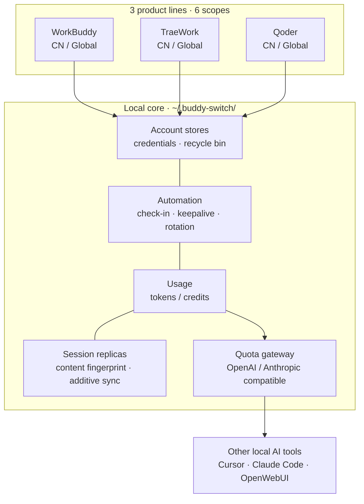
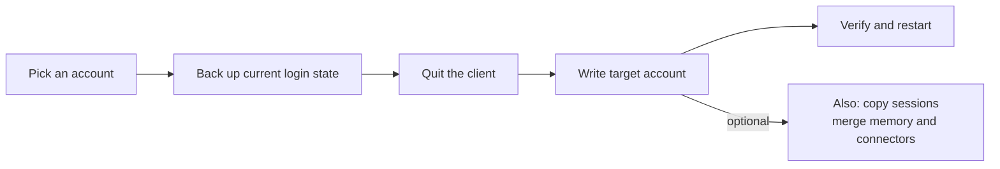
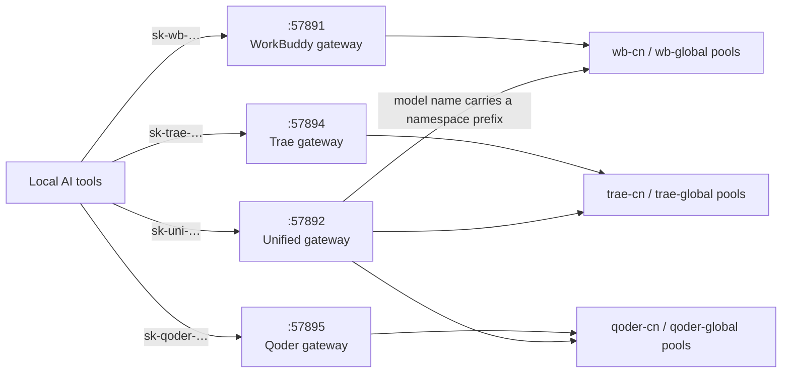
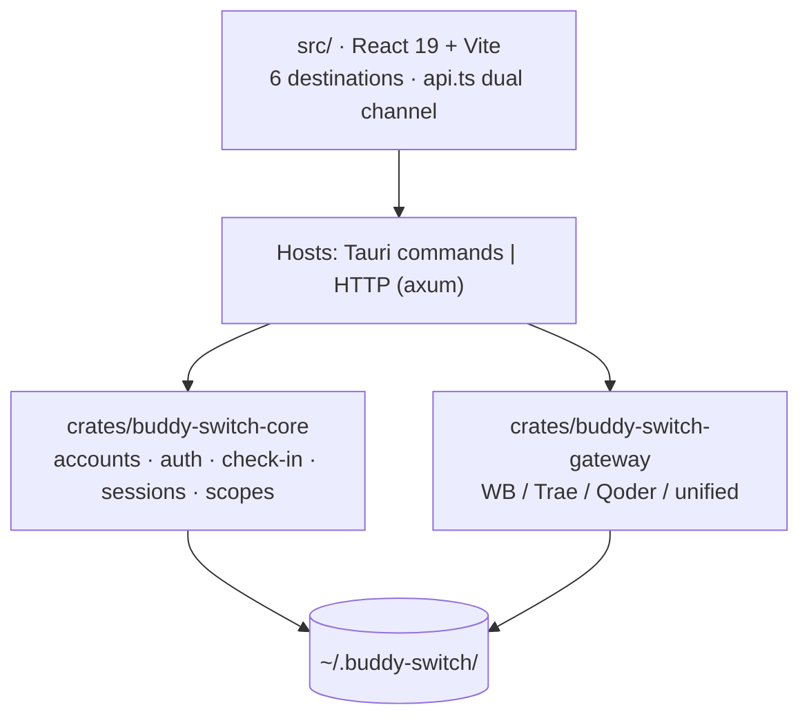

<p align="center">
  
</p>

<h1 align="center">Buddy Switch</h1>

<p align="center">
  <b>WorkBuddy · CodeBuddy · TraeWork · Qoder multi-account workbench</b><br />
  Turn “which account am I signed in with?” into one click
</p>

<p align="center">
  
  <a href="https://github.com/NextAgentX/qoder-trae-workbuddy-switch/releases/latest"></a>
  <a href="./LICENSE"></a>
  <a href="https://github.com/NextAgentX/qoder-trae-workbuddy-switch/stargazers"></a>
</p>

<p align="center">
  <a href="README.md">简体中文</a> ·
  <strong>English</strong>
</p>

# Buddy Switch

A **local-first** multi-account workbench: it gathers accounts from four product lines — **WorkBuddy / CodeBuddy / TraeWork / Qoder** — and **6 scopes** into one place. QR / device-code sign-in, one-click login-state switching, check-in and credits, usage analytics, session-replica syncing — plus exposing your model quota to other local AI tools through OpenAI / Anthropic compatible endpoints.

|  |  |
| --- | --- |
| 🪪 **6 scopes, one place** | Three product lines × CN / Global, each with its own account store. Switching shows live progress and rolls back automatically on a failed write. |
| ✅ **The to-do list writes itself** | Overview lists what needs attention — re-login, today's check-in, expiring credits, client not running — each with an inline action. |
| 📊 **Usage and rate limits, visible** | Tokens, credits, per-account model limits, and which session replica lags or diverged — all on one screen. |
| 🔌 **Feed the quota to your other tools** | Expose it as an OpenAI / Anthropic compatible endpoint and drop it into Cursor, Claude Code or OpenWebUI. |

> **Scope and intended use**
>
> This project is the author's **personal, self-use and learning** work — written to solve their own multi-account switching friction. **You are welcome to read, fork and improve it, but it comes with no maintenance commitment**: no commercial support, no SLA, and no guarantee of compatibility with any specific client version.
>
> Licensed under **PolyForm Noncommercial 1.0.0**: **personal, noncommercial use only — any commercial use is prohibited** (including internal commercial projects, SaaS / hosted services, resale and bundled distribution). Commercial use requires prior written permission from the author.

> ⚠️ **Unofficial · Noncommercial**: not affiliated with, authorized, sponsored or endorsed by WorkBuddy, CodeBuddy, TraeWork, Qoder or their rights holders; **commercial use is not permitted**. It reads and writes local clients' authentication data, sends automated requests on the schedule you configure, and can forward your quota through a local port. Read the **[Disclaimer](docs/policies/DISCLAIMER.en.md)** before use.

## Screenshots

<table>
  <thead>
    <tr><th>Overview (light)</th><th>Overview (dark)</th></tr>
  </thead>
  <tbody>
    <tr>
      <td></td>
      <td></td>
    </tr>
  </tbody>
</table>

<table>
  <thead>
    <tr><th>WorkBuddy accounts (light)</th><th>WorkBuddy accounts (dark)</th></tr>
  </thead>
  <tbody>
    <tr>
      <td></td>
      <td></td>
    </tr>
  </tbody>
</table>

<table>
  <thead>
    <tr><th>Usage · trend (light)</th><th>Usage · trend (dark)</th></tr>
  </thead>
  <tbody>
    <tr>
      <td></td>
      <td></td>
    </tr>
  </tbody>
</table>

<table>
  <thead>
    <tr><th>Gateway (light)</th><th>Gateway (dark)</th></tr>
  </thead>
  <tbody>
    <tr>
      <td></td>
      <td></td>
    </tr>
  </tbody>
</table>

<table>
  <thead>
    <tr><th>Qoder gateway (light)</th><th>Qoder gateway (dark)</th></tr>
  </thead>
  <tbody>
    <tr>
      <td></td>
      <td></td>
    </tr>
  </tbody>
</table>

<details>
<summary><b>More screenshots (sessions / settings / TraeWork / Qoder)</b></summary>

<table>
  <thead>
    <tr><th>Sessions (light)</th><th>Sessions (dark)</th></tr>
  </thead>
  <tbody>
    <tr>
      <td></td>
      <td></td>
    </tr>
  </tbody>
</table>

<table>
  <thead>
    <tr><th>Settings (light)</th><th>Settings (dark)</th></tr>
  </thead>
  <tbody>
    <tr>
      <td></td>
      <td></td>
    </tr>
  </tbody>
</table>

<table>
  <thead>
    <tr><th>TraeWork accounts (light)</th><th>TraeWork accounts (dark)</th></tr>
  </thead>
  <tbody>
    <tr>
      <td></td>
      <td></td>
    </tr>
  </tbody>
</table>

<table>
  <thead>
    <tr><th>Qoder accounts (light)</th><th>Qoder accounts (dark)</th></tr>
  </thead>
  <tbody>
    <tr>
      <td></td>
      <td></td>
    </tr>
  </tbody>
</table>

</details>

> Generated by `scripts/gen-readme-shots.mjs` from the demo build (`VITE_DEMO_MODE=1`); accounts, credits and request records are fictional. Re-run it once after a UI change.

## The big picture



**Three hard rules** hold everywhere: data stays on this machine, credentials are only written into client login state (no proxy login, no upstream protocol hacks), and every write is backed up first.

## Four forms

| Form | How to get it | Notes |
| --- | --- | --- |
| **Desktop app** | Download from [GitHub Releases](https://github.com/NextAgentX/qoder-trae-workbuddy-switch/releases/latest) | Packaged with Tauri; recommended for daily use |
| **webui** | [CLI binary from Releases](docs/guides/LINUX-WEBUI-FALLBACK.md) or build from source (below) | Same frontend bundle as the desktop app, served over local HTTP |
| **Docker** | Pull the prebuilt image `ghcr.io/nextagentx/buddy-switch` (amd64 / arm64) | The container runs the **headless server** (webui + API gateways), **not** the desktop switcher; see [Docker deployment](docs/guides/DOCKER.md) |
| **Online demo** | [GitHub Pages](https://nextagentx.github.io/qoder-trae-workbuddy-switch/) | Read-only demo; accounts and usage are fictional |

> Linux desktop **Create API Key** dialog not showing? See the [local WebUI fallback guide](docs/guides/LINUX-WEBUI-FALLBACK.md) (Chinese).
>
> The npm package is not published yet, so `npm i -g` will not install it; use a prebuilt CLI binary from Releases or the source build steps below for webui.
>
> The Docker form is **server-only**: switching client login state, launching the client, the tray and the floating window all need a **graphical client on the same machine**, so none of them work inside the container.

## Quick start

**Desktop app**: download the installer for your platform from Releases.

| Platform | Installer | Install |
| --- | --- | --- |
| macOS Apple Silicon (arm64) | `BuddySwitch_<version>_aarch64.dmg` | Open the DMG, drag `BuddySwitch.app` into Applications |
| macOS Intel (x86_64) | `BuddySwitch_<version>_x86_64.dmg` | Same as above |
| Windows x64 | `BuddySwitch_<version>_x64-setup.exe` | Run the installer |
| Linux x64 | `BuddySwitch_<version>_amd64.deb` / `.AppImage` | Install the `.deb`, or make the AppImage executable and run it |

**webui (build from source)**: the frontend bundle is embedded into the server **at compile time** (`rust-embed`), so the order matters.

```bash
npm install
npm run build                                    # 1) frontend → dist/
cargo build --release -p buddy-switch-server     # 2) build the server (embeds dist/)
./target/release/buddy-switch                    # 3) serve + open browser (127.0.0.1:57890)
```

```bash
buddy-switch              # serve + open browser
buddy-switch serve        # serve only (--port to override)
buddy-switch status       # print the current account in the terminal
buddy-switch version      # version
```

<details>
<summary><b>macOS: "app is damaged" / "cannot verify developer" / "no permission" when switching</b></summary>

- **"BuddySwitch is damaged and can't be opened"** — Gatekeeper says this (not "cannot verify developer") for a downloaded, unsigned app.
  After dragging it into Applications, run `xattr -dr com.apple.quarantine /Applications/BuddySwitch.app` and open it normally.
  The command only removes the "downloaded from the internet" flag; it does not modify the app.
- Cannot verify developer: in Finder, Control-click the app → Open, or go to System Settings → Privacy & Security → "Open Anyway".
- Switching accounts writes the client's auth file: grant BuddySwitch **App Management** (or **Full Disk Access**) in System Settings → Privacy & Security, then restart the app. The in-app "permission check" verifies it any time.
- In webui form, permissions follow the terminal process that started the service.
- **macOS keeps asking to allow Keychain access** — the client's (Qoder / CodeBuddy IDE) Safe Storage master key lives in the login keychain, so the first read always needs one approval; choose "Always Allow". It is read once per process (cached, see issue #104).
  If it prompts on every action, the app was probably moved or reinstalled and its signing identity changed — delete the item in Keychain Access, then reopen the client and BuddySwitch once to re-authorize.

</details>

## 6 scopes (platform × region)

The scope selector at the top-left decides which set of accounts you are managing. The scope lives in the URL (`/s/wb-cn/accounts`), so refresh, sharing and back/forward all stay put; `⌘K` / `Ctrl+K` searches across scopes, `⌘1`–`⌘6` switches directly.

| Scope | Platform | Region | Clients managed |
| --- | --- | --- | --- |
| `wb-cn` | WorkBuddy | CN | WorkBuddy desktop, CodeBuddy CN IDE / CLI, CodeBuddy plugins for VS Code / JetBrains |
| `wb-global` | WorkBuddy | Global | Same clients (global builds) |
| `trae-cn` | TraeWork | CN | Trae CN |
| `trae-global` | TraeWork | Global | Trae |
| `qoder-cn` | Qoder | CN | Qoder CN desktop / CLI |
| `qoder-global` | Qoder | Global | Qoder desktop / CLI |

The six scopes are **fully independent**: separate account stores, separate clients, separate config, separate gateway keys. Trae's two legacy program lines (TraeWork / TraeCode) were merged upstream into one client; the old ids remain for compatibility only.

## 6 sidebar destinations

Identical item for item across all three platforms: **Overview · Accounts · Usage · Sessions · Gateway · Settings**. Entries are gated by **capability** (not by platform branch): no capability, no entry — and a direct URL still yields a structured empty state.

| Destination | In one line |
| --- | --- |
| **Overview** | Things needing attention (re-login / today's check-in / expiring credits / client not running) + stat cards + 14-day token chart + a glance at other scopes |
| **Accounts** | Card and table views, program slots, QR or device-code sign-in, local import, check-in, recycle bin (30 days), client rate-limit ledger (WorkBuddy only) |
| **Usage** | One workbench, four views: trend · models · sessions · credits; a single parameter bar (range + data source) |
| **Sessions** | Replicas of the same session across accounts: who lags, who diverged, sync to whom (**WorkBuddy only**) |
| **Gateway** | Independent gateways (one per scope) and the unified gateway (one provider across scopes) |
| **Settings** | Nine sections: general · account & login · check-in & credits · gateway · schedules · client · permissions & diagnostics · logs · backup & restore |

### Capability matrix

| Capability | WorkBuddy | TraeWork | Qoder |
| --- | :---: | :---: | :---: |
| Account store / sign-in / local import | ✅ QR + import | ✅ Web login + JWT | ✅ Device code + PAT |
| Program slots | ✅ 5 (4 switchable + 1 read-only probe) | ✅ 1 (merged client) | ✅ 2 (desktop / CLI) |
| Check-in / credits | ✅ incl. auto-travel, auto-rotation | ✅ | ✅ daily check-in + plan / quota |
| Usage analytics | ✅ tokens + credits | ✅ tokens + credits | ✅ credits only — the client stores token counts as 0 |
| Session replica sync | ✅ content fingerprint + additive | — | — |
| Quota gateway | ✅ `:57891` | ✅ `:57894` | ✅ `:57895` |

## How switching an account works



- **Backup before write**: auth files, Trae login snapshots and session overwrites all leave a rollback copy first.
- **Verify after write**: a failed write is reverted automatically; a running client is refused, so it cannot write its in-memory state back over yours.
- **Delete is soft**: accounts go to the recycle bin for 30 days and can be restored; permanent deletion also removes credentials and snapshots.

## Model quota gateway

Expose the current account's quota to local tools: OpenAI compatible (`/v1/models`, `/v1/chat/completions`, `/v1/responses`) and Anthropic compatible (`/v1/messages`), both with SSE streaming. Loopback-only by default.



- **Four independent listeners**: ports form one **`5789x` block** — `57890` UI · `57891` WorkBuddy · `57892` unified · `57893` session hook · `57894` Trae · `57895` Qoder. Turning the unified gateway off affects no existing client; the `/v1/*` routes overlap verbatim, so they **cannot** be merged into one Router.
- **Key prefixes are one family**: `sk-wb-` · `sk-trae-` · **`sk-qoder-`** · `sk-uni-` — the prefix alone tells you which port to configure.
- **Key lifecycle**: revoke · restore · delete (only revoked keys can be deleted). The plaintext is returned once at creation; the store keeps sha256 plus the first/last 4 characters.
- **Key quota & allowlist**: each key can cap its consumption (limit × reset window — unit is either tokens or request count; window: none / daily / weekly / calendar month) and be restricted to a chosen set of accounts (whole groups can be picked at once). Over-quota returns 429 `quota_exceeded`; when every allowlisted account is unavailable it returns 401 `no_credential` (same code as an empty pool; the `message` states how many accounts the allowlist covers and why they are unusable) and **does not fall back to the full pool**.
- **Account pool**: picks accounts by balance and rate-limit state, can exclude unusable ones, probes "account × model" limits, and revives them with one click.

The **unified gateway** solves "the same model name overwriting itself across platforms": model names become `<namespace>:<model-id>`, where namespaces derive from the scope registry (currently six: `wb-cn` / `wb-global` / `trae-cn` / `trae-global` / `qoder-cn` / `qoder-global`).

| Rule | Behaviour |
| --- | --- |
| Bare model name (no prefix) | **400** with the list of valid prefixes (no guessing a default and silently hitting the wrong pool) |
| Namespace parsing | **Whole-segment exact match only** (`trae` / `traework` / `traecode` are prefixes of one another) |
| One key, many platforms | A single `sk-uni-` key can authorize several platforms at once |
| `/v1/responses` | Served for every namespace (Trae joined on 2026-10-22; Qoder translates to chat internally) |
| Default state | **Off**; enable it in the Gateway page's "Unified gateway" type |

> Architecture: [UNIFIED-GATEWAY-ARCH.md](docs/specs/UNIFIED-GATEWAY-ARCH.md) · Client snippets: [guides/GATEWAY-CLIENT-INTEGRATION.md](docs/guides/GATEWAY-CLIENT-INTEGRATION.md)

## Automation

Schedules support **minute-level** times (e.g. `09:37`), multiple times per task, and **random jitter** (±5/15/30 minutes) so runs scatter instead of firing on the hour.

| Side | Tasks |
| --- | --- |
| WorkBuddy (6) | Check-in · cat travel · activity map · token keepalive · back-to-school · night owl |
| Trae (2) | Check-in · automatic JWT renewal |
| Qoder (2) | Check-in · token keepalive |

Auto-rotation (WorkBuddy only) is a separate background loop, not a schedule entry — see below.

<details>
<summary><b>Auto-rotation policy (WorkBuddy, prevents credit expiry)</b></summary>

A background loop sets the account used by **subsequent CodeBuddy CLI launches** to the most urgent one (earliest expiry with credits left). Decision order:

1. Valid account (query ok, not expired, credits left)
2. Urgency (if even the most urgent has more than `min_urgency_hours` left, default 72h → no switch)
3. Already the target → no switch
4. Cooldown (`cooldown_minutes`, default 120)
5. Active guard (conversation within the last `active_guard_minutes`, default 30 → no switch)
6. Value filter (remaining credits below `min_remaining_credits` → not worth it)
7. Anti-jitter (gap smaller than `min_gap_hours`, default 24 → no switch)

**Boundary**: only the default account for future sessions changes; the running session is not hot-swapped — reload via ACP or restart the CLI.

</details>

<details>
<summary><b>App-level capabilities (shared by all six scopes)</b></summary>

| Capability | Notes |
| --- | --- |
| App settings (⚙) | Theme (light / dark / pure black OLED / system), UI language (简体中文 / English), silent start to tray, close-to-tray, auto-update |
| Global backup & restore | Covers every scope at once, selectable by accounts / config / gateway, **no credentials by default** |
| Skill manager | Scans `skills/*/SKILL.md`, toggles each entry (line-level rewrite, other bytes preserved), moves entries across regions, imports from zip |
| Client settings hosting | Reads and writes the upstream client's own `settings.json`: six-slot spec table, format fingerprint, minimal byte-level patch, backup / restore / diff |
| Session overlay (desktop only) | A small always-on-top window with cross-source task states; read-only, click to focus the original session |
| Client session watching (off by default) | Installs a hook into WorkBuddy's `settings.json` and streams task states into the overlay (receiver `127.0.0.1:57893`) |
| Runtime log | This tool's **own** log (`~/.buddy-switch/logs/runtime-YYYY-MM-DD.log`), readable in Settings → logs with level / date / keyword filters, copy, open-folder and clear. Kept 7 days, capped at 4 MiB per part and 4 parts per day; credentials are redacted before writing. Set `BUDDY_SWITCH_LOG_LEVEL=debug` (then restart) for per-request detail |

</details>

## Data and privacy

- Everything lives in `~/.buddy-switch/` on this machine; nothing is uploaded. UI preferences stay local too.
- Account stores are per scope (e.g. `accounts.json` / `accounts.global.json`, `trae/checkin_accounts*.json`).
- Exported backups contain **no tokens by default**; plaintext tokens require an explicit checkbox plus a second confirmation, with a warning that the file can be used to sign in directly.
- Gateway keys store only a hash and a prefix; **local data is never committed**, and token patterns are scanned before release.
- The runtime log stays on this machine and **redacts credentials before writing** (token parameters, `Bearer` values and JWTs). Local paths are kept as-is, since that is what makes a bug report actionable.

## Development



```bash
npm install
npm run tauri dev     # desktop development
npm run build         # frontend build + contract / scope / platform gates
npm run check:api     # API contract check only
```

```
crates/
  buddy-switch-core/     # accounts, auth, OAuth, processes, switching, sessions, check-in, regions, Trae / Qoder modules
  buddy-switch-gateway/  # OpenAI / Anthropic compatible gateways (four implementations)
  buddy-switch-server/   # HTTP server + CLI (axum API + rust-embed frontend)
src-tauri/               # desktop host (thin Tauri wrappers + tray + gateway hosts)
src/                     # frontend: components / pages / lib / locales
npm/                     # npm packages (not published yet)
```

## Docs

The full index lives in [docs/README.md](docs/README.md) — split by lifecycle: guides / living specs / read-only history / prototype. The ones you will open most:

| Document | What it covers |
| --- | --- |
| [guides/DEVELOPMENT.md](docs/guides/DEVELOPMENT.md) | Requirements, local development, gate list, release process, layout conventions |
| [guides/DOCKER.md](docs/guides/DOCKER.md) | Container deployment: prebuilt image / source build, ports and security, troubleshooting |
| [guides/GATEWAY-CLIENT-INTEGRATION.md](docs/guides/GATEWAY-CLIENT-INTEGRATION.md) | Wiring Codex / Claude Code / other clients to the local gateway |
| [specs/](docs/specs/) | Living architecture and decisions (read before changing code) |
| [policies/](docs/policies/) | License and disclaimer |

## Contributing

**This project has grown through contributions**: the Qoder platform, the unified gateway, schedule jitter and the multilingual READMEs all came from issues and pull requests. You do not need to be an expert to help.

| | |
| --- | --- |
| 🐞 **Report a bug** | Include the version and a screenshot of the log: [open an issue](https://github.com/NextAgentX/qoder-trae-workbuddy-switch/issues/new) |
| 🧩 **Add a platform** | Platform differences are declared once in `src/lib/platforms/registry.ts` and `product.rs`; page components stay untouched. |
| 🌍 **Fix translations** | UI copy lives in `src/locales/domains/*.zh.ts` ↔ `*.en.ts`; corrections to the eight READMEs are welcome too. |
| 📸 **Refresh screenshots** | One command re-shoots every light/dark image — see the header of `scripts/gen-readme-shots.mjs`. |
| 🧪 **Add a test** | Most guard tests in this repo were added by contributors; start from the gate list in `docs/guides/DEVELOPMENT.md`. |

Full guide (what to work on, PR checklist, code conventions): **[CONTRIBUTING.en.md](CONTRIBUTING.en.md)** ([简体中文](CONTRIBUTING.md)).

## Acknowledgements

- [changexbc/workbuddy-switch](https://github.com/changexbc/workbuddy-switch) — for the WorkBuddy account data format and the multi-account switching approach.
- [Sliverkiss/workbuddy2api](https://github.com/Sliverkiss/workbuddy2api) — for the idea of exposing model quota as an OpenAI-compatible service.

Each project follows its own license. This project is an independent implementation with no affiliation, partnership or endorsement relationship with them; all names and trademarks belong to their respective owners.

## Support this project

Buddy Switch is free, open source, and licensed for noncommercial use only. If it saves you a few minutes a day, you can buy the author a drink:

<table>
  <tr>
    <td align="center"><br /><sub>WeChat Pay</sub></td>
    <td align="center"><br /><sub>Alipay</sub></td>
  </tr>
</table>

No money needed either: **starring the repo** helps just as much — it is the main reason this project keeps getting maintained.

> **Donations are unrelated to functionality**: every feature is the same for everyone, and donating **does not unlock, affect or change** any feature or licence. Donations are voluntary gifts: not a purchase, subscription, paid service, commercial licence or support commitment, and they create no consideration of any kind; donating buys no priority response, custom development or extra entitlement. Licensing and terms of use remain governed solely by [LICENSE](./LICENSE) — see [License](#license).

## Disclaimer

Full text in **[docs/policies/DISCLAIMER.en.md](docs/policies/DISCLAIMER.en.md)** ([简体中文](docs/policies/DISCLAIMER.md)), seven sections: unofficial third-party tool; terms of service and compliance; data writes and backups; risks of automated behaviour; API gateway exposure; provided "as is"; restrictions on use (no commercial use, no resale or sharing of quota). Using the project means you have read and agree to them; if not, stop using it and uninstall.

## License

**[PolyForm Noncommercial License 1.0.0](./LICENSE)**: noncommercial use is permitted, **commercial use is not licensed**.

- Full text: [LICENSE](./LICENSE)
- Plain-language summary and FAQ: [docs/policies/LICENSING.en.md](docs/policies/LICENSING.en.md) ([简体中文](docs/policies/LICENSING.md))
- For commercial licensing, contact the author via this repository's Issues.
- **Donations are unrelated to licensing**: they are voluntary gifts, not a purchase, a commercial licence, or any promise of service.
- This is a **personal project**: no commercial support, no SLA, no maintenance commitment. Issues and PRs get a best-effort response, without any guaranteed turnaround.

## Star history

<a href="https://www.star-history.com/?repos=NextAgentX%2Fqoder-trae-workbuddy-switch&type=date&legend=top-left">

 <picture>
   <source media="(prefers-color-scheme: dark)" srcset="https://api.star-history.com/chart?repos=NextAgentX/qoder-trae-workbuddy-switch&type=date&theme=dark&legend=top-left" />
   <source media="(prefers-color-scheme: light)" srcset="https://api.star-history.com/chart?repos=NextAgentX/qoder-trae-workbuddy-switch&type=date&legend=top-left" />
   
 </picture>
</a>
