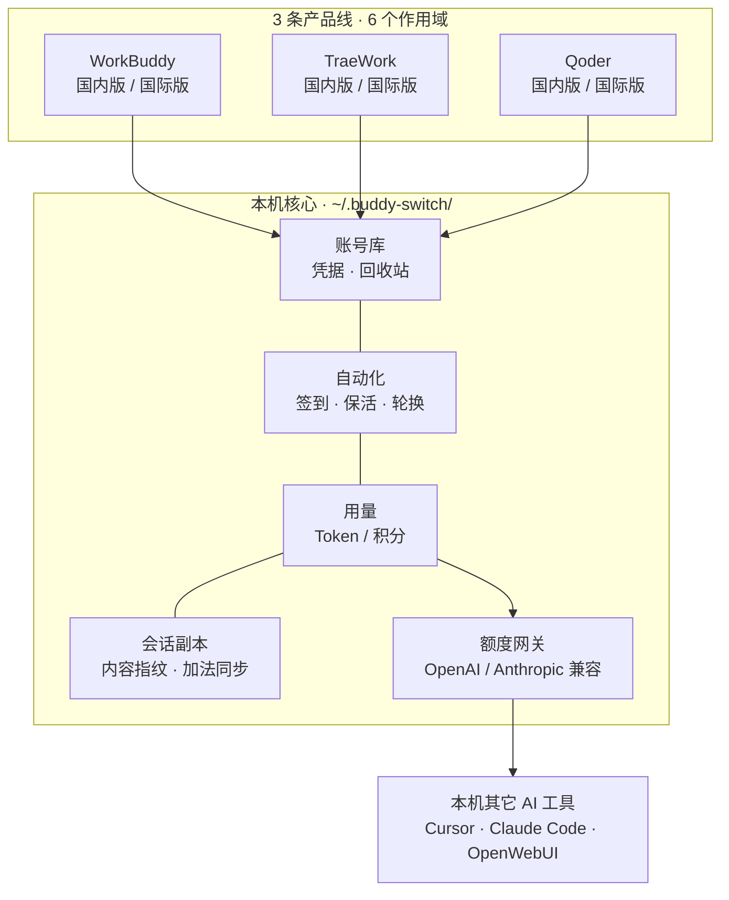
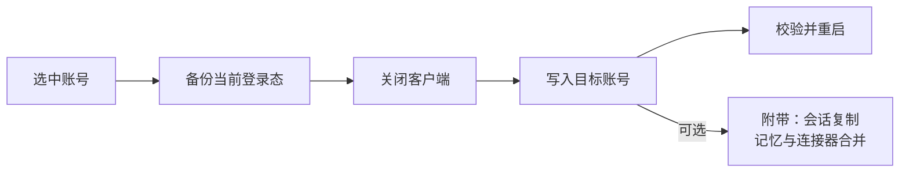
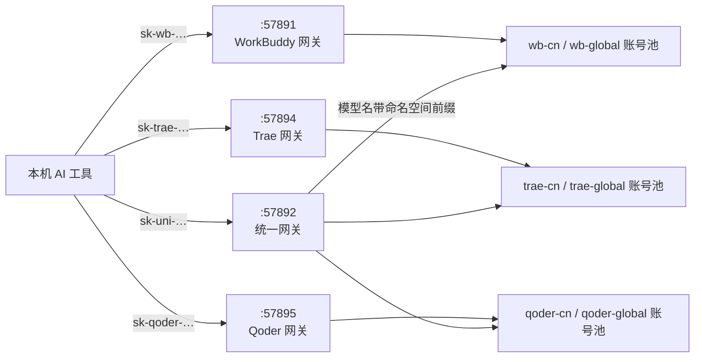
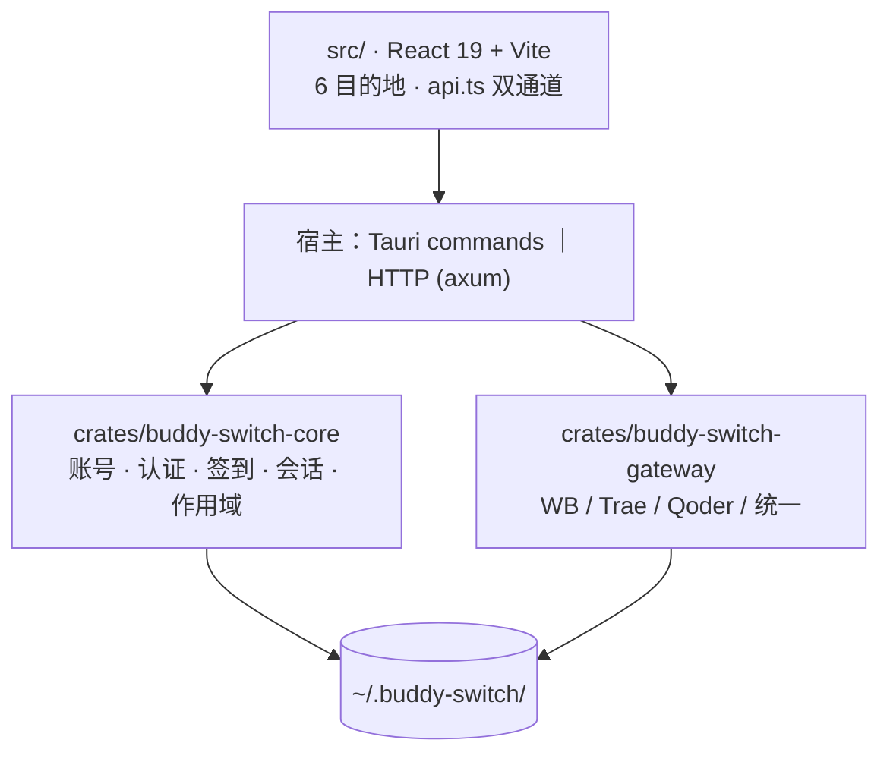

<p align="center">
  
</p>

<h1 align="center">Buddy Switch</h1>

<p align="center">
  <b>WorkBuddy · CodeBuddy · TraeWork · Qoder 多账号工作台</b><br />
  把「现在登的是哪个号」变成一次点击
</p>

<p align="center">
  
  <a href="https://github.com/NextAgentX/qoder-trae-workbuddy-switch/releases/latest"></a>
  <a href="./LICENSE"></a>
  <a href="https://github.com/NextAgentX/qoder-trae-workbuddy-switch/stargazers"></a>
</p>

<p align="center">
  <strong>简体中文</strong> ·
  <a href="README.en.md">English</a>
</p>

一个**本地运行**的多账号工作台：把 **WorkBuddy / CodeBuddy / TraeWork / Qoder** 四条产品线、**6 个作用域**的账号收在一处——扫码登录、一键切号、签到与积分、用量统计、会话副本同步，并把模型额度以 OpenAI / Anthropic 兼容接口开放给本机其它 AI 工具。所有数据只放在你自己的机器上。

|  |  |
| --- | --- |
| 🪪 **6 个作用域一屏管完** | 三条产品线 × 国内 / 国际，各有独立账号库；切号带实时进度，写失败自动回滚 |
| ✅ **该做的事自己冒出来** | 概览把「要重新登录 / 今日未签到 / 积分将过期 / 客户端没开」列成待办，点一下处理完 |
| 📊 **用量与限流看得见** | Token、积分、账号 × 模型限流、会话副本谁落后谁分叉，全在一屏 |
| 🔌 **额度还能喂给别的工具** | 一键暴露成 OpenAI / Anthropic 兼容接口，直接配进 Cursor、Claude Code、OpenWebUI |

> **定位与使用边界**
>
> 本项目是作者**个人自用与学习**的产物——为解决自己多账号切换的麻烦而写。**欢迎参考、fork 与改进，但不承诺维护**：不提供商业支持、SLA 或特定客户端版本的兼容性承诺。
>
> 许可为 **PolyForm Noncommercial 1.0.0**：**仅允许个人非商业使用，禁止任何形式的商业使用**（含企业内部商业项目、SaaS / 托管服务、售卖与捆绑分发）。商业使用须事先取得作者书面授权。

> ⚠️ **非官方 · 非商业**：与 WorkBuddy、CodeBuddy、TraeWork、Qoder 及其权利人不存在隶属、授权、赞助或背书关系；**不得商用**。它会读写本机客户端的认证数据、按你的配置自动发起请求，并可通过本地端口转发额度。使用前请读完 **[免责声明](docs/policies/DISCLAIMER.md)**。

## 界面预览

<table>
  <thead>
    <tr><th>概览（浅色）</th><th>概览（深色）</th></tr>
  </thead>
  <tbody>
    <tr>
      <td></td>
      <td></td>
    </tr>
  </tbody>
</table>

<table>
  <thead>
    <tr><th>WorkBuddy 账号（浅色）</th><th>WorkBuddy 账号（深色）</th></tr>
  </thead>
  <tbody>
    <tr>
      <td></td>
      <td></td>
    </tr>
  </tbody>
</table>

<table>
  <thead>
    <tr><th>用量 · 趋势（浅色）</th><th>用量 · 趋势（深色）</th></tr>
  </thead>
  <tbody>
    <tr>
      <td></td>
      <td></td>
    </tr>
  </tbody>
</table>

<table>
  <thead>
    <tr><th>网关（浅色）</th><th>网关（深色）</th></tr>
  </thead>
  <tbody>
    <tr>
      <td></td>
      <td></td>
    </tr>
  </tbody>
</table>

<table>
  <thead>
    <tr><th>Qoder 网关（浅色）</th><th>Qoder 网关（深色）</th></tr>
  </thead>
  <tbody>
    <tr>
      <td></td>
      <td></td>
    </tr>
  </tbody>
</table>

<details>
<summary><b>更多截图（会话同步 / 设置 / TraeWork 账号 / Qoder 账号）</b></summary>

<table>
  <thead>
    <tr><th>会话副本（浅色）</th><th>会话副本（深色）</th></tr>
  </thead>
  <tbody>
    <tr>
      <td></td>
      <td></td>
    </tr>
  </tbody>
</table>

<table>
  <thead>
    <tr><th>设置（浅色）</th><th>设置（深色）</th></tr>
  </thead>
  <tbody>
    <tr>
      <td></td>
      <td></td>
    </tr>
  </tbody>
</table>

<table>
  <thead>
    <tr><th>TraeWork 账号（浅色）</th><th>TraeWork 账号（深色）</th></tr>
  </thead>
  <tbody>
    <tr>
      <td></td>
      <td></td>
    </tr>
  </tbody>
</table>

<table>
  <thead>
    <tr><th>Qoder 账号（浅色）</th><th>Qoder 账号（深色）</th></tr>
  </thead>
  <tbody>
    <tr>
      <td></td>
      <td></td>
    </tr>
  </tbody>
</table>

</details>

> 图由 `scripts/gen-readme-shots.mjs` 从演示构建（`VITE_DEMO_MODE=1`）自动生成，账号、积分与请求记录均为虚构数据；界面改版后重跑一次即可同步。

## 全景



**三条硬纪律**，贯穿全部功能：数据只落本机、凭据只写客户端登录态（不代登录、不改上游协议）、任何写入前先备份。

## 四种形态

| 形态 | 获取方式 | 说明 |
| --- | --- | --- |
| **桌面 App** | [GitHub Releases](https://github.com/NextAgentX/qoder-trae-workbuddy-switch/releases/latest) 下载安装包 | Tauri 打包，推荐日常使用 |
| **webui** | [Releases 的 CLI 裸二进制](docs/guides/LINUX-WEBUI-FALLBACK.md)或从源码构建（见下） | 与桌面 App 同一份前端产物，走本地 HTTP 通道 |
| **Docker** | 拉预构建镜像 `ghcr.io/nextagentx/buddy-switch`（amd64 / arm64） | 容器内是 **headless 服务端**（webui + API 网关），**不是**桌面切换器；见 [Docker 部署](docs/guides/DOCKER.md) |
| **在线演示** | [GitHub Pages](https://nextagentx.github.io/qoder-trae-workbuddy-switch/) | 只读演示，账号与用量均为虚构数据 |

> Linux 上若桌面「创建密钥」弹窗无响应，可改用 [本机 WebUI 备用方案](docs/guides/LINUX-WEBUI-FALLBACK.md)。
>
> npm 包尚未发布，`npm i -g` 暂时装不到；webui 可直接使用 Releases 提供的 CLI 裸二进制，或按下面步骤从源码构建。
>
> Docker 形态只跑**服务端**：切换客户端登录态、启动客户端、托盘、悬浮窗这些依赖**同机图形客户端**的能力在容器里一律不可用（webui 上会显示为不可用/无数据）。

## 快速开始

**桌面 App**：从 Releases 下载对应平台的安装包。

| 平台 | 安装包 | 安装 |
| --- | --- | --- |
| macOS Apple Silicon（arm64） | `BuddySwitch_<版本>_aarch64.dmg` | 打开 DMG，把 `BuddySwitch.app` 拖进「应用程序」 |
| macOS Intel（x86_64） | `BuddySwitch_<版本>_x86_64.dmg` | 同上 |
| Windows x64 | `BuddySwitch_<版本>_x64-setup.exe` | 运行安装程序 |
| Linux x64 | `BuddySwitch_<版本>_amd64.deb` / `.AppImage` | 装 `.deb`，或给 AppImage 加执行权限后直接运行 |

**webui（源码构建）**：前端产物在**编译期**被服务端嵌入（`rust-embed`），所以顺序不能反。

```bash
npm install
npm run build                                    # 1) 前端 → dist/
cargo build --release -p buddy-switch-server     # 2) 编译服务端（把 dist/ 嵌进去）
./target/release/buddy-switch                    # 3) 起服务并打开浏览器（默认 127.0.0.1:57890）
```

```bash
buddy-switch              # 起服务 + 打开浏览器
buddy-switch serve        # 只起服务（--port 指定端口）
buddy-switch status       # 终端查看当前账号
buddy-switch version      # 版本号
```

<details>
<summary><b>macOS 提示「已损坏」／「无法验证开发者」／切换时提示无权限</b></summary>

- **提示「BuddySwitch 已损坏，无法打开」**（Gatekeeper 对**已下载但未签名**的应用会给这句，而不是「无法验证开发者」）：
  把应用拖进「应用程序」后执行 `xattr -dr com.apple.quarantine /Applications/BuddySwitch.app`，再正常双击打开。
  这条命令只删「从网络下载」这个标记，不改动应用本身。
- 无法验证开发者：Finder 里按住 Control 点击应用 → 「打开」，或到「系统设置 → 隐私与安全性」→「仍要打开」。
- 切换账号需要写入客户端认证文件：在「系统设置 → 隐私与安全性」的 **App 管理**（或 **完全磁盘访问**）中授权 BuddySwitch，然后重启应用。设置页的「权限检测」可随时验证。
- webui 形态的权限跟随启动服务的终端进程。
- **macOS 反复弹出「允许访问钥匙串」**：客户端（Qoder / CodeBuddy IDE）的 Safe Storage 主密钥存在系统钥匙串里，首次读取必然要一次授权，点「始终允许」即可；同一进程内只会读一次（已缓存，见 issue #104）。
  若每次操作都弹，通常是应用被移动过或重新安装导致签名身份变化 —— 在「钥匙串访问」里把该条目删除后，重开一次客户端与 BuddySwitch，重新授权一次即可。

</details>

## 6 个作用域（平台 × 区域）

顶栏左上角的作用域选择器决定「现在管哪一套账号」。作用域写进 URL（`/s/wb-cn/accounts`），刷新、分享、前进后退都留在原地；`⌘K` / `Ctrl+K` 跨作用域搜索，`⌘1`–`⌘6` 直接切换。

| 作用域 | 平台 | 区域 | 管理的客户端 |
| --- | --- | --- | --- |
| `wb-cn` | WorkBuddy | 国内版 | WorkBuddy 桌面端、CodeBuddy CN IDE / CLI、VS Code / JetBrains 的 CodeBuddy 插件 |
| `wb-global` | WorkBuddy | 国际版 | 同上（国际版客户端） |
| `trae-cn` | TraeWork | 国内版 | Trae CN |
| `trae-global` | TraeWork | 国际版 | Trae |
| `qoder-cn` | Qoder | 国内版 | Qoder CN 桌面版 / CLI |
| `qoder-global` | Qoder | 国际版 | Qoder 桌面版 / CLI |

六个作用域**彼此独立**：独立账号库、独立客户端、独立配置、独立网关 Key。Trae 的两条老程序线（TraeWork / TraeCode）已被官方合并成同一个客户端，旧标识仅作兼容。

## 侧栏 6 个目的地

三个平台**逐条同构**：**概览 · 账号 · 用量 · 会话 · 网关 · 设置**。入口按**能力门控**（不是平台分支）：缺哪个能力就不画哪个入口，URL 直达时给结构化空态。

| 目的地 | 一句话 |
| --- | --- |
| **概览** | 待处理清单（需重新登录 / 今日未签到 / 积分将过期 / 客户端未运行）+ 统计卡 + 近 14 天 Token 柱状图 + 其他作用域速览 |
| **账号** | 卡片 / 表格双视图、程序位切换、扫码或设备码登录、本机导入、签到、回收站（30 天）、客户端限流台账（WorkBuddy 专有） |
| **用量** | 一个工作台四个视图：趋势 · 模型 · 会话 · 积分；参数条只有一条（范围 + 数据来源） |
| **会话** | 同一份会话在各账号的副本：谁落后、谁分叉、同步给谁（**仅 WorkBuddy**） |
| **网关** | 独立网关（每个作用域一套）与统一网关（跨作用域一个 provider） |
| **设置** | 九个分区：通用 · 账号与登录 · 签到与积分 · 网关 · 计划任务 · 客户端 · 权限与诊断 · 日志 · 备份与恢复 |

### 能力矩阵

| 能力 | WorkBuddy | TraeWork | Qoder |
| --- | :---: | :---: | :---: |
| 账号库 / 登录 / 本机导入 | ✅ 扫码 + 导入 | ✅ 网页登录 + JWT | ✅ 设备码 + PAT |
| 一键切程序位 | ✅ 5 个（4 可切换 + 1 只读探测） | ✅ 1 个（合并客户端） | ✅ 2 个（桌面版 / CLI） |
| 签到 / 积分 | ✅ 含自动旅行、自动轮换 | ✅ | ✅ 每日活动领取（campaigns）+ 套餐 / 额度 |
| 用量统计 | ✅ Token + 积分 | ✅ Token + 积分 | ✅ 仅积分（客户端本地把 token 计数恒记为 0） |
| 会话副本同步 | ✅ 内容指纹 + 加法同步 | — | — |
| 模型额度网关 | ✅ `:57891` | ✅ `:57894` | ✅ `:57895` |

## 切换账号是怎么做的



- **先备份后写入**：认证文件、Trae 登录态快照、会话覆盖前，都会先留一份可回滚的副本。
- **写后校验**：写入失败自动还原；客户端运行中直接拒写，避免退出时把内存里的旧登录态写回覆盖。
- **删除是软的**：账号先进回收站保留 30 天，可随时恢复；永久删除才连带清凭据与快照。

## 模型额度网关

把当前账号的额度以**兼容接口**暴露给本机工具：OpenAI 兼容（`/v1/models`、`/v1/chat/completions`、`/v1/responses`）+ Anthropic 兼容（`/v1/messages`），都支持 SSE 流式。默认只监听 `127.0.0.1`。



- **四条监听彼此独立**：端口按 **`5789x` 一段**排开——`57890` 界面 · `57891` WorkBuddy · `57892` 统一 · `57893` 会话 hook · `57894` Trae · `57895` Qoder；关掉统一网关不影响任何既有客户端。路由 `/v1/*` 逐字重叠，所以**不能**合成一个 Router。
- **Key 前缀同族**：`sk-wb-` · `sk-trae-` · **`sk-qoder-`** · `sk-uni-`，看一眼前缀就知道该配哪个端口。
- **Key 三态**：吊销 · 恢复 · 删除（仅已吊销可删）。明文只在创建时返回一次，库里只存 sha256 + 前 4 / 后 4 位。
- **Key 配额与白名单**：每把 Key 可设「上限 × 重置周期」（计量单位二选一：token / 请求数；周期：不重置 / 每日 / 每周 / 自然月），并限定只能落到哪些账号（可按分组整组选取）。超额返回 429 `quota_exceeded`；白名单内一个都不可用时返回 401 `no_credential`（与「池空」同码；错误体 `message` 会写明名单覆盖了几个号、为什么都不可用），**不回退全池**。
- **账号池**：按余额与限流状态挑账号，可排除不可用账号、可做「账号 × 模型」限流探测，恢复后一键复活。

**统一网关**解决「同名模型在不同平台互相覆盖」：模型名写成 `<命名空间>:<模型id>`，命名空间由作用域注册表派生（当前 6 条：`wb-cn` / `wb-global` / `trae-cn` / `trae-global` / `qoder-cn` / `qoder-global`）。

| 规则 | 行为 |
| --- | --- |
| 裸模型名（不带前缀） | **一律 400**，并列出可用前缀（不猜默认值，避免静默走错账号池） |
| 命名空间解析 | **只做整段精确匹配**（`trae` / `traework` / `traecode` 互为前缀） |
| 一把 Key 跨平台 | 同一个 `sk-uni-` Key 可同时授权多个平台 |
| `/v1/responses` | 所有命名空间都可用（Trae 于 2026-10-22 补齐；Qoder 内部翻译成 chat） |
| 默认状态 | **默认关**，需在网关页「统一网关」分区手动启用 |

> 架构与决策：[UNIFIED-GATEWAY-ARCH.md](docs/specs/UNIFIED-GATEWAY-ARCH.md) · 接入片段：[guides/GATEWAY-CLIENT-INTEGRATION.md](docs/guides/GATEWAY-CLIENT-INTEGRATION.md)

## 自动化

计划任务支持**分钟粒度**时点（如 `09:37`）、多个时点，以及**随机抖动**（±5/15/30 分钟）——让每天的实际触发时刻错开，而不是整点齐发。

| 侧 | 任务 |
| --- | --- |
| WorkBuddy（6 类） | 签到 · 猫猫旅行 · 活跃地图 · Token 保活 · 开学季 · 夜猫子 |
| Trae（2 类） | 签到 · JWT 自动续期 |
| Qoder（2 类） | 签到 · 令牌保活 |

自动轮换（仅 WorkBuddy）是**独立的后台循环**，不是排程表里的一项——见下。

<details>
<summary><b>自动轮换策略（WorkBuddy，防积分过期）</b></summary>

后台定时把 **CodeBuddy CLI 后续启动**的默认账号设为「最紧迫」的账号（最早到期且仍有剩余积分）。依次判定：

1. 有效账号（查询成功、未过期、有剩余积分）
2. 紧迫度检查（最紧迫的剩余超过 `min_urgency_hours`，默认 72h → 不切）
3. 已是目标 → 不切
4. 冷却期（`cooldown_minutes`，默认 120）
5. 活跃保护（最近 `active_guard_minutes`，默认 30 内有对话 → 不切）
6. 价值过滤（剩余积分低于 `min_remaining_credits` → 不值得切）
7. 防抖动（差异小于 `min_gap_hours`，默认 24 → 不切）

**生效边界**：只更新后续会话使用的默认账号，不热切换当前会话——需 ACP 重新加载会话或重启 CLI。

</details>

<details>
<summary><b>应用级能力（六个作用域共用，不随作用域切换）</b></summary>

| 能力 | 说明 |
| --- | --- |
| 应用设置（顶栏 ⚙） | 主题（浅 / 深 / 纯黑 OLED / 跟随系统）、界面语言（简体中文 / English）、开机静默启动、关闭窗口进托盘、自动更新 |
| 全局备份与恢复 | 一次覆盖全部作用域，按账号 / 配置 / 网关分区勾选，**默认不含凭据** |
| Skill 管理 | 扫描 `skills/*/SKILL.md`，逐项启停（行级重写、其余字节原样保留），支持跨区域搬迁与 zip 导入 |
| 客户端设置托管 | 统一读写上游客户端自己的 `settings.json`：6 槽位规格表 + 格式指纹 + 字节级最小补丁 + 备份 / 恢复 / 差异对比 |
| 会话悬浮窗（仅桌面端） | 独立小窗展示跨来源的任务状态，只读、可点回原会话 |
| 客户端会话监听（默认关） | 在 WorkBuddy `settings.json` 装 hook，把任务状态实时送进悬浮窗（接收端 `127.0.0.1:57893`） |
| 运行日志 | 本工具**自己**的日志（`~/.buddy-switch/logs/runtime-YYYY-MM-DD.log`），在「设置 → 日志」里按级别 / 日期 / 关键字筛选、复制、打开目录、清空。保留 7 天，单文件 4 MiB、每天最多 4 个分片；写盘前脱敏凭据。`BUDDY_SWITCH_LOG_LEVEL=debug` 后重启可看逐请求明细 |

</details>

## 数据与隐私

- 全部数据落在本机 `~/.buddy-switch/`，不上传任何第三方服务；界面偏好只存本地。
- 账号库按作用域分家（如 `accounts.json` / `accounts.global.json`、`trae/checkin_accounts*.json`）。
- 导出备份**默认不含 token**；显式勾选并二次确认后才会写明文，页面同步警告该文件可直接用于登录。
- 网关 Key 只存哈希与前缀；**仓库不提交本地数据**，发布前会扫描 token 模式。
- 运行日志留在本机，且**写盘前脱敏凭据**（token 参数、`Bearer` 值、JWT）。本机路径照原样保留——那正是让一份反馈可定位的关键。

## 开发



```bash
npm install
npm run tauri dev     # 桌面端开发
npm run build         # 前端构建 + 契约 / 作用域 / 平台门禁
npm run check:api     # 只校验前端 API 契约
```

```
crates/
  buddy-switch-core/     # 账号、认证、OAuth、进程、切换、会话、签到、区域、Trae / Qoder 模块
  buddy-switch-gateway/  # OpenAI / Anthropic 兼容网关（四套：WB / Trae / Qoder / 统一）
  buddy-switch-server/   # HTTP server + CLI（axum API + rust-embed 内嵌前端）
src-tauri/               # 桌面宿主（Tauri command 薄包装 + 托盘 + 网关宿主）
src/                     # 前端：components / pages / lib / locales
npm/                     # npm 包（尚未发布）
```

## 文档

完整索引在 [docs/README.md](docs/README.md) —— 按生命周期分区：指南 / 现行规格 / 只读历史 / 原型。最常翻的几份：

| 文档 | 讲什么 |
| --- | --- |
| [guides/DEVELOPMENT.md](docs/guides/DEVELOPMENT.md) | 环境要求、本地开发、门禁清单、发布流程、目录约定 |
| [guides/DOCKER.md](docs/guides/DOCKER.md) | 容器部署：预构建镜像 / 源码构建、端口与安全、排障 |
| [guides/GATEWAY-CLIENT-INTEGRATION.md](docs/guides/GATEWAY-CLIENT-INTEGRATION.md) | 把 Codex / Claude Code / 其它客户端接到本机网关 |
| [specs/](docs/specs/) | 现行架构与决策（改代码前该读的依据） |
| [policies/](docs/policies/) | 许可与免责声明 |

## 参与贡献

**这个项目的形态就是被贡献推着长出来的**：Qoder 平台、统一网关、随机抖动、多语言 README，都来自 Issue 与 PR。不需要"很懂"才能参与：

| 你可以做的事 | 起点 |
| --- | --- |
| 🐞 **报 Bug**（附版本 + 日志截图） | [新建 Issue](https://github.com/NextAgentX/qoder-trae-workbuddy-switch/issues/new) |
| 🧩 **接新平台**（Galaxy / 其它 IDE） | 平台差异只在 `src/lib/platforms/registry.ts` 与 core 的 `product.rs` 各声明一次，页面组件不用改 |
| 🌍 **修翻译 / 补语言** | 界面文案在 `src/locales/domains/*.zh.ts` ↔ `*.en.ts` 一一对应；README 中英两版也欢迎校订 |
| 📸 **更新截图** | `scripts/gen-readme-shots.mjs` 一条命令重拍全部浅/深色图（见文件头注释） |
| 🧪 **补测试** | 仓里大量护栏测试都是贡献者补的；先读 `docs/guides/DEVELOPMENT.md` 的门禁清单 |

完整指引（能做什么、PR 自检清单、代码约定）见 **[CONTRIBUTING.md](CONTRIBUTING.md)**（[English](CONTRIBUTING.en.md)）。

## 致谢

- [changexbc/workbuddy-switch](https://github.com/changexbc/workbuddy-switch) — 借鉴 WorkBuddy 账号数据格式与多账号切换思路。
- [Sliverkiss/workbuddy2api](https://github.com/Sliverkiss/workbuddy2api) — 借鉴把模型额度封装成 OpenAI 兼容接口的思路。

以上项目各自遵循其自身许可；本项目为独立实现，与它们不存在隶属、合作或背书关系，相关名称与商标归各自权利人所有。

## 支持这个项目

Buddy Switch 免费、开源，且仅授权个人非商业使用。如果它每天帮你省下几分钟，可以扫码请作者喝杯饮料：

<table>
  <tr>
    <td align="center"><br /><sub>微信支付</sub></td>
    <td align="center"><br /><sub>支付宝</sub></td>
  </tr>
</table>

不想花钱也完全没问题：**给项目点个 Star** 同样有用——它是作者继续维护下去最大的动力。

> **打赏与功能无关**：所有功能对所有人一致，打赏**不解锁、不影响、也不改变**任何功能或授权。它属自愿赠与，不构成购买、订阅、付费服务、商业授权或技术支持承诺，亦不构成任何对价关系；不因打赏获得优先响应、定制开发或任何额外权益。软件许可与使用条件仍完全以 [LICENSE](./LICENSE) 为准，见[许可](#许可)一节。

## 免责声明

完整条款见 **[docs/policies/DISCLAIMER.md](docs/policies/DISCLAIMER.md)**（[English](docs/policies/DISCLAIMER.en.md)），共 7 条：非官方第三方工具、服务条款与合规自理、数据写入与备份、自动化行为风险、API 网关暴露风险、按「原样」提供、用途限制（不得商用、不得转售或共享额度）。使用即表示已阅读并同意；如不同意，请立即停止使用并卸载。

## 许可

**[PolyForm Noncommercial License 1.0.0](./LICENSE)**：个人非商业使用允许，**商业使用不被授权**。

- 条款全文：[LICENSE](./LICENSE)
- 白话说明与常见问题：[docs/policies/LICENSING.md](docs/policies/LICENSING.md)（[English](docs/policies/LICENSING.en.md)）
- 商业授权请通过本仓库 Issues 联系作者。
- **捐赠与授权无关**：赞助属自愿赠与，不构成付费购买、商业授权或任何服务承诺。
- 本项目为**个人项目**，不提供商业支持、SLA 或维护承诺；Issue 与 PR 会尽力回应，但不保证时限。

## Star 趋势

<a href="https://www.star-history.com/?repos=NextAgentX%2Fqoder-trae-workbuddy-switch&type=date&legend=top-left">

 <picture>
   <source media="(prefers-color-scheme: dark)" srcset="https://api.star-history.com/chart?repos=NextAgentX/qoder-trae-workbuddy-switch&type=date&theme=dark&legend=top-left" />
   <source media="(prefers-color-scheme: light)" srcset="https://api.star-history.com/chart?repos=NextAgentX/qoder-trae-workbuddy-switch&type=date&legend=top-left" />
   
 </picture>
</a>
