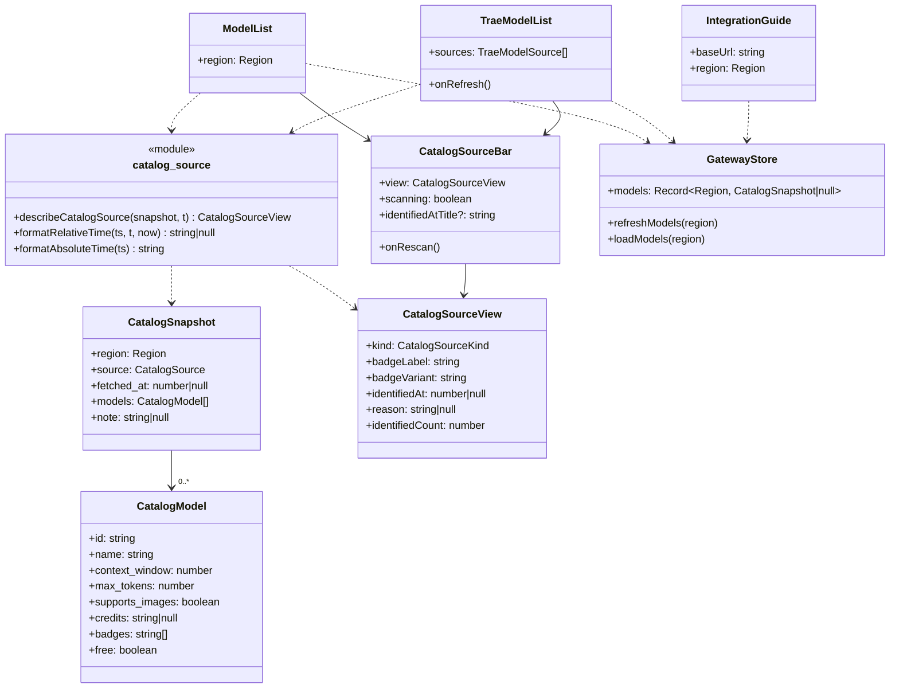
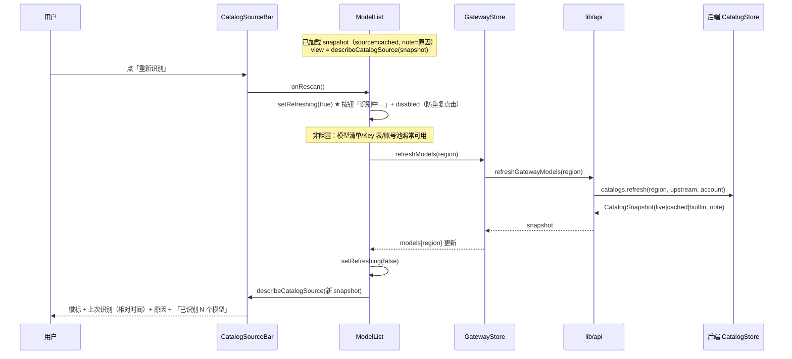
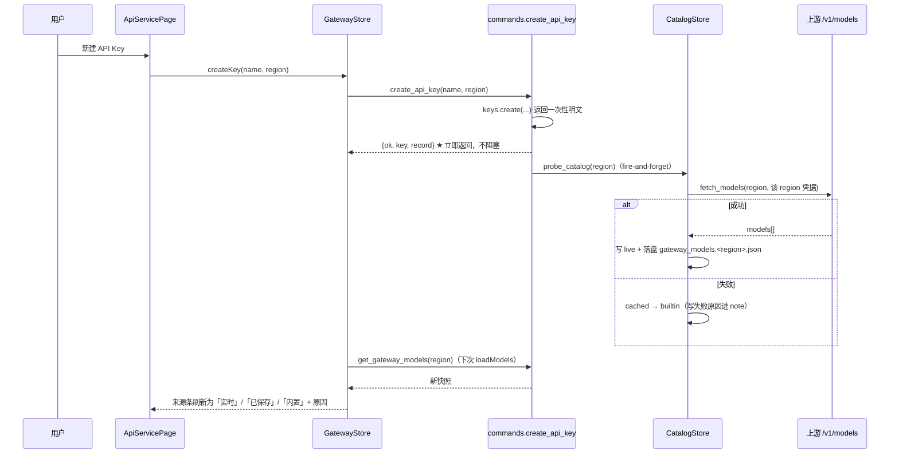
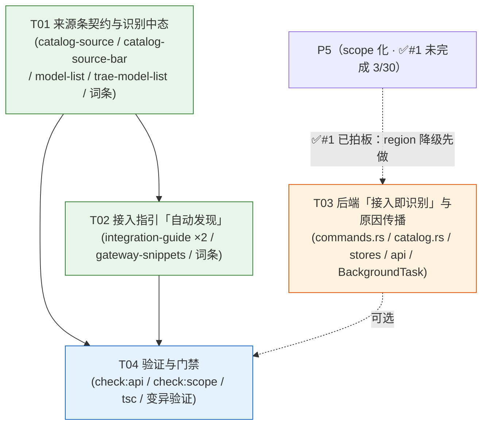

# P10 架构分解：网关接入与模型自动识别

> **状态**：设计（2026-10-04）。**§7 的 8 条待明确事项已由 lead 全部拍板（2026-10-04），正文已同步。** 本文是 `P5-P12-TASKS.md` P10 段的**落地设计**，可直接交给工程师。
> **上游**：`PLAN.md` §3.17（网关接入与模型自动识别：3.17.1 三级来源 / 3.17.2 触发时机 / **3.17.3 三陷阱** / 3.17.4 UI / 3.17.5 安全边界）、§3.4（四条列表通用规则）、§3.6（统一状态语言）、§2.5（安全边界）、§2.7（能力 ≠ 偏好）；`DECISIONS.md` **D23**（触发范围）/ **D24**（不做识别后校验）；`GAP-ANALYSIS.md` §2.7（P10 七条全 ⚠️）；`verify-behaviors.cjs:1016-1079`（6 条断言，**读的是断言体**）。
> **格式参考**：`P4-TOOLBAR-ARCH.md`（同构：实现方案 / 文件列表 / 数据结构 / 有序任务 / 共享知识 / 风险 / 待明确 / 依赖图）。
> **下游**：§4 任务列表直接交给工程师。
> **范围**：**仅** P10 —— ① 模型清单**来源条**（三级来源 + 原因 + 识别中态 + 文案口径）；② 接入指引补「自动发现」；③ 后端「接入即识别」探测触发与失败原因传播。
> **明确排除**：**模型禁用 / 协议 Tab / `/v1/messages` 说明**属 **P11**（§3.18）；请求代理属 **P12**（§3.19）。本文**不碰**。

---

## 1. 实现方案

### 1.1 核心难点

| 难点 | 现状（证据） | 处理 |
|:---|:---|:---|
| **★ 三级来源只是「能标」不是「必标」** | `model-list.tsx:73-85` 有 `source` 徽标 + `updatedAt` + `note`，但 `note` 是**可选通道**；`catalog.rs:252-266` 的 `load_cached` 把 `note` 置 `None` ⇒ 一份「已保存」快照可以**没有原因**，用户只看到一个灰徽标 | 把「原因」升格为**契约**：`kind !== "live"` ⇒ `reason` **恒非空**（后端 `note` 优先，缺失时前端 i18n 兜底）—— 见 §1.3 |
| **★ 「内置」与「实时」可能被混淆** | 三级徽标已在，但**缺**「从未识别成功」的显式措辞（原型要求「尚未成功识别过」） | `identifiedAt === null && kind === "builtin"` ⇒ 显式「尚未识别过」+ 原因「尚未成功识别过（上游未响应）」—— 见 §1.3 |
| **★ 识别中态缺失（且不是加载态）** | `model-list.tsx:64-69` 只有 `refreshing` + `Loader2`，按钮文案是**「刷新」**；无「识别中」文字 | 按钮文案改「重新识别」/「识别中…」+ `disabled` + 非阻塞。⚠️ 这是**按钮操作中**态（`<Loader2>`），**不是**区块加载态（§3.6 两条适用面②）—— 见 §1.4 |
| **★ 文案承诺口径** | `modelsCount`（`共 {n} 个模型`）措辞安全，但原型要「**已识别** N 个」 | 统一为「**已识别** {n} 个模型」；**禁止**出现「N 个模型**可用**」（HTTP 200 ≠ 可用，§3.17.3 陷阱 3 / D24）—— 见 §1.5 |
| **★ 接入即识别未接线** | `create_api_key`（`commands.rs:1322-1331`）**同步创建 Key、不触发探测**；探测**只有手动** `refresh_gateway_models`（`:1360`） | 创建 Key 后**后台探测**该 region（非阻塞）—— 见 §1.6。**✅ #6：触发点 = 创建 API Key**（用户认知里的「接入」动作） |
| **★ 失败原因不具体** | `catalog.rs:209-240` `refresh()` 失败时 `_ =>` **吞掉错误**，只写通用 `DEGRADE_NOTE` | 把 `UpstreamFailure` 映射为**可读原因**写进 `note`。**✅ #5：映射为具体原因**（超时 / 网络 / 鉴权）—— 见 §1.6 |
| **接入指引没说「自动发现」** | `integration-guide.tsx` / `gateway-snippets.ts` 只给 Base URL + Key | 补一句「客户端会自动从 `/v1/models` 读取模型清单，**不需要手填模型名**」—— 见 §1.7 |
| **Trae 与 WB 的「来源」词汇不同** | WB：`CatalogSnapshot.source` = `live/cached/builtin`（上游探测）；Trae：`TraeClientModelList.source` = `client-cache/missing`（读客户端本地缓存，`trae-model-list.tsx:47-48`） | **共用壳 + 各自数据**：抽共用来源条组件，来源词汇由调用方填（**不是**把 Trae 改成三级）—— 见 §1.2 / §3.1 |

### 1.2 组件分层：共用来源条 + 平台注入（沿用 P4 的分层结论）

**判断依据（P4 §1.3 结论）**：*能合并的合并；差异 ≥3 处就别硬合。*

逐项核对 WB 与 Trae 的「来源条」：

| 维度 | WorkBuddy（`model-list.tsx`） | Trae（`trae-model-list.tsx`） | 差异性质 |
|:---|:---|:---|:---|
| 来源词汇 | 实时 / 已保存 / 内置（三级） | 客户端缓存 / 未读取（两级） | **数据** |
| 上次识别时间 | `fetched_at`（ms） | `readAt`（ms） | **数据** |
| 原因通道 | `note` | `note` | 相同 |
| 「接入后自动识别」提示 | 需要 | 需要 | 相同 |
| 「重新识别」按钮 | 需要（`gw-scan`） | 已有（「重新读取」） | **数据**（文案 + 机制） |
| 「已识别 N 个」计数 | `models.length` | `groups` 去重后 size | **数据** |

**结论**：来源条**结构完全相同**，差异**全部是「词汇 + 时间字段 + 计数来源」的数据**。⇒

- **共用壳 `CatalogSourceBar`**：只接收一个归一后的 `CatalogSourceView`（§3.1）+ `scanning` + `onRescan`，**不含任何平台判断**。
- **平台适配**：WB 由 `describeCatalogSource(snapshot, t)` 产出 view；Trae 由其页面/组件自行组装 view（复用同一 view 类型与「原因必填」契约）。

> ⚠️ **反向约束**（同 P4 §1.3）：若 `CatalogSourceBar` 内开始出现 `if (platform === ...)` 或 `if (source === "client-cache")`，即说明合并过度，应退回「两份来源条 + 抽文案片段」。设计上**禁止**在共用组件内写平台/来源分支。

> **✅ #3 已决策（lead 拍板 · 2026-10-04）：Trae 的来源词汇「不统一」为三级。**
> WB 是「实时 / 已保存 / 内置」（**上游探测**）；Trae 是「客户端缓存 / 未读取」（**读客户端本地缓存**，`trae-model-list.tsx:47-48`）—— **机制不同**。
> 硬把 Trae 统一成三级会**让 UI 撒谎**（它并不探测上游）。⇒ 来源条**共用壳**、来源词汇**各填**。
>
> **✅ #4 已决策（lead 拍板 · 2026-10-04）：Trae 的按钮保留原名「重新读取」，不改「重新识别」。**
> Trae 的动作是**重新读客户端缓存**（`trae-model-list.tsx:142-145`），不是上游探测；改名「重新识别」会误导。
> ⇒ Trae **只补**「识别中」态与「原因」契约，**不改**按钮名与来源词汇。

### 1.3 ★ 三级来源契约（对应 §3.17.1 三条硬规则 + 陷阱 1/2）

**契约（可证伪）**：对任意快照，来源条渲染后必须满足：

1. **徽标显式标注来源**（实时 / 已保存 / 内置）—— 不许把「内置」伪装成「实时」（§3.6 静默错误）。
2. **`kind !== "live"` ⇒ 原因文案非空**。原因来源优先级：
   - ① 后端 `snapshot.note`（经 `displayText` 归一 —— 见 §5 白屏防线）；
   - ② 缺失时用 i18n 兜底：`cached` ⇒ `reasonCached`，`builtin` ⇒ `reasonBuiltin`。
3. **从未识别成功**（`kind === "builtin"` 且 `identifiedAt === null`）⇒ 时间位显示「**尚未识别过**」（不是「更新于 —」），且原因含「**尚未成功识别过**」。
4. **`/v1/models` 必须与我们识别的清单同源**（§3.17.1 规则 2）—— 见 §1.8，属**后端**职责，前端只保证展示的是**过滤后**清单。

**陷阱 1「识别到的 ≠ 能用的」的落点**：UI **只展示过滤后清单**（WB 侧 `parse_model_catalog` 已按 CLI 白名单过滤；Trae 侧 `servable_entries` 按 function 分组过滤，`payload.rs:176-184`）。原始清单只进诊断，不给用户看。⇒ 本设计**不改**过滤逻辑，只保证**展示面 = 过滤后集合**。

**陷阱 2「名称按区域规范化」的落点**：`parse_model_catalog(data, international)`（`upstream.rs:813`）按 `international` 标志决定裸名 / `CN` 后缀。⇒ **识别必须按 scope 分家**（WB 的 `CatalogStore` 已按 region 落盘 `gateway_models.<region>.json`，`catalog.rs:6-7`），**禁止跨 scope 复用缓存**（§3.17.5）。

### 1.4 识别中态（对应原型 `gw-scan` + 断言 5）

**交互**：

- 按钮**常驻**：空闲文案「重新识别」，进行中文案「识别中…」，进行中 `disabled`（防重复点击）。
- 进行中图标用 `<Loader2 className="animate-spin">`（**按钮操作中**，§3.6），**不得**换成 `<Skeleton>`。
- **非阻塞**：探测是后台请求，页面其余部分（模型清单、Key 表、账号池）照常可用，**不弹模态**（§3.17.2「不弹模态阻塞用户」）。

> **与既有 `refreshing` 的关系**：现状 `model-list.tsx:41` 已有 `refreshing` state，本设计**保留该 state**，只补「识别中…」文案与按钮标签，**不新增第二套 loading 状态**。

### 1.5 文案口径（对应 §3.17.3 陷阱 3 + D24 + §3.5 假承诺红线）

**唯一允许的计数措辞**：**「已识别 {n} 个模型」**。

**禁止**：
- ❌「{n} 个模型**可用**」—— HTTP 200 ≠ 模型可用（上游把错误放在响应体 / SSE，Trae 侧有「失败也是 HTTP 200，错误在 `event:error`」的既有事实）；
- ❌「共 {n} 个**可用**模型」等任何把「已识别」与「可用」等同的措辞。

> **与 §3.5 红线的关系**：§3.5 的红线是「**文案不许假承诺**」（写「可恢复」而入口没做、写「不可撤销」而后端已可恢复，两个方向都错）。本条的镜像形态是：**没做校验却承诺「可用」**。D24 已定**不做识别后校验** ⇒ 文案**只能**说「已识别」。
> **与 §3.4 规则 1「无数据不渲染」的关系**：`identifiedCount === 0` 时**不渲染**计数文案（不摆「已识别 0 个模型」的假内容）。

### 1.6 后端「接入即识别」与原因传播（对应 §3.17.2 + D23 + 陷阱 3）

**触发（D23 推荐，只做两条，不做「每次切作用域都探测」）**：

| 时机 | 行为 | 本次是否做 |
|:---|:---|:---:|
| **新绑定 API Key 成功** | **立即后台探测**该 region —— 「接入即识别」的落点 | ✅ T03（**✅ #6：触发点 = 创建 API Key**，不是「启用网关开关」） |
| 网关启动 | 清单为「内置」或 `fetched_at` 超过 24h ⇒ 后台探测 | ✅ T03 |
| 切换作用域 | 清单待确认 ⇒ 后台探测 | ⛔ D23 **不做**（收益不抵请求成本） |
| 手动刷新 | **保留**（兜底，不做成唯一入口） | ✅ 已有 |

> **✅ #6 已决策（lead 拍板 · 2026-10-04）：「绑定凭据成功」= 创建 API Key（`create_api_key`）。**
> 理由：创建 Key 是用户认知里的「**接入**」动作（「我要让某工具连上这个网关」）；「启用网关开关」只是让服务监听，不表达「有人要接入」。⇒ 触发点落在 `create_api_key` 成功之后。
>
> **✅ #1 已决策（lead 拍板 · 2026-10-04）：P5 未完成（T03 只做了 3/30）⇒ T03 按 `region` 降级，不等 P5。**
> 理由：`CatalogStore` 已按 region 隔离（`gateway_models.<region>.json`），region 参数化**功能等价**；P5 落地后再切 `Scope`，届时语义更清晰。**前端 T01/T02 完全不受此影响。**

**实现要点**：

- `create_api_key` 改为 `async`，创建 Key 后 `tauri::async_runtime::spawn` 一个探测（**fire-and-forget**，失败静默 —— 探测失败**不阻断**接入，§3.17.1 规则 3）。
- 探测复用既有 `catalogs.refresh(region, &upstream, &account)`（`commands.rs:1368-1371`）—— **不新造探测逻辑**。
- **原因传播（✅ #5：映射为具体原因）**：`catalog.rs` 的 `refresh()` 把 `UpstreamFailure`（`upstream.rs` 的 `kind`）映射为**具体原因**写进 `note`（「上游未响应 / 超时 / 网络错误 / 鉴权失败」），**取代**当前笼统的 `DEGRADE_NOTE`。理由：用户要能理解「**为什么不是实时**」；笼统一句话回答不了。
  > ⚠️ 前端 `describeCatalogSource` **仍保留兜底原因**（后端给不出具体原因时用 i18n 兜底）—— 映射是**增强**，不是契约的替代。
- **安全边界（§3.17.5 / §2.5）**：探测**必须用该 region 自己的凭据**（`state.strategy_for(region).select(...)` 已按 region 选号）；**禁止**跨 region 读缓存（`CatalogStore` 已按 region 隔离）。
- **`BackgroundTask` 登记（✅ #7：要登记）**：`create_api_key` 后的探测**写清单 = 写状态** ⇒ 按 P5 §2.2 在**两侧 `BackgroundTask` 注册表**登记。
  > ⚠️ **若最终判定不登记**：**必须在代码注释里写明「为什么不登记」**（否则后来人会以为漏了）。

### 1.7 接入指引补「自动发现」（对应断言 6 + §3.17.4 末段）

在接入指引卡内补一句（**不是**改片段，而是**卡内说明**）：

> 客户端会自动从 `/v1/models` 读取模型清单，**不需要手填模型名**；若你的工具不支持自动发现，从「模型」页复制即可。

**位置**：`integration-guide.tsx` 的 `streamNote`（`:93-95`）旁新增一行说明；`trae-integration-guide.tsx` 同构。

**与片段的关系**：`gateway-snippets.ts` 的片段**保留** `Model:` / `openAiModelId:` / `ANTHROPIC_MODEL`（它们是客户端读取的**契约**，不能删）；但**片段注释**可补一句「模型名可从 `/v1/models` 自动发现」（可选，见 T02）。

### 1.8 `/v1/models` 同源（§3.17.1 规则 2）—— **本设计不改，仅声明**

WB 侧 `/v1/models` 出口与 `CatalogStore` 同源（`catalog.rs` 是唯一目录源）；Trae 侧 `/v1/models` 由 `payload::models_response_for` 产出，与 `servable_entries` 同源。本设计**不引入第二份清单**，因此**自动满足**同源约束。**风险**：若 T03 的探测改动了 `CatalogStore` 的写入路径，需回归「id 集合完全一致」（见 §6 R4）。

### 1.9 ★ 与 PLAN §3.17.4 的分歧：scope Tab 被 P2 取代（**✅ #2 已裁决**）

PLAN §3.17.4 末段曾要求模型页有「**按 scope 分组的 Tab**（国内版 / 国际版清单不同）」。**本设计不做**。

**冲突**：PLAN §3.17.4 的「卡内 scope Tab」与真实应用**已确立的「页头唯一版本入口」**（`model-list.tsx:33-37` 注释：卡内不再自带 Tabs，版本只在页头 `WorkbuddyRegionSwitch` 切）**不能同时成立**——这正是此前修过的「同一页四处各说各话」缺陷的复发形态。

**✅ #2 已决策（lead 拍板 · 2026-10-04）：保留「页头唯一版本入口」，不做 scope Tab。**

**裁决理由**：**P2 已确立的纪律是「别放第二个看起来能切的控件」**，而 scope Tab 与侧栏 `ScopeSwitch` 是**同一维度的两个入口**。PLAN §3.17.4 写在前、P2 的纪律**在后且更具体** ⇒ **冲突时遵循更晚、更具体的决策**。

⇒ **PLAN §3.17.4 的「按 scope 分组 Tab」一条标注为「被 P2 取代」**，本设计**不实现**。模型清单仍按**当前 region** 渲染（region 由页头/侧栏唯一入口决定）。

---

## 2. 文件列表

### 新建

| 相对路径 | 作用 |
|:---|:---|
| `src/lib/catalog-source.ts` | 来源契约：`CatalogSourceView` / `describeCatalogSource` / `formatRelativeTime` / `formatAbsoluteTime`（§3.1） |
| `src/components/gateway/catalog-source-bar.tsx` | **共用**来源条：徽标 + 上次识别（相对时间，悬停绝对）+ 原因 + 「接入后自动识别」提示 + 重新识别按钮（**文案由 props 注入**，见 §3.2） |

### 修改

| 相对路径 | 改动 |
|:---|:---|
| `src/components/gateway/model-list.tsx` | 用 `CatalogSourceBar` 替换 `:72-85` 的来源行；按钮文案「刷新」→「重新识别」/「识别中…」；计数改「已识别 {n} 个模型」；来源条补「接入后自动识别」 |
| `src/components/gateway/trae-model-list.tsx` | 来源行改用 `CatalogSourceBar`（来源词汇仍是「客户端缓存 / 未读取」）；补「接入后自动识别」提示与「识别中」态（✅ #4：**保留**按钮名「重新读取」）；**保留**其程序位选择器与 `servable` 标记 |
| `src/components/gateway/integration-guide.tsx` | 卡内补「客户端会自动从 `/v1/models` 读取模型清单，不需要手填模型名」说明 |
| `src/components/gateway/trae-integration-guide.tsx` | 同构补说明 |
| `src/lib/gateway-snippets.ts` | （可选）片段注释补「模型名可从 `/v1/models` 自动发现」；**不改**片段键名 |
| `src/locales/domains/wbStats.zh.ts` / `.en.ts` | 来源条/识别中/计数/相对时间/接入指引键（§4 T01/T02） |
| `src/locales/domains/traeGateway.zh.ts` / `.en.ts` | 同上（Trae 侧词汇） |
| `src-tauri/src/commands.rs` | **（T03）** `create_api_key`（✅ #6）后台探测；网关启动探测；抽出 `probe_catalog(region)`；按 P5 §2.2 登记 `BackgroundTask`（✅ #7） |
| `crates/buddy-switch-core/src/modules/catalog.rs` | **（T03）** `refresh()` 失败原因传播（✅ #5：映射为具体原因）；`is_stale` 过期判断辅助 |
| `src/stores/gateway.ts` | **（T03）** `createKey` 后拉一次该 region 快照（或订阅探测结果） |

> **不修改**：`src/lib/types.ts`（`CatalogSnapshot` / `CatalogSource` / `CatalogModel` 已够用，**不新增字段**）；`src/components/gateway/trae-model-list.tsx` 的 `servable` 过滤逻辑；`parse_model_catalog` / `servable_entries`（过滤已正确，**不动**）。
> **不新建** 独立的 `sequence-diagram.mermaid` / `class-diagram.mermaid` —— 本文内嵌（与 `P4-TOOLBAR-ARCH.md` 同构）。

---

## 3. 数据结构与接口

### 3.1 来源契约（`src/lib/catalog-source.ts`）

```ts
import type { Translate } from "@/lib/i18n";
import type { CatalogSource, CatalogSnapshot } from "@/lib/types";

/** 三级来源（与后端 `catalog::CatalogSource` 逐字对齐：live/cached/builtin）。 */
export type CatalogSourceKind = CatalogSource;

/**
 * 来源条的**展示模型** —— 把 `CatalogSnapshot` 归一成「可渲染的文案契约」。
 *
 * ★ 关键不变量：`kind !== "live"` ⇒ `reason` **恒非空**（绝不返回 null）。
 *   这是「不能只给一个灰徽标让用户猜」的**可证伪**落点。
 */
export interface CatalogSourceView {
  /** 来源种类（驱动徽标语义色）。 */
  kind: CatalogSourceKind;
  /** 徽标文案（**已 i18n**；调用方用 `t()` 渲染）。 */
  badgeLabel: string;
  /** 徽标语义色（`success` = 实时；`secondary` = 已保存；`warning` = 内置）。 */
  badgeVariant: "success" | "secondary" | "warning";
  /** 上次识别成功时间（ms）；从未成功（builtin）为 `null`。 */
  identifiedAt: number | null;
  /** ★ 非「实时」时的原因；`live` 恒为 `null`，非 live 恒非空。 */
  reason: string | null;
  /** 已识别的模型数（**不是**「可用」数 —— HTTP 200 ≠ 可用）。 */
  identifiedCount: number;
}

/**
 * 归一来源快照。`snapshot === null`（尚未加载）按「内置 + 尚未识别」处理。
 *
 * ⚠️ `snapshot.note` 经 `displayText` 归一：它是 `string | null`，但**运行时不保证**
 *    是字符串（脏数据可能是对象）—— 直接当 React 子节点会**卸载整棵树 ⇒ 白屏**（issue #2）。
 */
export function describeCatalogSource(
  snapshot: CatalogSnapshot | null,
  t: Translate,
): CatalogSourceView;

/** 相对时间文案（「刚刚 / {n} 分钟前 / {n} 小时前 / {n} 天前」）；`ts === null` ⇒ `null`。 */
export function formatRelativeTime(ts: number | null, t: Translate, now?: number): string | null;

/** 绝对时间（本地化 `YYYY-MM-DD HH:mm`），供 `title` 悬停显示（§3.17.4「悬停给绝对时间」）。 */
export function formatAbsoluteTime(ts: number | null): string;
```

**实现约定**：

```ts
const VARIANT: Record<CatalogSourceKind, CatalogSourceView["badgeVariant"]> = {
  live: "success", cached: "secondary", builtin: "warning",
};

export function describeCatalogSource(snapshot, t) {
  const kind = snapshot?.source ?? "builtin";
  const identifiedAt = snapshot?.fetched_at ?? null;
  const backendReason = displayText(snapshot?.note); // ← 白屏防线
  const fallback = t(
    kind === "cached" ? "wbStats.gateway.reasonCached" : "wbStats.gateway.reasonBuiltin",
  );

  // ★ 规则 3 落点：从未成功识别（builtin 且 identifiedAt === null）。
  // 此时**无条件**拼兜底措辞 —— 有后端 note 时「兜底 · note」，无 note 时仅「兜底」。
  // ⚠️ 不能写成 `backendReason ?? fallback`：见下「为什么 `??` 不够」。
  const neverIdentified = kind === "builtin" && identifiedAt === null;
  const reason =
    kind === "live"
      ? null
      : neverIdentified
        ? backendReason
          ? `${fallback} · ${backendReason}` // 兜底措辞恒在前（承载「尚未成功识别过」语义）
          : fallback
        : backendReason ?? fallback; // cached / builtin(已识别过)：后端原因优先

  return {
    kind,
    badgeLabel: t(`wbStats.gateway.source${cap(kind)}`), // sourceLive / sourceCached / sourceBuiltin
    badgeVariant: VARIANT[kind],
    identifiedAt,
    reason,
    identifiedCount: snapshot?.models.length ?? 0,
  };
}
```

> **★ 为什么 `??` 不够（原 §3.1 参考实现的关键缺口）**
>
> 原实现写 `backendReason ?? fallback`，即**只在 `note` 为 null 时**才用兜底措辞。但后端存在一条「`note` **非空却仍缺该语义**」的路径：
>
> - `catalog.rs:237`：刷新失败且无缓存 ⇒ `builtin_snapshot(region, Some(DEGRADE_NOTE))`，其中 `DEGRADE_NOTE = "上游接口可能已变更，当前展示的是上次成功或内置兜底目录"`（`catalog.rs:75`）；而 `builtin_snapshot` 恒置 `fetched_at: None`（`catalog.rs:246`）。
> - ⇒ 该快照 **`kind === "builtin"` 且 `identifiedAt === null`**（即「**从未成功识别**」），但 `note` **非空**（= 笼统的降级说明）。
> - ⇒ 按 `??` 写法：`reason = DEGRADE_NOTE`，兜底措辞（含「**尚未成功识别过**」）**永不出现** ⇒ **直接违反 ★ 规则 3**。
> - ⇒ **根因**：`??` 只能「**缺则补**」，**不能**「**在不完整时叠加**」。规则 3 要求的语义（「尚未成功识别过」）与 `note` 是**正交**的一条信息 —— 它必须**无条件存在**，不能交给 `??` 决定。
>
> ⇒ 因此：`neverIdentified` 时**无条件**拼兜底措辞（有 note ⇒ `兜底 · note`；无 note ⇒ `兜底`）。这与 §1.3 规则 3「原因含『尚未成功识别过』」逐字对应。
> ⇒ **建议 T04 增补一条变异验证**：把内置快照喂成 `note = DEGRADE_NOTE`（模拟 `catalog.rs:237`）⇒ 期望 `reason` **仍含**兜底措辞（若实现退回 `??`，该断言应变红）。

### 3.2 共用来源条组件（`src/components/gateway/catalog-source-bar.tsx`）

```ts
import type { CatalogSourceView } from "@/lib/catalog-source";

export interface CatalogSourceBarProps {
  /** 归一后的来源视图（§3.1）。 */
  view: CatalogSourceView;
  /** 是否正在识别（驱动按钮 `scanningLabel` + disabled）。 */
  scanning: boolean;
  /** ★ 空闲态按钮文案 —— **由调用方注入**（WB「重新识别」/ Trae「重新读取」）。 */
  rescanLabel: string;
  /** ★ 进行中按钮文案 —— **由调用方注入**（WB「识别中…」/ Trae「读取中…」）。 */
  scanningLabel: string;
  /** 点按钮。 */
  onRescan: () => void;
  /** 可选：上次识别时间的绝对时间（悬停 `title`）。 */
  identifiedAtTitle?: string;
}
```

**约束**：

- 组件内**禁止**出现 `platform === ...` 或来源分支（`if (source === "client-cache")`）；只按 `view` 渲染。
- **原因行**：`view.reason` 非空时渲染为琥珀色小字；为空时**不渲染**（`live` 无原因）。
- **计数**：`view.identifiedCount > 0` 时渲染「已识别 {n} 个模型」；`=== 0` 时**不渲染**（§3.4 规则 1）。
- **提示**：常驻一行「接入后自动识别，无需手填模型名」。
- **按钮**：`scanning` 时 `<Loader2>` + `scanningLabel` + `disabled`；否则 `rescanLabel`。**文案一律取自 props，组件内禁止写死**（见下）。
- **状态语言**：`scanning` 是**按钮操作中**（`<Loader2>`），**不是**区块加载态（不得换 `<Skeleton>`，§3.6）。

> **★ 为什么按钮文案不能写死（原 §3.2「写死文案」与 §3.3 / ✅#4 的裁决）**
>
> 原 §3.2 把按钮文案写死为「重新识别 / 识别中…」，但 §3.3 与 **✅ #4** 要求 **Trae 保留「重新读取」** —— 二者**不能同时成立**。根因有两条，且**都指向同一结论**：
>
> 1. **壳内禁止平台分支**（§1.2 反向约束）：`CatalogSourceBar` 内不许出现 `platform === ...` ⇒ 壳**无法自己判断**该显示「重新识别」还是「重新读取」。
> 2. **两平台的词汇本就不同**：WB 的动作是**上游探测**（`gw-scan`）、Trae 的动作是**重读客户端缓存**（`trae-model-list.tsx:142-145`）—— 机制不同，词汇必须不同（✅ #4）。
>
> ⇒ 若壳把文案写死，只剩两条死路：**要么违反「壳内无分支」**，**要么让 Trae 的 UI 撒谎**（把「重读缓存」说成「重新识别」）。
> ⇒ 唯一自洽解：**壳只提供结构与状态，文案由调用方注入**（`rescanLabel` / `scanningLabel`）。**组件内出现任何写死的中文按钮文案即为缺陷**（T04 评审守）。

### 3.3 页面/组件接线（两平台同形）

```ts
// model-list.tsx 内
const snapshot = useGatewayStore((s) => s.models[region]);
const refreshModels = useGatewayStore((s) => s.refreshModels);
const [refreshing, setRefreshing] = useState(false);
const view = describeCatalogSource(snapshot, t);

async function onRescan() {
  setRefreshing(true);                    // ★ 按钮「识别中…」+ disabled，非阻塞
  try { await refreshModels(region); }
  catch (e) { toast.error(t("wbStats.gateway.refreshFail"), { description: api.asError(e) }); }
  finally { setRefreshing(false); }
}
```

```tsx
<CatalogSourceBar
  view={view}
  scanning={refreshing}
  rescanLabel={t("wbStats.gateway.rescan")}       // WB：「重新识别」
  scanningLabel={t("wbStats.gateway.scanning")}   // WB：「识别中…」
  onRescan={() => void onRescan()}
  identifiedAtTitle={view.identifiedAt ? formatAbsoluteTime(view.identifiedAt) : undefined}
/>
```

> **Trae 侧**：`trae-model-list.tsx` 用同一 `CatalogSourceBar`，`view` 由它自己组装（来源词汇 = 「客户端缓存 / 未读取」，`identifiedAt = data.readAt`，`reason = displayText(data.note) ?? 兜底`）；**按钮文案注入 Trae 自己的词汇**（`rescanLabel` = 「重新读取」/ `scanningLabel` = 「读取中…」，**✅ #4**）—— **这正是「文案由调用方注入」的动机**：同一壳、两套词汇，不靠壳内分支。

### 3.4 后端接口（T03，Rust）

```rust
// commands.rs
/// POST /api/gateway/keys —— 创建 Key（返回一次性明文）。
/// ★ 创建成功后**后台探测**该 region（「接入即识别」，§3.17.2 / D23）。
#[tauri::command]
pub async fn create_api_key(name: Option<String>, region: Option<String>) -> Value;

// commands.rs（内部）
/// 后台探测某 region 的目录：成功写 live，失败按 cached → builtin 降级，**不返回错误给调用方**。
async fn probe_catalog(region: Region);
```

```rust
// catalog.rs
/// 把上游失败映射为可读原因（取代笼统的 DEGRADE_NOTE）。
fn failure_reason(failure: &UpstreamFailure) -> String;

/// 快照是否「待确认」：内置，或 live 且 `fetched_at` 超过 24h。
pub fn is_stale(snapshot: &CatalogSnapshot, now_ms: i64) -> bool;
```

### 3.5 类图



### 3.6 调用流程（重新识别 · 非阻塞）



### 3.7 调用流程（接入即识别 · T03）



---

## 4. 任务列表（有序 · 含依赖 · 按实现顺序）

> **硬性顺序**：T01 → T02 → T04；T03 与 T01/T02 **并行**（前端 / 后端不同文件，仅共享词条）。
> **P0 = 必须；P1 = 重要；P2 = 可裁剪。**
> **★ P5 依赖说明**：T01 / T02 是**纯前端**，只消费既有的 `CatalogSnapshot`（region 参数化，`CatalogStore` 已按 region 隔离）⇒ **不阻塞于 P5**。T03 的后端探测**✅ #1 已拍板：P5 未完成（3/30）⇒ 按 `region` 参数化降级先做，不等 P5**（`CatalogStore` 已按 region 隔离，功能等价；P5 落地后再切 `Scope`，见 T03）。

### T01 · 来源条契约与识别中态（前端 · 共享 lib + 共用来源条 + 两平台模型卡 + 词条） ｜ P0
- **源文件**
  - 新建 `src/lib/catalog-source.ts`（`CatalogSourceView` / `describeCatalogSource` / `formatRelativeTime` / `formatAbsoluteTime`）
  - 新建 `src/components/gateway/catalog-source-bar.tsx`
  - 修改 `src/components/gateway/model-list.tsx`（来源行换 `CatalogSourceBar`；按钮「刷新」→「重新识别」/「识别中…」；计数「已识别 {n} 个模型」）
  - 修改 `src/components/gateway/trae-model-list.tsx`（同款来源条 + 识别中态；**保留**程序位选择器与 `servable` 标记）
  - 修改 `src/locales/domains/wbStats.zh.ts` / `.en.ts`（来源条/识别中/计数/相对时间键）
  - 修改 `src/locales/domains/traeGateway.zh.ts` / `.en.ts`（同上）
- **依赖**：无（**不阻塞于 P5**）
- **要点**
  - **契约**：`kind !== "live"` ⇒ `reason` 恒非空（后端 `note` 优先，缺失时 i18n 兜底）；「从未识别」⇒「尚未识别过」+「尚未成功识别过」。
  - **`snapshot.note` 过 `displayText`**（白屏防线）；**计数只写「已识别」，禁止「可用」**（§3.17.3 陷阱 3）。
  - 识别中是**按钮操作中**态（`<Loader2>`），**非**区块加载态；按钮 `disabled` 防重复点击；**非阻塞**。
  - 共用组件内**禁止**平台/来源分支（§1.2）。
  - **✅ #2：模型清单按「当前 region」渲染，不做卡内 scope Tab**（页头/侧栏是唯一版本入口，见 §1.9）—— 本任务**不含** scope Tab。
  - **✅ #3 / #4（Trae 侧）**：来源词汇保持「客户端缓存 / 未读取」，按钮名保持「重新读取」；Trae **只**补「识别中」态与「原因」契约（§1.2）。
  - 词条 **zh + en 同步**；**只加会被引用的键**；`updatedAt` / `modelsCount` 被替换 ⇒ **删除旧键**（不保留死键）。
  - 覆盖断言：`verify-behaviors.cjs:1027` / `:1036` / `:1042` / `:1050` / `:1058` / `:1068`。

### T02 · 接入指引「自动发现」说明（前端） ｜ P0
- **源文件**
  - 修改 `src/components/gateway/integration-guide.tsx`
  - 修改 `src/components/gateway/trae-integration-guide.tsx`
  - 修改 `src/lib/gateway-snippets.ts`（可选：片段注释补「模型名可从 `/v1/models` 自动发现」；**不改**片段键名）
  - 修改 `src/locales/domains/wbStats.zh.ts` / `.en.ts` + `traeGateway.zh.ts` / `.en.ts`（接入指引键）
- **依赖**：T01（**词条文件串行** —— 两者都改 `wbStats` / `traeGateway`，避免并行冲突）
- **要点**
  - 补一句「客户端会自动从 `/v1/models` 读取模型清单，**不需要手填模型名**；若你的工具不支持自动发现，从「模型」页复制即可」。
  - **不编造配置**（§3.18.3 诚实边界同源）：只加说明，**不改**任何片段键名 / 值。
  - 覆盖断言：`verify-behaviors.cjs:1074`（`/v1/models` + `不需要手填模型名`）。

### T03 · 后端「接入即识别」与原因传播 ｜ P1
- **源文件**
  - 修改 `src-tauri/src/commands.rs`（`create_api_key` 后台探测；网关启动探测；抽出 `probe_catalog(region)`；登记 `BackgroundTask`）
  - 修改 `crates/buddy-switch-core/src/modules/catalog.rs`（`failure_reason` 原因传播；`is_stale` 过期判断）
  - 修改 `src/stores/gateway.ts`（`createKey` 后拉一次该 region 快照）
  - 修改 `src/lib/api.ts`（若需新增探测命令 —— 优先复用 `getGatewayModels`）
  - 修改两侧 `BackgroundTask` 注册表（`src-tauri` + `buddy-switch-server`，**✅ #7**）
- **依赖**：**P5（scope 化）** —— **✅ #1 已决策：P5 未完成（3/30）⇒ T03 按 `region` 参数化先做，不等 P5。** `CatalogStore` 已按 region 隔离，功能等价；P5 落地后再切 `Scope`。
- **要点**
  - **✅ #6：触发点 = `create_api_key` 成功后**（不是「启用网关开关」）—— 用户认知里的「接入」动作。
  - 探测**复用** `catalogs.refresh(...)`，**不新造探测逻辑**；失败**不阻断**接入（fire-and-forget，静默）。
  - **安全边界**：探测用**该 region 自己的凭据**（`strategy_for(region).select(...)`）；**禁止**跨 region 读缓存。
  - **✅ #5：原因传播映射为具体原因**（超时 / 网络 / 鉴权失败）—— 用户要能理解「为什么不是实时」；前端兜底仍保留。
  - **✅ #7：探测「写清单 = 写状态」⇒ 按 P5 §2.2 登记两侧 `BackgroundTask` 注册表**；⚠️ 若最终不登记，**必须在代码注释里写明为什么不登记**。
  - 覆盖验收（§6）：接入后**未经手动刷新**即出现清单；`/v1/models` 与识别清单 **id 集合一致**；跨 scope 探测被拒。

### T04 · 验证与门禁 ｜ P0
- **源文件**：无源码改动（跑门禁 + 手工回归 + 变异验证）
- **依赖**：T01、T02（T03 可选）
- **要点**
  - `npm run check:api` / `check:store-selectors` / `check:scope` / `tsc` 全绿；`cargo test`（若含 T03）。
  - **变异验证（可证伪）**：
    1. **非实时无原因**：把 `describeCatalogSource` 的兜底原因删掉 ⇒ 期望「非实时必有原因」断言变红。
    2. **伪装来源**：把 `builtin` 的徽标文案改成「实时」⇒ 期望「不伪装」断言变红。
    3. **假承诺**：把计数文案改成「{n} 个模型可用」⇒ 期望「不承诺可用」断言变红。
    4. **识别中态**：去掉按钮 `disabled` 或「识别中」文案 ⇒ 期望「识别中」断言变红。
    5. **自动发现**：删掉接入指引的 `/v1/models` 说明 ⇒ 期望「自动发现」断言变红。
    6. **白屏防线**：给 `snapshot.note` 喂一个对象 ⇒ 期望**不白屏**（走 `displayText` 出口）。
    7. **`??` 回归陷阱（从未识别成功）**：把内置快照喂成 `note = DEGRADE_NOTE`（**模拟 `catalog.rs:237`**：`builtin` 且 `fetched_at = None` 却 `note` 非空）⇒ 期望 `reason` **仍含**兜底措辞（「尚未成功识别过」）；**若实现退回 `backendReason ?? fallback` ⇒ 该断言变红**（§3.1「为什么 `??` 不够」）。
       > **为什么要这条**：`??` 更简洁，后来人极易改回去，而**改回去只在「从未识别成功」这一种情况下错** —— 最不易被发现的那类回归。**没断言的修复 = 没修**。
  - 手工回归：切 region 时来源条随快照变；点「重新识别」时按钮禁用、页面不卡；`Trae` 侧来源词汇仍是「客户端缓存 / 未读取」。

---

## 5. 共享知识（跨文件约定）

- **三级来源是契约，不是装饰**：`live` / `cached` / `builtin` 必须**显式标注**；`kind !== "live"` ⇒ **原因恒非空**；**禁止**把「内置」伪装成「实时」（§3.6 静默错误）。
- **「已识别」≠「可用」**（§3.17.3 陷阱 3 / D24）：文案**只能说「已识别 N 个模型」**，**禁止**「N 个模型可用」；D24 已定**不做**识别后校验。这是 §3.5「文案不许假承诺」红线在本期的落点。
- **展示字段出口归一为「字符串或 null」**：`snapshot.note` / `data.note` 一律过 `displayText`（`@/lib/display-text`）—— **对象会卸载整棵树 ⇒ 白屏**（issue #2）。
- **状态语言（§3.6）**：**按钮操作中**（重新识别）→ `<Loader2>`（**不是加载态，不许换 `<Skeleton>`**）；**区块首次加载** → `<Skeleton>`；空态 → `<EmptyState>`（四要素：icon + title + description + **出口**）。
- **无数据不渲染**（§3.4 规则 1）：`identifiedCount === 0` 时**不渲染**计数文案（不摆「已识别 0 个模型」的假内容）。
- **识别按 scope 分家**（§3.17.3 陷阱 2 / §3.17.5）：名称规范化依赖 scope；探测**只用本 scope 凭据**；**禁止**跨 scope 复用缓存（宁可显示「内置」）。
- **只展示过滤后清单**（§3.17.3 陷阱 1）：WB 用 `parse_model_catalog` 的 CLI 白名单；Trae 用 `servable_entries` 的 function 过滤。原始清单只进诊断。
- **共用组件内禁止平台/来源判断**：来源条差异一律走 `CatalogSourceView`（数据）；出现 `platform === ...` 或来源分支即说明合并过度。
- **i18n**：zh + en **同时**加（`src/locales/domains/`），扁平点分命名，**只保留真正被引用的键**；被替换的旧键（`wbStats.gateway.updatedAt` / `wbStats.gateway.modelsCount`）**删除**。
- **组件文件头注释说明「为什么这么设计」**（本仓惯例），不复述代码。
- **不保留死代码**；**最小可提交单元要查跨文件依赖**（A 用 B 的新符号 ⇒ 同批提交）。
- **UI 原语**：优先复用 `src/components/ui/`（`Badge` / `Button` / `Card` / `EmptyState`）；自定义组件（`CatalogSourceBar`）需在文件头记录理由（`AGENTS.md`）。

---

## 6. 风险点

| # | 风险 | 后果 | 对策 |
|:--|:---|:---|:---|
| **R1** | **文案承诺「可用」** | 违反 §3.5 红线 + §3.17.3 陷阱 3；用户照清单调用扑空 | 计数文案固定「已识别」；T04 变异验证 ③ 兜住 |
| **R2** | **非实时无原因**（只给灰徽标） | 用户分不清「加载中」与「拉不到」 | `describeCatalogSource` 保证非 live 原因恒非空；变异验证 ① 兜住 |
| **R3** | **把「内置」伪装成「实时」** | §3.6 静默错误；用户按过时清单调用 | 三级徽标显式标注；变异验证 ② 兜住 |
| **R4** | **`/v1/models` 与识别清单不同源** | 客户端自动发现到调不通的模型 ⇒ 判定「网关坏了」 | T03 **不新增第二份清单**；改 `CatalogStore` 写入路径后回归「id 集合一致」 |
| **R5** | **跨 scope 探测**（用 A 的凭据写 B 的清单） | §3.17.5 安全边界破坏；名称规范化错乱 | 探测只用本 scope 凭据；`CatalogStore` 按 region 隔离；T03 加「跨 scope 被拒」断言 |
| **R6** | **识别中态被误当加载态** | 把按钮换成 `<Skeleton>` ⇒ 按钮变骨架屏（§3.6 明确禁止） | 共用组件内固定 `<Loader2>`；T01 代码评审守 |
| **R7** | **`note` 是脏对象** | 当 React 子节点 ⇒ **白屏**（issue #2） | 过 `displayText`；变异验证 ⑥ 兜住 |
| **R8** | **Trae 来源词汇被错误统一为三级** | Trae 机制是**读客户端缓存**（`client-cache`），不是上游探测 ⇒ 统一会撒谎 | 来源条共用**壳**、来源词汇**各填**；**禁止**在共用组件内写来源分支 |
| **R9** | **T03 依赖 P5，P5 未完成** | 后端探测无法以 `Scope` 参数化 | **✅ #1 已决策：P5 未完成（3/30）⇒ 按 `region` 降级先做**（功能等价）；P5 落地后切换；**前端 T01/T02 完全不受影响** |
| **R10** | **探测触发未登记 `BackgroundTask`** | 违反 P5 §2.2「新增写状态出口要登记」 | **✅ #7 已决策：要登记**（探测写清单 = 写状态）；⚠️ 若最终不登记，**必须在代码注释里写明为什么不登记** |

---

## 7. 决策记录（原待明确事项 · **已由 lead 全部拍板**）

> **说明**：以下 8 条原为「待明确事项」，均已于 **2026-10-04 由 lead 全部拍板**。逐条列出**决策 + 理由**，并标明该决策是否**改变了下文/正文设计**（改变者已同步改对应章节）。

### ✅ #1 · P5 是否在 P10 前完成？—— **未完成，T03 按 `region` 降级** ✅ 已决策（lead 拍板 · 2026-10-04）
- **决策**：P5 **未完成**（T03 只做了 3/30）⇒ **T03 按 `region` 参数化先做，不等 P5**。
- **理由**：`CatalogStore` 已按 region 隔离（`gateway_models.<region>.json`），region 参数化**功能等价**；P5 落地后再切 `Scope`。
- **对正文的影响（★ 改变了设计）**：**已同步** —— §1.6「#1 决策块」、§4 T03「依赖」行、§6 R9、§8 依赖图（P5 → T03 由「建议依赖」改为「降级先做」）。

### ✅ #2 · 「按 scope 分组的 Tab」与「页头唯一版本入口」冲突？—— **保留页头唯一入口，不做 scope Tab** ✅ 已决策（lead 拍板 · 2026-10-04）
- **决策**：**保留「页头唯一版本入口」**（`WorkbuddyRegionSwitch`），**不做**卡内 scope Tab；**PLAN §3.17.4 的「按 scope 分组 Tab」一条标注为「被 P2 取代」**。
- **理由**：**P2 已确立的纪律是「别放第二个看起来能切的控件」**，而 scope Tab 与侧栏 `ScopeSwitch` 是**同一维度的两个入口**。PLAN §3.17.4 写在前、P2 的纪律**在后且更具体** ⇒ **冲突时遵循更晚、更具体的决策**。
- **对正文的影响（★ 改变了设计）**：**已同步** —— **新增 §1.9**（分歧 + 裁决理由）；**§4 T01 要点**补「按当前 region 渲染、不含 scope Tab」；§4 T01 标题/范围不含 Tab。

### ✅ #3 · Trae 的「来源」词汇是否统一为三级？—— **不统一** ✅ 已决策（lead 拍板 · 2026-10-04）
- **决策**：Trae **保持**「客户端缓存 / 未读取」（**不**改成「实时 / 已保存 / 内置」）。
- **理由**：WB 是**上游探测**、Trae 是**读客户端本地缓存**（`trae-model-list.tsx:47-48`）—— **机制不同**；硬统一会**让 UI 撒谎**（Trae 并不探测上游）。
- **对正文的影响**：**已同步** —— §1.2 新增「#3 决策块」；§4 T01 要点补「Trae 词汇保持」。

### ✅ #4 · Trae 的「重新读取」是否改名「重新识别」？—— **保留原名** ✅ 已决策（lead 拍板 · 2026-10-04）
- **决策**：Trae **保留**按钮名「重新读取」，**不改**「重新识别」。
- **理由**：Trae 的动作是**重新读客户端缓存**（`trae-model-list.tsx:142-145`），不是上游探测；改名会**误导**。Trae **只**补「识别中」态与「原因」契约。
- **对正文的影响**：**已同步** —— §1.2 新增「#4 决策块」；§2 文件列表 `trae-model-list.tsx` 行；§4 T01 要点。

### ✅ #5 · 失败原因的粒度？—— **映射为具体原因** ✅ 已决策（lead 拍板 · 2026-10-04）
- **决策**：后端 `refresh()` 把 `UpstreamFailure.kind` **映射为具体原因**（超时 / 网络 / 鉴权失败）写进 `note`，取代笼统的 `DEGRADE_NOTE`。
- **理由**：用户看到「**为什么不是实时**」要能理解；笼统一句话回答不了。
- **对正文的影响**：**已同步** —— §1.1「失败原因」行、§1.6「实现要点」、§4 T03 要点、§3.4 `failure_reason` 签名（原「增强项」措辞改为「决策项」）。

### ✅ #6 · 「绑定凭据成功」= 创建 API Key 还是启用网关开关？—— **创建 API Key** ✅ 已决策（lead 拍板 · 2026-10-04）
- **决策**：触发点 = **`create_api_key` 成功之后**。
- **理由**：创建 Key 是用户认知里的「**接入**」动作（「让某工具连上网关」）；「启用网关开关」只表达服务监听，不表达「有人要接入」。
- **对正文的影响**：**已同步** —— §1.1「接入即识别」行、§1.6 触发表 + #6 决策块、§4 T03 要点。

### ✅ #7 · 探测触发是否需登记 `BackgroundTask`？—— **要登记** ✅ 已决策（lead 拍板 · 2026-10-04）
- **决策**：**要登记**（两侧 `BackgroundTask` 注册表）。
- **理由**：探测**写清单 = 写状态**。
- **⚠️ 附带硬约束**：**若最终决定不登记，必须在代码注释里写明「为什么不登记」**（否则后来人会以为漏了）。
- **对正文的影响**：**已同步** —— §1.6「实现要点」、§2 文件列表（新增两侧注册表行）、§4 T03 源文件 + 要点、§6 R10。

### ✅ #8 · Trae 是否也有「接入即识别」？—— **无** ✅ 已决策（lead 拍板 · 2026-10-04）
- **决策**：Trae **没有**「接入即识别」；**仅**补来源条 UI（T01）。
- **理由**：Trae 清单来自**客户端本地缓存**，**没有可探测的上游**。
- **对正文的影响**：**已同步** —— §4 T01 要点（Trae 只补来源条）；T03 仅覆盖 WB（`region` 探测）。

> **全部 8 条均已拍板，无遗留待明确事项。** 若实现中出现**新的**歧义，按本仓惯例**先问再定**，不自行拍板。

---

## 8. 任务依赖图



> **可先做（不阻塞于 P5）**：**T01 + T02**（纯前端，消费既有 `CatalogSnapshot`）—— 这两项即可关闭 `GAP-ANALYSIS.md` §2.7 的全部 6 条来源条/接入指引断言。
> **✅ #1 已拍板**：P5 未完成 ⇒ **T03 以 `region` 参数化降级先做**（不等 P5，功能等价）；P5 落地后再切 `Scope`。
