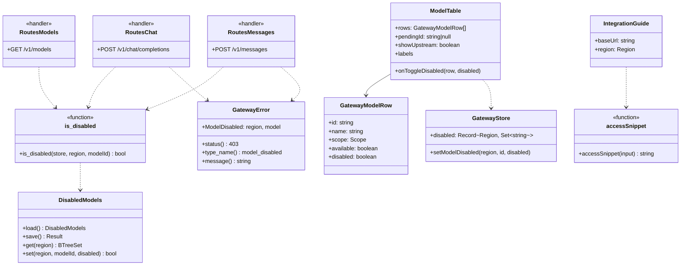
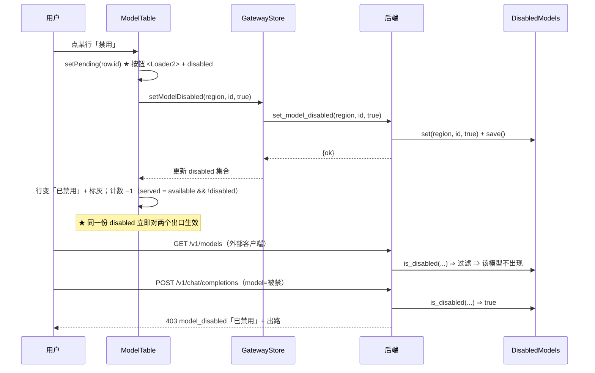
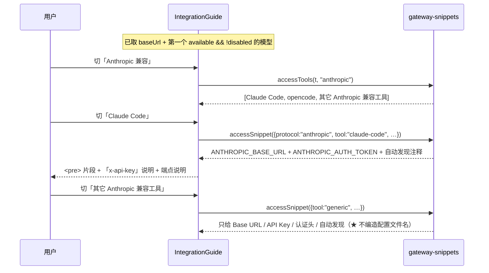
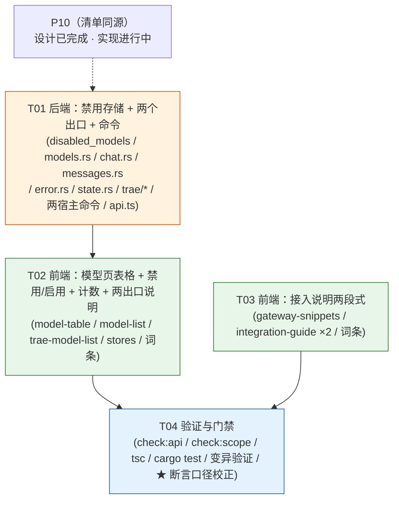

# P11 架构分解：模型禁用与接入说明

> **状态**：设计（2026-10-04）· **§7 八条待明确已决策（lead 拍板 · 2026-10-04）**，正文已同步（改动点见 §7 末「同步清单」）。本文是 `P5-P12-TASKS.md` P11 段的**落地设计**，可直接交给工程师。
> **上游**：`PLAN.md` §3.18（模型禁用与接入说明：3.18.1 禁用 / 3.18.2 `/v1/messages` 已支持 / 3.18.3 接入说明）、§3.17（清单同源 / 三陷阱）、§3.4（规则 1 无数据不渲染）、§3.5（文案不许假承诺）、§3.6（状态语言）、§2.5（安全边界）、§2.7（能力 ≠ 偏好）；`DECISIONS.md` **D25**（可加不可删）/ **D26**（可见但标灰）/ **D27**（默认全开）/ **D28**（工具清单硬编码）；`GAP-ANALYSIS.md` §2.8（P11 九条全 ❌）；`verify-behaviors.cjs:1081-1164`（8 条断言）+ `:547`（B4，**读的是断言体**）。
> ⚠️ **两套验收，各验各的对象**：`docs/redesign/verify-behaviors.cjs`（112 条）验**原型**（`boot()` → `DIR/index.html` → `demo-app.js`），`scripts/check-scope-registry.cjs` 验**真实应用**（`src/`）。本文按决策 #1/#2/#3 设计的**真实应用**列集与原型**不同**（见 §1.10.1）—— 其验收断言加进 `check-scope-registry.cjs`，**不动**原型套件。
> **格式参考**：`P4-TOOLBAR-ARCH.md` / `P10-ARCH.md`（同构：实现方案 / 文件列表 / 数据结构 / 有序任务 / 共享知识 / 风险 / 待明确 / 依赖图）。
> **下游**：§4 任务列表直接交给工程师。
> **范围**：**仅** P11 —— ① 模型禁用（**两个出口同时改** + `available × disabled` 四组合）；② 接入说明升级为「**协议 Tab × 工具 Tab**」。
> **明确排除**：模型**来源条**属 **P10**（`P10-ARCH.md`，已设计）；请求代理属 **P12**（§3.19）。本文**不碰**。
> **依赖**：**P10（清单同源）**。P10 设计已完成、实现进行中 ⇒ **本设计可以先做**（见 §1.9）。

---

## 1. 实现方案

### 1.1 核心难点

| 难点 | 现状（证据） | 处理 |
|:---|:---|:---|
| **★ 两个出口必须同时改** | `/v1/models` 出口（`routes/models.rs:19-36`）**直接列 `snapshot.models`，无任何过滤**；调用出口（`routes/chat.rs:54-69` / `routes/messages.rs:55-70`）**只处理前缀路由，不认「禁用」** | 两个出口**读同一份** `disabled` 存储 + **同一个** `is_disabled()` 判断 —— 见 §1.2 |
| **★ `disabled` 存哪** | 无任何「禁用」概念（全仓无 `disabled` / `row-off`） | 它是**用户偏好**（§2.7）**但后端必须可读**（两个出口都在后端）⇒ 存独立文件（仿 `account_strategy`）—— 见 §1.4 |
| **★ `available` 从哪来** | `CatalogModel`（`types.ts:701-710`）**无 `available`**；Trae 的 `servable` 是**派生**（`gatewayNames`，`trae-model-list.tsx:85`） | `available` = **派生**（模型 ∈ 网关可服务集合）；**不新增上游探测**（D24 不做校验）。WB 恒 `true` ⇒ **不渲染「上游状态」列**；Trae 有真实判据 ⇒ **渲染**（**决策 #3 / #8**）—— 见 §1.3 |
| **★ 复用既有拒绝路径** | 既有拒绝路径在 `model_route.rs`（`PrefixDecision::Rejected` → `GatewayError::BadRequest`），`chat.rs:61-68` / `messages.rs:62-69` 在用 | 禁用**走同一条** `GatewayError` 出口，**不新造错误格式**（否则客户端要处理两套）—— 见 §1.5 |
| **模型页是 chips 不是表格** | `model-list.tsx:89-113` 是**弹性格**（flex-wrap spans），**无表格 / 无禁用按钮 / 无计数** | 改为**表格**（模型 / [仅 Trae] 上游状态 / 网关暴露 + 按钮 + 标灰行；**无归属列、无协议列**）—— 见 §1.6 |
| **接入说明只有工具 Tab** | `integration-guide.tsx:79-88` 只有**工具** Tabs（Cursor/Cline/…），**无协议 Tab**；认证头未按协议区分 | 升级为「**协议 Tab × 工具 Tab**」两段式 —— 见 §1.7 |
| **通用工具页可能编造配置** | `gatewaySnippet` 对未知工具返回 `""`（`gateway-snippets.ts:133-134`）—— 安全，但**没有**「通用参数」页 | 新增 `generic` 工具页：**只给通用参数**（Base URL + Key + 认证头 + 模型自动发现），**不编造配置文件片段** —— 见 §1.8 |
| **示例模型可能取到被禁用的** | `integration-guide.tsx:57` 取 `catalog?.models[0]?.id` | 示例模型必须取 **`available && !disabled`** 的第一个（原型明写：「别拿一个被禁用的模型当例子」）—— 见 §1.7 |

### 1.2 ★ 两个出口必须同时改（P11 的核心陷阱）

**这是「禁用」是否成立的分水岭**（§3.18.1）：

| 只改哪个 | 后果 | 名字 |
|:---|:---|:---|
| 只改 `/v1/models`（隐藏） | 用户以为禁用了，**实际还能调** | **假开关** |
| 只改调用（拒绝） | 清单里还有它，调了报错 ⇒ 用户困惑 | 用户困惑 |
| **两个都改** | 接入方自动发现看不到它；硬调用被**明确说明「已禁用」**地拒 | ✅ 真禁用 |

⇒ **实现铁律**：两个出口**必须读同一份数据、用同一个判断**：

```rust
// disabled_models.rs（唯一判断点）
pub fn is_disabled(store: &DisabledModels, region: Region, model_id: &str) -> bool;
```

- 出口 ①：`routes/models.rs` 在 `.map(...)` 前 `.filter(|m| is_available(region, m) && !is_disabled(...))` —— 语义是「**可用的**模型清单」：不可服务（`available=false`）与被禁用的都**不出现**（**决策 #8**）。WB 侧 `is_available` 恒 `true`（no-op），Trae 侧滤掉非 `servable`；
- 出口 ②：`routes/chat.rs` / `routes/messages.rs` 在 `decide(...)` 之后、`relay` 之前判断，命中 ⇒ 返回 `GatewayError::ModelDisabled { .. }`。

> **禁止**在两处各写一份判断逻辑（那就是「两个出口会漂移」的种子）。判断函数**只有一处**。

### 1.3 `available × disabled` 四组合（对应断言 1 / 3 / 4 + §3.18.1）

**两个维度正交**：

| 字段 | 谁决定 | 存哪 | 含义 |
|:---|:---|:---|:---|
| `available` | **上游** | **派生**（不存） | 这个模型**事实上**能不能调 |
| `disabled` | **用户** | **存储**（偏好） | 用户**主动**把它从暴露清单里拿掉 |

**四组合全部合法，UI 必须能表达**（§3.18.1）：

| `available` | `disabled` | 上游状态列（**仅 Trae 渲染**） | 网关暴露列（WB + Trae） | 计数 |
|:--:|:--:|:---|:---|:--:|
| ✓ | ✗ | 可用 | **已暴露** + [禁用] | ✅ 计 |
| ✓ | ✓ | 可用 | **已禁用** + [启用] | ✗ |
| ✗ | ✗ | **不可用** | 已暴露 | ✗ |
| ✗ | ✓ | 不可用 | 已禁用 | ✗ |

- **两列独立驱动**：上游状态列只看 `available`；网关暴露列只看 `disabled`（`disabled ? 已禁用 : 已暴露`）⇒ 四组合天然可区分（断言 1 要求「已暴露 / 已禁用 / 不可用」三种文本都在；**但「不可用」只可能在 Trae 侧出现** —— 见下）。
- **计数 = `available && !disabled`**（`/v1/models` 实际会返回的条数）—— 与出口 ① **同源**（断言 2 / 3 要求禁用后计数 −1、启用后恢复）。
- **`available` 是派生的**（不新增字段、不做探测）：
  - **WB**：`CatalogModel` 是上游清单的解析结果 ⇒ **在清单里即 `available = true`**（WB 无「非可服务」概念）⇒ **「上游状态」列恒为「可用」，WB 侧不渲染该列**（**决策 #3**：一列永远同一个值就是噪音，§3.4 规则 1）；
  - **Trae**：`available = 该模型 ∈ servable_entries`（即 `trae-model-list.tsx` 已有的 `servable` 标记，`gatewayNames` 派生）⇒ 该列**有信息量，Trae 侧渲染**。
  > ⚠️ **不新增 `available` 到 `CatalogModel`**：它是**派生**，落库会引入第二份真相。
  > ⚠️ **出口 ① 也过滤 `available=false`**（**决策 #8**）：`/v1/models` 的语义是「**可用的**模型清单」；WB 侧恒 true（no-op），Trae 侧滤掉非 `servable`。计数 `available && !disabled` 与出口 ① **同源**。

### 1.4 `disabled` 存哪（用户偏好 · 后端可读）

**约束**：`disabled` 是**用户偏好**（§2.7：不进 `capabilities`），但**两个出口都在后端** ⇒ **不能**只存前端 `localStorage`（后端读不到）。

**方案**（**决策 #4 / #6**）：仿既有 `account_strategy`（`account_strategy.rs:171-195`，独立文件 `gateway_strategy.json`），新增：

- 存储：`~/.buddy-switch/gateway_disabled_models.json`，形状 `HashMap<Region, BTreeSet<String>>`（**按 region 分家** —— 后端 `CatalogStore` / `GatewayState` 都是 region 粒度，用 `wb-cn` 会引入一个后端不存在的维度）；
- 读写在 `disabled_models.rs`（`load` / `save` / `set_disabled` / `is_disabled`）；
- 挂进 `GatewayState`（`state.rs:309-340`）一个新字段 `disabled: Arc<RwLock<DisabledModels>>`。

> **为什么不塞进 `GatewayConfig`**：① `GatewayConfig` 的键集被 `gateway_config_serializes_with_snake_case_keys`（`state.rs:574-597`）**精确钉死**，加字段要改契约测试；② 它是**运行配置**，而 `disabled` 是**用户偏好**（§2.7 两类东西别混）；③ per-region 集合塞进扁平 config 形状别扭。**与 `account_strategy` 同构最自然**。

### 1.5 复用既有拒绝路径（不新造错误格式）

**既有拒绝路径**（`model_route.rs`）：`PrefixDecision::Rejected` → `GatewayError::BadRequest(rejection_message(...))` → 经 `openai_error` / `anthropic_error` 出口。禁用**走同一条路**：

- `error.rs` 新增变体 `GatewayError::ModelDisabled { region: Region, model: String }`；
- `status()` → **403**（不是笼统 4xx 里的 400；403 语义 = 明确拒绝）；
- `type_name()` → `"model_disabled"`；
- `message()` → **必须说明是「被禁用」**（而不是笼统 4xx）：如「模型 `{model}` 已在「模型」页被禁用，不会出现在 `/v1/models`；如需调用请在「模型」页重新启用」；
- `openai_body()` / `anthropic_body()` **复用既有实现**（`error.rs:96-104`）—— **不新造**。

> ⚠️ **`type_name` 必须与既有类别可区分**（`unauthorized` / `no_credential` / `region_mismatch` / `bad_request` …）—— 客户端据此分流。

### 1.6 模型页：chips → 表格（对应断言 1 / 4）

**现状**：`model-list.tsx:86-114` 把模型渲染成 `flex-wrap` 的 chip 网格（无状态列、无按钮）。

**目标**：改为**表格**，列为（**决策 #1 / #2 / #3 已定列集**）：

| 列 | 内容 | 适用 |
|:---|:---|:---|
| **模型** | `model.name`（等宽；`model.id` 不同时补小字） | WB + Trae |
| **上游状态** | `available ? 可用 : 不可用`（徽标） | **仅 Trae**（WB 恒「可用」⇒ 不渲染，§3.4 规则 1 / **决策 #3**） |
| **网关暴露** | `disabled ? 已禁用 + [启用] : 已暴露 + [禁用]`（徽标 + 按钮） | WB + Trae |

> **无「归属」列**（**决策 #1**：UI 只渲染**当前 region** ⇒ 全表同一 scope，归属列冗余）；**无「协议」列**（**决策 #2**：协议是**端点属性**、不是模型属性，同一模型两种协议都支持 ⇒ 无数据支撑，§3.4 规则 1）。

- **标灰行**：`disabled` 的行加 `row-off` 等价样式（`opacity-60` + 虚边框，**仍可见**，D26）。
- **计数行**：表格下方「**当前暴露 {served} / {total} 个**」+ **「两个出口」说明**（见 §1.7 文案）。
- **示例模型**（接入指引用）：取第一个 `available && !disabled` 的（§1.7）。

> **状态语言（§3.6）**：切换禁用/启用是**按钮操作中**态（`<Loader2>` 在按钮内，`disabled` 防重复点击），**不是**区块加载态；区块首次加载 → `<Skeleton>`；空态 → `<EmptyState>`（四要素含出口）。
> **`displayText` 白屏防线**：`model.name` / `model.id` / `provider` 等展示字段**一律过 `displayText`**（`@/lib/display-text`）—— 对象当 React 子节点会**卸载整棵树 ⇒ 白屏**（issue #2）。

### 1.7 接入说明：协议 Tab × 工具 Tab（对应断言 6 / 7 / 8 + B4）

**信息架构**（§3.18.3）：从「一个工具 Tab」升级为**两段式**：

1. **协议 Tab**（`openai` / `anthropic`）—— 决定**端点路径**与**认证头**；
2. **工具 Tab**（该协议下已知的工具）—— 决定「填到哪个配置项」。

**协议差异**（§3.18.2 / §3.18.3）：

| | OpenAI 兼容 | Anthropic 兼容 |
|:---|:---|:---|
| 端点 | `POST /v1/chat/completions` | `POST /v1/messages` |
| 认证头 | `Authorization: Bearer <Key>` | `x-api-key: <Key>`（网关也接受 Bearer） |
| 模型发现 | `GET /v1/models` | 同左 |

**工具清单**（D28：**硬编码在词条**，`ACCESS_TOOLS` 常量；**决策 #7：新增 `opencode` / `codex`**）：

| 协议 | 工具 |
|:---|:---|
| OpenAI | **Codex**（`model_provider` 的 `base_url` + `env_key`）、**opencode**、**其它 OpenAI 兼容工具** |
| Anthropic | **Claude Code**（`ANTHROPIC_BASE_URL` + `ANTHROPIC_AUTH_TOKEN`）、**opencode**、**其它 Anthropic 兼容工具** |

**说明区**（卡内小字）：

- 协议端点行：「`POST /v1/chat/completions`（OpenAI）· `POST /v1/messages`（Anthropic）—— 两者都已支持，含流式。」
- 自动发现行：「客户端会自动从 `/v1/models` 读取模型清单，**不需要手填模型名**；若你的工具不支持自动发现，到「模型」页复制即可。」（与 **P10** 的接入指引同一句，**共用词条**）

> **`/v1/messages` 是「告知」不是「开发」**（§3.18.2）：端点**已挂载**（`routes/messages.rs`），本任务**不新增端点**，只把「Anthropic 客户端用 `x-api-key`」写对。

### 1.8 诚实边界：通用工具页不编造配置（对应断言 8 + §3.18.3）

**通用工具页**（`generic`）**只给通用参数**，**不出现任何具体配置文件片段**：

```
# 其它 Anthropic 兼容工具
Base URL : http://127.0.0.1:<port>
API Key  : <你的 Key>        （认证头：x-api-key）
模型名    : 从 GET http://127.0.0.1:<port>/v1/models 自动发现
```

- **禁止**出现 `config.toml` / `settings.json` / `opencode.json` 等具体文件名（断言 8 逐字检查）；
- **必须**含 `Base URL`（断言 8 检查）；
- 未确认的客户端一律「**协议 + 通用参数 + 一句『以其官方文档为准』**」。

> **与 §3.10 第 1 条同源**：**不许在渲染层写死或编造内容**。编错的配置比没有说明更糟（用户会以为网关坏了）。

### 1.9 与 P10 的关系

- **P11 依赖 P10 的「清单同源」**（`/v1/models` = 识别清单）——禁用是在**同一份清单**上再做一层用户过滤，**不引入第二份清单**。
- **P10 的 `CatalogSourceBar`**（来源条）与 P11 的**模型表格**是**同一张卡**的上下两部分：来源条在上、表格在下。
- **P10 已完成设计**（`P10-ARCH.md`）⇒ **本设计可以先做**；实现顺序上 P11 的**接入说明（T03）与 P10 完全无耦合**，可最先做。

### 1.10 与原型的分歧：跨 scope 表格 → 裁决为「按当前 region」（**决策 #1**）

**冲突**：**P10 §1.9 已裁决**「模型清单仍按**当前 region** 渲染」（不做 scope Tab）；但 **P11 原型是跨 scope 表格**（`demo-app.js:1200-1214` 渲染**全部** `g.models`，`GATEWAY["wb-cn"].models` 里同时含「国内版」+「国际版」共 **6 行**；禁用动作 `model-disable|claude-sonnet-4.5|国内版` **带 scope 参数**；表头有「协议」「归属」列）。**两者不能同时成立**。

**裁决（lead 拍板 · 2026-10-04）：维持 P10 的裁决 —— 按当前 region，不做跨 scope 表格。** 理由：

1. **同一页面不能有两套语义** —— 模型表格与来源条在**同一个卡片**里，一个按 region、一个跨 scope，用户会不知道自己在看什么。
2. **★ 安全** —— 原型禁用动作带 scope ⇒ 跨 scope 表格意味着用户可能**误禁另一个区域的模型**，而那是**另一套账号体系**（后果是「我明明没动国际版，它怎么不能用了」）。
3. **原型 vs 真实应用的结构性差异** —— 原型是**单页演示、没有侧栏 scope 切换** ⇒ 它需要「一屏看全」来补偿；**真实应用有侧栏 `ScopeSwitch`** ⇒ 不需要。

⇒ **数据模型保留 `scope` 字段**（`GatewayModelRow.scope`，两种渲染都能承载），但 **UI 只渲染当前 region**、**不渲染「归属」列**、**禁用动作的 scope 参数可省略**（键为当前 region）。

#### 1.10.1 原型 ≠ 真实应用的三处差异（决策 #1/#2/#3 的连带结果）—— 不是缺陷，是**分工**

| 维度 | 原型（`demo-app.js:1204`） | 真实应用（本设计） | 依据 |
|:---|:---|:---|:---|
| **行集** | 跨 region，**6 行** | **仅当前 region** | **决策 #1**（P10 §1.9） |
| **「协议」列** | 有（`provider`） | **删** | **决策 #2**（协议是端点属性，无数据支撑） |
| **「归属」列** | 有（`scope`） | **删** | **决策 #1**（只渲染当前 region ⇒ 冗余） |
| **「上游状态」列** | 有（WB 也渲染） | **WB 删、Trae 留** | **决策 #3**（WB 恒可用） |

**⇒ 原型 vs 真实应用的分歧不是缺陷，是分工**（**两套验收，各验各的对象**）：

| 文件 | 验什么 | 该不该动 |
|:---|:---|:---|
| `docs/redesign/verify-behaviors.cjs`（112 条） | **原型**（`index.html` + `demo-app.js`） | ❌ **不动** |
| `scripts/check-scope-registry.cjs`（把 `src/` TS 转译后跑真代码断言） | **真实应用** | ✅ 真实应用的断言加这里 |

原型里「跨 region 6 行」「WB 含上游状态列」是**原型自身的设计**（单页演示、无侧栏 scope 切换 ⇒ 需「一屏看全」）—— **原型是对的，它的断言也是对的**，只是**不适用于真实应用**。

> **⇒ 不需要「改写断言 1」，也不需要「声明断言只覆盖原型」** —— 那本来就是 `verify-behaviors.cjs` 的职责范围。
> **P11 的验收断言**（**两个出口同源** / 四组合可区分 / 计数同源 / 不编造配置 / 认证头正确）**加进 `scripts/check-scope-registry.cjs`**，**不动 `verify-behaviors.cjs`**。
> **一套验收对一个对象**：若为了「对齐真实应用」去改原型断言，**原型的验收就失去意义**（它验的就不再是原型）。

---

## 2. 文件列表

### 新建

| 相对路径 | 作用 |
|:---|:---|
| `crates/buddy-switch-gateway/src/disabled_models.rs` | `disabled` 偏好存储：`DisabledModels`（`HashMap<Region, BTreeSet<String>>`）+ `is_disabled`（**唯一判断点**）+ 落盘 `gateway_disabled_models.json` |
| `src/components/gateway/model-table.tsx` | 模型表格（列定义驱动：模型 / [仅 Trae] 上游状态 / 网关暴露 + 禁用·启用按钮 + 标灰行；**无归属列、无协议列**） |

### 修改

| 相对路径 | 改动 |
|:---|:---|
| `crates/buddy-switch-gateway/src/routes/models.rs` | **出口 ①**：`/v1/models` 过滤 `available && !is_disabled`（**决策 #8**） |
| `crates/buddy-switch-gateway/src/routes/chat.rs` | **出口 ②**：`/v1/chat/completions` 命中禁用 ⇒ `GatewayError::ModelDisabled` |
| `crates/buddy-switch-gateway/src/routes/messages.rs` | **出口 ②**：`/v1/messages` 同上 |
| `crates/buddy-switch-gateway/src/error.rs` | 新增 `GatewayError::ModelDisabled`（status / type_name / message） |
| `crates/buddy-switch-gateway/src/state.rs` | `GatewayState` 挂 `disabled` 字段；构造时 `load()` |
| `crates/buddy-switch-gateway/src/trae/payload.rs` | **出口 ①（Trae）**：`models_response_for` 过滤 `available && !is_disabled` |
| `crates/buddy-switch-gateway/src/trae/routes.rs` | **出口 ②（Trae）**：命中禁用 ⇒ 拒绝 |
| `src-tauri/src/commands.rs` + `crates/buddy-switch-server/src/api.rs` | 新命令 `get_disabled_models(region)` / `set_model_disabled(region, model_id, disabled)`（**两宿主同步**） |
| `src/lib/api.ts` | 新命令接线（`call` + ROUTES/ALIASES） |
| `src/stores/gateway.ts` | `disabled` 状态 + `loadDisabled` / `setModelDisabled` |
| `src/components/gateway/model-list.tsx` | 表格化 + 禁用/启用 + 计数 + 「两个出口」说明（**保留** P10 的 `CatalogSourceBar`） |
| `src/components/gateway/trae-model-list.tsx` | 同（**保留** 程序位选择器 + `servable` 标记） |
| `src/lib/gateway-snippets.ts` | 协议 × 工具矩阵（`GATEWAY_PROTOCOLS` / `accessTools` / `accessSnippet`）+ 认证头 + Codex + opencode + generic |
| `src/components/gateway/integration-guide.tsx` | 协议 Tab × 工具 Tab 两段式；示例模型取 `available && !disabled` |
| `src/components/gateway/trae-integration-guide.tsx` | 同构 |
| `src/locales/domains/wbStats.zh.ts` / `.en.ts` | 模型表格列/状态/按钮/计数/两出口/toast + 接入说明键 |
| `src/locales/domains/traeGateway.zh.ts` / `.en.ts` | 同上（Trae 侧） |
| `src/locales/domains/shared.zh.ts` / `.en.ts` | 接入说明**共用**键（协议 / 端点 / 认证头 / 通用工具） |

> **不修改**：`src/lib/types.ts` 的 `CatalogModel`（**不新增 `available`** —— 它是派生，见 §1.3；仅**追加**新视图类型 `GatewayModelRow`）；`model_route.rs` 的既有前缀路由逻辑（只**新增**禁用判断，不改前缀语义）；`/v1/messages` 端点（§3.18.2 已支持）。
> **不新建** 独立的 `sequence-diagram.mermaid` / `class-diagram.mermaid` —— 本文内嵌。

---

## 3. 数据结构与接口

### 3.1 后端：禁用存储（`disabled_models.rs`）

```rust
use std::collections::{BTreeSet, HashMap};
use buddy_switch_core::modules::region::Region;

/// 按 region 的禁用模型集合（用户偏好，§2.7 不进 capabilities）。
#[derive(Debug, Clone, Default, serde::Serialize, serde::Deserialize)]
pub struct DisabledModels {
    /// 键恒为两个 region（缺失即空集，`#[serde(default)]`）。
    regions: HashMap<Region, BTreeSet<String>>,
}

impl DisabledModels {
    /// 从 `~/.buddy-switch/gateway_disabled_models.json` 读取；缺失 / 损坏回落空表。
    pub fn load() -> Self;
    /// 原子写回。
    pub fn save(&self) -> Result<(), String>;
    /// 某 region 的禁用集合（只读）。
    pub fn get(&self, region: Region) -> &BTreeSet<String>;
    /// 置位 / 清位；返回是否发生了变化（幂等）。
    pub fn set(&mut self, region: Region, model_id: &str, disabled: bool) -> bool;
}

/// ★ **唯一判断点**：两个出口都调它（禁止在别处复制判断）。
pub fn is_disabled(store: &DisabledModels, region: Region, model_id: &str) -> bool;
```

### 3.2 后端：错误变体（`error.rs`）

```rust
pub enum GatewayError {
    // …既有变体…
    /// 模型被用户禁用 → 403（明确拒绝，不是笼统 4xx）。
    ModelDisabled { region: Region, model: String },
}

// status() → 403；type_name() → "model_disabled"；
// message() → 「模型 `{model}` 已在「模型」页被禁用，不会出现在 /v1/models；
//              如需调用请在「模型」页重新启用」；
// openai_body() / anthropic_body() 复用既有实现（不新造）。
```

### 3.3 后端：命令（两宿主同步）

```rust
// commands.rs（Tauri）与 api.rs（server）各注册一次
#[tauri::command]
pub async fn get_disabled_models(region: Option<String>) -> Value;      // → { "region": …, "ids": [ … ] }

#[tauri::command]
pub async fn set_model_disabled(region: Option<String>, model_id: String, disabled: bool)
    -> Result<Value, String>;                                          // → { "ok": true }
```

### 3.4 前端：模型行视图（`src/lib/types.ts` 追加，**不改 `CatalogModel`**）

```ts
import type { Scope } from "@/lib/scope";

/** 模型行 = 上游清单（派生 available）∪ 用户偏好（disabled）。 */
export interface GatewayModelRow {
  /** 模型 id（调用时真正要传的名字）。 */
  id: string;
  /** 展示名。 */
  name: string;
  /** 归属作用域。**UI 只渲染当前 region（决策 #1）⇒ 不渲染「归属」列**；
      保留字段供按 region 键控与未来跨 scope 渲染。 */
  scope: Scope;
  /** 上游事实：能不能调（**派生**，不落库）。WB 恒 true；Trae = ∈ servable_entries。 */
  available: boolean;
  /** 用户偏好：是否被禁用（来自后端存储）。 */
  disabled: boolean;
}

/** 暴露计数：`available && !disabled` —— 与 `/v1/models` **同源**。 */
export function servedCount(rows: GatewayModelRow[]): { served: number; total: number };
```

### 3.5 前端：接入说明数据（`src/lib/gateway-snippets.ts` 扩展）

```ts
export type GatewayProtocolKey = "openai" | "anthropic";

/** 协议维度：端点 + 认证头（§3.18.2）。 */
export const GATEWAY_PROTOCOLS: readonly {
  key: GatewayProtocolKey;
  /** 已 i18n。 */
  labelKey: TranslationKey;
  /** 端点路径（**英文契约，不翻译**）。 */
  endpoint: string;
  /** 认证头名（**英文契约，不翻译**）。 */
  authHeader: string;
}[];

/** 该协议下已知的工具（D28：硬编码 + 词条；generic 的标签走 i18n）。 */
export function accessTools(t: Translate, protocol: GatewayProtocolKey): { key: string; label: string }[];

export interface AccessSnippetInput {
  t: Translate;
  protocol: GatewayProtocolKey;
  /** 工具 key（`codex` / `claude-code` / `opencode` / `generic`）。 */
  tool: string;
  /** OpenAI 兼容 base（含 `/v1`）。 */
  baseUrl: string;
  /** 根地址（去掉 `/v1`）—— Anthropic 系客户端自己拼 `/v1/messages`。 */
  rootUrl: string;
  /** 已脱敏的 Key 前缀或占位文案。 */
  key: string;
  /** 示例模型（**必须是 `available && !disabled` 的第一个**）。 */
  model: string;
}

/** 生成片段。**generic 只给通用参数，不编造配置文件片段**（§1.8）。 */
export function accessSnippet(input: AccessSnippetInput): string;
```

### 3.6 前端：模型表格（`model-table.tsx`）

```ts
import type { GatewayModelRow } from "@/lib/types";

export interface ModelTableProps {
  rows: GatewayModelRow[];
  /** 正在切换的行 id（驱动按钮 `<Loader2>` + disabled）。 */
  pendingId: string | null;
  onToggleDisabled: (row: GatewayModelRow, disabled: boolean) => void;
  /** 是否渲染「上游状态」列 —— WB `false`（恒可用，§3.4 规则 1 / 决策 #3），Trae `true`。 */
  showUpstream: boolean;
  /** 已 i18n 的列头 / 状态文案 / 按钮标签（**无 `colScope`** —— 无归属列，决策 #1）。 */
  labels: {
    colModel: string;
    colUpstream: string;
    colExposed: string;
    upstreamAvailable: string;
    upstreamUnavailable: string;
    exposed: string;
    disabled: string;
    disable: string;
    enable: string;
  };
}
```

**约束**：

- **列集**：模型 / [仅 `showUpstream=true` 时] 上游状态 / 网关暴露。**无归属列**（决策 #1）、**无协议列**（决策 #2）。
- 单元格展示字段**一律过 `displayText`**（白屏防线）。
- `disabled` 行加**标灰**样式（`opacity-60` + 虚边框），**仍渲染**（D26：可见但标灰）。
- 每行**只一个**可点区（禁用/启用按钮）—— 无行点击、无勾选（与 `AccountTable` 不同，**不复用**它：后者强制勾选 + 打开详情）。
- 共用组件内**禁止**平台判断（差异走 `rows` 数据 + `showUpstream` + `labels`）。

### 3.7 类图



### 3.8 调用流程（禁用 → 两个出口）



### 3.9 调用流程（接入说明：协议 × 工具）



---

## 4. 任务列表（有序 · 含依赖 · 按实现顺序）

> **硬性顺序**：T01 → T02；T03 **独立**（与 T01/T02 无文件重叠，可最先做）；T04 收尾。
> **P0 = 必须；P1 = 重要；P2 = 可裁剪。**

### T01 · 后端：禁用存储 + 两个出口（WB + Trae）+ 命令 ｜ P0
- **源文件**
  - 新建 `crates/buddy-switch-gateway/src/disabled_models.rs`
  - 修改 `crates/buddy-switch-gateway/src/routes/models.rs`（出口 ① 过滤）
  - 修改 `crates/buddy-switch-gateway/src/routes/chat.rs` + `routes/messages.rs`（出口 ② 拒绝）
  - 修改 `crates/buddy-switch-gateway/src/error.rs`（`ModelDisabled`）
  - 修改 `crates/buddy-switch-gateway/src/state.rs`（挂 `disabled`）
  - 修改 `crates/buddy-switch-gateway/src/trae/payload.rs` + `trae/routes.rs`（Trae 两出口）
  - 修改 `src-tauri/src/commands.rs` + `crates/buddy-switch-server/src/api.rs`（新命令，**两宿主同步**）
  - 修改 `src/lib/api.ts`
- **依赖**：**P10（清单同源）**（设计已完成，可先做）
- **要点**
  - **唯一判断点 `is_disabled`**：两个出口**共用**，禁止复制逻辑（§1.2）。
  - **出口 ① 过滤口径**：`is_available(...) && !is_disabled(...)` —— 不可服务与被禁用的都**不出现**（**决策 #8**）；WB `is_available` 恒 `true`（no-op），Trae 滤掉非 `servable`。
  - **出口 ② 走既有 `GatewayError` 出口**（复用 `openai_body`/`anthropic_body`），**不新造错误格式**。
  - `type_name = "model_disabled"`，`message` **必须说明「被禁用」**（不是笼统 4xx）。
  - **按 region 分家**（**决策 #4**）；`disabled` **不进 `capabilities`**（§2.7）。
  - 落盘仿 `account_strategy`（独立文件 + `atomic_write`，**决策 #6**）。
  - 覆盖验收：**两个出口同时生效**（只过一条即视为假开关）。

### T02 · 前端：模型页表格 + 禁用/启用 + 计数 + 两出口说明（WB + Trae） ｜ P0
- **源文件**
  - 新建 `src/components/gateway/model-table.tsx`
  - 修改 `src/components/gateway/model-list.tsx`（表格化；**保留** P10 的 `CatalogSourceBar`）
  - 修改 `src/components/gateway/trae-model-list.tsx`（同；**保留** 程序位选择器 + `servable` 标记）
  - 修改 `src/stores/gateway.ts`（`disabled` 状态 + 动作）
  - 修改 `src/locales/domains/wbStats.zh.ts` / `.en.ts` + `traeGateway.zh.ts` / `.en.ts`
- **依赖**：T01
- **要点**
  - **只渲染当前 region**（**决策 #1**，与 P10 §1.9 一致；见 §1.10）；**列集 = 模型 / [仅 Trae] 上游状态 / 网关暴露**。
  - **WB 不渲染「上游状态」列**（恒可用，**决策 #3**）；**Trae 渲染**。**无归属列**（#1）、**无协议列**（#2）。
  - **四组合可区分**（仅 Trae 有上游状态列时可见）：上游状态列只看 `available`，网关暴露列只看 `disabled`（§1.3）。
  - **计数 = `available && !disabled`**，与出口 ① 同源；禁用后 −1、启用后恢复。
  - **标灰仍可见**（D26）；**默认全开**（D27，新 scope 的 `disabled` 初始为空）。
  - **「两个出口」说明**必须出现（否则禁用是假开关）：「禁用的模型**不会出现在 `/v1/models`**，**直接调用也会被拒绝**并说明原因 —— 两个出口同时生效，否则禁用就是假开关。」
  - 切换按钮是**按钮操作中**态（`<Loader2>` + `disabled`）；展示字段过 `displayText`（白屏防线）；`servedCount === 0` 时不渲染计数（§3.4 规则 1）。
  - 词条 **zh + en 同步**；**只加会被引用的键**。
  - 覆盖验收（**真实应用验收加进 `scripts/check-scope-registry.cjs`**，**不动**原型套件 `verify-behaviors.cjs`，见 §1.10.1）：两个出口同源 / 四组合可区分 / 计数禁用后 −1、启用后恢复 / 标灰仍可见 / 「两个出口」说明。

### T03 · 前端：接入说明两段式（协议 × 工具） ｜ P0
- **源文件**
  - 修改 `src/lib/gateway-snippets.ts`（`GATEWAY_PROTOCOLS` / `accessTools` / `accessSnippet`）
  - 修改 `src/components/gateway/integration-guide.tsx`（协议 Tab × 工具 Tab；示例模型取 `available && !disabled`）
  - 修改 `src/components/gateway/trae-integration-guide.tsx`（同构）
  - 修改 `src/locales/domains/shared.zh.ts` / `.en.ts`（协议 / 端点 / 认证头 / 通用工具）+ `wbStats` / `traeGateway`
- **依赖**：无（**纯前端 + 数据**，与 P10/T01 无耦合，可最先做）
- **要点**
  - **认证头按协议给对**：Anthropic → `x-api-key`；OpenAI → `Authorization: Bearer`（§3.18.2）。
  - **Codex** 给 `model_provider` 的 `base_url` + `env_key`。
  - **新增 `opencode` / `codex`** 到工具清单（**决策 #7**，D28 硬编码 + 词条）。
  - **generic 只给通用参数**：含 `Base URL`，**不出现** `config.toml` / `settings.json` / `opencode.json`（§1.8）。
  - 端点说明：`/v1/chat/completions`（OpenAI）· `/v1/messages`（Anthropic）**都已支持**。
  - **示例模型取 `available && !disabled` 的第一个**（原型明写）。
  - **不编造配置**；`/v1/messages` **不新增开发**（只告知）。
  - 覆盖验收（**真实应用验收加进 `scripts/check-scope-registry.cjs`**，**不动**原型套件，见 §1.10.1）：认证头按协议（Anthropic→`x-api-key` / OpenAI→`Bearer`）/ Codex 给 `base_url` + `env_key` / generic 不编造配置 / Anthropic 页给 `/v1/messages`。

### T04 · 验证与门禁 ｜ P0
- **源文件**：无源码改动（跑门禁 + 手工回归 + 变异验证）
- **依赖**：T01、T02、T03
- **要点**
  - `npm run check:api` / `check:store-selectors` / `check:scope` / `tsc` 全绿；`cargo test`（网关 crate）。
  - **★ 验收归属（§1.10.1）**：**两套验收，各验各的对象** —— `verify-behaviors.cjs` 验**原型**（**不动**）；P11 的**真实应用**验收断言（**两个出口同源** / 四组合可区分 / 计数同源 / 不编造配置 / 认证头正确）**加进 `scripts/check-scope-registry.cjs`**，**变异验证也打在它上**，**不碰 `verify-behaviors.cjs`**。
  - **变异验证（可证伪）**：
    1. **假开关**：只删出口 ①（`/v1/models` 过滤）⇒ 期望「被禁模型不在 `/v1/models`」断言变红。
    2. **假开关（反向）**：只删出口 ②（调用拒绝）⇒ 期望「直接调用被拒且说明已禁用」断言变红。
    3. **四组合**：把网关暴露列改成只看 `available` ⇒ 期望「已暴露 / 已禁用 / 不可用 可区分」断言变红。
    4. **计数**：把计数改成 `!disabled`（忽略 `available`）⇒ 期望计数断言变红。
    5. **编造配置**：给 generic 片段加一行 `settings.json` ⇒ 期望「不编造配置」断言变红。
    6. **认证头**：把 Anthropic 页的 `x-api-key` 换成 `Bearer` ⇒ 期望「按协议给对认证头」断言变红。
    7. **白屏防线**：给 `model.name` 喂对象 ⇒ 期望**不白屏**（走 `displayText`）。
  - 手工回归：禁用 → `/v1/models` 消失 + 硬调用 403「已禁用」；启用 → 恢复；切换协议 Tab 认证头正确；generic 页无配置文件名。

---

## 5. 共享知识（跨文件约定）

- **★ 两个出口必须同时改**（§3.18.1）：`/v1/models` 过滤 + 调用拒绝，**读同一份 `disabled` + 用同一个 `is_disabled`**。只改一个 = **假开关**。这是本期**最硬的纪律**。
- **出口 ① 语义 = 「可用的模型清单」**（**决策 #8**）：过滤口径是 `available && !is_disabled`；WB `available` 恒 true（no-op），Trae 滤掉非 `servable`。计数与出口 ① **同源**。
- **`available` 是派生、`disabled` 是存储**：`available`（上游事实）**不落库**（WB：在清单里即 true；Trae：∈ `servable_entries`）；`disabled`（用户偏好）存后端独立文件，**按 region 分家**。
- **两个维度正交**（§3.18.1 / §2.7）：上游状态列只看 `available`，网关暴露列只看 `disabled` ⇒ 四组合可区分；**不得**把两者压成一个字段。
- **WB 不渲染「上游状态」列**（**决策 #3**，§3.4 规则 1）；**Trae 渲染**。
- **模型页只渲染当前 region**（**决策 #1**，与 P10 §1.9 一致）；**无「归属」列**、**无「协议」列**（**决策 #2**）。
- **`disabled` 是用户偏好**：**不进 `capabilities`**（§2.7）、**不塞进 `GatewayConfig`**（键集被契约测试钉死）；仿 `account_strategy` 独立文件。
- **复用既有拒绝路径**（§3.18.1）：禁用走既有 `GatewayError` 出口，**不新造错误格式**；`type_name` 与既有类别可区分；`message` **必须说明「被禁用」**（不是笼统 4xx）。
- **文案不许假承诺**（§3.5 红线）：禁用提示必须**如实**说清「不会出现在 `/v1/models` + 直接调用会被拒」；接入说明**只写能确认的**，未确认客户端给「通用参数 + 以其官方文档为准」。
- **不编造配置**（§3.18.3 / §3.10 第 1 条）：generic 工具页**只给通用参数**，**不出现具体配置文件片段**。
- **展示字段出口归一为「字符串或 null」**：`model.name` / `id` / `provider` 等一律过 `displayText`（`@/lib/display-text`）—— **对象会卸载整棵树 ⇒ 白屏**（issue #2）。
- **状态语言（§3.6）**：**按钮操作中**（禁用/启用切换）→ `<Loader2>`（**不是加载态**）；**区块首次加载** → `<Skeleton>`；空态 → `<EmptyState>`（四要素含**出口**）。
- **无数据不渲染**（§3.4 规则 1）：`servedCount === 0` 时**不渲染**计数文案。
- **禁用默认全开**（D27）：新 scope 的 `disabled` 初始为空，**不替用户做决定**。
- **被禁用模型可见但标灰**（D26）：**不彻底隐藏**（隐藏会让用户以为清单里没有它）。
- **i18n**：zh + en **同时**加（`src/locales/domains/`），扁平点分命名，**只保留真正被引用的键**；共用键放 `shared.*`，平台键放各平台 domain。
- **组件文件头注释说明「为什么这么设计」**（本仓惯例）；**不保留死代码**；**最小可提交单元要查跨文件依赖**（A 用 B 的新符号 ⇒ 同批提交）。
- **命令面两宿主同步**：新命令在 `commands.rs`（Tauri）与 `api.rs`（server）**各注册一次**，并接 `api.ts` 的 ROUTES/ALIASES（P5 纪律）。

---

## 6. 风险点

| # | 风险 | 后果 | 对策 |
|:--|:---|:---|:---|
| **R1** | **假开关**：只改 `/v1/models` 过滤、调用不拒绝 | 用户以为禁用了，**实际还能调** | 两个出口**共用 `is_disabled`**；T04 变异验证 ①② 双向兜住 |
| **R2** | **两个出口判断漂移**（各写一份） | 一处改了一处没改 ⇒ 又变假开关 | **唯一判断点** `is_disabled`；禁止复制逻辑（§1.2） |
| **R3** | **四组合不可区分**（把 available 与 disabled 压成一个字段） | 用户分不清「上游不可用」与「自己禁用了」 | 两列独立驱动；变异验证 ③ 兜住 |
| **R4** | **禁用错误是笼统 4xx** | 用户以为网关坏了（§3.18.1 明列） | `type_name=model_disabled` + `message` 说明「被禁用」+ 出路 |
| **R5** | **`disabled` 落进 `GatewayConfig`** | 破坏配置契约测试；且把「偏好」混进「运行配置」（§2.7） | 独立文件（仿 `account_strategy`） |
| **R6** | **generic 页编造配置文件片段** | 用户按错的配置操作 ⇒ 以为网关坏了 | generic **只给通用参数**；变异验证 ⑤ 兜住 |
| **R7** | **认证头给错**（Anthropic 填 Bearer） | 客户端认证失败 | 协议 Tab 驱动认证头；变异验证 ⑥ 兜住 |
| **R8** | **展示字段是脏对象** | 当 React 子节点 ⇒ **白屏**（issue #2） | 过 `displayText`；变异验证 ⑦ 兜住 |
| **R9** | **示例模型取到被禁用的** | 用户照示例调用扑空 | 示例模型取 `available && !disabled` 的第一个 |
| **R10** | **新 scope 预置禁用高消耗模型** | 静默的能力缺失，比报错更难排查（D27） | 默认全开；`disabled` 初始为空 |
| **R11** | **命令只改一宿主** | 桌面端可用、server 端不可用（或反之） | 两宿主 + `api.ts` **同批**注册（P5 纪律） |
| **R12** | **误把「原型断言」当「真实应用验收」**（§1.10.1） | 拿 `verify-behaviors.cjs`（验**原型**）去卡真实应用 ⇒ 误判「正确实现」为红；或反过来去改原型断言 ⇒ **原型的验收失去意义** | **两套验收，各验各的对象**：`verify-behaviors.cjs` 验原型（**不改**）；真实应用的 P11 断言加进 `scripts/check-scope-registry.cjs`（变异验证也打在它上） |

---

## 7. 决策记录（**8 条待明确已决策 · lead 拍板 2026-10-04**）

> 每条给出「原问题 → ✅ 决策 → 理由」。**正文已同步**（同步清单见本节末）。

1. **★ 模型页是「当前 region」还是「跨 scope 表格」？** → ✅ **按当前 region，不做跨 scope 表格**。
   理由：① 同页不能两套语义（表格与来源条同卡）；② **安全**——跨 scope 会误禁另一区域（另一套账号体系）；③ 原型是单页演示、无侧栏 `ScopeSwitch` ⇒ 需「一屏看全」补偿，真实应用有 `ScopeSwitch` ⇒ 不需要。**数据模型保留 `scope` 字段**（两种渲染都能承载），UI 只渲染当前 region。→ 详见 §1.10。

2. **「协议」列是否存在？** → ✅ **删列**。
   理由：真实 `CatalogModel` 无 `provider`，且**协议是端点属性、不是模型属性**（同一模型两种协议都支持）⇒ 该列**无数据支撑**（§3.4 规则 1）。

3. **WB 的 `available` 是否恒 true？** → ✅ **接受「恒为可用」，且 WB 侧不渲染「上游状态」列**（Trae 渲染）。
   理由：**§3.4 规则 1「无数据不渲染」**——一列永远显示同一个值就是噪音；Trae 有 `servable` 概念，那列有信息量。

4. **`disabled` 粒度：`(region, model)` 还是 `(scope, model)`？** → ✅ **region**。
   理由：后端 `CatalogStore` / `GatewayState` 都是 region 粒度（`cn`/`global`），用 `wb-cn` 会**引入一个后端不存在的维度**。

5. **Trae 侧是否纳入 P11？** → ✅ **纳入**。
   理由：§3.18.1 说「按 scope」，Trae scope 也有网关清单（`servable_entries`）。

6. **`disabled` 存储归属：独立文件 vs 复用 `GatewayConfig`？** → ✅ **独立文件**（仿 `account_strategy`，`gateway_disabled_models.json`）。
   理由：`GatewayConfig` 键集被 `gateway_config_serializes_with_snake_case_keys` **契约测试精确钉死**，塞进去会破坏契约；且 `disabled` 是**偏好**不是**运行配置**（§2.7）。

7. **工具清单是否含 `opencode` / `codex`？** → ✅ **新增 `opencode` / `codex`**。
   理由：原型两协议下都有 `opencode` ⇒ 它是**目标行为**，不是可有可无（D28：清单硬编码 = 改词条 + 常量）。

8. **`/v1/models` 是否也过滤 `available=false`？** → ✅ **要过滤**。
   理由：出口 ① 的语义是「**可用的**模型清单」，不可服务的模型不该出现 ⇒ 计数 `available && !disabled` 与出口 ① 同源。

### 7.1 同步清单（正文改在哪）

| 决策 | 正文改动点 |
|:--|:---|
| **#1** | §1.1（chips 行）、**§1.6 列集**（删归属列 + 只渲染当前 region）、**§1.10（新增：冲突 / 裁决 / 结构性差异）**、§2（`model-table.tsx` 描述）、§3.4（`GatewayModelRow.scope` 注释）、§3.6（删 `colScope`）、§4 T02 要点、§5、§6 R12 |
| **#2** | §1.1（chips 行）、§1.6 列集（删协议列）、§3.6 约束、§4 T02 要点、§5 |
| **#3** | §1.1（available 行）、§1.3（表头「仅 Trae 渲染」+ WB 说明）、§1.6 列集（WB 不渲染上游状态列）、§3.6（`showUpstream`）、§4 T02 要点、§5 |
| **#4** | §1.4（按 region）、§4 T01 要点、§5 |
| **#5** | §2（Trae 两出口）、§4 T01/T02 要点、§5 |
| **#6** | §1.4、§4 T01 要点、§5 |
| **#7** | §1.7 工具清单、§2（`gateway-snippets.ts`）、§4 T03 要点、§5 |
| **#8** | §1.2（出口 ① 口径）、§1.3（尾注）、§2（`models.rs` 改动）、§4 T01 要点、§5 |

---

## 8. 任务依赖图



> **可先做**：**T03**（接入说明，**纯前端 + 数据**，与 P10/T01 无耦合）。
> **核心路径**：T01 → T02（**两个出口**是 P11 的成立前提）。
> **依赖 P10**：T01 的「清单同源」建立在 P10 的 `/v1/models` 识别清单之上（P10 设计已完成，可先做）。
> **★ T04 前置**：真实应用验收断言加进 `scripts/check-scope-registry.cjs`（**不动**原型套件 `verify-behaviors.cjs`），见 §1.10.1。
