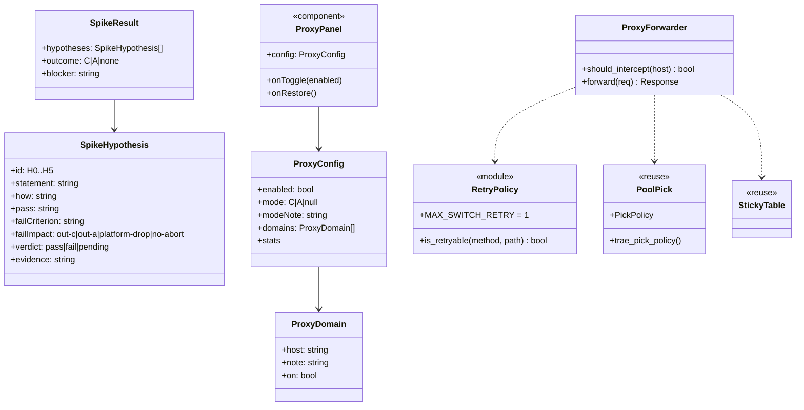
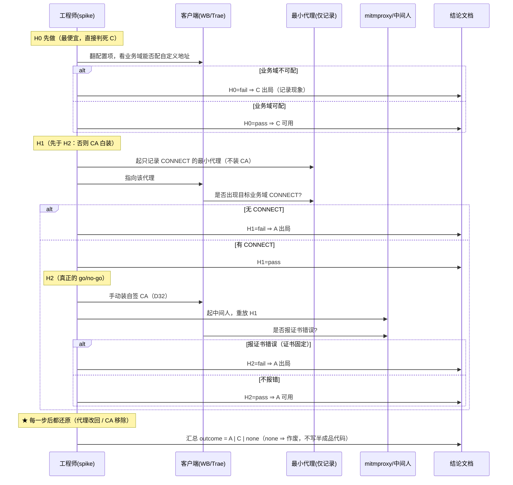
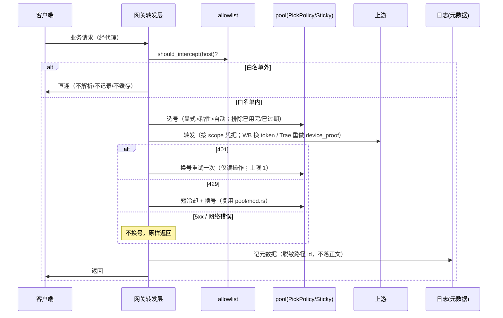
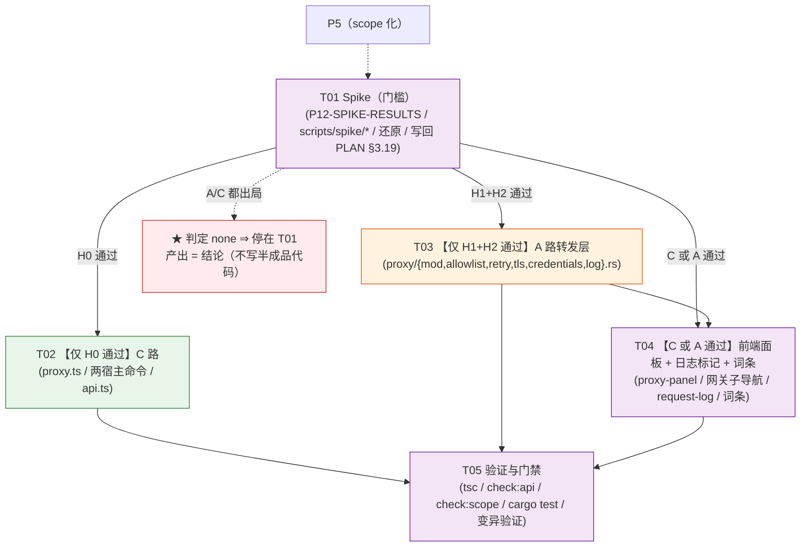

# P12 架构分解：请求代理与无缝切号（**spike 设计**）

> **★ 实现状态（2026-10-07 回写 —— 以代码 + 门禁为准）**：**T01/T02/T03/T04/T05 全部落地**。
> - **路线已变更**：原「A 路 = 客户端配 HTTP 代理 + TLS 中间人」**改走「本地路由」**
>   （客户端 base URL 指向本机网关，**明文 http、不需要 CA**）⇒ 原 H2「证书固定」硬门槛
>   **已不适用**（详见 `P12-SPIKE-RESULTS.md` §3「A 路改道」）。
> - **落地物**：`crates/buddy-switch-core/src/modules/proxy.rs`（只存本地状态，**无转发**）、
>   `biz_allowlist.rs`（业务路径白名单）、`crates/buddy-switch-gateway/src/routes/biz.rs`
>   （`POST /biz/{*path}` 业务转发）、`src/components/gateway/proxy-panel.tsx`（引导面板）。
> - **门禁 4 条**：默认关 + 一键还原不留残留 / 风险 2 条 + 不劫持 4 条逐条出现 /
>   拦截方式 + 白名单表 + 兜底行「直连」/ `verified` 恒 false（诚实红线）。
> - **仍待用户手动**（非代码工作量，`P12-SPIKE-RESULTS.md` §6）：H0 运行时确认、
>   H1 真客户端半段、H4 抓 header 原始大小写。
>
> **状态**：设计（2026-10-05）· **§7 六条待明确已决策（lead 拍板 · 2026-10-05）**，正文已同步（改动点见 §7 末「同步清单」）。本文是 `P5-P12-TASKS.md` P12 段的**落地设计**，可直接交给工程师。
> **★ 本期性质**：**这不是一份实现设计，而是一份 spike 设计** —— P12 有**硬门槛**（证书固定），**先证明「做不做得成」，再谈怎么做**。**A / C 两路都出局 ⇒ 整个 P12 作废，没有兜底**（B 路已被 D29 排除）。
> **上游**：`PLAN.md` §3.19（3.19.1–3.19.11，含 spike 步骤）/ §2.5（fail-closed 纪律）/ §3.6（状态语言）/ §3.3（邮箱脱敏，与「日志脱敏路径 id」同源）；`P5-P12-TASKS.md` P12 段 + 附 A1；`DECISIONS.md` **D29**（只用 A/C、排除 B、默认关）/ **D30**（只代理业务域）/ **D31**（粘性 5 分钟）/ **D32**（手动装 CA）/ **D33**（宽口径：显式信任 CA 的中间人≠劫持）/ **D34**（C 先行）；`VOCABULARY.md`。
> **格式参考**：`P11-ARCH.md` / `P6-ARCH.md`（实现方案 / 文件列表 / 数据结构 / 有序任务 / 共享知识 / 风险 / 待明确 / 依赖图）。
> **下游**：§4 任务列表直接交给工程师。
> **范围**：**仅** P12 —— ① spike（go/no-go）；② C 路（先行）；③ A 路（后评估）。
> **明确排除**：会话复制（§3.15，**文件层**，与 P12 网络层**无关**，两件事都要做、**不能互相替代**）；网关 Key 体系（§3.19.8，与代理用的**账号凭据**是两套东西）；模型识别/禁用（P10/P11，已落）。
> **依赖**：**P5**（scope 化）；D29–D34 已确认。**P12 排最后**（权限最大的功能，且被 spike 门禁卡住）。
> **⚠️ 依赖方向**：**P6/P7/P11 → P12**（P12 在串行骨架末端）；**P12a spike 通过之前，P12b/P12c 不启动**。

---

## 0. 一句话：本期先回答「做不做得成」，再谈怎么做

| 层 | 产出 | 是否可证伪 |
|:---|:---|:---|
| **P12a（spike）** | 一份**结论**（用 A / 用 C / **不可行**）+ 证据 + 还原脚本 | ✅ 每条假设有**作废判据**（§1.2） |
| **P12b（C 路，先行）** | 改客户端 base URL 指向网关 + 单账号 | 仅当 **H0 通过** |
| **P12c（A 路，后评估）** | 白名单域代理 + 选号 + 粘性 + 401 换号 + 一键还原 | 仅当 **H1 且 H2 通过**，且 **P12b 之后重新评估值不值得**（D34） |

> ⚠️ **本文的最硬结论**：**A / C 都不可行时，P12 的产出是「结论：不可行」——不是半成品代码**（§1.5）。**不要为了让 P12「看起来能做成」而弱化作废判据**；**失败的 spike 也是合格产出**（它省掉后面全部投入）。

---

## 1. 实现方案

### 1.1 核心难点

| 难点 | 现状（证据） | 处理 |
|:---|:---|:---|
| **★ 证书固定是硬阻塞** | 客户端走 `https://`，网关当中间人必须让客户端信任自签 CA；**若客户端做了 pinning，方案不成立**（`PLAN §3.19.2 ③`）——**不是工作量问题** | **先 spike 后写码**（§1.2 H2）；H2 失败 ⇒ A 出局 |
| **★ 没有兜底** | B（hosts/DNS/透明代理）已被 **D29 排除**（不劫持） | **A / C 都出局 ⇒ P12 作废**（§1.5）；**绝不引入 B** |
| **C 覆盖不到业务请求（大概率）** | cc-switch 印证：改 base URL 只接管 **LLM 调用**，业务域硬编码（`PLAN §3.19.10 D`） | **D34：C 先行**（高频 LLM、零 CA 成本）；**H0 实测业务域是否也可配** |
| **A 收益低但成本最高** | 本仓**签到/积分是它自己直接调上游**（`checkin.rs` / `credits.rs`）**不经过客户端** ⇒ 客户端侧业务请求只剩「点开看积分」这类**低频**操作（`DECISIONS D34`） | **A 后评估**（P12c 前重新判值不值得） |
| **header casing** | 现成框架默认小写化 ⇒ `anthropic-version` 变 `Anthropic-Version` 就 **401**（cc-switch 踩过，`PLAN §3.19.10 D`） | **H4 实测**；必要时 `preserve_header_case` / 自研接收循环 |
| **改 `PickPolicy` 默认值会静默改 WB 选号** | `PickPolicy` 默认 `expiry_urgency_weight=0.0` / `deterministic=false`（`pool/pick.rs:458,466`）是 **WorkBuddy 选号基线** | 代理链路若需不同值 ⇒ **走 `trae_pick_policy()`（`trae/pool.rs:502`）式显式覆写**，**不许改默认值** |
| **★ 引用字段张冠李戴** | 本仓已两次事故（`lastUsedAt` 张冠李戴、camelCase 假断言）；**本期又核出 PLAN 两处模块/函数名不准**（§1.7） | 逐字段核实（§1.7），引用按**实际**符号名 |

### 1.2 ★ Spike 假设清单（逐条可证伪 · 验证手段 · 作废判据）

> 顺序**不可颠倒**：**H0 最便宜、排最前**（只翻配置项，且**直接判死 C**）；**H1 先于 H2**（先确认客户端认代理，再装 CA —— 否则 CA 白装还得清理，`PLAN §3.19.11`）。

| # | 假设（要验证什么） | 验证手段（**读什么 / 跑什么 / 看什么**） | 通过判据 | **★ 作废判据** | 作废含义 |
|:--|:---|:---|:---|:---|:---|
| **H0** | 客户端**业务域**可配自定义地址 ⇒ **C 路可用** | **读**：WorkBuddy(Electron) / Trae(VSCode 系) 的配置文件与设置项 —— 是否存在能指向自定义 base URL 的**业务域**项（**不是只有 LLM 域**）。**跑**：改配置指向本地 mock server。**看**：业务请求是否真的打到 mock | 业务域**可配** | **业务域不可配**（配置项只覆盖 LLM 域） | ✅ **#1：C 记「部分通过」**（C 可用但**只覆盖 LLM**）—— **C 不判死、仍做**（高频收益），**但 P12 不算达成标题目标**（须如实写） |
| **H1** | 客户端会**主动走 HTTP 代理** ⇒ **A 路前半** | **跑**：起一个**只记录 CONNECT** 的最小 HTTP 代理（**不装 CA、不解密**），把客户端指向它。**看**：代理日志里**是否出现目标业务域的 CONNECT** | 看到目标域 CONNECT | **看不到目标域 CONNECT** | **A 出局** |
| **H2** | 客户端**信任自签 CA、不报证书错误** ⇒ **A 路后半（★ 真正 go/no-go）** | **跑**：**手动装**自签 CA（D32）→ mitmproxy / 自研中间人 → **重放 H1**。**看**：客户端**是否报证书错误**，且业务功能是否正常 | **不报证书错误** 且业务正常 | **报证书错误**（= 证书固定） | **A 出局**（硬阻塞） |
| **H3** | 凭据可**按请求替换** | **跑**：中间人拦一个真实业务请求 —— WB 直接换 `Authorization: Bearer <token>`；Trae 换 token 后**重做 `device_proof` 签名**（`trae/icube.rs:844`，P-256 ECDSA）。**看**：上游是否接受（200）。⚠️ **#6：Trae 的 `device_proof` 需 P-256 私钥**（`icube.rs:382` PKCS#8，注释说**只为 refresh 路径服务**）⇒ **代理换号可能拿不到私钥** ⇒ **Trae 侧状态 = 「需额外打通」**（**非**「已实现」） | 上游**接受** | 上游仍**拒绝** | ✅ **#6：该平台凭据替换不可行 ⇒ 单平台剔除**（**WB 可换、Trae 不可换是可接受结果**）；**两平台都失败** ⇒ 视同 A/C 出局 |
| **H4** | 转发层**不改写 header 原始大小写** | **跑**：转发一个带 `anthropic-version` 的请求。**看**：上游收到的 header 大小写 | 大小写**保持** | 大小写被改写（`Anthropic-Version`） | **不作废 P12**，但**决定实现选型**（需 `preserve_header_case` / 自研） |
| **H5** | 业务请求可**按方法+路径分类读/写** | **读**：抓业务请求样本（签到 / 积分 / 旅行）。**列**：方法+路径白名单 | 能**可靠区分**读写 | 无法区分 | ✅ **#5：不作废**，但**换号重试整体禁用**（fail-closed；**宁可少一个功能，不可写错**） |

**判据汇总（go/no-go）**：

- ✅ **#1：H0 失败 ⇒ C 记「部分通过」**（C 可用但**只覆盖 LLM**）—— **C 不判死、仍做**（高频收益）；**但 P12 不算达成标题目标**（标题含「业务请求」）；
- **A 出局 ⟺ H1 失败 或 H2 失败**；
- **★ A 与 C 都出局 ⇒ 整个 P12 作废**（B 已排除，**无兜底**）；
- ✅ **#6：H3 失败** ⇒ 该平台从代理范围剔除（**WB 可换、Trae 不可换是可接受结果**）；**两平台都失败** ⇒ 视同 A/C 出局；
- **H4 / H5 失败 ⇒ 不作废**，只影响实现成本 / 功能完整度。

### 1.3 C 路技术方案（**D34：先行**）

| 维度 | 内容 |
|:---|:---|
| **做法** | 改**客户端配置**，把 base URL 指向网关（`http://127.0.0.1:<port>`）—— 客户端**主动**把请求交给网关 |
| **覆盖范围** | **LLM 调用（高频）**。⚠️ **大概率覆盖不到业务请求**（签到/积分域硬编码）⇒ **与 P12 标题目标（业务请求）有落差**（§1.1） |
| **前置** | **无需 CA、无需管理员权限、不碰 TLS**（HTTP 明文，客户端主动发往 localhost） |
| **参照** | cc-switch 改 `~/.claude/settings.json` 的 `ANTHROPIC_BASE_URL`（`PLAN §3.19.10 D`） |
| **判据（P12b）** | **AI 调用正常切号**；**无需 CA、不碰 TLS** |
| **⚠️ 诚实边界（✅ #1）** | 若 H0 显示业务域不可配 ⇒ **C 记「部分通过」**：C 可用但**只覆盖 LLM** ⇒ **P12 不算达成标题目标**（标题含「业务请求」）。**结论必须如实写「C 可用但只覆盖 LLM，与标题目标有落差」** —— **不许把「C 覆盖 LLM」说成「P12 达成」**（那是**标题级假承诺**） |

### 1.4 A 路技术方案（**P12c，后评估**）

| 维度 | 内容 |
|:---|:---|
| **做法** | 客户端配 HTTP 代理指向网关 → 网关做 **TLS 中间人**（装自签 CA）→ 按请求选号 → 转发 |
| **覆盖范围** | **业务请求（低频）**：签到 / 积分 / 旅行（用户在客户端里点开的那些） |
| **前置** | ① **自签 CA 手动安装**（D32）；② 客户端支持配代理（H1）；③ **无证书固定**（H2）。⚠️ **CA 装进系统信任库可能需提权**（Windows「受信任的根证书颁发机构」/ macOS 系统钥匙串）；**代理配置本身不需要管理员权限**（区别于 B 路的 hosts）。✅ **#3：明确告知用户「这一步需要管理员权限」，由用户手动操作；应用不得自动提权**（装 CA 到系统信任库是**系统级改动**，风险高） |
| **★ 绝不劫持** | 客户端**主动**配代理（`A`）—— **不改 hosts / 不做 DNS / 不做透明代理**（D29 红线） |
| **判据（P12c）** | 业务请求正常，且**流量确实过网关**。✅ **#2：A 是否值得做 = 实测「客户端侧业务请求日均 < 20 次」⇒ 不做 A**（⚠️ **依据是成本估算，非数据**：A 成本高 —— 装 CA + 提权 + 中间人 + 长期维护 TLS；低频收益 < 成本。**将来有实测数据可调**）。**A 在 P12b 之后重新评估**（D34） |
| **复用（不新造）** | 选号复用 `pool/entry_like.rs::PoolEntryLike` + `PickPolicy`；粘性复用 `StickyTable`（`sticky.rs:31`）；429 冷却复用 `pool/mod.rs`（见 §1.7）；日志扩展 `request-log.tsx` 加「代理」来源标记 |

### 1.5 ★ 作废条件（go/no-go）与**作废时的产出**

**作废条件（分层 · ✅ #1 / #6）**：

| 层 | 条件 | 含义 |
|:---|:---|:---|
| **「业务请求」目标作废** | **A 出局**（H1 失败 **或** H2 失败 **或** H3 在两平台都失败） | 业务请求**只有 A 能覆盖**（C 大概率不行）⇒ **标题目标（业务请求）未达成** |
| **C 降级交付**（非作废） | H0 **部分失败**（业务域不可配、LLM 域可配） | **C 仍交付 LLM 无缝切号**（高频收益，**不浪费**）；**结论如实写「与标题目标有落差」** |
| **★ 整个 P12 完全作废（零产出）** | **A 出局 且 C 出局**（H0 **完全失败**：业务域与 LLM 域**都**不可配） | **停在 T01**，产出 = 结论（**不写半成品代码**） |

> ⚠️ **诚实纪律（✅ #1）**：**A 出局但 C 可用 ⇒ 是「降级交付」不是「P12 达成」** —— 结论必须写明「**C 可用但只覆盖 LLM，与标题目标有落差**」，**不许含糊成「P12 成了」**（标题级假承诺）。
> ⚠️ **诚实纪律（✅ #6）**：Trae 的 `device_proof` 需 P-256 私钥，注释说**只为 refresh 路径服务** ⇒ **代理换号可能拿不到私钥**。**H3 对 Trae 的状态 = 「需额外打通」（非「已实现」）**；**WB 可换、Trae 不可换是合格结果** —— **不许因「这样 P12 就不完整」而含糊**（**单平台也比假承诺好**）。

**⇒ 作废时的产出（**必须**如此，不是半成品代码）**：

| 产出 | 内容 |
|:---|:---|
| **结论文档** | `docs/redesign/P12-SPIKE-RESULTS.md`：**结论（`A` / `C` / `none`）+ 卡在哪一步 + 现象 + 证据**（日志 / 报文 / 截图） |
| **写回 PLAN** | §3.19：通过的写「用哪条路 + 证据」；失败的写「卡在哪一步 + 现象」（**失败的 spike 也是产出**） |
| **还原** | **不留残留**：代理设置改回、CA 移除（§1.6） |
| **★ 禁止** | **不产出**半成品转发层 / 面板代码（**沉没成本**；作废 = 不实现） |

> ⚠️ **诚实纪律**：**「有开源项目做过」≠「我们能照抄」**（`PLAN §3.19.10 C`）—— 能借鉴的是**代理层做法**，**协议层必须用本仓自己的逆向成果**。作废判据**不许**因「别人做成了」而放宽。

### 1.6 三条硬边界 + 绝不劫持 / 默认关（**逐条对齐原型断言**）

原型断言原文（`verify-behaviors.cjs:1306-1357`，**验原型、不动**）—— 真实应用**必须**满足同样的语义：

| 约束 | 原型断言 | 真实应用落点 |
|:---|:---|:---|
| **★ 绝不劫持 hosts** | `:1325-1327` 断言「不改 hosts / 不做 DNS 劫持 / 不做透明代理」三条**同时**出现 | 实现中**不存在** hosts / DNS / 透明代理的**写入路径**（断言：grep 源码无相关写路径，§5 A4） |
| **★ 默认关** | `:1313-1319` 断言开关默认**不带 `on`** 且显示「已关闭」 | `ProxyConfig.enabled` 默认 `false`；**用户主动开启才生效** |
| **★ 开启时同时说明「风险」+「不劫持」** | `:1321-1329` 断言「流量会经过本机网关」+「不落盘请求正文」+「不劫持」三条**同时**出现（**不能只写一句**） | 开启态面板**逐条**渲染：风险（流量过网关、含账号身份、不落盘正文）+ 不劫持三条 |
| **★ 白名单外直连** | `:1343-1349` 断言兜底行是「**其它全部域名 … 直连**」（不是「也代理」） | 白名单**外**一律**直连**（不解析、不记录、不缓存） |
| **★ 一键还原无残留** | `:1351-1357` 断言点「一键还原」后回到**已关闭**态 | 还原 = 撤代理设置（自动）+ **撤销 CA**（✅ #3：CA 移除需管理员权限 ⇒ 给指引、**由用户手动执行**、应用**不自动提权**）；**不留残留**（**绝不静默留一个受信任的自签 CA**） |
| 白名单 / KPI | `:1331-1341` 断言开启后显示**拦截方式** + 白名单行数 + KPI | 面板显示：拦截方式（C/A）、白名单域表 + 兜底行、今日代理请求 / 换号 / 落盘正文（=0） |

**另**：三条硬边界（D33 附带，缺一不可）—— ① **只代理白名单域**；② **不落盘正文**（日志只记元数据：时间/域/路径/状态/耗时/账号）；③ **默认关 + 一键还原**。

### 1.7 ★ 字段 / 符号归属核实（防张冠李戴 —— 本期又核出两处）

> ⚠️ 本仓已两次事故（`lastUsedAt` 张冠李戴、camelCase 假断言）。**本期逐符号核实后，发现 PLAN §3.19 有两处模块/函数名不准**，引用时按**实际**符号名：

| PLAN §3.19 的写法 | **实际**（已核实） | 结论 |
|:---|:---|:---|
| §3.19.2 「`trae/icube.rs` 的 `device_proof_signature`」 | 实际函数名 = **`device_proof`**（`crates/buddy-switch-core/src/modules/trae/icube.rs:844`，P-256 ECDSA / P1363） | ⚠️ **函数名不准**；引用写 `device_proof` |
| §3.19.6 / §3.19.8 「复用 `credits.rs` 的冷却机制」 | **冷却不在 `credits.rs`**（该文件只有 `post_with_account`，`credits.rs:388`）；冷却在 **`crates/buddy-switch-gateway/src/pool/mod.rs`**（`CoolKind::Hard/Soft`、`cooldown_until_tomorrow_4am`、`model_cooldowns`、429 软冷却基准 600s / 封顶 2h） | ⚠️ **模块归属不准**；引用写 `pool/mod.rs` |
| §3.19.5 `PickPolicy` 默认 `expiry_urgency_weight=0` / `deterministic=false` | ✅ 确认（`pool/pick.rs:43,66`，默认值 `:458,466`） | 一致 |
| §3.19.5 `trae_pick_policy()` 式显式覆写 | ✅ 确认（`crates/buddy-switch-gateway/src/trae/pool.rs:502`） | 一致 |
| §3.19.5 粘性 `StickyTable` | ✅ 确认（`crates/buddy-switch-gateway/src/sticky.rs:31`） | 一致 |
| §3.19.8 代理用**账号凭据**（非网关 Key） | `ApiKeyRecord`（`types.ts:676`）/ `TraeApiKeyRecord`（`trae-types.ts:828`）是**网关 Key**，**代理不用它们** | 两套东西，别混 |

> ⇒ **写代码前先按上表核符号**：`device_proof`（非 `device_proof_signature`）、`pool/mod.rs`（非 `credits.rs`）。

### 1.8 与现有能力的关系（别重复造）

| 已有能力 | 与 P12 的关系 |
|:---|:---|
| 账号池 + `PickPolicy`（`pool/pick.rs`） | **直接复用**（§3.19.5），**不新写**；**不改默认值** |
| 冷却（`pool/mod.rs`，**非** `credits.rs`） | **直接复用**（429 处理） |
| 网关请求日志（`request-log.tsx`） | **扩展**：加「代理」来源标记，**不另起一套** |
| 网关 Key 体系（`ApiKeyRecord` / `TraeApiKeyRecord`） | **不复用** —— 代理链路用**账号凭据**，两套东西**别混** |
| 会话复制（§3.15） | **无关**（文件层 vs 网络层）—— **两件事都要做，不能互相替代** |

### 1.9 状态语言 / 白屏防线 / i18n

- **状态语言（§3.6）**：面板首次加载 → `<Skeleton>`；开关切换是**按钮操作中**态（`<Loader2>`，非区块加载态）；**已关闭**态不是空态（是正常态）；开启/还原失败 → 行内 `<Alert>` + 重试。
- **`displayText` 白屏防线**：面板里**域名 / 归属 / 状态**等展示字段**一律过 `displayText`**（`@/lib/display-text`）—— 对象当 React 子节点会**卸载整棵树 ⇒ 白屏**（issue #2）。
- **i18n**：zh + en **同步**加（`src/locales/domains/`），扁平点分命名，**只保留被引用的键**。
- **日志脱敏**：请求日志默认脱敏**路径中的 id**（与 §3.3 邮箱脱敏同源）。

---

## 2. 文件列表

> ⚠️ **分两段**：**A. spike 期产物（必产，无论成败）** / **B. 通过后的实现产物（条件性，仅当 spike 通过才产出）**。

### A. Spike 期产物（必产）

| 相对路径 | 作用 |
|:---|:---|
| `docs/redesign/P12-SPIKE-RESULTS.md` | **spike 结论**（H0–H5 逐条 verdict + 总判定 `A`/`C`/`none` + 证据 + 现象）。**无论通过与否都产出** |
| `scripts/spike/p12-proxy-log.cjs` | 最小 HTTP 代理：**只记录 CONNECT**（不装 CA、不解密）—— H1 用；**spike-only** |
| `scripts/spike/p12-mitm-addon.py` | mitmproxy addon：**按域过滤** + 记录 header 原始大小写 + 记录凭据替换结果 —— H2/H3/H4 用；**spike-only** |
| `scripts/spike/README.md` | spike 执行步骤 + **每步的还原**（代理改回 / CA 移除）—— `PLAN §3.19.11`：**spike 阶段就要把「还原」做出来** |

> ✅ **#4：`scripts/spike/*` 入库（可复现），但不得进打包产物** —— `build-quick.cmd` / `build-exe.cmd` 的打包**不包含** `scripts/spike/*`（spike 工具只服务本地复现，不进发布产物）。

### B. 通过后的实现产物（条件性）

**B-1 C 路（仅 H0 通过）**

| 相对路径 | 作用 |
|:---|:---|
| `src/lib/proxy.ts` | `ProxyConfig` / `ProxyDomain` 类型 + 读写（经命令） |
| `src-tauri/src/commands.rs` + `crates/buddy-switch-server/src/api.rs` | 新命令 `get_proxy_config` / `set_proxy_enabled` / `proxy_restore`（**两宿主同步**） |
| `src/lib/api.ts` | 命令接线（`call` + ROUTES/ALIASES） |

**B-2 A 路（仅 H1 且 H2 通过）**

| 相对路径 | 作用 |
|:---|:---|
| `crates/buddy-switch-gateway/src/proxy/mod.rs` | 转发层入口：白名单过滤 + 按请求选号 + 401 换号（上限 1） |
| `crates/buddy-switch-gateway/src/proxy/allowlist.rs` | 白名单域（D30：只业务域）+ 「其它全部域名直连」兜底 |
| `crates/buddy-switch-gateway/src/proxy/retry.rs` | 可重试白名单（方法+路径，**默认不可重试**，fail-closed）+ 换号去重（并发占位） |
| `crates/buddy-switch-gateway/src/proxy/tls.rs` | TLS 中间人（自签 CA 加载 / 上游校验）；⚠️ **header 原始大小写**（`preserve_header_case`） |
| `crates/buddy-switch-gateway/src/proxy/credentials.rs` | 按 scope 取账号凭据 + WB 换 token / Trae 重做 `device_proof` |
| `crates/buddy-switch-gateway/src/proxy/log.rs` | 元数据日志（时间/域/路径/状态/耗时/账号，**脱敏路径 id**；**不落正文**） |

**B-3 前端面板（C 或 A 通过后共用）**

| 相对路径 | 作用 |
|:---|:---|
| `src/components/gateway/proxy-panel.tsx` | 请求代理面板（**默认关** / 开启时**同时**说明风险+不劫持 / 白名单表 + 兜底行 / KPI / **一键还原**）—— 对照原型 `demo-app.js:1103-1153` |
| `src/pages/ApiServicePage.tsx` / `src/pages/TraeApiServicePage.tsx` | 网关子导航加第 6 项「请求代理」（原型 `demo-app.js:1160`） |
| `src/components/gateway/request-log.tsx` | **扩展**「代理」来源标记（不另起一套） |
| `src/locales/domains/*.zh.ts` / `.en.ts` | 面板 / 命令 / 日志词条（zh + en 同步） |
| `scripts/check-scope-registry.cjs` | 追加 P12 真实应用断言（§5） |

> **不修改**：`docs/redesign/verify-behaviors.cjs`（验**原型**，含 P12 原型断言 `:1306-1357`，**不动**）；`verify-demo.cjs`；`pool/pick.rs` 的**默认值**（只允许显式覆写）。
> **不新建** 独立 `sequence-diagram.mermaid` / `class-diagram.mermaid` —— 本文**内嵌**。

---

## 3. 数据结构与接口

### 3.1 Spike 结果模型（`docs/redesign/P12-SPIKE-RESULTS.md` 的承载结构）

```ts
/** 一条 spike 假设（H0–H5）。 */
export interface SpikeHypothesis {
  id: "H0" | "H1" | "H2" | "H3" | "H4" | "H5";
  /** 要验证什么（可证伪的一句话）。 */
  statement: string;
  /** 怎么验证（读什么 / 跑什么 / 看什么）。 */
  how: string;
  /** 通过判据。 */
  pass: string;
  /** ★ 作废判据（什么结果出现 ⇒ 该路不通）。 */
  failCriterion: string;
  /** 该假设作废的含义：出局 C / 出局 A / 平台剔除 / 不作废但影响选型。 */
  failImpact: "out-c" | "out-a" | "platform-drop" | "no-abort";
  /** 实测判定。 */
  verdict: "pass" | "fail" | "pending";
  /** 证据（日志路径 / 报文 / 截图）。 */
  evidence?: string;
}

/** spike 总判定。 */
export interface SpikeResult {
  hypotheses: SpikeHypothesis[];
  /** 最终走哪条路；none = 作废。 */
  outcome: "C" | "A" | "none";
  /** 卡在哪一步 + 现象（作废时必填）。 */
  blocker?: string;
}
```

### 3.2 代理配置（前端 / 命令面）

```ts
// src/lib/proxy.ts
import type { Scope } from "@/lib/scope";

/** 白名单域（D30：只业务 API 域）。 */
export interface ProxyDomain {
  host: string;        // 如 "www.codebuddy.cn"
  note: string;        // 归属（"WorkBuddy CN" / "Trae CN" …）
  on: boolean;         // 是否代理
}

export interface ProxyConfig {
  /** ★ 默认 false（D29：默认关，用户主动开启才生效）。 */
  enabled: boolean;
  /** 当前拦截方式：C（base URL，先行）/ A（代理+中间人）/ null（未定）。 */
  mode: "C" | "A" | null;
  /** 拦截方式说明（已 i18n）。 */
  modeNote: string;
  /** 白名单（UI 渲染 + 兜底行「其它全部域名 → 直连」）。 */
  domains: ProxyDomain[];
  /** KPI（元数据，**不含正文**）。 */
  stats: { todayRequests: number; switches: number; persistedBodies: 0 };
}
```

### 3.3 后端（A 路，条件性）

```rust
// crates/buddy-switch-gateway/src/proxy/mod.rs
/// 单次代理转发：白名单过滤 → 选号 → 转发 → 失败处理。
pub struct ProxyForwarder { /* pool, sticky, allowlist, retry, tls, log */ }

impl ProxyForwarder {
    /// 白名单外 ⇒ 直接直连（不解析、不记录、不缓存）。
    pub fn should_intercept(host: &str) -> bool;
    /// 按请求选号（复用 PickPolicy；**不改默认值**，需要时显式覆写）。
    pub async fn forward(&self, req: IncomingRequest) -> Result<Response, ProxyError>;
}

// proxy/retry.rs
/// 可重试白名单：**默认不可重试**（fail-closed，§2.5 纪律）。
pub fn is_retryable(method: &str, path: &str) -> bool;
/// 换号重试上限 = 1（换一个号，不是无限轮转）。
pub const MAX_SWITCH_RETRY: u8 = 1;
```

### 3.4 类图



### 3.5 调用流程（spike 执行 —— 含「任一步失败即停」）



### 3.6 调用流程（A 路转发 —— 条件性，仅 H1+H2 通过）



---

## 4. 任务列表（有序 · 含依赖 · 按实现顺序）

> **★ 门槛**：**T01（spike）是硬门槛** —— **T01 判定 `none` ⇒ T02–T05 全部不启动**（P12 停在 T01，产出 = 结论文档）。
> **P0 = 必须；P1 = 重要；P2 = 可裁剪。**

### T01 · Spike 执行（H0–H5）+ 还原机制 + 结论写回 ｜ P0（**门槛**）
- **源文件**
  - 新建 `docs/redesign/P12-SPIKE-RESULTS.md`（H0–H5 verdict + outcome + 证据）
  - 新建 `scripts/spike/p12-proxy-log.cjs`（仅记录 CONNECT）
  - 新建 `scripts/spike/p12-mitm-addon.py`（按域过滤 + 记录 header casing / 凭据替换）
  - 新建 `scripts/spike/README.md`（步骤 + **每步还原**）
  - 修改 `docs/redesign/PLAN.md` §3.19（**写回结论**：通过写「用哪条路+证据」，失败写「卡在哪一步+现象」）
- **依赖**：P5（scope）；D29–D34（已确认）
- **要点**
  - **顺序**：**H0 先**（最便宜，判死 C）→ **H1 先于 H2**（否则 CA 白装）。**H4/H5 可与 H2 并行**。
  - **★ 自动化 vs 用户参与的分工（派工程师前必须讲清 · lead 拍板 2026-10-05）**：
    - **工程师能自动化（无用户在场也能跑）**：
      - **H0** —— **读**客户端配置（WorkBuddy Electron / Trae VSCode 系的配置文件与设置项），核**业务域**是否存在可配 base URL 的项（**只读文件 + 记结论**，不改客户端）；
      - **H1** —— **起**只记录 CONNECT 的最小 HTTP 代理（`scripts/spike/p12-proxy-log.cjs`，**不装 CA、不解密**）+ 把**测试客户端**指向它，看代理日志是否出现目标业务域 CONNECT（**起服务 + 读日志**）；
      - **H4/H5** —— **读**已抓到的请求样本（header 大小写 / 方法+路径），**离线**判大小写是否保持、能否分类读写。
    - **必须用户参与（工程师单独做不到）**：
      - **H2** —— **手动装自签 CA 到系统信任库**（D32 + ✅ #3：需管理员权限，**应用不得自动提权**，须用户在真实系统上手动操作）→ 起中间人重放 H1 → **看客户端是否报证书错误**；
      - **H3** —— **跑真实客户端**产生**真实业务流量**（签到 / 积分 / 旅行）才能验证凭据替换；**工程师无法凭空造出真实上游响应**（mock 只能验转发层，验不了上游是否接受换号后的凭据）。
    - ⇒ **交付物分两类**：**自动化步骤**产出脚本 + 日志证据（可复现）；**用户参与步骤**产出**操作记录 + 现象截图**（`P12-SPIKE-RESULTS.md` 里如实标注「此步需用户手动执行」）。
  - **每一步都要能干净撤销**：代理改回、CA 移除（`PLAN §3.19.11`）；**spike 阶段就做还原**。
  - **★ 诚实边界**：H0 显示业务域不可配时，**不许把「C 覆盖 LLM」说成「P12 达成」**（§1.3）。
  - **★ 作废即停**：A/C 都出局 ⇒ **停在 T01**，**不产出**任何转发层 / 面板代码（§1.5）。
  - **字段按 §1.7 核符号**：`device_proof`（非 `device_proof_signature`）、`pool/mod.rs`（非 `credits.rs`）。

### T02 · 【仅 H0 通过】C 路：base URL 指向网关 ｜ P1
- **源文件**：`src/lib/proxy.ts` · `src-tauri/src/commands.rs` + `crates/buddy-switch-server/src/api.rs` · `src/lib/api.ts`
- **依赖**：T01（**H0 通过**）
- **要点**：改客户端配置指向网关 + 单账号（不选号）；**无需 CA、不碰 TLS**；两宿主命令同步。

#### T02 补充 · 「改客户端配置」的**具体机制**（**补设计** · 2026-10-07）

> ⚠️ **原要点不足**：只写「改客户端配置指向网关」，**没说怎么改** —— 不足以直接实现。
> 而 H0 的结论指出关键约束：**`ACC_PRODUCT_CONFIG*` 是启动期 env，不是用户设置文件** ⇒
> **「改一处就生效」做不到**，**必须定义注入机制**。

**可选机制（按"碰用户资产"的程度从低到高）**：

| 方案 | 做法 | 风险 | 一键还原 |
|:---|:---|:---|:---|
| **A · 纯引导** | 应用**只显示**要设的 env 与命令，**由用户手动设置** | **最低**（应用**不碰**用户环境） | 天然无残留 |
| **B · 启动脚本**（推荐） | 应用生成一个 `.cmd`（内含 env），用户**从它启动**客户端 | 低（**不改用户任何既有东西**，只多一个文件） | 删文件即可 |
| **C · 改快捷方式** | 改用户既有的客户端快捷方式（加 env） | **中高**（**改用户资产**，还原需精确回滚） | 需先备份原快捷方式 |
| **D · 改 `product.json`** | 改安装目录配置 | **高**（安装目录可能只读 + **升级被覆盖**） | 不可靠 |

**⇒ 推荐 A 或 B**，理由：

1. **符合「默认关 + 绝不劫持」的精神** —— 应用**不悄悄改用户的系统 / 环境**（D29 红线的延伸）；
2. **「一键还原」天然成立**（A 无需还原；B 删文件即可）；
3. **⚠️ 代价是"用户要多一步手动操作"** —— 但这是**诚实**：我们**没有能力**在不碰用户资产的前提下"悄悄改"。

**⚠️ 无论选哪个，都必须如实告知「需要重启客户端才生效」**（env 是**启动期**读取的）——
不许写成"开启即生效"（那是假承诺）。

**⇒ ✅ 已定案（2026-10-07 实施时确定）：选 A · 纯引导。**

依据（不是"默认选最便宜的"，而是**唯一自洽的那个**）：`ACC_PRODUCT_CONFIG*` 是**启动期 env**，
而实测发现 WB 真正读的是 `~/.workbuddy/settings.json` 的 `http.proxy` ——
两条路都意味着**应用必须碰用户资产才能"自动生效"**，这与 D29「绝不劫持」直接冲突。
⇒ 只剩 A 成立。

**落地证据**：`crates/buddy-switch-core/src/modules/proxy.rs` 头部注释即写着
「T02 定的是**引导式（方案 A）**」；该模块**只记一个本地标记**，全仓无任何
`settings.json` / 注册表 / 快捷方式写入路径（门禁 `★ P12 请求代理：默认关（D29）+ 一键还原不留残留` 兜住）。

**★ 2026-10-07 追加（实测发现）**：**WB 的代理配置在 `~/.workbuddy/settings.json` 的 `http.proxy`**
（代码里有 `proxySettings:getSettings` / `saveSettings` / `testConnection` IPC，且读 **VSCode 风格**的 `http.proxy`）。

⇒ **「引导」的具体内容应改为「在客户端设置里填 `http.proxy`」** ——
**比「设 env」更贴近事实**（env 那段代码只是**读出来给 UI 显示**，**不是用它设代理**；两次实测都验证了这点）。

⚠️ **但「直接写这个键」仍待验证**（我注入过它，但**没观察到流量**；可能「要配合 `http.proxySupport`」，也可能「WB 启动即无请求」）
⇒ **在验证前，T02 仍走引导式，不自动写用户设置文件**。

#### T04 补充 · 「开启」的**语义**（**补设计** · 2026-10-07）

> ⚠️ 与 T02 同源的问题：原要点说「**默认关**；开启时说明风险与不劫持」，但**没说「开启」到底做什么**。

**因为 T02 选了「引导式」（A / B 方案）⇒ 「开启」不能是「应用自动改环境」**（那与 A/B 自相矛盾）。
**⇒ 可选语义**：

| 方案 | 「开启」= | 「运行中」怎么判定 | 「一键还原」= |
|:---|:---|:---|:---|
| **① 引导态**（推荐） | 显示"要设的 env + 启动脚本"，并置一个**本地标记** | **本地标记**（用户点了"我已设置"）—— ⚠️ **如实标注"应用不校验"** | 清标记 + 提示用户清 env |
| **② 检测态** | 同上，但**尝试检测** env 是否真的生效 | **真检测**（跨进程读环境）—— ⚠️ **不可靠** | 同 ① |

**⇒ 推荐 ①，但必须如实**：

- **「运行中」的文案不能让人以为「应用验证过代理真的生效了」** ⇒ 应写「**已按引导设置**（**应用不校验**）」这类**不夸大**的措辞；
- **「拦截方式」在 C 路 = 「base URL 重定向」**（**不是"中间人"**）⇒ **不许含糊**。

**⇒ ✅ 已定案（2026-10-07 实施时确定）：选 ① · 引导态。**

**落地证据**：`proxy.rs` 头部「⚠️ **应用不校验**：标记只代表『用户点了按钮』，**不代表代理真的生效**」；
门禁 `★ P12 诚实红线：verified 恒 false + 文案不许说「运行中」` 断言兜住（把 `verified` 改成 true 即变红）。
⇒ 「拦截方式」在 C 路如实写「base URL 重定向」，**未**含糊成「中间人」。

---

### T03 · 【**本地路由路线**】业务请求转发（**复用 `relay` 的治理层**）｜P0

> ★ **2026-10-07 路线变更**：原 T03 是「A 路 = 客户端配 HTTP 代理 + TLS 中间人」——
> 那条路**要装 CA**，且**被 H2（证书固定）阻塞**。
> 参照 **cc-switch** 的成熟做法（它的「本地路由」让客户端配置里**只写 `http://127.0.0.1:15721`**），
> **本仓改走「本地路由」：客户端 base URL 指向本地网关（明文 http）**
> ⇒ **全程不需要 CA** ⇒ **H2 这个阻塞不再存在**。

**三步（前两步已有）**：

| 步 | 内容 | 状态 |
|:--|:---|:---|
| **1** | **客户端 base URL 指向本地网关**（明文 `http://127.0.0.1:57891`） | **C 路已做**（引导式，T02）✓ |
| **2** | **网关转发 LLM 请求** | **`relay.rs` 已有**（选号 / 在途租约 / 出站 / 治理 / 换号重试）✓ |
| **3** | **网关转发业务请求**（签到 / 积分 / 旅行） | **本任务** |

**★ 复用而非重写**：`relay.rs` 的**治理层**（选号 / 在途租约 / 冷却 / 熔断 / 换号重试 / `max_rotate`）
**是协议无关的** ⇒ **只把「出站」这一步参数化**，其余**原样复用**。

**需要参数化的两处**（**实测确认**）：

1. **路径**：`upstream.rs:364` 的 `let url = format!("{}/v2/chat/completions", …)` 是**硬编码** ⇒
   抽成 `forward_with(region, acc, path, body, signal, headers)`，让 `chat_stream_with` 调它并传 LLM 路径。
2. **请求头**：`account::build_chat_headers` 是 **LLM 专用** ⇒ 业务请求用 `Authorization: Bearer`
   （**复用既有构造或新增一个**）。

**★ 硬约束（沿用原 T03，一条不删）**：

- **白名单外直连**（不解析 / 不记录 / 不缓存）—— 与 cc-switch 的「**最小侵入**」同精神；
- **★ 绝不劫持**（**无 hosts / DNS / 透明代理写路径**）—— **D29 红线不变**；
- **401 换号重试上限 = 1**；**只读操作**可重试（`is_retryable` **默认 false**，fail-closed）；**写操作不换号**；
- **排除已用完 / 已过期**的包（issue #7 同源）；
- **不落盘正文**（日志只元数据 + 脱敏路径 id）。

### T04 · 【C 或 A 通过】前端面板 + 命令面 + 日志标记 + 词条 ｜ P0
- **源文件**：`src/components/gateway/proxy-panel.tsx` · `src/pages/ApiServicePage.tsx` / `TraeApiServicePage.tsx` · `src/components/gateway/request-log.tsx` · `src/locales/domains/*.zh.ts` / `.en.ts`
- **依赖**：T01（C 或 A 通过）；A 路还需 T03
- **要点**
  - **默认关**；开启时**同时**说明**风险**（流量过网关、含账号身份、不落盘正文）**与不劫持三条**（`verify-behaviors.cjs:1321-1329` 的语义）。
  - **白名单表 + 兜底行「其它全部域名 → 直连」**（`:1343-1349`）；显示**拦截方式**与 KPI（`:1331-1341`）。
  - **一键还原** ⇒ 回到**已关闭**态、**无残留**（`:1351-1357`）。
  - 展示字段过 `displayText`；词条 zh + en 同步；日志加「代理」来源标记。

### T05 · 【T02/T03/T04 之后】验证与门禁 ｜ P0
- **源文件**：无源码改动（跑门禁 + 变异验证 + 断言归属）
- **依赖**：T02 / T03 / T04
- **要点**
  - `tsc` · `check-scope-registry.cjs` · `check:api` · `build:fast` 全绿；`cargo test`（gateway crate）。
  - **★ 验收归属**：原型断言（`verify-behaviors.cjs:1306-1357`）**不动**；P12 **真实应用**断言加进 `scripts/check-scope-registry.cjs`（§5）。
  - **变异验证**：默认关 / 风险+不劫持 / 白名单外直连 / 一键还原 / **绝不劫持**（源码无 hosts 写路径）/ 401 换号上限 1 / 写操作不换号。

---

## 5. 共享知识（跨文件约定）

- **★ 绝不劫持（D29 红线）**：**不改 hosts / 不做 DNS / 不做透明代理**；只接受**客户端主动**把请求交给网关（A 配代理 / C 配 base URL）。实现中**不存在** hosts / DNS / 透明代理的**写入路径**（断言兜住）。
- **★ 默认关（D29）**：`ProxyConfig.enabled` 默认 `false`；用户**主动开启**才生效。
- **★ 开启时同时说明「风险」与「不劫持」**：风险（流量过本机网关、含账号身份、不落盘正文）+ 不劫持三条 —— **不能只写一句**（`verify-behaviors.cjs:1321-1329`）。
- **★ 白名单外直连**：不解析 / 不记录 / 不缓存（不是「也代理」）。
- **★ 一键还原无残留（✅ #3）**：**撤代理设置**（自动）+ **撤销 CA**。⚠️ **CA 移除与安装一样是系统级改动、需管理员权限** ⇒ **应用不得自动提权**：还原流程**给出「移除 CA」的明确步骤 / 指引，由用户手动执行**，并**核对已移除**（不留残留）。**绝不静默留一个受信任的自签 CA**。
- **★ 三条硬边界（D33，缺一不可）**：① 只代理白名单域；② 不落盘正文（日志只元数据）；③ 默认关 + 一键还原。
- **★ 作废即停**：A/C 都出局 ⇒ **产出 = 结论**（`P12-SPIKE-RESULTS.md` + 写回 PLAN §3.19），**不产出半成品代码**。
- **★ 字段 / 符号归属（§1.7）**：`device_proof`（非 `device_proof_signature`）；冷却在 **`pool/mod.rs`**（非 `credits.rs`）；`PickPolicy` 默认值 **不许改**（需覆写走 `trae_pick_policy()`）。
- **选号复用不新造**：`PoolEntryLike` + `PickPolicy` + `StickyTable`（D31 粘性 5 分钟）；**排除已用完/已过期**的包（issue #7）。
- **换号重试 fail-closed**：可重试白名单**默认不可重试**；**只读操作**才重试；**写操作不换号**；**上限 = 1**；5xx / 网络错误**不换号**。
- **不落盘正文**：内存转发；日志只记元数据（时间/域/路径/状态/耗时/账号），**路径 id 脱敏**。
- **网关 Key ≠ 账号凭据**：代理链路用**账号凭据**，与 `ApiKeyRecord` / `TraeApiKeyRecord` **两套东西，别混**。
- **会话复制无关**：文件层 vs 网络层，**两件事都要做，不能互相替代**。
- **`displayText` 白屏防线**：面板所有展示字段过 `@/lib/display-text`（issue #2）。
- **状态语言（§3.6）**：面板首次加载 → `<Skeleton>`；开关切换 → 按钮内 `<Loader2>`；失败 → 行内 `<Alert>` + 重试。
- **i18n**：zh + en 同步（`src/locales/domains/`），扁平点分命名，**只留被引用的键**。
- **两套验收各验各的对象**：`verify-behaviors.cjs`（含 P12 原型断言 `:1306-1357`）**不动**；P12 真实应用断言加进 `scripts/check-scope-registry.cjs`。
- **命令面两宿主同步**：新命令在 `commands.rs`（Tauri）与 `api.rs`（server）**各注册一次**，并接 `api.ts` 的 ROUTES/ALIASES（P5 纪律）。

---

## 6. 风险点

| # | 风险 | 后果 | 对策 |
|:--|:---|:---|:---|
| **R1** | **证书固定**（H2 失败） | **硬阻塞**，A 出局；若 C 也出局 ⇒ P12 作废 | **先 spike 后写码**；H2 报证书错误即停；**不硬凑** |
| **R2** | **C 覆盖不到业务请求**（H0 失败） | 只剩 A；若 A 也不可用 ⇒ 作废；且 C 只覆盖 LLM ⇒ **目标落差** | H0 先做、直接判死；结论里**如实**写「C 覆盖 LLM，非业务请求」 |
| **R3** | **A 收益低、成本最高** | 投入产出倒挂（低频业务请求 vs 高成本中间人） | **D34：A 后评估**（P12c 前重新判值不值得） |
| **R4** | **引入 B（hosts/DNS/透明代理）** | **违反 D29 红线**（劫持全机） | 源码**不存在** hosts 写路径（断言 A4）；作废也不引入 B |
| **R5** | **假承诺**：把「C 可用」说成「P12 达成」 | 用户以为业务请求也能无缝切号，实际没有 | §1.3 诚实边界；结论 `outcome` 必填且**不许含糊** |
| **R6** | **header casing 被改写** | 上游 401（`anthropic-version` → `Anthropic-Version`） | **H4 实测**；`preserve_header_case` / 自研接收循环 |
| **R7** | **改 `PickPolicy` 默认值** | **静默改 WorkBuddy 选号** | 只允许 `trae_pick_policy()` 式**显式覆写**；断言默认值不变 |
| **R8** | **换号重试重复执行写操作** | 领两次奖励 / 重复提交 | `is_retryable` **默认 false**（fail-closed）；**写操作不换号**；上限 1；✅ **#5：若 H5 显示无法可靠区分读/写 ⇒ 换号重试整体禁用**（宁可少一个功能，不可写错） |
| **R9** | **spike 试错把机器搞脏** | 代理/CA 残留，卸载不干净留隐患 | **spike 阶段就做还原**；`scripts/spike/README.md` 每步含还原；CA 手动装（D32） |
| **R10** | **字段张冠李戴** | 引用不存在的符号（`device_proof_signature` / `credits.rs` 冷却）⇒ 编译错或找错文件 | §1.7 核实表；按**实际**符号名写 |
| **R11** | **落盘正文** | 敏感业务流量留存 | 内存转发；日志只元数据 + 脱敏路径 id；断言「磁盘无请求/响应体」 |
| **R12** | **spike 结论丢失** | 试过但没记录 ⇒ 后人重走弯路 | **结论写回 PLAN §3.19**（无论成败）；`P12-SPIKE-RESULTS.md` 留档 |
| **R13** | **Trae 凭据替换需额外打通**（H3 失败）：换号需重做 `device_proof`，私钥仅 refresh 路径持有（`icube.rs:382`）⇒ 代理换号**可能拿不到私钥** | 若含糊 ⇒ 用户以为 Trae 也能无缝切号（**假承诺**） | ✅ **#6：如实记为「需额外打通」（非「已实现」）**；**WB 可换、Trae 不可换是合格结果**；**两平台都失败** ⇒ 视同 A/C 出局（§1.2 / §1.5） |
| **R14** | **A 路「值不值得」的阈值（日均 < 20）是估算拍的** | 用拍脑袋的阈值当数据 ⇒ 误判做/不做 A | ✅ **#2：明确标注「依据是成本估算，非数据」**；**将来有实测数据可调**；**不预先承诺做**（§1.4） |

---

## 7. 决策记录（**6 条待明确已决策 · lead 拍板 2026-10-05**）

> 每条给出「原问题 → ✅ 决策 → 理由」。**正文已同步**（同步清单见 §7.1）。
> ⚠️ **总纪律**：**6 条决策都不许用来弱化作废判据** —— 尤其 #1 / #6：**宁可 P12 只成一半（或如实判「不可行」），不可写「标题级假承诺」**。

1. **★ H0 的判定粒度**（C 只能覆盖 LLM 时算不算通过）→ ✅ **记「部分通过」**：C 路**不判死、仍做**（高频 LLM 收益，零 CA 成本）；**但 P12 不算达成标题目标**（标题含「业务请求」）。
   理由：C 覆盖 LLM 是**真收益**（不该因不覆盖业务域就全丢）；但「业务请求」是**标题承诺** ⇒ **结论必须如实写「C 可用但只覆盖 LLM，与标题目标有落差」**。**不许把「C 覆盖 LLM」说成「P12 达成」**（那是**标题级假承诺**，§1.3 / §1.5）。**作废判据不因此放宽** —— 「业务请求」目标仍只认 A。

2. **★ A 路「后评估」的判据**（P12c 前用什么判值不值得）→ ✅ **实测「客户端侧业务请求日均 < 20 次」⇒ 不做 A**。
   理由：D34 说 A「只剩低频收益」，而 A **成本最高**（装 CA + 提权 + 中间人 + 长期维护 TLS）⇒ **低频收益 < 成本**。⚠️ **依据是成本估算，不是数据** —— 阈值 **20 是估算拍的**；**将来有实测数据可调**（不锁死）。**A 在 P12b 之后重新评估**（D34），**不预先承诺做**。

3. **★ CA 安装提权**（是否接受开启 A 路触发 UAC/授权）→ ✅ **不接受「自动提权」**：**明确告知用户「这一步需要管理员权限」，由用户手动操作；应用不得自动提权**。
   理由：装 CA 到系统信任库（Windows「受信任的根证书颁发机构」/ macOS 系统钥匙串）是**系统级改动、风险高** ⇒ **不许静默提权**（那等于让用户不知情地改系统信任根）。**代理配置本身不需管理员权限**（区别于 B 路 hosts）；**一键还原要能撤销 CA**（§1.4 / §1.6 / §5）。

4. **★ spike 产物是否入库** → ✅ **入库（可复现），但不得进打包产物**。
   理由：`scripts/spike/*`（仅记录 CONNECT 的代理 / mitmproxy addon）**入库**才能复现与审计；但它是 **spike-only 工具**，**不得进发布产物** —— `build-quick.cmd` / `build-exe.cmd` 的打包**不包含** `scripts/spike/*`（§2 A）。

5. **★ H5 无法区分读写时的退化行为** → ✅ **接受 fail-closed**：无法可靠分类读/写 ⇒ **换号重试整体禁用**（价值下降但**不作废**）。
   理由：**宁可少一个功能，不可写错** —— 换号重试若误判写操作 ⇒ **重复提交/重复领奖**（R8）。fail-closed 是 §2.5 纪律：**不确定即不做**（`is_retryable` 默认 false）。

6. **★ A 路的凭据刷新（Trae `device_proof`）** → ✅ **如实记为「需额外打通」**（**非**「已实现」）。
   理由：Trae 换号需**重做 `device_proof` 签名**（P-256 ECDSA），但该私钥（`icube.rs:382` PKCS#8）注释说**只为 refresh 路径服务** ⇒ **代理换号可能拿不到私钥** ⇒ **Trae 侧状态 = 「需额外打通」**。**WB 可换、Trae 不可换是合格结果** —— **单平台也比假承诺好**；**不许因「这样 P12 就不完整」而含糊**（§1.5 诚实纪律 #6）。

### 7.1 同步清单（正文改在哪）

| 决策 | 正文改动点 |
|:--|:---|
| **#1** | 头部「状态」、§1.2（H0 行 + 判据汇总）、§1.3（诚实边界）、§1.5（分层作废条件 + 诚实纪律 #1）、§6 R2 / R5 |
| **#2** | §1.4（判据 = 日均 < 20 + 「依据是成本估算，非数据」）、§6 R14 |
| **#3** | §1.4（前置：告知用户需管理员权限、应用不得自动提权）、§1.6（一键还原 = 撤代理 + 撤销 CA）、§5（一键还原无残留） |
| **#4** | §2 A-段（`scripts/spike/*` 入库但不进打包产物） |
| **#5** | §1.2（H5 行）、§1.5、§5、§6 R8 |
| **#6** | §1.2（H3 行 + 判据汇总）、§1.5（诚实纪律 #6）、§5（字段归属）、§6 R13 |

---

## 8. 任务依赖图



> **门槛**：**T01 判定 `none` ⇒ T02–T05 全部不启动**（P12 停在 T01）。
> **先行**：T02（C 路，H0 通过即做，零 CA 成本）。
> **后评估**：T03（A 路）—— H1+H2 通过才做，且 **P12b 之后重新判值不值得**（D34）。
> **依赖方向**：P6/P7/P11 → P12（P12 在串行骨架末端）；**spike 通过之前，P12b/P12c 不启动**。
