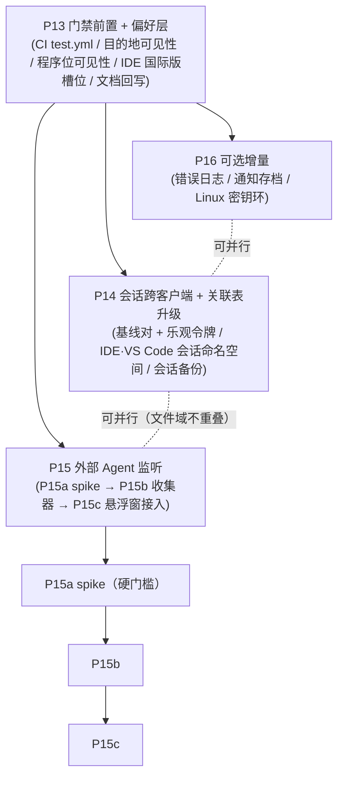

# P13–P16 · 参考实现对齐方案（把 `changexbc/workbuddy-switch` 的可纳入功能排进本仓期次）

> **状态**：设计（**待拍板**，2026-10-09）。本文**不动一行代码**。
> **基线原型**：`docs/redesign/` —— `index.html` + `demo-app.js`（7 个视图：概览 / 账号 / 用量 / 网关 / 会话 / 设置 / 备份）+ `demo-data.js` + `verify-behaviors.cjs`（**112 条断言**）。本方案所有新增交互**一律先补原型、再写代码**，并沿用该目录的
> `PLAN.md`（v2.7）分期口径、`DECISIONS.md`（**D1–D34 已确认**）、`VOCABULARY.md`（**L1–L5 五层 + 能力/偏好两分**）、
> `P5-P12-TASKS.md`（任务分解格式）。
> **参考档案**：`docs/reference-changexbc-workbuddy-switch.md`（同产品的兄弟实现，MIT）。本文只引用该档案的结论，
> **每条结论都带证据分级**（见 §1.2）。
> **现状口径**：以当前工作区代码为准（2026-10-09）。`GAP-ANALYSIS.md`（10-04）与 `COVERAGE-REPORT.md`（10-06/10-08）
> 的若干结论**已被代码推翻**（P7/P8/P9/P11/P12 均已落地），引用时以本文件 §1.3 的「本仓当前事实」为准。

---

## 0. 结论先行

三句话：

1. **两仓是同一产品的两条分叉，不是上下游**（本仓 `NextAgentX/trae-workbuddy-switch`，参考 `changexbc/workbuddy-switch`）。
   **功能表逐条对得上，真正的差集只有 4 处** —— 且其中 **3 处本仓 `PLAN.md` 已经写成目标，只是没落地**。
   ⇒ 本方案的多数条目**不是新增功能，而是「把已拍板的设计做完」**。
2. **最该先做的不是参考的大功能，而是两件「小而硬」的事**：
   **① 本仓完全没有 CI 测试门禁**（`.github/workflows/` 只有 `build.yml` + `pages.yml`）；
   **② 缺「用户偏好」这一层**（`PLAN §2.7 / §3.2 / §3.3 规则 3` 已写清语义，本仓 grep `preferences.*` 只有一条注释）。
   参考这两处都有**可直接对照的实现**，且它们的落地**降低后续所有改动的风险**。
3. **最贵、最不确定的一块是「外部 Agent 监听」**（参考的 Agent Companion）。它**与本仓 P9 的既有红线正面冲突**
   （本仓 P9 要求独立窗口**键盘可达** + **只读** + **标题不进 DOM**；参考的悬浮栏是 `focusable(false)` 的
   点击穿透挂件、带设置写命令面、直接显示 prompt 前 240 字）⇒ **必须走 spike + 新决策，不许直接开工**。
   ⚠️ 同时必须诚实说明：**本仓 P9 今天的实际产出接近空转** —— `companion_snapshot()` **最多 push 一条**
   `LiveOperation`（`src-tauri/src/commands.rs:2969-2997`），且 `state` 硬编码 `Running`，
   `waiting/done/failed` 只活在枚举与单测里。⇒ 与其接一个大组件，**先把 P9 的数据源做实**是更划算的第一步。

### 三个可度量的收益

| 指标 | 现状 | 目标 |
|:---|:---|:---|
| CI 对测试的覆盖 | **0**（无任何 `cargo test` / `vitest` / `clippy` / `tsc` job） | 3 个 job（rust-tests / lint / frontend-tests），**push 与 PR 触发** |
| 「关掉一个入口」的手段 | 只有**能力门控**（平台固有，用户改不了） | + **偏好层**（用户可改、可逆、不影响数据） |
| 侧栏目的地的可见性 | 固定（`DESTINATIONS` 6 项静态表） | 可配置，且**关掉 ≠ 不可达**（URL 直达仍可用） |
| 程序位入口的可见性 | 固定（`WORKBUDDY_PROGRAMS` 5 项全渲染） | 逐程序位可关；**JetBrains 默认关**（灰度） |
| 会话复制覆盖的客户端 | **1**（仅 WorkBuddy 桌面） | **3**（+ CodeBuddy IDE / VS Code 插件） |
| 会话「落后 / 分叉」的判据 | 有（逐行 hash，已修假分歧） | **保持不动**；只补「基线对 + 乐观令牌 + 勾选纪律」 |
| 悬浮窗能显示的条目 | **≤ 1 行，且恒为「运行中」** | ≥ 4 态可被数据驱动；外部来源为**可选**第二阶段 |
| 本仓 `.github/workflows/` 文件数 | 2 | 3 |

---

## 1. 口径（先读这一节，否则后面全会被误读）

### 1.1 「以 `docs/redesign` 为基础原型」的严格含义

本方案不新造原型。任何新增交互都必须落到这四个既有文件里，**代码开工前原型先绿**：

| 文件 | 本方案的改动方式 |
|:---|:---|
| `docs/redesign/index.html` + `demo-app.js` | 在**既有 7 个视图函数**（`viewOverview` / `viewAccounts` / `viewUsage` / `viewGateway` / `viewSessions` / `viewSettings` / `viewBackup`）里加区块，**不新增第 8 个视图** |
| `docs/redesign/demo-data.js` | 演示数据必须**自洽**（`GAP-ANALYSIS §4.2` 的红线：不许为了断言造不存在的结构） |
| `docs/redesign/demo.css` | 复用既有 token；**不为新功能引入新色板** |
| `docs/redesign/verify-behaviors.cjs` | 每条新行为**加一条 `check(...)`**，且**可证伪**（去掉实现即变红） |

### 1.2 证据分级（本文每条结论后面都标）

| 级别 | 含义 |
|:---:|:---|
| **【代码】** | 在参考仓库或本仓的**源码**里直接读到 |
| **【文档】** | 只在参考的 README / doc-comment 里声称，代码未取证 |
| **【未取证】** | 文件存在但**内容未读**（本次调研通道受限，见 `docs/reference-changexbc-workbuddy-switch.md` §5.1） |
| **【本地实测】** | 本仓代码 / CI 配置 / 门禁的当前状态 |

> ⚠️ **本次调研的硬限制**：参考仓库多个关键模块（`session_link.rs` 132 KB、`session_groups.rs` 111 KB、
> `vscode_session_sync.rs` 126 KB、`session_backup.rs` 54 KB、`limits.rs` 140 KB、`rate_limit_hook.rs` 59 KB …）
> **只确认存在与字节数，未读一行**。⇒ **凡是要移植其内部算法，开工前必须先做一次真实源码阅读**
> （见 §7「落地前三件事」）。

### 1.3 ★ 本仓当前事实（用于纠正 `GAP-ANALYSIS` / `COVERAGE-REPORT` 的过时结论）

| 项 | 本仓现状 | 证据【本地实测】 |
|:---|:---|:---|
| P7 全局备份 | ✅ 已落地（`BackupSection` 在设置子导航第 9 项） | `src/components/settings/settings-subnav.tsx:62`；`src/components/settings/backup-section.tsx` |
| P8 会话工作台 | ✅ 已落地：**含**内容指纹、组状态四态、关联图、**增量同步（加法）**、**分歧处理（覆盖 + 备份复核）** | `crates/buddy-switch-core/src/modules/session.rs:370,390,410,505,723`；`src/lib/session-replicas.ts:63,96`；`src/pages/SessionsPage.tsx` |
| P9 桌面悬浮窗 | ⚠️ 窗口/UI/托盘/可见性 ✅；**数据源接近空转**（≤1 行、恒 `running`） | `src-tauri/src/companion.rs`；`src-tauri/src/commands.rs:2969-2997` |
| P11 模型禁用 + 接入说明 | ✅ 已落地 | `COVERAGE-REPORT.md` 第六轮；`src/components/gateway/model-table.tsx` |
| P12 请求代理 | ✅ 已落地（**本地路由**，非 TLS 中间人） | `crates/buddy-switch-core/src/modules/proxy.rs`、`biz_allowlist.rs` |
| 5 个 WB 程序位（含 VS Code 插件 / JetBrains 插件） | ✅ **两条「待新增」已于 2026-10-09 落地为 `available`** | `src/lib/platforms/registry.ts:109-116`；`crates/.../modules/jetbrains.rs`、`vscode_ext.rs` |
| Skill 管理 / 客户端设置托管 / 客户端限流台账 | ✅ 三条新能力已落地 | `crates/.../modules/skill.rs`、`client_settings.rs`、`client_limits.rs` |
| **CI 测试门禁** | ❌ **完全没有** | `.github/workflows/` 仅 `build.yml` + `pages.yml` |
| **用户偏好层（`preferences.*`）** | ❌ 只有一条注释 | `src/lib/platforms/registry.ts:36`；全仓 grep `preferences.*` **0 命中** |
| **CodeBuddy IDE 国际版程序位** | ⚠️ 能力在、**未接线** | `vscode_cn_inject.rs` 有 `CodeBuddyIdeFlavor::{Cn,Intl}`；`programs.rs` 的 `PROGRAMS` **无 Intl 槽** |

> ⚠️ **文档债（本方案 §9 会要求回写）**：`VOCABULARY.md:33` 仍写「VS Code CodeBuddy 插件、JetBrains IDE 插件
> **当前不存在**」，`VOCABULARY.md:47-48` 仍写「`sessionCopy` 只有 WorkBuddy 有，**精确到 WorkBuddy 桌面**」；
> 而 `registry.ts:75-81` 已自陈两条目标**均已落地**。**同一仓的两份文档互相打脸**，必须先修。

---

## 2. 候选清单与取舍（共 17 条）

> 分类口径：**A = PLAN 已写未落地**（直接排期，不需要新决策）；**B = PLAN 未写/明确推迟**（需新决策）；
> **C = 机制不同，需先对照评估**（不直接排期）；**D = 不建议纳入**。

### A 类 · PLAN 已写、本仓未落地（**优先，不需要新决策**）

| # | 候选 | PLAN 依据 | 参考对照 | 成本 |
|:--:|:---|:---|:---|:--:|
| **A1** | **目的地可见性偏好** —— 关掉侧栏某项 = 不渲染入口，**URL 直达仍可用**，数据不受影响 | `PLAN §3.2` 四条规则之 2；`VOCABULARY §3` 偏好列 | `src/lib/nav-prefs.ts`（【代码】全文已读） | **S** |
| **A2** | **程序位可见性偏好（逐客户端入口开关）** —— 关掉 = 入口不渲染 + **该端状态轮询跳过**，账号库不受影响；JetBrains **默认关** | `PLAN §2.7`（能力 vs 偏好）、`§3.3` 规则 3、`§3.2` 规则 1 | `src/lib/supported-tools.ts`（【代码】全文已读） | **S** |
| **A3** | **会话能力覆盖到 CodeBuddy IDE 与 VS Code 插件**（复制 / 关联 / 增量同步） | `PLAN §3.3` A/B 表、`§3.15` 能力边界（原文说「只有 WorkBuddy 桌面有」——**被参考项目证伪**） | 三套会话命名空间：`session*` / `vscode_session*` / `codebuddy_ide_session*`（【代码】仅模块清单） | **XL** |
| **A4** | **客户端 Tab 的退化规则**（只剩 1 项时不渲染 Tab）—— **必须与 A3 捆绑交付** | `PLAN §3.15.1`（v2.6 新增的退化规则） | 参考侧栏「会话」页有 3 个 section（【文档】+【未取证】） | **S**（依附 A3） |

> ⚠️ **A4 的顺序是硬的**：本仓 `src/pages/SessionsPage.tsx:32-34` 与 `:297` **刻意**写死「不渲染客户端 Tab，
> 也不保留结构」，理由是「只有 1 项 ⇒ 单选项的切换器是假控件」。**先做 Tab 而客户端仍只有 1 个，
> 会主动违反本仓自己的纪律** ⇒ 必须 A3 与 A4 同批交付。

### B 类 · PLAN 未写 / 明确推迟，参考证明可行（**需新决策 D35–D42**）

| # | 候选 | 为什么值得 | 参考对照 | 成本 | 风险 |
|:--:|:---|:---|:---|:--:|:---|
| **B1** | **显式关联表 + 基线对（`pair_bases`）+ 乐观令牌（`previewToken`）** | 本仓的关联是 **copy ledger 的连通分量**（`session.rs:1666`），**没有基线** ⇒ 「增量」是相对**另一个账号当前内容**，不是相对**上次一致点**。加了基线才算真「增量」 | 【代码】`session_link::load_store` → `store.groups[].members[] / pair_bases[] / variant`；`SyncSelection{group_id, preview_token, mode}` | **M** | 引入**第二事实源**（组 vs 账本）；参考怎么解**未取证** |
| **B2** | **外部 Agent 监听**（Codex / WorkBuddy / CodeBuddy IDE / VS Code 插件 / Codeg / 自定义来源） | 本仓 P9 只显示自家操作；参考能显示**别的 Agent 在干什么** | 【代码】collector + hooks/webhook + Rust runtime + Tauri 插件；【文档】能力表 | **XL** | **与本仓 P9 三条红线正面冲突**（见 §4.3） |
| **B3** | **会话级备份 / 恢复面**（SQLite **在线备份 API** 生成一致快照 + 列出 / 还原） | 本仓会话备份**只**是 `unify` 的副作用（`session.rs:764`）；且本仓 `rusqlite` **没有开 `backup` feature**（`crates/buddy-switch-core/Cargo.toml:15` 只有 `bundled`） | 【代码】`wb-switch-core/Cargo.toml` 注释 + `rusqlite{features:["bundled","backup"]}`；`session_backup.rs` 54 KB【未取证】 | **M** | 备份面**未取证** ⇒ 要么自研，要么先读 |
| **B4** | **CodeBuddy IDE 国际版程序位** | 能力**已在**（`vscode_cn_inject.rs` 的 `CodeBuddyIdeFlavor::{Cn,Intl}`），缺的只是 `programs.rs` 一条槽 + 切换接线 ⇒ **极低成本补齐客户端覆盖** | 【代码】参考有独立模块 `codebuddy_ide.rs`（50 KB，国际版） | **S** | 需确认「国际版 IDE 的 bundle id / Keychain service」与国内版不同（参考 `MACOS_BUNDLE_ID = com.tencent.codebuddycn` 只覆盖 CN） |
| **B5** | **错误日志**（`~/.buddy-switch/error.log`，JSON Lines、环形保留、detail 截断、写失败静默降级） | 本仓 `error_code.rs` 是**错误码映射**，不是日志；`settings.logs` 分区在 WB 侧是**空态 + 出口** ⇒ 用户报障时没有原始线索 | 【代码】参考 `error_log.rs`（11 KB，**全文已读**） | **S** | 无 |
| **B6** | **通知存档**（`notifications.json`，保留 N 条、去抖、字符截断、损坏文件不覆盖） | 本仓只有**一处**系统通知（签到完成，`src-tauri/src/tray.rs:398`），**无存档** ⇒ 用户错过就没了 | 【代码】参考 `notifications.rs`（9.7 KB，**全文已读**） | **S** | 需定「系统通知 vs 应用内存档」的分工（`trae/settings.rs:51-53` 已有 `notify: toast\|system\|none` 偏好） |
| **B7** | **★ CI 测试门禁**（`test.yml` 三 job：`rust-tests` / `lint` / `frontend-tests`） | **本仓测试零 CI 覆盖** —— 这是本次调研里**最高性价比**的一条。参考的注释还给出了事故出处：「测试必须独立于发布流程；2026-09 的 Windows『os error 5』回归正是这样漏到 0.1.43 的」 | 【代码】`.github/workflows/test.yml`（4.8 KB，全文已读） | **S** | 需定「tests 是否 gate release」（参考：**gate push/PR，不 gate tag 发布**） |

### C 类 · 机制不同，先做对照评估（**不直接排期**）

| # | 候选 | 本仓做法 | 参考做法 | 处置 |
|:--:|:---|:---|:---|:---|
| **C1** | **限流采集** | `client_limits.rs`：以 `SQLITE_OPEN_READ_ONLY` **只读**客户端三表 join，绝不写库 | `rate_limit_hook.rs`(59 KB) + `rate_limit_events.rs`(77 KB)：疑似**向客户端注入 hook** 后轮询 `~/.wb-switch/hook-events.jsonl`；`wb-switch-server/main.rs` 有 `rate_limit_hook::auto_install_on_startup()` 与 `rate_limit_events::spawn_watcher()`【代码仅调用点】 | **只评估**：hook 注入会**写用户其它客户端的配置**，与 `PLAN §2.5`「破坏性操作要有后端支撑」同源风险。**评测口径**：更实时/更准的收益 vs 「改别人配置」的成本。**未取证，不许照搬** |
| **C2** | **Linux 密钥环** | `vscode_cn_inject.rs:403-404` **逐字自陈**「本仓**未内置 D-Bus Secret Service 客户端**，直接按 `application` 属性用 `secret-tool` 检索（libsecret-tools）」 | `linux_keyring.rs`(4.9 KB)：直连 D-Bus `org.freedesktop.secrets`（`zbus` blocking），**不依赖默认未安装的 `secret-tool`** | **建议纳入（小）**：这是参考为修 issue 的真实改进，本仓是**已知退化**。但需先定「新增 `zbus` 依赖」是否符合本仓依赖纪律 |
| **C3** | **`limits` 扫描缓存** | 本仓**无等价**（grep `invalidate_scan_cache` = 0） | `limits.rs`(140 KB)：疑似「来源扫描 + 扫描缓存」【未取证】 | **暂缓**：职责未取证，不值得为它排期 |

### D 类 · 不建议纳入（含「不要为了对齐而改坏」）

| # | 不纳入 | 理由 |
|:--:|:---|:---|
| **D1** | **`vendor-patched/` 内联打过补丁的 crate**（参考内联了 `indexmap`） | 把「上游修复」变成手工维护；本仓既有取向是正常依赖 + 版本约束 |
| **D2** | **整体替换本仓 P9 为 vendored Agent Companion** | 会**丢掉本仓 P9 的键盘可达性门禁**（`P9-ARCH §1.7` + `check-scope-registry.cjs` 第 227 条）与「只读红线」，并引入**两条更新链**（宿主 updater + 组件 updater）。⇒ 只借它的「监听什么 + 怎么收」（B2），不搬它的窗口 |
| **D3** | **照抄参考的会话分歧口径** | 参考疑似**「记录条数级」**判据（其 UI 自陈「条数相同也不代表内容完全一致」），本仓是**「逐行 hash 级」**（`session.rs:390` + `:410` 已专门修过「假分歧」，有单测 `:3332` 钉死）。**两套不是同一坐标系**，混用会让同一页出现两个「共同旧版」 |
| **D4** | **照抄参考的模块粒度** | 参考多个模块是超大单文件（`session.rs` 426 KB、`limits.rs` 140 KB、`vscode_session_sync.rs` 126 KB、`config.rs` 76 KB）。本仓按域拆分 + 单测密度更高 |
| **D5** | **照抄它的发布 / 签名路径** | 参考把签名私钥放 `~/.wb-switch/*.key` 由构建脚本注入；本仓现行路径不同，且 `docs/reference-workbuddy-manager.md §5.4` 已记录本仓对「签名私钥是否进 CI」的既有判断 ⇒ **改流程要单独拍板** |

---

## 3. 期次划分（P13–P16）与依赖



| 期 | 目标一句话 | 前置 | 可否并行 | 结论 |
|:---|:---|:---|:---|:---|
| **P13** | 把**门禁和偏好层**这两件小而硬的事做完：CI 三 job + 用户偏好层 + IDE 国际版槽位 + 文档回写 | 无 | 与 P14/P15 无重叠，但它是**它们的保护网** | **必做**，成本最低、收益最高 |
| **P14** | 会话能力从 1 个客户端扩到 3 个；把「账本连通分量」升级为「带基线的关联组」 | P13（`check:api` 门禁要能吃新命令） | 与 P15 可并行 | **可做**，但 A3 是 **XL**，必须拆 T01/T02/T03 分批 |
| **P15** | 外部 Agent 监听：先 spike 定生死，再收集器，最后接进悬浮窗 | P13；**P15a 是硬门槛** | 与 P14 可并行 | **条件性可做**（spike 决定形态，见 D39/D40） |
| **P16** | 三条低成本增量：错误日志 / 通知存档 / Linux 密钥环 | P13 | 与 P14/P15 可并行 | **可做**（都是 **S**，适合填充） |

---

## 4. 逐期任务分解

> 格式沿用 `P5-P12-TASKS.md`：**目标 / 涉及文件 / 依赖 / 验收项 / 风险点 / 回滚**。

### 4.1 P13 · 门禁前置 + 偏好层

> **PLAN 章节**：`§2.7`（能力 vs 偏好）、`§3.2`（可配置目的地 + 四条规则）、`§3.3` 规则 3、`§3.6`（状态语言）。
> **决策**：D35（偏好粒度）、D42（CI 门禁强度）。

#### T01 ★ CI 测试门禁（**先做，它保护后面全部改动**）

**目标**：新增 `.github/workflows/test.yml`，`push`（任意分支）+ `pull_request` 触发，三个 job：

| job | 内容 | 与参考的差异 |
|:---|:---|:---|
| `rust-tests` | `cargo test -p buddy-switch-core --lib`（本地口径；参考是 `-p wb-switch-core`），三平台 matrix、`fail-fast: false` | Linux 额外跑 clippy |
| `lint` | `npx tsc --noEmit` + `cargo fmt --check` + `cargo clippy --all-targets --no-deps -D warnings` | clippy **必须** `--no-deps`（本仓有大量依赖） |
| `frontend-tests` | `npm ci`（无 Rust 工具链依赖） | 本仓有 `check:api` / `check:scope` / `check:store-selectors` 三个自研门禁 —— **一并纳入本 job** |

**验收项**：故意改坏一处（如删掉一条 fail-closed 断言）⇒ **CI 变红**；`build.yml` **不**新增测试步骤
（保持「发布链」与「测试链」分离 —— 这是参考用一次真实事故换来的结论）。

**风险点**：⚠️ 本仓自研门禁脚本依赖 Node 与仓库相对路径，CI 上可能因大小写 / 路径分隔符差异误红（Windows 本地绿、
ubuntu 红）。**必须先在 CI 上跑一遍空转**，再决定是否设为 required check。

**回滚**：删 workflow 文件即回退（对产物零影响）。

#### T02 偏好层（A1 + A2）

**目标**：新增**两条正交偏好**，与既有 `Capability` 严格分家（`VOCABULARY §3`）：

```ts
// 新增：src/lib/prefs/destination-visibility.ts（A1）
//   localStorage: "buddy-switch.nav.<destination>"，值 "1"/"0"，缺省开
// 新增：src/lib/prefs/program-visibility.ts（A2）
//   localStorage: "buddy-switch.program.<programId>"，值 "1"/"0"，缺省取 ProgramSpec 的 defaultEnabled
```

**四条硬规则**（照抄参考**已实现**的语义，逐字对齐 `PLAN §3.2`）：

1. **关闭 = 不渲染入口**；**URL 直达仍可用**（`/s/wb-cn/sessions` 直达不封路由）；
2. **数据与账号库不受影响**，重新打开即恢复；
3. 关闭某端 ⇒ **该端状态轮询跳过**；但**写状态的后台任务（保活 / 签到 / 轮换）不许停**
   （`PLAN §2.7` 三个「必须避免的错误」之 3 —— 这条是本仓比参考**写得更严**的地方，必须守住）；
4. **至少保留 1 个目的地**（不允许把侧栏关空）。

**同页广播**：参考踩过的坑 —— `storage` 事件**只在其它标签页触发** ⇒ 必须自建 `*:changed` 事件
（【代码】`nav-prefs.ts` / `supported-tools.ts` 都有这一层）。**本仓照做。**

**⚠️ 「WorkBuddy 桌面」这个特例（D35）**：参考的 `ToolId` 把 `workbuddy` 也当一个「工具」，
但本仓的 `VOCABULARY §2` 把 WorkBuddy 桌面当作**平台自身的默认程序位**（不在 `WORKBUDDY_PROGRAMS` 的 5 项里）。
⇒ 只能对 `WORKBUDDY_PROGRAMS` 的 5 项做偏好；**WorkBuddy 桌面这一项必须单独定规则**（D35）。

**涉及文件**：两个新 `src/lib/prefs/*.ts`；`src/App.tsx`（`scopedNav` 过滤）；`src/components/settings/settings-subnav.tsx`（第 10 项）；
`src/pages/SettingsPage.tsx`（新分区）；`src/components/account-card.tsx`（程序位按钮过滤）；词条 ×2；
门禁 `scripts/check-scope-registry.cjs`（新增断言）。

**验收项**：关掉「会话」⇒ 侧栏不渲染、URL 直达仍渲染、`sessionCopy` 能力不变（后端仍接受命令）；
关掉某程序位 ⇒ 账号卡不渲染该按钮、**该端轮询跳过**、**签到 / 保活仍在跑**（用日志或单测证明）。

**回滚**：偏好存 localStorage ⇒ 清 key 即回退；两个 `prefs` 模块删除即回滚。

#### T03 设置页新分区（承载 T02 的两组开关）

**目标**：`settings-subnav.tsx` 从 9 项扩到 10 项（暂名「界面」或并入既有 `client` 分区 —— 见 D35）。
**必须给出**：每项一行说明 + 「关闭后仍可直达」的如实文案（不许写成「隐藏功能」）。

**风险点**：⚠️ 本仓 `settings-subnav` 已被多个并行任务编辑过（见 `sessions.zh.ts:12-13` 的注释）⇒
**词条放独立域文件**，避免并发踩踏。

#### T04 CodeBuddy IDE 国际版程序位（B4）

**目标**：`programs.rs` 的 `PROGRAMS` 增加 Intl 槽；`switch` 接线到既有 `inject_codebuddy_ide_secret(flavor)`。
**验收项**：`cargo test -p buddy-switch-core` 的「程序位表」单测更新；门禁 `check:scope` 的 `label_key` 对照更新；
`product_spec_matches_frontend_registry_slug_and_capabilities` 护栏必须同步改（**它会在两侧漂移时变红**）。
**风险点**：⚠️ 国际版 IDE 的 bundle id / Keychain service 与国内版**不同**（参考只有 `com.tencent.codebuddycn` 覆盖 CN）
⇒ **必须先取证国际版的真实标识**，不许猜。

#### T05 文档回写（**必做，否则后续每个接手者都会被误导**）

| 文件 | 改什么 |
|:---|:---|
| `docs/redesign/VOCABULARY.md:33` | 「待新增」→ 已落地；补 Intl 槽（若 T04 落地） |
| `docs/redesign/VOCABULARY.md:47-48` | `sessionCopy` 的边界改写（P14 后为 3 个客户端） |
| `docs/redesign/VOCABULARY.md:44-45` | 能力枚举：是否加 `externalAgent` / `sessionBackup` 等新能力（随 P14/P15 定） |
| `README.md` 功能表 | 补 **5 项已落地但未写**：VS Code 插件 / JetBrains 插件 / 会话工作台 / 桌面悬浮窗 / 全局备份与恢复 |
| `docs/redesign/COVERAGE-REPORT.md` | 加一条「第七轮」口径块，声明 P7/P8/P9/P11/P12 的过时结论 |

---

### 4.2 P14 · 会话跨客户端 + 关联表升级

> **PLAN 章节**：`§3.15`（会话工作台，含 3.15.1 退化规则 / 3.15.2 关联图 / 3.15.4 安全同步）。
> **决策**：D36（判据口径）、D37（关联表与账本的关系）、D38（新客户端的 diff 粒度 + 运行态闸门）。
> **顺序**：T01 → T02 → T03 为**硬序**（T03 依赖 T01 的 store 与 T02 的备份面）。

#### T01 关联表 + 基线对 + 乐观令牌（B1）

**目标**（**只加字段，不改写入路径**）：把 `session.rs` 的 copy ledger 连通分量，升级为
**带 `pair_bases[]` 的关联组**：

| 概念 | 本仓今天 | 目标 |
|:---|:---|:---|
| 组 | `replica_groups_from_ledger` 的连通分量（`session.rs:1666`） | 同上，**仍是唯一事实源**（D37：关联表**只**存基线 + 预览令牌，**不存成员**） |
| 基线 | ❌ 无 | 复制成功时写 1 条 `baseline`（对齐参考的 `pair_bases.len()==1`） |
| 增量语义 | 相对**另一个账号当前内容** | 相对**上次一致点** |
| 乐观令牌 | ❌ 无 | `previewToken`：**没有它就不能提交**（对齐参考的 `isActionable`） |
| 词表 | `latest/behind/diverge/unknown` | **保留本仓词表**（D36），只借参考的**勾选纪律**：「全选只作用于可同步项」「分歧默认不勾」「不可勾的即使勾了也不提交」 |

**验收项**（**必须可证伪**）：
① 有分歧时提交 ⇒ **一个字节都不写**（本仓已有此纪律，`session.rs:538`）；② **令牌失效后提交被拒**（新）；
③ 「全选」不包含 `diverge` 组（新，对齐参考有单测的那三条）；
④ 旧账本**无需迁移即可读**（新增字段缺省即「无基线」，行为退化为今天）。

**风险点**：
- ⚠️ **最大的坑是双份事实源**。本仓纪律是「ledger 是唯一事实源、`partial` 恒 true」（`session-replicas.ts:71,214`）。
  参考怎么解**未取证**（`session_groups.rs` 111 KB 未读）⇒ **D37 必须先拍板**：本方案推荐
  **「账本存成员，关联表只存基线 + 令牌」**，从结构上消灭不一致。
- ⚠️ **不要照抄参考的 `common/extraA/extraB`**（D3）：本仓 `PREFIX_HASH_LIMIT = 512` 是**前 512 行**，
  与参考的「全量条数 + baseline」不是同一坐标系。

**回滚**：新增的基线文件删掉即回退（缺省无基线 = 今天的行为）。

#### T02 会话级备份 / 恢复面（B3）

**目标**：① `crates/buddy-switch-core/Cargo.toml` 给 `rusqlite` 加 `backup` feature；
② 用 **SQLite 在线备份 API**（不是 `cp`）生成一致快照；③ 提供「列出 / 还原」入口。

**为什么必须用在线备份 API**（参考的注释【代码】）：「会话同步前用 SQLite 在线备份 API 生成**一致**快照，
**不 `cp` 活动库**」—— 本仓已有的纪律与之同源（`session.rs:764-776`「先备份并**复核备份字节数**，
备份不成功就绝不覆盖」，且变异可证伪）。

**验收项**：会话库处于写入中时备份 ⇒ 备份文件可被 `PRAGMA integrity_check` 通过；
「备份失败 ⇒ 绝不覆盖目标」有单测；备份目录与保留策略明确（本仓 `backup.rs` 已有保留策略可复用）。

**风险点**：⚠️ 参考的 `session_backup.rs`（54 KB）**未取证** ⇒ **不许照抄它的面**；
本方案只采纳「**在线备份 API**」这一条已被注释佐证的做法，其余自研。

#### T03 CodeBuddy IDE / VS Code 插件的会话命名空间（A3，**最大工作量**）

**目标**：新增两套会话命名空间，**复制 / 关联 / 增量同步**三件套齐全：

| 客户端 | 会话存储形态 | 能不能复用现有实现 |
|:---|:---|:---|
| WorkBuddy 桌面 | jsonl（逐行） | ✅ 今天已有 |
| **VS Code 插件** | `index.json` + `messages/<id>.json`（JSON 记录级） | ❌ **不能** |
| **CodeBuddy IDE（CN/Intl）** | 同 VS Code 布局（参考侧**共用同一份实现**） | ❌ **不能** |

> 🚨 **这条是本方案里唯一「老实现完全不能复用」的地方**：本仓的增量同步是
> `append_delta_between_files` —— **按行**追加（`session.rs:505`，`OpenOptions::append(true)`）。
> 插件的会话是 **JSON 结构**（`index.json` 的 `conversations[] / messages[] / requests[]` + 逐条 message 文件），
> **按行追加对它无意义** ⇒ 必须新写一套**记录级 diff + 追加**（D38）。

**必须同时实现的三件事**（都有参考的代码证据，且有测试）：
1. **命名空间隔离**：三套 store 各自一个文件（参考：`session_links.json` / `vscode_session_links.json` /
   `codebuddy_ide_session_links.json`，且测试断言**不串文件**）；
2. **变体隔离**：CN / Global **互不串组**（参考有测试 `shared_namespace_filters_groups_by_variant`：
   拿 `ai` 组的 id 去 `cn` 同步 ⇒ `synced=[]` + `errors.len()==1` + **目标正文未变**）；
   本仓已有 `region` 分文件机制（`session.rs:1438,1647`），但**必须显式加一条拒绝分支**才与参考行为一致；
3. **运行态闸门**：IDE 正在运行时**拒绝写会话**（参考：`sync_selected_for` 在 `flavor.is_running()` 时
   直接 `Err`）；本仓 `vscode_ext.rs` / `jetbrains.rs` 已有进程检测能力，但**会话侧要新接**。

**同时必须做**（A4）：`SessionsPage` 的**客户端 Tab**——**≥2 个客户端才渲染**；
1 个客户端时**不渲染也不保留结构**（`PLAN §3.15.1`）。

**验收项**：三个客户端 Tab 各自只列自己的会话组；跨变体同步被拒且目标文件**逐字节未变**；
IDE 运行时同步返回结构化错误（不是静默失败）；「复制会话到新账号并建立关联」有入口。

**风险点**：
- ⚠️ **IDE 会话「记录」的边界未取证**（`requests[]` 还是 `messages[]` 为单位？）——
  参考 125 KB 的 `vscode_session_sync.rs` **未读** ⇒ 这是**开工前的第一件事**（§7）。
- ⚠️ **成本 XL**：建议拆成 **T03a（VS Code 插件，只读 + 复制）→ T03b（+ 关联/同步）→ T03c（IDE 复用）**，
  每步可独立交付、独立回滚。

**回滚**：新命名空间是**新增文件**；Tab 由客户端数驱动 ⇒ 回退到 1 个客户端时**自动不渲染**。

---

### 4.3 P15 · 外部 Agent 监听（**spike-gated**）

> **参考档案**：`docs/reference-changexbc-workbuddy-switch.md` §3.3。
> **决策**：D39（进程模型与窗口分叉）、D40（隐私口径）、D41（hook 安装面）。

#### P15a spike（**硬门槛，先写代码即违规**）

**必须回答的四个问题**（答不出来就不做）：

| # | 问题 | 为什么是门槛 |
|:--:|:---|:---|
| 1 | **窗口分叉**：外部监听要做成**第二个悬浮窗**，还是替换本仓 P9 的窗口？ | 本仓 `P9-ARCH §1.7` 要求独立窗口**键盘可达**（Tab / `:focus-visible` / Esc / 拖动不抢焦点）+ `check-scope-registry.cjs` 第 227 条门禁；参考的挂件是 `focusable(false)` + 点击穿透 ⇒ **两者不能共存于一个窗口**。且本仓 `P9-ARCH:109` 有「不许出现第二个看起来能切的控件」的纪律 |
| 2 | **进程模型**：收集器（HTTP 接收端 + 周期轮询）放**宿主内**还是**独立进程**？ | 本仓硬约束「登记即执行」：新增任何**周期性 / 写状态**出口都要先 grep 两侧 `BackgroundTask` 注册表（`modules/background.rs` + `src-tauri/lib.rs` + `server/main.rs`），漏登记 ⇒ 任务永不执行（本项目已出过三次）。参考的形态是**独立 runtime 进程 + 1s 轮询**，正好把周期任务**关在宿主之外** ⇒ 值得优先采纳 |
| 3 | **隐私口径**：外部会话的**标题**（往往就是 prompt 前 240 字）要不要进 DOM？ | 本仓 P9 的整条理由就是防截图泄露（`companion-row.tsx` 未悬停时渲染 `••••••••`）；参考**直接显示 prompt 前 240 字** ⇒ **互斥，是产品决策** |
| 4 | **hook 安装面**：要不要写用户**其它客户端**的配置（`~/.codex/hooks.json` 等）？ | 参考由 runtime 负责安装（`codex-live.js` 的 `isNativeHook()` 判定 `command.includes('agent-studio-runtime')`）。本仓**已有可复用机制**：`client_settings.rs` 的**格式指纹 + 手术式字节级补丁 + 写前备份 + 进程守卫** ⇒ 但这是**写别人配置**，必须显式确认 + 可一键还原 |

**spike 产出**：一份 `docs/redesign/P15-SPIKE-RESULTS.md`（格式对齐 `P12-SPIKE-RESULTS.md`），
含四项结论 + go/no-go。**spike 未收口 ⇒ P15b/c 不开工**（同 `PLAN §5` 对 P12a 的处置）。

#### P15b 收集器（若 P15a 判 go）

**目标**：本地接收端 + **每来源一个适配器**（**先做 2 个：WorkBuddy + Codex**，其余按需）。

**可直接借用的接收端安全基线**（【代码】参考 `collector/server.js` 全文已读，**逐条都可复用**）：

| 约束 | 参考做法 |
|:---|:---|
| 绑定 | 只绑 `127.0.0.1`（参考默认端口 **8849**；本仓已占 57890 / 57891 / 7864 / 8899 ⇒ **必须另选并登记**） |
| Host 校验 | `Host` 必须匹配 `^(127\.0\.0\.1\|localhost)(:\d+)?$`，否则 **403** |
| Origin 校验 | `Origin` 存在且 ≠ `http://<host>` ⇒ **403** |
| 体积上限 | 请求体硬上限，超限 **413**（分级：设置 32 KB / hook 64 KB / 自定义集成 2 MB） |
| Content-Type | 必须 `application/json`，否则 **415** |
| 方法白名单 | 非白名单方法 **405** |
| 不落盘正文 | 只记元数据（与本仓 `PLAN §3.19.4` 三条硬边界之 ② 同源） |

**来源与事件**（【代码】参考侧）：
- **Codex**：hooks = `SessionStart / UserPromptSubmit / PreToolUse / PostToolUse / PermissionRequest / Stop / Interrupt / SessionEnd`；
  **不读 transcript**；重启恢复只用自己保存的少量已跟踪状态（最多 128 会话 / 512 KiB）。
- **WorkBuddy**：hooks（+ 可选 `logWatch`）—— ⚠️ **这里有一处待核实的冲突**：参考称
  「WorkBuddy **沙箱审批不发 Hook**，靠解析**运行日志**识别（延迟 10–25 s）」，而**本仓文案写「WorkBuddy 无独立运行日志」**
  （`src/locales/domains/shell.zh.ts:182-184`）。**两处不可能同时为真** ⇒ 若要走这条路，**先核实本仓是否漏了 WB 的日志目录**。
- **CodeBuddy IDE 与 VS Code 插件共用同一 source id**，靠 `hostKind` 区分。
- **Codeg**：走 **webhook**（不是 hook）。
- **自定义来源**：`custom:<id>`（模板 + hook 命令）。

**状态模型**（【代码】参考的 wire 枚举比 README 多）：
`unknown / running / wait / done / error / aborted`（+ presentation 层 `idle / offline`）。
⚠️ **本仓 `CompanionState` 只有 4 态**（`running/waiting/done/failed`，`companion.rs:37-46`）
⇒ **不要为了对齐而扩枚举**；建议**映射**（`aborted → failed`、`unknown → 结构化空态`），
并**保留本仓的四态契约**（前端「完全按字段渲染、不做业务判断」，`companion.rs:33-34`）。

**关键：本仓 P9 的数据模型**已经预留了替换点**（`companion.rs:82-93` 的 `LiveOperation`，
文档明写「P8 就绪时只需把它的会话状态也映射成 `LiveOperation` 塞进 `snapshot_from_operations`，
本模块与前端**无需改动**」）⇒ **P15b 不需要改前端契约**。

#### P15c 悬浮窗接入 + 设置（若 P15a 判 go）

**目标**：把 P15b 的产出接进悬浮窗；**开关默认关**（对齐参考的 `default_enabled: false`）；
配套「悬浮窗设置」（**独立的设置窗口或既有设置页一个新分区** —— 见 D39）。

**汇报形态**（参考的工程做法，值得抄）：
- 宿主只拥有**托盘 + 总开关**，组件自己拥有窗口与监听连接（参考 `src-tauri/src/companion.rs` 只有 **2.9 KB**）；
- 开关状态落文件（参考：`agent-studio-enabled.json`，内容就是 `"true"/"false"`）+ emit 事件（`agent-studio:enabled`）；
- **不产生第二个托盘项 / 登录项**（参考文档明写「The installed app contains a single wb-switch tray」）；
- **不在运行时下载可执行代码**（参考显式承诺）。

**只读演示**：参考把组件的 **web demo 构建**嵌进 GitHub Pages 演示（`companion-demo-dialog.tsx` +
`src/lib/companion-demo-script.ts` + `postMessage` 通道，跳转/关闭只回报 `blocked`）。
本仓已有 `build:demo` + Pages 流水线 ⇒ **可照搬这一层**（不引入任何原生副作用）。

**验收项**：默认关；开启后能在**不打断用户当前客户端**的前提下显示 ≥1 条外部会话；
**一键还原**（关掉即撤销全部安装的 hook）；`check:api` 四方一致（route / invoke / call / ROUTES）。

---

### 4.4 P16 · 可选增量（三条 **S**，适合填充）

| 任务 | 目标 | 验收项 |
|:---|:---|:---|
| **T01 错误日志**（B5） | `~/.buddy-switch/error.log`：JSON Lines、环形保留 N 条、detail 截断、**写失败静默降级**；`settings.logs` 分区从「空态」变成真列表 | 环形截断后**首条是预期的第 N+1 条**（参考的断言写法：`entries[0]["message"]=="错误 50"`，**不是**「写了 200 条」这种假断言） |
| **T02 通知存档**（B6） | `notifications.json`：保留 N 条、2 s 去抖、标题/描述字符截断、**损坏文件不覆盖** | 与既有 `notify: toast\|system\|none` 偏好（`trae/settings.rs:51-53`）的分工写清 |
| **T03 Linux 密钥环**（C2） | 直连 D-Bus `org.freedesktop.secrets`（`zbus` blocking），**不依赖默认未装的 `secret-tool`** | 本仓 `vscode_cn_inject.rs:403-404` 的已知退化消失；需先定「新增 `zbus` 依赖」是否符合本仓依赖纪律 |

---

## 5. 新增决策（D35–D42，**待拍板**）

> 编号续 `DECISIONS.md` 的 D34。格式沿用该文件的「推荐 / 理由 / 定了会动什么 / 选反方案的代价」。

| # | 决策 | 推荐 | 关键理由 |
|:--:|:---|:---|:---|
| **D35** | 偏好的**粒度**：「目的地可见性」+「程序位可见性」两层，还是只做后者？ | **两层都做**；且 **WorkBuddy 桌面这个特例**按「不可关闭」处理（它是平台本体，不是程序位） | 对齐 `PLAN §3.2`（可配置目的地）与 `§3.3` 规则 3（客户端可关闭）；参考只做了「工具」一层，缺目的地层 |
| **D36** | 会话判据口径：**逐行 hash**（本仓）vs **记录条数**（疑似参考） | **保留本仓 hash 口径**，只借参考的**词表 / 乐观令牌 / 勾选纪律** | 本仓 hash 更严，且已专门修过「假分歧」（`session.rs:410` + 单测 `:3332`）。混用会让同页出现两个「共同旧版」 |
| **D37** | 是否引入**显式关联表**（第二事实源）？ | **引入，但表里只存「基线 + 预览令牌」，成员仍由 copy ledger 派生** | 从结构上消灭「组说 3 个成员、账本只有 2 条边」的不一致；参考怎么解未取证，不赌 |
| **D38** | 新客户端会话的 **diff 粒度** + 运行态闸门 | 按**记录**（JSON 记录）为单位；**IDE/编辑器运行中拒绝写会话** | 本仓的**行级**追加（`session.rs:505`）对 JSON 结构无意义；运行态闸门参考有测试钉死 |
| **D39** | 外部监听的**进程模型 + 窗口分叉** | **独立进程**承载收集器与周期任务（借参考形态，把周期任务关在宿主外）；**新开一个窗口**，**不替换** P9 的窗口 | ① 绕开 `BackgroundTask`「登记即执行」的风险面；② 本仓 P9 已有键盘可达性门禁与只读红线，替换会丢门禁 |
| **D40** | 外部会话**标题的隐私口径** | **沿用本仓 P9 的「不进 DOM」**（未悬停/未聚焦渲染占位符） | 本仓 P9 的整条理由就是防截图泄露；参考直接显示 prompt 前 240 字，与本地红线互斥。**这是产品决策，不是实现细节** |
| **D41** | 是否**写用户其它客户端的配置**来装 hook？ | **要，但必须**：复用 `client_settings.rs` 的手术式补丁 + 写前备份 + 进程守卫 + **一键还原** + 用户显式确认 | 参考由 runtime 负责安装；本仓已有可复用机制，但这是「写别人的配置」，须守 `PLAN §2.5`（破坏性操作要有后端支撑） |
| **D42** | CI 门禁强度：**测试是否 gate release**？ | **不 gate tag 发布，只 gate push / PR** | 参考用一次真实事故换来这条：「测试若挂在 `build.yml` 下，就只在发版时执行 ⇒ 2026-09 的 Windows 回归漏到 0.1.43」 |

---

## 6. 原型（`docs/redesign`）补充清单

> **规则**：每条行为在 `verify-behaviors.cjs` 里**加一条 `check(...)`**，且**可证伪**。编号续「既有断言」之后，
> 用 `R1-*` … `R5-*` 前缀（`R` = Reference parity），**刻意不与 PLAN 期次编号混用**
> （`GAP-ANALYSIS §0.2` 已经踩过「原型编号 ≠ PLAN 期次」这个坑）。

| 视图 | 新增内容 | 新断言（示例，必须可证伪） |
|:---|:---|:---|
| `viewSettings` | 新增分区的**两组开关**（目的地可见性 / 程序位可见性），每项带「关闭后仍可直达」说明 | `R1-1` 设置页含两组开关且项数与注册表一致；`R1-2` 关掉「会话」后**侧栏不渲染**该入口；`R1-3` 关掉后 **URL 直达仍渲染页面**；`R1-4` 关掉一个程序位后账号卡**少一个按钮**；`R1-5` 全部目的地都关到只剩 1 项时**最后一项禁用并说明原因** |
| 侧栏 | 按偏好过滤目的地；会话徽章（待同步组数） | `R1-6` 同一页内改动**立即**反映到侧栏（覆盖「`storage` 事件只在其它标签页触发」这个坑） |
| `viewSessions` | **客户端 Tab**（仅 ≥2 项时渲染）+ **verdict 词表** + **乐观令牌失效态** | `R2-1` 客户端只有 1 项时**不渲染 Tab**（`§3.15.1`）；`R2-2` 有 2 项时渲染且切换真的收敛；`R2-3` 「全选」**不包含** `diverge` 组；`R2-4` 令牌失效 ⇒ 主按钮禁用并提示「已被其他操作修改，请刷新」（对齐 `§3.6` 冲突态） |
| `viewBackup` | **会话 scope**（与账号 / 配置并列的第 4 类可备份内容） | `R3-1` 勾选会话 scope 后预估大小变化；`R3-2` 不含会话内容的备份**不出现**会话键 |
| 悬浮窗（原型内的浮层演示） | **外部来源行** + **「未接入」结构化空态**（含接入出口） | `R4-1` 无外部来源时给**结构化空态 + 原因**（不造假）；`R4-2` 标题默认**不进 DOM**（占位符），悬停才展开（**D40**）；`R4-3` 悬浮窗仍**不含任何写操作** |
| `viewAccounts` | 程序位按钮按偏好过滤后的**布局不塌** | `R5-1` 隐藏 2 个程序位后卡片高度不跳（`§3.4` 规则 4 骨架形状） |

---

## 7. 门禁与验收

### 7.1 每条任务的**最小门禁**（沿用 `P5-P12-TASKS.md:24-30`）

| 用途 | 命令 |
|:---|:---|
| 类型 | `npx tsc --noEmit` |
| 注册表 / 作用域 | `npm run check:scope`（`check-scope-registry.cjs`） |
| API 四方一致 | `npm run check:api`（`check-api-contract.cjs`；改命令面**必须**先扩两条规则，见 `PLAN §2.4`） |
| 构建 | `npm run build:fast` |
| 原型 | `node docs/redesign/verify-behaviors.cjs`（当前 **112 passed**；P13–P16 每条新行为 +1） |
| 后端 | `cargo test -p buddy-switch-core --lib` |

### 7.2 ★ 落地前的三件事（**不做完不许开工**）

1. **读参考的大文件**。以下模块本次**只确认存在、未读一行**，而本方案要「借其机制」：
   `session_link.rs`（132 KB，B1/T01 的基线语义）、`vscode_session_sync.rs`（126 KB，T03 的记录级 diff）、
   `session_backup.rs`（54 KB，B3）、`session_groups.rs`（111 KB，D37 的双事实源）、
   `error_log.rs` / `notifications.rs`（B5/B6，**这两份 11 KB / 9.7 KB 本次已全读**，可直接照抄形态）。
   ⇒ **开工前把前四个各读一遍，把「不确定」清成「确定」。**
2. **CI 空转一次**。本仓自研门禁脚本的路径 / 大小写敏感度在 ubuntu 上**未验证**（§4.1 T01 风险点）。
3. **拍板 D35–D42**。其中 **D36 / D39 / D40 是硬门槛**：
   D36 决定会话数字对不对，D39 决定 P15 的窗口与进程形态，D40 决定要不要接外部监听。

### 7.3 许可与出处登记（**硬要求**）

- 参考仓库 `LICENSE` 为 **MIT**（`Copyright (c) 2026 wb-switch`）；本仓自 2026-09-22 起为
  **PolyForm-Noncommercial-1.0.0**。⇒ **MIT 代码可以进本仓**（须保留其版权与许可声明），
  **本仓代码不能反向进 MIT 项目**。
- 遵守 `CONTRIBUTING.md`「不要提交来源不明的代码」：**逐文件登记出处**
  （建议在移植文件头写 `// 出处：changexbc/workbuddy-switch@<sha> <path>（MIT）`）。
- ⚠️ **不许写「参考实现是纯 MIT、无第三方来源问题」**：它仓库里有 `vendor/` 与 `vendor-patched/`
  两个目录，**其内容与许可本次未核查**（`docs/reference-changexbc-workbuddy-switch.md` §5.3）。

---

## 8. 明确不做

1. **不整体引入 vendored Agent Companion**（D2）—— 会丢本仓 P9 的键盘门禁与只读红线，并引入两条更新链。
2. **不内联打过补丁的第三方 crate**（D1）。
3. **不改本仓的会话判据口径**（D3/D36）。
4. **不按参考的模块粒度合并文件**（D4）。
5. **不动本仓的发布 / 签名流程**（D5）。
6. **不为了对齐参考而扩 `CompanionState` 枚举**（§4.3）—— 用映射，不改契约。
7. **不做「代理 / 劫持」类的新能力**（`DECISIONS D29` 已拍板：只接受客户端主动委托）。
8. **不在 P15a spike 收口前写任何 P15b/c 的代码**（同 P12a 的处置）。

---

## 9. 必须回写的既有文档（**做完才能算收口**）

| 文档 | 回写内容 |
|:---|:---|
| `docs/redesign/VOCABULARY.md` | §2 的「待新增」清单（已落地）；§3 的能力枚举与 `sessionCopy` 边界；若新增偏好层，§3 表格补一行「偏好 ≠ 能力」的落地位置 |
| `docs/redesign/PLAN.md` | §0 收益表补 CI / 偏好两行；§3.3 的 A/B 表标注已落地；新增本方案的期次引用 |
| `docs/redesign/DECISIONS.md` | 追加 D35–D42 的结论与影响面；「附：拍板后的整体形态」补一句 |
| `docs/redesign/P5-P12-TASKS.md` | 在总览表后追加 `P13–P16` 段落（或新建 `P13-P16-TASKS.md`，指向本文件） |
| `docs/redesign/COVERAGE-REPORT.md` | 加「第七轮」口径块：声明 P7/P8/P9/P11/P12 的过时结论 + 本轮新增的能力 |
| `README.md` | 功能表补 5 项（VS Code 插件 / JetBrains 插件 / 会话工作台 / 桌面悬浮窗 / 全局备份与恢复）；CI 徽章（T01 后） |
| `docs/DEVELOPMENT.md` | 补「CI 三 job」与「本地门禁五条」（含原型断言）|

---

## 附 A · 每条候选的「不可照搬处」速查

> 这一节是给实施者的**红线清单**：参考的机制可以借，**下列具体做法不要借**。

| 候选 | 参考的做法 | 为什么不借 | 本仓该怎么做 |
|:---|:---|:---|:---|
| A1 目的地可见性 | `nav-prefs.ts` 只做了**「会话」一项**（硬编码单键 `wb-switch.nav.sessions`） | 本仓有 6 个目的地，硬编码单键等于没做抽象 | 做成**表驱动**（遍历 `DESTINATIONS`），键 `buddy-switch.nav.<dest>` |
| A2 程序位可见性 | `ToolId` 把 `workbuddy` 也算一个「工具」 | 与本仓 `VOCABULARY §2` 冲突（WorkBuddy 桌面是**平台本体**） | 只对 `WORKBUDDY_PROGRAMS` 5 项做偏好；平台本体单列规则（D35） |
| B1 关联表 | `common / extraA / extraB` 三数 + `recordCount` | 与本地 `deriveGroupStatus` **不同坐标系**，会打架 | 保留 hash 口径；只借 `previewToken` + 勾选纪律（D36/D37） |
| B2 外部监听 | `focusable(false)` + 点击穿透 + 直接显示 prompt | 与本仓 P9 的键盘门禁、只读红线、隐私口径**三重互斥** | 独立进程 + **新窗口**；沿用「标题不进 DOM」（D39/D40） |
| B3 会话备份 | `session_backup.rs` 54 KB 的具体面 | **未取证** | 只采纳「SQLite **在线备份 API**」这一条（已被其注释佐证） |
| B5/B6 日志与通知 | 环形 / 截断 / 去抖的具体阈值 | —— | **可照抄形态**（这两份本次已全读），阈值按本仓量级重定 |
| B7 CI | tests **不** gate tag 发布 | —— | **照抄**（含注释里的那次事故说明） |
| C1 限流采集 | 向客户端**注入 hook** | 写用户其它客户端的配置，风险面大 | 先做对照评估；若要，走 D41 的补丁 + 备份 + 一键还原 |
| C2 Linux 密钥环 | 直连 D-Bus（`zbus`） | 新增依赖需过本仓依赖纪律 | 评估后小步引入 |
| D2 | 整树快照 + `externalBin` + `interfaceVersion` | 会与本仓 P9 冲突 | 只借 **`*.version.json`（revision + sha + interfaceVersion）**这个版本钉的**表达方式** |

## 附 B · 本方案与既有文档的对照

| 本方案条目 | 与 `PLAN` 的关系 | 与 `DECISIONS` 的关系 | 与 `GAP-ANALYSIS`/`COVERAGE-REPORT` 的关系 |
|:---|:---|:---|:---|
| A1 / A2 偏好层 | **PLAN 已写**（§2.7 / §3.2 / §3.3 规则 3），本方案只是把它排期 | 无需新决策（D35 只补「粒度」细节） | `GAP-ANALYSIS:158` 的 ❌ 一直没被处理；`COVERAGE-REPORT` 未覆盖 |
| A3 / A4 会话跨客户端 | **PLAN §3.3 A/B 表**列了客户端，但 **§3.15 能力边界**写死「只有 WorkBuddy 桌面有」⇒ 参考项目**证伪了这条边界** | 需 D38 | `GAP-ANALYSIS §2.5`/`COVERAGE-REPORT §2.14` 按「只有 1 个客户端」写，P14 后需重写 |
| B1 关联表 | PLAN §3.15 未提「基线对 / 乐观令牌」 | 需 D36/D37 | `COVERAGE-REPORT` 第三轮已把「状态派生 / 关联图」判 ✅，但**没有基线**这层 |
| B2 外部监听 | PLAN §3.16 只写「各来源会话状态」，**没说来源是外部 Agent** | 需 D39/D40/D41 | `COVERAGE-REPORT §2.6` 判 P9「整期落地 ✅」—— **口径过宽**（数据源接近空转，本方案 §1.3 已纠正） |
| B3 会话备份 | PLAN §2.6 的全局备份**不含会话** | 需新决策（可归入 D37 或单列） | 未覆盖 |
| B7 CI 门禁 | PLAN §6 只列「命令」，**没要求进 CI** | 需 D42 | 未覆盖（本方案新增发现） |
