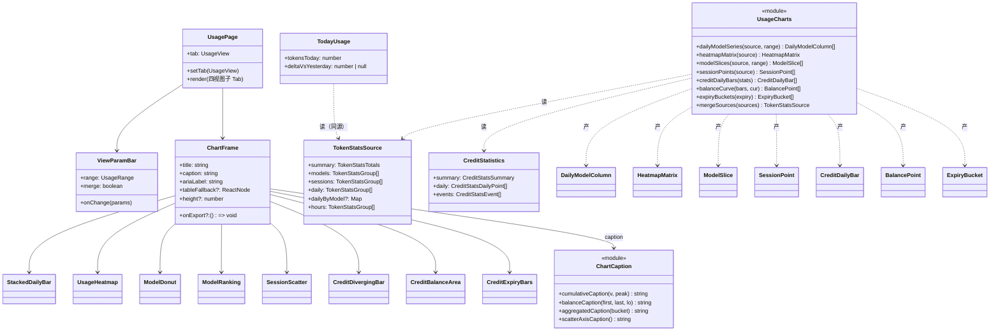
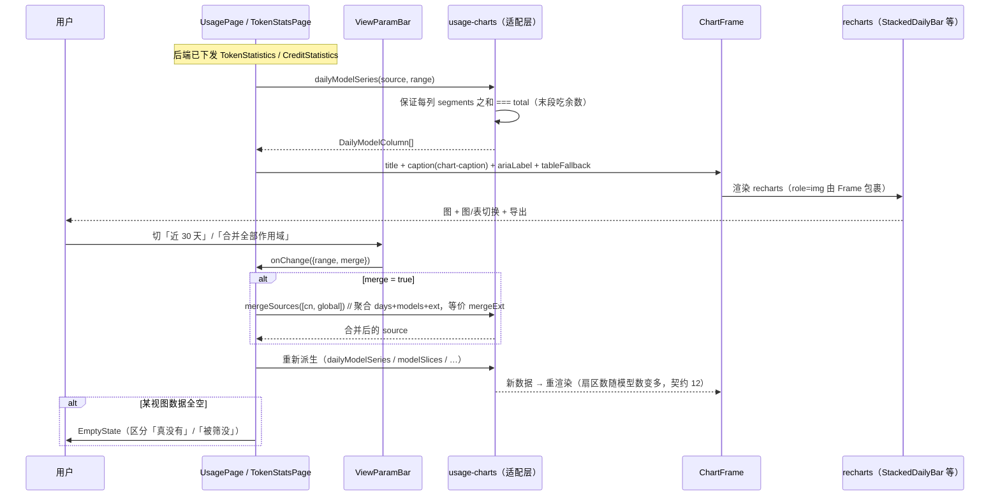
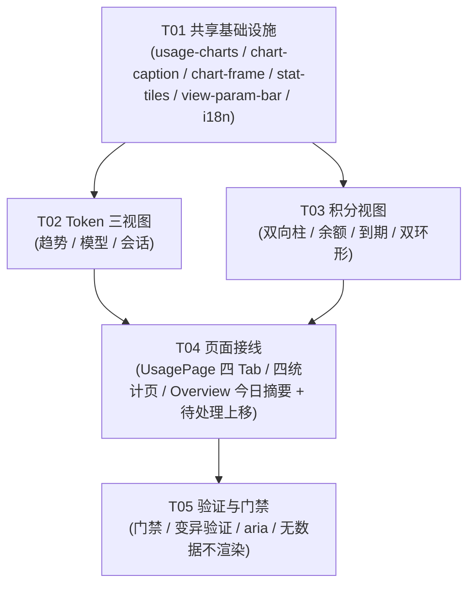

# P3 架构分解：用量图表「四视图」+ 概览「今日用量摘要」

> **状态**：设计（2026-10-06）。
> **上游**：`docs/redesign/PLAN.md` §3.9（用量 = 一个目的地 + 顶部子 Tab：趋势 / 模型 / 会话 / 积分）、§3.10（图表规范九条）、§3.4（四条列表通用规则）、§3.6（统一状态语言）、§3.11（无障碍）；`docs/redesign/COVERAGE-REPORT.md` §2.12（用量图表 12 条 ⚠️）+ §2.1（概览 3 条 ❌/⚠️）。
> **下游**：本文件「任务列表」直接交工程师执行（T01–T05）。
> **判据来源**：`docs/redesign/verify-behaviors.cjs` 的「用量工作台图表」段（逐条读**断言体**，见 §1.3）。
> **范围边界**：本期只做 **① 用量四视图按原型重做** + **② 概览「今日用量摘要」+ 待处理上移**。
> **明确排除**：请求代理（P12，PLAN 要求先 spike）、会话工作台状态派生（P8 后半）、程序位注册表（P0）、`ViewParamBar` 的**组件化抽取**（本期先收敛每页为一条，抽取留待后续）。

---

## 0. 一句话背景

`src/pages/UsagePage.tsx` 目前只做了 **IA 合并**（Token/积分合为子 Tab，**直接复用旧页面组件**），
`TokenStatsPage` / `CreditStatsPage` / `TraeTokenStatsPage` / `TraeCreditsPage` **未按原型四视图重做**：

- 视图参数散乱（同一页 4 组切换器，PLAN §3.9 要求**每页最多一条**）；
- 图表**张数 / 结构 / 图注口径**都不是原型的四视图（COVERAGE-REPORT §2.12，12 条 ⚠️）；
- 原型判据用的专属 class（`.cbar/.ccol/.cheat-row/.cdonut/.cspark/.cscatter/.cdiv`）**全仓 0 命中**，
  真实实现走 `recharts`。

> ⚠️ **原型是 HTML 静态演示**（内联 SVG / CSS 手绘），**真实应用是 React + 已有 recharts**
> （`src/components/ui/chart.tsx` 提供 `ChartContainer` / `ChartStyle` / `ChartTooltip`）。
> **不要照搬原型 DOM**（`.ccol` / `.cheat-row` …），要把**原型的行为契约**映射到 **recharts 组件 + 数据适配层**。

---

## 1. 实现方案

### 1.1 核心难点

| 难点 | 现状 | 处理 |
|:---|:---|:---|
| 四视图 vs 旧页面 | 现有页面是**旧实现**，张数/结构/图注均非原型四视图 | 新建**四视图组件**，页面改为「装配数据 → 渲染组件」，旧页内逻辑收敛 |
| 视图参数散乱 | 同页 4 组切换器（来源切片 / 范围 / 区域 / 合并） | 收敛为**一条** `ViewParamBar`（范围 + 合并）；区域由侧栏 `ScopeSwitch` 承担（`all` 是视图参数，保留） |
| **图不能撒谎** | 图注写「峰值 = 末值」等废话；余额曲线锚 0 成直线 | 契约落到**数据适配层**（§1.4），图注由生成器统一产出（§1.5） |
| **无数据不渲染** | 旧页面用空图 / 0 值占位 | 空数组 → **不渲染该图**（区块级空态用 `EmptyState`，§3.4 规则 1） |
| 无障碍 | recharts 默认不给 `role="img"` + 中文 aria-label | 统一经 `ChartFrame` 出口补 `role="img"` + `aria-label` + 数据点 `<title>` |
| 概览答不出「现在用了多少」 | `OverviewPage` 只有 3 个 tile（账号/待处理/客户端），**无今日用量** | 新增「今日用量摘要」块；**待处理上移到统计块之前**（COVERAGE §2.1 / §2.4 P1-6） |
| 白屏防线 | 展示字段喂对象会卸载整棵树（issue #2） | 所有进入图表 / 摘要的文本走 `displayText` 出口（§5） |

### 1.2 原型的四视图（**以原型 `viewUsage()` 为准**，不凭记忆）

`docs/redesign/demo-app.js` 的 `tabs = [["trend","趋势"],["models","模型"],["sessions","会话"],["credits","积分"]]`：

| 视图 | 4 个统计 tile | 图表（原型原语 → 真实 recharts） |
|:---|:---|:---|
| **趋势** `trend` | 区间总 Token / 日均 / 峰值 / 活跃账号 | ① 每日按模型**堆叠柱**（`stackedBar`）② 累计消耗**面积曲线**（`areaChart`）③ 模型占比**环形**（`donut`）④ 7×24 **热力图**（`heatmap`） |
| **模型** `models` | 模型数 / 头部模型 / 模型总 Token / 单模型均值 | ① 模型占比**环形** ② 模型用量**排行**（横向条 `hbarList` + 每行**迷你趋势线** `sparkline`） |
| **会话** `sessions` | 会话数 / 会话总 Token / 单会话均值 / 最高消耗 | ① 会话 Token **排行** ② 消息数 × Token **散点气泡**（`scatterChart`）③ 会话明细**表** |
| **积分** `credits` | 可用积分合计 / 区间入账 / 区间消耗 / 即将过期 | ① 每日积分收支**双向柱**（`divergingBars`，上=入账/下=消耗）② 积分余额**面积曲线**（`anchorZero:false`）③ 积分到期分布**柱**（30 天完整轴）④ 账号 Token 占比**环形** ⑤ 网关状态码分布**环形** ⑥ 积分流水表 |

> **合并态（`merge`）**：`usageFor()` 返回 `{ days, models, sessions, credits, ext: mergeExt(ids) }` ——
> **图表数据必须一起聚合**（`mergeExt` 聚合 `modelDays / hourly / creditDaily / balance / expiry / accountShare / statusCodes / scatter / curTotal`）。
> 否则「切了开关只有 days 变」是谎报（断言 `mergeExt` 见 §1.3）。

### 1.3 必须对齐的原型契约（逐条读断言体）

来自 `verify-behaviors.cjs`「用量工作台图表」段：

1. **趋势 ≥4 张图，每张 `role="img"` + 非空 aria-label**（`imgs.length >= 4`，`noLabel.length === 0`）。
2. **堆叠柱列数 = 天数，每列分段数 = 模型数**（`USAGE[scope].ext.modelDays.length`）。
3. **堆叠柱各分段高度之和 ≈ 当日总量**（末列分段和 vs `days[last].value / maxDay * 100`，误差 ≤ 1.5）。
   → **各分段之和必须精确等于当日总量**（最后一段吃舍入余数，PLAN §3.10 第 2 条）。
4. **热力图 7 行 × 24 列**（`.cheat-row` 7 行，每行 24 格）。
5. **环形扇区数 = 模型数**（`.cdonut circle` 数 = `modelDays.length`）。
6. **累计曲线图注不写「峰值 = 末值」**（`figcaption` 含「累计」，PLAN §3.10 第 5 条）。
7. **模型页：环形 + 每行一条迷你趋势线**（`.hbar` 数 = `.cspark` 数 = 模型数）。
8. **会话页：气泡数 = 会话数，排行条数 = 会话数**。
9. **会话气泡不溢出绘图区**（半径留边）。
10. **积分页：双向柱 + 余额曲线 + 到期时间轴（30 根）+ 两个环形**。
11. **积分余额曲线基线不锚 0**（`figcaption` 含「非 0」，PLAN §3.10 第 3 条）。
12. **合并态模型扇区数真的变多**（`mergeExt` 聚合了图表数据）。

### 1.4 数据适配层：把「真实后端数据」映射到四视图（**契约落在这里，不落渲染层**）

真实数据源（已核实，**逐字段确认归属**）：

- `TokenStatsSource`（`src/lib/types.ts:567`）：
  `summary` / `models` / `projects` / `sessions` / `daily` / `dailyByModel?` / `hours` / `filesScanned` / `parseErrors` / `coverageStartAt` / `coverageEndAt`。
- **热力图数据来自 `hours`**：后端 `crates/buddy-switch-core/src/modules/token_stats.rs:215` 的 key 形如
  `format!("{}-{}", local.weekday().num_days_from_monday(), local.hour())` ⇒ **`{weekday}-{hour}`**，
  weekday 0=周一 … 6=周日，hour 0–23。**这正是 7×24 矩阵**，无需后端新增字段。
- `CreditStatistics`（`types.ts:551`）：`summary` / `daily: CreditStatsDailyPoint[]`（`date` + `usage` + `models[]`）/ `accounts` / `events` / `officialUsage?`。
- `CreditExpiry`（`types.ts:401`）：`resources[].expireAt` ⇒ 到期分布。

> ⚠️ **字段张冠李戴防线**（本项目已出过三次：`lastUsedAt` 属 `TraeApiKeyRecord` / camelCase vs snake_case / `replicaCount` 后端无该字段）：
> - 会话散点的 x 轴：原型用 `s.msgs`（**消息数**，原型演示字段）；真实 `TokenStatsGroup` **没有 `msgs`**，
>   只有 `records`（**调用/记录次数**）。⇒ **x 轴语义是「记录数」，图注必须如实写「记录数 × Token」，不许写成「消息数」**。
> - 目录名从 `Session.cwd` **末段推导**（复用 `switch-account-dialog.tsx` 的 `sessionFolderLabel`），**不是**独立字段。
> - 余额曲线**不是**后端字段：后端无逐日余额快照，必须**以 `summary.currentRemaining` 为终值、按净额回推**（同原型 `mergeExt`），并在图注注明「回推」。

**适配层职责**（纯函数，可单测）——见 `src/lib/usage-charts.ts`：

```
dailyModelSeries(source, range) -> { day, label, total, segments: {name, value}[] }[]
  ★ 保证每列 segments 之和 === total（末段吃余数）——契约 3

heatmapMatrix(source) -> { rows: 7, cols: 24, cells: number[][] }
  ★ 从 hours 的 "{weekday}-{hour}" key 还原；缺失格补 0（不丢点，PLAN §3.10 第 7 条）

modelSlices(source, range) -> { name, value, spark: number[] }[]
  ★ value = models[].total；spark = dailyByModel[name] 的逐日序列 —— 契约 7

sessionPoints(source) -> { id, title, x /* records，非 msgs */, y /* total */, value }[]
  ★ 契约 8/9：气泡半径按 y 归一，留边

creditDailyBars(stats) -> { label, inAmt, outAmt }[]
  ★ outAmt = daily[].usage；inAmt = events 里 kind==="checkin" 按 date 汇总（入账无逐日字段，须聚合）

balanceCurve(bars, currentRemaining) -> { label, value, baseline }[]
  ★ 终值 = summary.currentRemaining，逐日回推；baseline = min - (max-min)*0.35（同原型），非 0

expiryBuckets(expiry) -> { day: 1..30, value }[]
  ★ 完整 30 天轴（无到期的天补 0，不跳格）—— 契约 10
```

### 1.5 图注生成器（统一出口，杜绝「写废话」）

`src/lib/chart-caption.ts` 统一产出：

| 图 | 图注口径（PLAN §3.10 第 3/5/7 条） |
|:---|:---|
| 累计消耗曲线 | `区间累计 {v}（单日峰值 {peak}）` —— **不写「峰值 = 末值」** |
| 积分余额曲线 | `{first} → {last}（基线 {lo}，非 0）` —— **必须写明基线非 0** |
| 会话散点 | `横轴 = 记录数`（**不写「消息数」**） |

### 1.6 「无数据不渲染」（§3.4 规则 1 在图表层的落地）

- 某图的数据数组为**空** ⇒ **整块图不渲染**（不留空图框、不画 0 基线假图）。
- 一个视图的**全部**图都空 ⇒ 该视图给**区块级 `EmptyState`**（icon + title + description + 出口）。
- **区分两种空**：`真的没有数据`（「还没有产生用量」+ 出口）vs `被视图参数筛没了`（「近 7 天没有数据」+ 「看近 30 天」）—— 混用会让人以为数据丢了（§3.6）。

### 1.7 概览「今日用量摘要」+ 待处理上移

- 新增「今日用量摘要」块：读 **Token** 数据源（`summary.total` 的**今日**口径 / `daily` 末值），
  **与用量页同源**（§3.10 第 1 条：同一件事的数字只有一个来源）—— **禁止**概览自己写死数字。
- 「对比昨日」若做，必须**真算**（`今日 vs 昨日`），**不许硬编码 `+12%`**（断言 `P0-2` 明确禁止 `+12%`）。
- **待处理项上移到统计块之前**（原型 `P1-6`：`indexOf("待处理") < indexOf("账号总数")`）。

---

## 2. 文件列表

### 新建

| 相对路径 | 作用 |
|:---|:---|
| `src/lib/usage-charts.ts` | **数据适配层**（纯函数）：四视图序列派生 + 契约保证（堆叠和=总量、7×24、扇区=模型数、非 0 基线、30 天轴） |
| `src/lib/chart-caption.ts` | **图注生成器**：累计 / 余额非 0 / 散点轴语义 / 单向柱说明 |
| `src/components/usage/chart-frame.tsx` | 统一图表外壳：标题 + 图注 + `role="img"` + 中文 `aria-label` + 图/表切换 + 导出（PLAN §3.10 第 4/8/9 条） |
| `src/components/usage/stat-tiles.tsx` | 四视图的 4 个统计 tile（复用 `OverviewPage` 的 tile 形态，收敛到一处） |
| `src/components/usage/view-param-bar.tsx` | **每页唯一**的视图参数条（范围 7/14/30 + 合并二态），§3.9 |
| `src/components/usage/stacked-daily-bar.tsx` | 趋势·每日按模型堆叠柱（recharts `BarChart` + 多 `Bar` stackId） |
| `src/components/usage/usage-heatmap.tsx` | 趋势·7×24 热力图（由 `hours` 派生） |
| `src/components/usage/cumulative-area.tsx` | 趋势·累计消耗面积曲线（`AreaChart`） |
| `src/components/usage/model-donut.tsx` | 趋势/模型·模型占比环形（`PieChart` innerRadius） |
| `src/components/usage/model-ranking.tsx` | 模型·排行条 + 每行迷你趋势线（`sparkline`） |
| `src/components/usage/session-scatter.tsx` | 会话·记录数 × Token 散点气泡（`ScatterChart`） |
| `src/components/usage/session-ranking.tsx` | 会话·Token 排行 + 明细表 |
| `src/components/usage/credit-diverging-bar.tsx` | 积分·每日收支双向柱（入账上 / 消耗下，零线居中） |
| `src/components/usage/credit-balance-area.tsx` | 积分·余额曲线（**非 0 基线**） |
| `src/components/usage/credit-expiry-bars.tsx` | 积分·到期分布（完整 30 天轴） |
| `src/components/usage/credit-donuts.tsx` | 积分·账号占比环形 + 状态码环形（数据不足时不渲染，见 §6） |
| `src/components/overview/today-usage.tsx` | 概览·今日用量摘要块 |
| `docs/redesign/P3-ARCH.md` | 本文档 |

### 修改

| 相对路径 | 改动 |
|:---|:---|
| `src/pages/UsagePage.tsx` | 子 Tab 由 **2**（tokens/credits）改为 **4**（趋势/模型/会话/积分）；平台差异以**数据**表达（无积分能力的平台不渲染积分 Tab） |
| `src/pages/TokenStatsPage.tsx` | 改为「装配 `usage-charts` 数据 → 渲染四视图组件」；视图参数收敛为一条 `ViewParamBar`；**删除**页内多余切换器 |
| `src/pages/CreditStatsPage.tsx` | 同上（积分视图） |
| `src/pages/TraeTokenStatsPage.tsx` / `src/pages/TraeCreditsPage.tsx` | **不改**（见下方 ⚠️ 说明 —— Trae 数据源不同，不适用本设计的四视图组件） |
| `src/pages/OverviewPage.tsx` | 挂载「今日用量摘要」；**待处理块上移到统计块之前** |

> ⚠️ **Trae 两页为何不改**（T05 观察 O2 · lead 裁决 · 2026-10-07）：
> Trae 的用量数据源是 **`TraeTokenStatistics`**（含 `accounts` / `statuses`），与 WB 的 `TokenStatsSource`（`models` / `projects` / `sessions` / `daily` / `hours`）**形状不兼容**。
> **⇒ 强行复用本设计的四视图组件会违反「数据不支持就不画」**（§3.4 规则 1 + §3.10「图不能撒谎」）。
> **⇒ 裁决：Trae 两页保持既有实现**（它有自己正确的状态语言与视图），**不强行装配**。
> ⚠️ 注意：决策 #2 / #3 / #4（账号 Token 占比环形 / 网关状态码分布 / 「活跃账号」tile **不渲染**）**只针对 WB 的 `TokenStatsSource`** ——
> Trae 侧这些数据**确实存在**（`TraeTokenStatistics.accounts` / `statuses`），故**不受那三条约束**。
| `src/locales/domains/*.zh.ts` / `.en.ts` | 四视图标题 / 图注 / 空态 / 轴语义键（zh + en **同步**） |

> ⚠️ **最小可提交单元**：T01（适配层 + 外壳 + 词条）必须先落地；T02/T03（Token 三视图 / 积分视图）可并行但都依赖 T01；T04（页面接线）依赖 T02+T03。

---

## 3. 数据结构与接口

### 3.1 适配层类型（`src/lib/usage-charts.ts`）

```ts
export type UsageView = "trend" | "models" | "sessions" | "credits";
export type UsageRange = 7 | 14 | 30;

/** 趋势·堆叠柱：一天一列，segments 之和 === total（契约 3）。 */
export interface DailyModelColumn {
  day: string;         // ISO 日期
  label: string;       // 轴短标签
  total: number;
  segments: { name: string; value: number }[];  // 末段吃舍入余数
}

/** 趋势·热力图：7 行（周一..周日）× 24 列。 */
export interface HeatmapMatrix {
  rows: 7;
  cols: 24;
  cells: number[][];   // [weekday][hour]，缺失补 0
  max: number;         // 用于相对强度着色（非绝对量，见 aria-label）
}

/** 模型：占比 + 迷你趋势线。 */
export interface ModelSlice {
  name: string;
  value: number;
  spark: number[];     // 逐日序列（dailyByModel）
}

/** 会话：散点。x 是「记录数」不是「消息数」（§1.4）。 */
export interface SessionPoint {
  id: string;
  title: string;
  x: number;           // records
  y: number;           // total tokens
  value: number;
}

/** 积分：逐日收支（入账须由 checkin 事件聚合）。 */
export interface CreditDailyBar {
  label: string;
  inAmt: number;
  outAmt: number;
}

/** 积分：余额曲线点（value 回推；baseline 非 0）。 */
export interface BalancePoint {
  label: string;
  value: number;
  baseline: number;
}

/** 积分：到期分布（完整 30 天）。 */
export interface ExpiryBucket {
  day: number;         // 1..30
  value: number;
}
```

**纯函数签名**：

```ts
export function dailyModelSeries(source: TokenStatsSource, range: UsageRange): DailyModelColumn[];
export function heatmapMatrix(source: TokenStatsSource): HeatmapMatrix;
export function modelSlices(source: TokenStatsSource, range: UsageRange): ModelSlice[];
export function sessionPoints(source: TokenStatsSource): SessionPoint[];
export function creditDailyBars(stats: CreditStatistics): CreditDailyBar[];
export function balanceCurve(bars: CreditDailyBar[], currentRemaining: number): BalancePoint[];
export function expiryBuckets(expiry: CreditExpiry): ExpiryBucket[];
/** 合并态：对多个 source 先求和再走上面的派生（等价原型 mergeExt）。 */
export function mergeSources(sources: TokenStatsSource[]): TokenStatsSource;
```

### 3.2 组件接口（示例：`ChartFrame`）

```ts
import type { ReactNode } from "react";

export interface ChartFrameProps {
  /** 已 i18n 的标题 */
  title: string;
  /** 图注：必须由 `chart-caption.ts` 产出（不许调用方手写废话） */
  caption: string;
  /** 中文 aria-label（看不了图的人拿到同样的信息） */
  ariaLabel: string;
  /** 图区（recharts 组件） */
  children: ReactNode;
  /** 表视图兜底（§3.10 第 8 条：图/表可互切，看到同一份数据） */
  tableFallback?: ReactNode;
  /** 导出当前图为 PNG/SVG（§3.10 第 9 条） */
  onExport?: () => void;
  /** 高度（px） */
  height?: number;
}
```

### 3.3 类图



### 3.4 调用流程（关键操作）



---

## 4. 任务列表（有序 · 含依赖 · 按实现顺序）

> **硬性顺序**：T01 → {T02, T03} → T04 → T05。
> **P0 = 必须；P1 = 重要；P2 = 可裁剪。**

### T01 · 共享基础设施（适配层 + 图表外壳 + 图注生成器 + 词条）｜ P0

- **源文件**
  - 新建 `src/lib/usage-charts.ts`（四视图序列派生 + **契约保证**：堆叠和=总量 / 7×24 / 扇区=模型数 / 非 0 基线 / 30 天轴 / `mergeSources`）
  - 新建 `src/lib/chart-caption.ts`（累计 / 余额非 0 / 散点轴语义 / 单向柱说明）
  - 新建 `src/components/usage/chart-frame.tsx`（`role="img"` + aria-label + 图/表切换 + 导出）
  - 新建 `src/components/usage/stat-tiles.tsx`、`src/components/usage/view-param-bar.tsx`
  - 修改 `src/locales/domains/*.zh.ts` / `.en.ts`（四视图标题 / 图注 / 轴语义 / 空态键，zh + en 同步）
- **依赖**：无
- **要点**：适配层是**纯函数**（可单测、可在门禁里 `loadTs` 运行时校验）；契约（和=总量、7×24、扇区数）在**适配层**保证，**不依赖渲染层**；`hours` 的 key 是 `"{weekday}-{hour}"`（`token_stats.rs:215`），**不要**假设是 24 桶。

### T02 · Token 三视图组件（趋势 / 模型 / 会话）｜ P0

- **源文件**
  - 新建 `src/components/usage/stacked-daily-bar.tsx`、`usage-heatmap.tsx`、`cumulative-area.tsx`、`model-donut.tsx`、`model-ranking.tsx`、`session-scatter.tsx`、`session-ranking.tsx`
  - 修改 `src/locales/domains/*.zh.ts` / `.en.ts`
- **依赖**：T01
- **要点**：趋势 = 4 图（堆叠柱 / 累计曲线 / 环形 / 热力图）+ 4 tile（契约 1）；模型 = 环形 + 每行迷你趋势线（契约 7）；会话 = 散点 + 排行（契约 8/9），**x 轴写「记录数」**；空数组**不渲染**该图；`ChartFrame` 统一补 aria。

### T03 · 积分视图组件（双向柱 / 余额 / 到期 / 双环形）｜ P0

- **源文件**
  - 新建 `src/components/usage/credit-diverging-bar.tsx`、`credit-balance-area.tsx`、`credit-expiry-bars.tsx`、`credit-donuts.tsx`
  - 修改 `src/locales/domains/*.zh.ts` / `.en.ts`
- **依赖**：T01
- **要点**：双向柱（入账上 / 消耗下，零线居中）+ 余额曲线（**非 0 基线**，图注写明）+ 到期 **30 天完整轴**；入账由 `checkin` 事件按日聚合（**无逐日入账字段**）；余额是**回推**值（图注注明）；**账号占比 / 状态码环形按 §6 #2 / #3 不渲染**（后端无数据源）。

### T04 · 页面接线（四 Tab + 收敛视图参数 + 概览今日摘要 + 待处理上移）｜ P0

- **源文件**
  - 修改 `src/pages/UsagePage.tsx`（子 Tab 2 → 4；平台差异用数据表达）
  - 修改 `src/pages/TokenStatsPage.tsx` / `CreditStatsPage.tsx`（装配 `usage-charts` 数据 → 渲染四视图；视图参数收敛为一条 `ViewParamBar`；删除多余切换器）
  - ⚠️ **Trae 两页（`TraeTokenStatsPage` / `TraeCreditsPage`）不改** —— 见 §2 文件列表的说明（**数据源不同，不适用本设计的四视图组件**）
  - 修改 `src/pages/OverviewPage.tsx`（挂载 `today-usage.tsx`；**待处理块上移到统计块之前**）
  - 新建 `src/components/overview/today-usage.tsx`
- **依赖**：T02、T03
- **要点**：概览的「今日用量」**与用量页同源**（禁止写死数字）；「对比昨日」**真算**（禁止 `+12%`）；待处理顺序对齐原型（`待处理` 在 `账号总数` 之前）；所有展示文本过 `displayText`。

### T05 · 验证与门禁 ｜ P0

- **源文件**：无源码改动（跑门禁 + 变异验证 + 手工回归）
- **依赖**：T04
- **要点**：
  - 门禁：`check:api` / `check:store-selectors` / `check:scope` / `tsc` 全绿。
  - **变异验证**（把缺陷塞回去 ⇒ 断言必须变红）：
    ① 让 `dailyModelSeries` 的末段**不吃余数** ⇒ 断言「分段和 ≈ 当日总量」变红；
    ② 让 `heatmapMatrix` 只出 24 桶（丢掉 weekday 维）⇒ 断言「7×24」变红；
    ③ 让余额曲线 `baseline = 0` ⇒ 断言「图注含『非 0』」变红；
    ④ 让合并态**不聚合** `ext`（只换 days）⇒ 断言「合并后扇区数变多」变红；
    ⑤ 给某图喂空数组却仍渲染空框 ⇒ 断言「无数据不渲染」变红。
  - **无障碍**：每张图 `role="img"` + 非空中文 aria-label；数据点 `<title>`。

---

## 5. 共享知识（跨文件约定）

- **图与表同源**（§3.10 第 1 条）：同一件事的数字只有一个来源；派生序列**全部由已有数据推导**，不在渲染层写死。
- **契约落在适配层**（`usage-charts.ts`）：堆叠和=总量、7×24、扇区=模型数、非 0 基线、30 天轴 —— **纯函数保证，可单测**。
- **图注只由 `chart-caption.ts` 产出**：禁止调用方手写图注（防「峰值 = 末值」这类废话回流）。
- **图不能撒谎**：① 不丢点（超 ~120 点按桶聚合并注明）；② 余额类序列基线不锚 0 并写明基线；③ 轴语义如实（散点 x 是**记录数**不是消息数）。
- **无数据不渲染**（§3.4 规则 1）：空数组 → 不渲染该图；整视图空 → 区块级 `EmptyState`；**区分「真没有」与「被筛没」**（§3.6）。
- **状态语言**（§3.6）：区块首次加载 → `<Skeleton>`；按钮操作中 → `<Loader2>`（**不算加载态**）；空态 → `<EmptyState>`（四要素含出口）。
- **无障碍**（§3.11）：每张图 `role="img"` + 中文 `aria-label` + 数据点 `<title>`；`ChartFrame` 统一兜底。
- **`displayText` 白屏防线**：所有进入图表 / tile / 摘要的展示字段过 `@/lib/display-text`（对象会卸载整棵树 ⇒ 白屏，issue #2）。
- **视图参数收敛**（§3.9）：每页**最多一条** `ViewParamBar`；区域由侧栏 `ScopeSwitch` 承担，`all`（合并）是**视图参数**保留。
- **i18n**：zh + en **同时**加（`src/locales/domains/`）；只保留真正被引用的键。
- **组件文件头注释说明「为什么这么设计」**；不保留死代码；最小可提交单元查跨文件依赖。

---

## 6. 决策记录（原「待明确事项」· 已由 lead 拍板 · 2026-10-07）

> **贯穿原则**：**数据不支持就不画** —— **不渲染胜过画一张会撒谎的图**
> （§3.4 规则 1「无数据不渲染」+ §3.10「图不能撒谎」）。

### ✅ #1 积分「入账」数据源 → **先核实；不可靠则只渲染消耗侧**

- **决策**：**先核实** `events` 里 `kind==="checkin"` 的**完整性**（是否覆盖全部入账来源、是否被保留期裁剪）。
  - **可靠** ⇒ 按设计做**双向柱**
  - **不可靠** ⇒ **只渲染消耗侧（单向柱）** + 图注说明「入账明细不可得」
- **理由**：**双向柱入账侧失真 = 图撒谎**（§3.10）。**宁可少画一半，不要画错一半。**
- **对正文的影响**：T03 要点里「双向柱」改为「**双向柱（条件）** —— 见 #1」。

### ✅ #2 账号 Token 占比环形 → **(C) 本期不渲染**

- **决策**：**不渲染**该环形。
- **理由**：真实 `TokenStatsSource` **没有按账号的 Token 分组**（只有 models / projects / sessions / daily / hours）⇒ **§3.4 规则 1「无数据不渲染」**。
- **为什么不选 (A)**：后端新增字段是**新功能**，超出「与 demo 对齐」的范围 —— 那是**补课，不是扩功能**。
- **对正文的影响**：T03 要点里「双环形」的**账号占比环删除**（保留另一个）。

### ✅ #3 网关状态码分布环形 → **(B) 本期不渲染**

- **决策**：**不渲染**。
- **理由**：用量页**不持有**网关状态码数据源 ⇒ 同上。
- **对正文的影响**：T03 要点里该环形删除。

### ✅ #4 「活跃账号」tile → **随 #2 一并处理（不渲染）**

- **决策**：**不渲染**（口径依赖 #2 的数据源，而它不存在）。
- **对正文的影响**：T04 要点里该 tile 移除。

### ✅ #5 Trae 数据源 → **缺则不渲染对应 Tab**

- **决策**：**按 §1.6「无数据不渲染」** —— Trae 侧缺哪个视图的数据源就**不渲染哪个 Tab**（**不画空壳**）。
- **理由**：**空 Tab 会让用户以为「数据是 0」，而实际是「没有这个数据」** —— 两者含义完全不同。

### ✅ #6 子 Tab 层级 → **按原型（一级四视图）**

- **决策**：**一级四视图**（趋势 / 模型 / 会话 / 积分）。
- **理由**：原型是这么定的；**保留 tokens / credits 两级会与原型不一致**。

---

## 7. 任务依赖图


