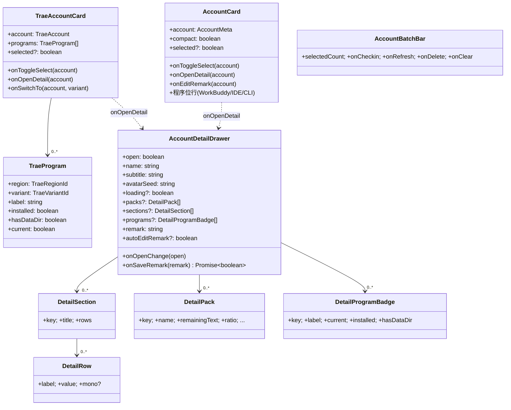
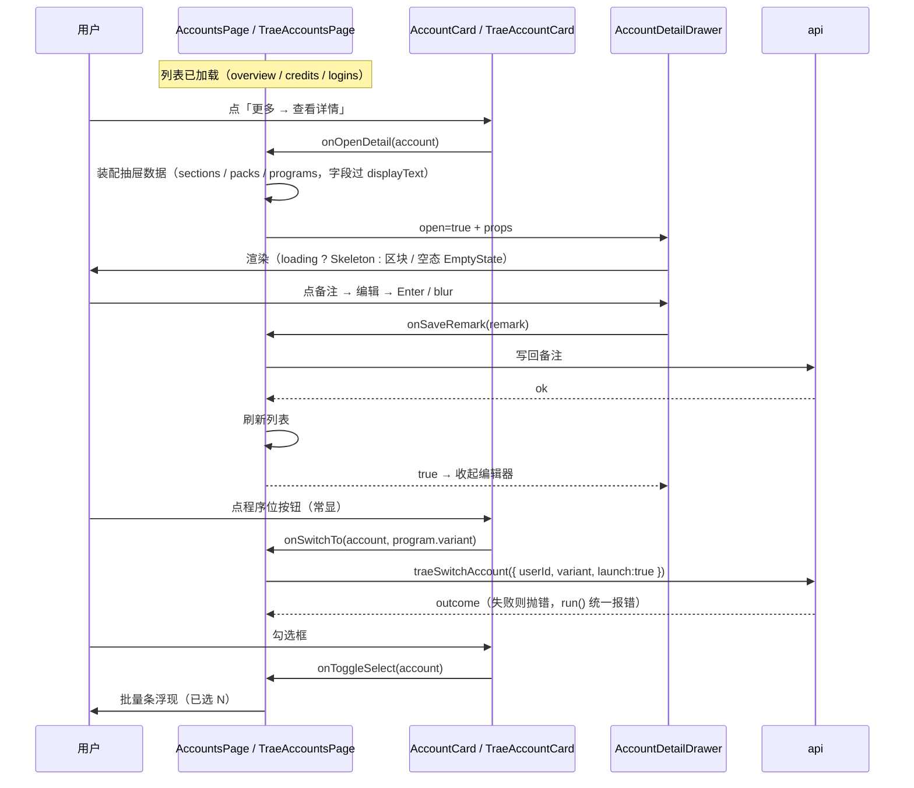
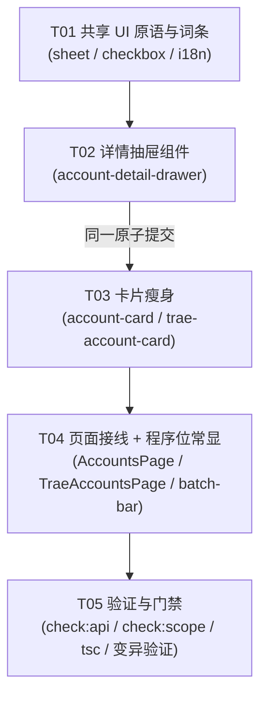

# P4 架构分解：账号详情抽屉 + 卡片瘦身 + 程序位常显

> **状态**：设计（2026-10-03）。
> **上游**：`docs/redesign/PLAN.md` §3.3（账号卡片瘦身 + 程序位不再被区域隐藏）、§3.5（抽屉替代模态）、§3.6（统一状态语言）、§5 的 P4 行；`VOCABULARY.md`（region / program）；`DECISIONS.md`（D5 程序位默认策略、D9 虚拟滚动不进）。
> **下游**：本文件的「任务列表」直接交给工程师执行（团队任务 #2 / #3）。
> **范围边界**：本期只做 **详情抽屉 + 卡片瘦身 + 程序位常显**（含最小勾选与最小批量条，见 §6 待确认 #4）。
> **明确排除**：搜索 / 排序 / 分组 / 卡片·表格切换 / 完整工具栏（§3.4 其余能力）、虚拟滚动（D9 已定不进本期）——建议单独分解。

---

## 1. 实现方案

### 1.1 核心难点

| 难点 | 现状 | 处理 |
|:---|:---|:---|
| 卡片可点区过多 | 两张卡各约 14 个可点区（含 compact / 非 compact 两套渲染的重复计数） | 只移出 **2 类**：备注编辑（`beginRemarkEdit`）、资源包展开（`setResourcesOpen`）；其余是「允许的 4 个」（勾选框 / 程序位按钮组 / 主按钮 / 更多菜单）与重复计数 |
| 详情无处可放 | 详情内联在卡片 + 两个 `Dialog`（`resourcesOpen` / `detailOpen`） | 统一移入**右侧抽屉**（`Sheet`，Radix Dialog） |
| ★ 卡片瘦身必须原子 | 若先把详情移走、抽屉还没建，用户**没地方看** | 抽屉与卡片瘦身**同一原子提交**（T02 + T03） |
| ★ Trae 程序位被区域隐藏 | `programsFor` 只取**当前区域**的 `programs`，用户「找不到 TraeCode 按钮」 | 改成跨**全部区域**取（§1.4），并解决随之而来的类型坑与切换语义 |
| 展示字段脏值白屏 | 对象当 React 子节点渲染会卸载整棵树（issue #2） | 抽屉是新渲染面，**所有字段走同一个 `displayText` 出口**（§5 共享知识） |

### 1.2 抽屉组件设计

**为什么用抽屉而不是模态**：§3.5 —— 列表上下文保留（用户在账号列表里逐个查看详情，不该被模态打断视线）。

**为什么用 shadcn `Sheet`**：`AGENTS.md`「UI Component Policy」要求优先复用 shadcn/Radix；本仓已有 `@radix-ui/react-dialog`（`package.json`），`Sheet` 正是它的侧滑封装。因此**新增 `src/components/ui/sheet.tsx`**（与 `ui/dialog.tsx` 同风格：`data-slot`、`cn()`、`tw-animate-css`），而不是手写抽屉。

**结构（共享壳，平台内容以「数据」注入）**：

```
┌ AccountDetailDrawer（side=right）──────────────┐
│ 头部：头像(avatarTone) + name + subtitle        │
│        （name/subtitle 均过 displayText 出口）   │
│ ───────────────────────────────────────────── │
│ 备注区（就地编辑，自包含）                       │
│ 积分/资源包区（packs，可选）                     │
│ 信息区块（sections，按序）                       │
│ 只读程序位徽标（programs，可选；**非**切换控件）  │
│ ───────────────────────────────────────────── │
│ 空态：EmptyState（icon+title+description+出口）  │
│ 加载态：Skeleton（区块级；**不是**按钮态）        │
└───────────────────────────────────────────────┘
```

**关键约束**：
- 抽屉是**纯展示 + 备注就地编辑**；**不放「看起来能切」的第二个控件**（例如区域选择器、程序位切换按钮）。程序位在抽屉里只以**只读徽标**呈现。
- 平台差异（WB 有资源包、Trae 有账号信息行）**由调用页面装配成 `sections` / `packs` 传入**，抽屉本身不做平台判断 —— 与 §5 的「差异用数据表达，不各写一份、也不强抹平」一致。
- **备注编辑器迁入抽屉**后，原卡片里的 `keepRemarkFocusRef`（绕开 Radix 菜单关闭后焦点归还的 hack）**可整段删除**：编辑器不再位于菜单背后，那个竞态在结构上消失。

### 1.3 卡片瘦身范围

**移出（进抽屉）**：
- **备注编辑**：`account-card.tsx` 的 `beginRemarkEdit` / `commitRemark` / `cancelRemarkEdit` 与就地编辑 UI（574 / 589 两处按钮 + `remarkEditing` 输入框）；`trae-account-card.tsx` 同款（604–652）。
- **资源包展开**：`account-card.tsx` 的 `setResourcesOpen(true)` 按钮（666）与 `resourcesOpen` `Dialog`（717–758）；`trae-account-card.tsx` 的 `detailOpen` `Dialog`（842–881）与「查看全部」按钮（758–768）。

**保留（§3.3 的「允许的 4 个」）**：
- **勾选框**（本期新增，1 区）—— 见 §6 待确认 #4。
- **程序位按钮组**（1 行）—— 收敛到**单处渲染**（现 WB 卡在 compact 头部与宽松页脚各渲染一套，属重复计数）。
- **主按钮**——本设计把「主按钮」收敛为程序位行里**平台主程序位**的主样式按钮（见 §6 待确认 #2）。
- **更多菜单**——原样保留位置；新增一项 **「查看详情」**（抽屉的入口，不新增可点区）。

**结果**：每张卡的常规可点区 = 勾选框 / 程序位行 / 更多菜单 = **3**（≤4，满足 §6 验收度量「≥10 → ≤4」）。

**未检测到的程序位（§3.3）**：置灰 + tooltip 说明原因；**点击引导到设置**（对应子项）。WB 现状已常显三程序位（WorkBuddy / IDE / CLI），只需补「未检测到 → 引导设置」；Trae 现状**按区域过滤**，需改为常显（§1.4）。

> ⚠️ **保留的例外**：`account-card.tsx:616` 的「OAuth 扫码添加」是 `credit.reason === ENCRYPTED_CREDENTIAL_REASON` 时的**错误态 CTA**（§3.6 权限/错误态的行内出口），不是常规可点区，随错误态一起保留。

### 1.4 ★ 程序位常显的解法（含类型坑与切换语义）

**现状**（`TraeAccountsPage.tsx:663`）：

```ts
function programsFor(account: TraeAccount): TraeProgram[] {
  const entry = variantStatuses.find((item) => item.variant === variant); // ← 只取当前区域
  return (entry?.programs ?? []).map(...);
}
```

注释解释过**为什么**按区域取：「区域决定账号体系（读哪本库），程序位决定客户端」。改成常显要跨区域取，但类型层面有坑：

| 类型 | 取值数 | 含义 |
|:---|:---|:---|
| `TraeProgramId` | 2（`trae_work` / `trae_code`） | 程序位（**不含区域**） |
| `TraeRegionId` | 2（`cn` / `global`） | 区域 |
| `TraeVariantId` | 4（区域 × 程序位：`trae_work` / `trae_cn` / `global` / `global_trae_code`） | **切换目标**（区域限定） |

`TraeProgramStatus.program` 是 **`TraeProgramId`（不含区域）** ⇒ 跨区域 `flatMap` 后按 `program` 去重，会把 `(cn, trae_work)` 与 `(global, trae_work)` 合并成一条，**丢掉「该写哪个客户端」**。

**解法（两步）**：

1. **映射结果带上来源区域**：`TraeProgram` 新增 `region: TraeRegionId`（来源区域）；**保留** `variant: TraeVariantId`（切换目标，本来就是区域限定的 `TraeProgramStatus.variant`）。
2. **不做 `program` 去重**：遍历**全部** `variantStatuses`，每个 `(region, program)` 组合天然唯一（最多 4 条）。若确需去重，只能按 **`variant`**（区域限定、唯一），**绝不能按 `program`**。

**切换语义**：`onSwitchTo(account, program.variant)` 已经把**区域限定的 `variant`** 作为切换目标传给 `api.traeSwitchAccount` —— 即「切换时用来源区域的客户端」在机制上已经满足。真正待产品拍板的是**跨区域按钮该不该切**（§6 待确认 #1）：
- 账户库按区域分家，列表里展示的账号属于**当前作用域**的库；
- 若跨区域程序位直接切换，可能与该账号所属库不符，被后端切换 / 保存守卫拒绝。

**显示层消歧（必须做）**：跨区域后会出现两个同名 `label`（如 `TraeWork` 的 cn 与 global 两条）。**不得渲染两枚无法区分的同名按钮** —— 用 `region` 给按钮加区域标识（tooltip 或小区域标记），或按区域分组渲染。

**只读徽标**：抽屉里的 `programs` 复用同一份 `region + variant` 数据，以只读徽标呈现（`current` / `installed` / `hasDataDir`），**不提供切换**。

---

## 2. 文件列表

### 新建

| 相对路径 | 作用 |
|:---|:---|
| `src/components/ui/sheet.tsx` | shadcn `Sheet`（基于 `@radix-ui/react-dialog`），右侧抽屉原语；与 `ui/dialog.tsx` 同风格 |
| `src/components/ui/checkbox.tsx` | shadcn `Checkbox`（基于 `@radix-ui/react-checkbox`）；本仓 `ui/` 尚无，卡片勾选框需要 |
| `src/components/account-detail-drawer.tsx` | 共享详情抽屉（壳 + 备注编辑器 + 区块/资源包/只读程序位 + Skeleton/EmptyState）；导出 `DetailRow` / `DetailSection` / `DetailPack` / `DetailProgramBadge` 类型 |
| `src/components/account-batch-bar.tsx` | 最小批量操作条（「已选 N」+ 批量签到 / 刷新 / 删除 + 清除）；**可裁剪**（§6 #4） |
| `docs/redesign/P4-ARCH.md` | 本文档 |

### 修改

| 相对路径 | 改动 |
|:---|:---|
| `src/components/account-card.tsx` | 移除备注编辑 + 资源包 `Dialog` + 展开按钮；加勾选框；程序位行收敛到单处；「更多」加「查看详情」；`onOpenDetail` / `selected` / `onToggleSelect` props |
| `src/components/trae-account-card.tsx` | 同上；`TraeProgram` 扩展 `region: TraeRegionId`；移除 `detailOpen` `Dialog` |
| `src/pages/AccountsPage.tsx` | 挂载抽屉、装配 `sections` / `packs`（字段过 `displayText`）；选择态与批量条；删除卡内 `Dialog` 用法；程序位「未检测到 → 引导设置」 |
| `src/pages/TraeAccountsPage.tsx` | 同上；`programsFor` 改为**跨全部区域**（§1.4）；区域消歧；`onSwitchTo` / `onSaveLogin` 语义接线 |
| `src/locales/domains/wbAccounts.zh.ts` / `.en.ts` | 抽屉 / 勾选 / 批量 / 详情入口 新键；移除**不再被引用**的备注、资源包弹窗旧键 |
| `src/locales/domains/traeComponents.zh.ts` / `.en.ts` | 同上（Trae 侧） |
| `src/locales/domains/shared.zh.ts` / `.en.ts` | 抽屉通用键（标题 / 空态 / 只读程序位）如跨平台共用则放这里 |
| `src/lib/trae-types.ts` | 若把 `TraeProgram` 从卡片迁出以便复用 / 测试，则在此声明（含新增 `region`） |

> ⚠️ **最小可提交单元**：T02（新建抽屉）与 T03（卡片瘦身）必须**同一提交** —— 卡片移除详情时抽屉必须已存在（见 §1.1）。页面接线（T04）与卡片新 props 同批（A 用 B 的新符号 ⇒ 同批提交）。

---

## 3. 数据结构与接口

### 3.1 抽屉（`account-detail-drawer.tsx`）

```ts
import type { ReactNode } from "react";

/** 详情里的一行「标签 / 值」。value 必须**已归一为字符串**（见 §5）。 */
export interface DetailRow {
  label: string;   // 已 i18n
  value: string;   // 已过 displayText 出口；绝不可能是对象
  mono?: boolean;  // 等宽（uid / 路径 / 时间戳）
  title?: string;  // 悬停完整值（value 被截断时）
}

/** 详情里的一个区块（标题 + 若干行）。 */
export interface DetailSection {
  key: string;     // React key，稳定
  title: string;   // 已 i18n
  rows: DetailRow[];
}

/** 积分 / 资源包明细行（WB 与 Trae 同形；文本已在调用方格式化）。 */
export interface DetailPack {
  key: string;
  name: string;
  remainingText: string; // 已格式化，抽屉内不再判断单位
  totalText: string;
  usedText: string;
  expiryText: string;
  expired: boolean;
  expiringSoon: boolean;
  ratio: number;         // 0..100，已夹紧
}

/** 只读程序位徽标（**不是**切换控件）。 */
export interface DetailProgramBadge {
  key: string;       // 含区域（见 §1.4）
  label: string;     // 已消歧（含区域标识）
  current: boolean;
  installed: boolean;
  hasDataDir: boolean;
}

export interface AccountDetailDrawerProps {
  open: boolean;
  onOpenChange: (open: boolean) => void;
  /** 头部展示名（已过 displayText 出口） */
  name: string;
  /** 头部副标题（身份 / uid，已归一） */
  subtitle: string;
  /** 头像底色种子（复用 `avatarTone`，与卡片同一套色板） */
  avatarSeed: string;
  /** 区块加载中（首次打开、数据未就绪）→ `<Skeleton>`；**不是**按钮态 */
  loading?: boolean;
  /** 积分 / 资源包明细；空数组 = 不渲染该区块 */
  packs?: DetailPack[];
  /** 信息区块（按序渲染） */
  sections?: DetailSection[];
  /** 只读程序位徽标；空数组 = 不渲染 */
  programs?: DetailProgramBadge[];
  /** 备注就地编辑（与卡片同语义：返回 true 才收起编辑器） */
  remark: string;
  onSaveRemark?: (remark: string) => Promise<boolean>;
  featuresDisabled?: boolean;
  /** 由「更多 → 编辑备注」打开时，直接进入备注编辑态 */
  autoEditRemark?: boolean;
  /** 详情区块**全空**时的空态出口（`EmptyState` 四要素） */
  empty?: { title: string; description: string; action?: ReactNode };
}
```

### 3.2 卡片 props 变化

```ts
// account-card.tsx
interface Props {
  // …现有 props 保留（备注相关 onSaveRemark 迁入抽屉后仍在页面持有）…
  /** 是否被勾选（批量操作） */
  selected?: boolean;
  onToggleSelect?: (account: AccountMeta) => void;
  /** 打开详情抽屉（由页面持有抽屉状态） */
  onOpenDetail?: (account: AccountMeta) => void;
  /** 「更多 → 编辑备注」：打开抽屉并进入编辑态 */
  onEditRemark?: (account: AccountMeta) => void;
}
```

```ts
// trae-account-card.tsx —— TraeProgram 扩展「来源区域」
export interface TraeProgram {
  /**
   * 程序位所属**区域**。
   *
   * ★ 跨区域常显后**必须**带上：`TraeProgramStatus.program` 只有 2 个取值
   * （`trae_work` / `trae_code`，不含区域），跨区域会重复；去重后又会丢失
   * 「该写哪个客户端」。`variant` 是切换目标（区域限定），`region` 用于**消歧与语义**。
   */
  region: TraeRegionId;
  /** 切换目标（区域限定，后端 `TraeProgramStatus.variant`）—— 真正喂给 `traeSwitchAccount` 的值 */
  variant: TraeVariantId;
  label: string;
  installed: boolean;
  hasDataDir: boolean;
  current: boolean;
}
```

### 3.3 `programsFor` 的目标形态（设计，非实现）

```ts
function programsFor(account: TraeAccount): TraeProgram[] {
  // 遍历**全部区域**（不再是当前区域那一条）；每个 (region, program) 唯一
  return variantStatuses.flatMap((status) =>
    status.programs.map((program) => ({
      region: status.variant,        // ★ 来源区域，别丢
      variant: program.variant,      // 切换目标（区域限定）
      label: program.label,
      installed: program.installed,
      hasDataDir: program.writeDataDirExists,   // 写侧目录存在性（沿用现口径）
      current:
        Boolean(account.userId) && logins[program.variant]?.userId === account.userId,
    })),
  );
  // 注：按 `program` 去重会丢区域 ⇒ 禁止；如需去重只能按 `variant`。
}
```

### 3.4 类图



### 3.5 调用流程（关键操作）



---

## 4. 任务列表（有序 · 含依赖 · 按实现顺序）

> **硬性顺序**：T01 → T02 → T03 → T04 → T05。
> **原子提交**：T02 与 T03 **必须同一提交**（卡片移走详情时抽屉必须已存在）。
> **P0 = 必须；P1 = 重要；P2 = 可裁剪。**

### T01 · 共享 UI 原语与词条 ｜ P0
- **源文件**
  - 新建 `src/components/ui/sheet.tsx`（shadcn `Sheet`，`side="right"`）
  - 新建 `src/components/ui/checkbox.tsx`（shadcn `Checkbox`）
  - 修改 `src/locales/domains/wbAccounts.zh.ts` / `.en.ts`、`traeComponents.zh.ts` / `.en.ts`（新增抽屉 / 勾选 / 批量 / 详情入口键；zh 与 en 同步）
- **依赖**：无
- **要点**：`sheet.tsx` 与 `ui/dialog.tsx` 同风格（`data-slot` / `cn()` / `tw-animate-css`）；新增依赖 `@radix-ui/react-checkbox`（写进 `package.json`）；词条只加**会被引用**的键。

### T02 · 详情抽屉组件 ｜ P0
- **源文件**
  - 新建 `src/components/account-detail-drawer.tsx`
  - 修改 `src/locales/domains/*.zh.ts` / `.en.ts`（抽屉通用键：标题 / 空态 / 只读程序位）
  - 修改 `src/components/account-card.tsx`、`trae-account-card.tsx`（**仅**把备注编辑器逻辑抽出、改由抽屉承载；此步先不动页面）
- **依赖**：T01
- **要点**：抽屉为纯展示 + 备注就地编辑；**不放第二个「看起来能切」的控件**；区块加载用 `Skeleton`、空态用 `EmptyState`（四要素含出口）；所有展示字段走 `displayText` 出口；文件头注释写「为什么这么设计」；备注编辑器迁入后删除两卡里的 `keepRemarkFocusRef` hack。

### T03 · 卡片瘦身（两卡）｜ P0
- **源文件**
  - 修改 `src/components/account-card.tsx`（移除备注编辑 + `resourcesOpen` `Dialog` + 展开按钮；加勾选框；程序位行收敛到单处；「更多」加「查看详情」；新 props）
  - 修改 `src/components/trae-account-card.tsx`（同上；`TraeProgram` 扩展 `region`；移除 `detailOpen` `Dialog`）
  - 修改 `src/lib/trae-types.ts`（若 `TraeProgram` 迁此复用 / 测试）
- **依赖**：T02（**同一原子提交**）
- **要点**：常规可点区收敛到 **3**（勾选框 / 程序位行 / 更多）；保留 `account-card.tsx:616` 的加密凭据错误态 CTA；不保留死代码。

### T04 · 页面接线 + 程序位常显 ｜ P0
- **源文件**
  - 修改 `src/pages/AccountsPage.tsx`（挂载抽屉、装配 `sections` / `packs`、选择态 + 批量条、删除卡内 `Dialog` 用法、程序位「未检测到 → 引导设置」）
  - 修改 `src/pages/TraeAccountsPage.tsx`（同上 + `programsFor` **跨全部区域** + 区域消歧 + `onSwitchTo` / `onSaveLogin` 语义接线）
  - 新建 `src/components/account-batch-bar.tsx`（最小批量条）
- **依赖**：T03
- **要点**：装配抽屉数据时字段**全部过 `displayText`**；`programsFor` **禁止按 `program` 去重**；同名程序位按钮**必须区域消歧**；`onSaveLogin` 复用 `programsFor(target).filter(p => p.current)`；跨区域切换语义按 §6 #1 的结论接线。

### T05 · 验证与门禁 ｜ P0
- **源文件**：无源码改动（跑门禁 + 手工回归 + 变异验证）
- **依赖**：T04
- **要点**：`npm run check:api` / `check:store-selectors` / `check:scope` / `tsc` 全绿；**变异验证**：① 静态计数断言「两张卡常规可点区 ≤ 4」（把移出的备注 / 资源包按钮加回去 ⇒ 期望断言变红）；② 抽屉展示字段喂一个对象脏值 ⇒ 期望**不白屏**（走 `displayText` 出口）；③ Trae 跨区域：构造两区域同 `program` ⇒ 期望**两条按钮可区分**且切换目标各是各自 `variant`。手工回归见 §6 验收项。

---

## 5. 共享知识（跨文件约定）

- **展示字段出口归一为「字符串或 null」**：所有进入抽屉的字段一律过 `displayText`（`@/lib/display-text`），出口 `string | null`，再 `?? "—"` 或本地化回退。**对象会卸载整棵树 ⇒ 白屏**（issue #2）。抽屉是新的渲染面，同样受此约束。
- **状态语言（§3.6）**：区块**首次加载** → `<Skeleton>`；**按钮操作中** → `<Loader2>`（**不算加载态，不许换成骨架屏**）；空态 → `<EmptyState>`（四要素：icon + title + description + **出口**）；列表级「有数据但被筛没」与「真没有数据」用**不同文案**。
- **抽屉内不许出现「看起来能切」的第二个控件**（如区域选择器）；程序位在抽屉里只以**只读徽标**呈现。
- **程序位清单从注册表 / 后端探测读**，不在页面硬编码（§2.3、§3.3 规则 1）。
- **「需要重启客户端」是维度、不是全局**：CLI **不重开**且会中断会话，文案**不得**沿用「自动重开」（§3.3 规则 2、§3.15.3）。
- **区域消歧（本批新增）**：跨区域常显后，`TraeProgram` 必须带 `region`；`variant` 是切换目标；显示层**不得**出现两个无法区分的同名按钮。
- **`variant` 双义**：新代码一律用 `region`（区域）/ `program`（程序位）（`VOCABULARY.md` §4）。
- **i18n**：zh + en **同时**加（`src/locales/domains/`），键用扁平点分命名，**只保留真正被引用的键**（本仓无未使用键检查，多余键会静默腐坏）。
- **组件文件头注释说明「为什么这么设计」**（本仓惯例），不复述代码。
- **不保留死代码**；**最小可提交单元要查跨文件依赖**（A 用 B 的新符号 ⇒ 同批提交）。
- **UI 原语**：优先复用 / 新增 shadcn 组件于 `src/components/ui/`；自定义组件需在文件头记录理由（`AGENTS.md`）。

---

## 6. 待明确事项（有歧义就列出，不自行拍板）

1. **★ Trae 程序位「常显」的切换语义（最关键）**：点某程序位按钮时，切**「当前区域的该程序位」**还是**「该程序位所属区域」**？
   - 账户库按区域分家，列表里的账号属于**当前作用域**的库；跨区域程序位若直接切换，可能与该账号所属库不符，被后端切换 / 保存守卫拒绝。
   - 候选：(A) 常显但**跨区域项不可切换**（点击引导「先切到该区域」）；(B) **跨区域项可切换**（切到该区域客户端，隐含该账号需存在于该区域库）。
   - 请产品拍板；本设计**两种都能承载**（机制上 `variant` 已区域限定），仅接线不同。

2. **「主按钮」是否与「程序位按钮组」物理分离**：§3.3 图示有独立的「[切换到此账号]」主按钮，但其**切换目标**未定义。本设计默认把「主按钮」收敛为程序位行里**平台主程序位**的主样式按钮（区域数仍 3–4，≤4）。若产品要求物理分离的独立主按钮，请明确其切换目标（WB=WorkBuddy 桌面？Trae=该区域主程序 TraeWork？）。

3. **详情抽屉的入口**：§3.3 未画详情入口。本设计放在**「更多菜单 → 查看详情」**（不新增可点区，保持 ≤4）。是否还要「点卡片主体即打开抽屉」？后者会新增一个可点区，需与「≤4」口径对齐。

4. **勾选框与批量操作是否属本期**：§3.3 图示含勾选框，但批量操作属 §3.4 工具栏。本设计含**最小勾选 + 最小批量条**（`account-batch-bar.tsx`）。若本期只做抽屉 / 卡片 / 程序位，可**裁剪勾选**（卡片区域数仍 ≤4）。

5. **WB 侧是否也需「程序位常显」改造**：WB 现状已常显三程序位（WorkBuddy / IDE / CLI），仅需补「未检测到 → 点击引导设置」。请确认「引导到设置」的**具体目标子项**（IDE 路径 / CLI 接入）。

6. **备注编辑器迁移后的焦点行为**：原卡片的 `keepRemarkFocusRef` 是绕开「菜单关闭后焦点归还」的 hack，迁入抽屉后可删。请确认「更多 → 编辑备注」应**直接打开抽屉并进入编辑态**（`autoEditRemark`），还是只打开抽屉、由用户再点备注。

---

## 7. 任务依赖图


