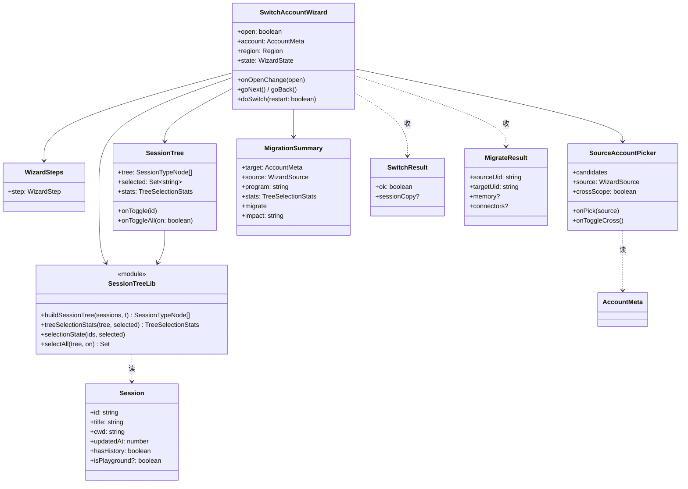
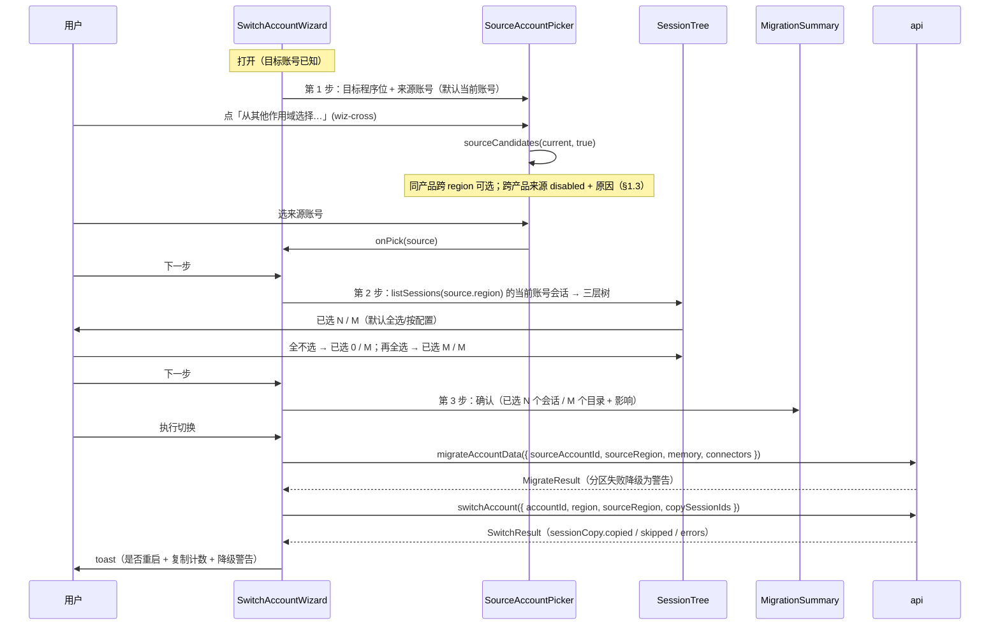
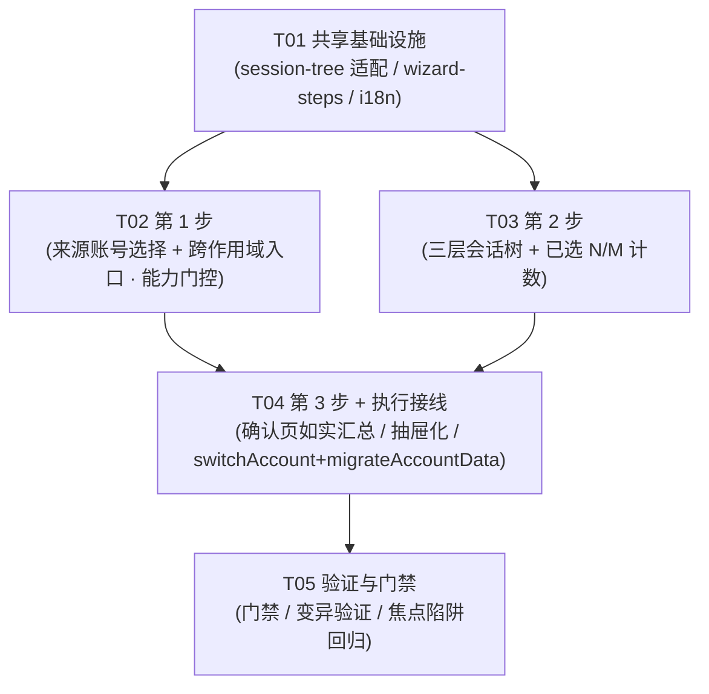

# P4 迁移架构分解：跨作用域迁移向导（三步 · 抽屉）

> **状态**：设计（2026-10-06）。
> **上游**：`docs/redesign/PLAN.md` §3.5（抽屉替代模态 → 切换账号 = **抽屉内三步向导：目标 → 迁移内容 → 确认**）、§3.6（统一状态语言 / 部分失败态）、§3.11（无障碍：抽屉 = `role="dialog"` + `aria-modal` + 焦点陷阱）、§3.15.3（统一重启确认流程）、§3.15 能力边界；`docs/redesign/COVERAGE-REPORT.md` §2.5（迁移向导 B1：1 ✅ / 2 ⚠️ / 2 ❌）。
> **下游**：本文件「任务列表」直接交工程师执行（T01–T05）。
> **判据来源**：`docs/redesign/verify-behaviors.cjs` 的 **B1 系列**（逐条读**断言体**，见 §1.2）。
> **范围边界**：本期只做 **① 三步向导化（含确认页）** + **② 来源账号选择 + 跨作用域入口** + **③ 三层会话树 + 「已选 N / M」计数**。
> **明确排除**：P8 会话工作台的状态派生 / 分歧 / 同步（另一条欠账）、P12 请求代理、程序位注册表（P0）。
> **与 `P4-ARCH.md` 的关系**：`P4-ARCH.md` 覆盖「账号工作台」（抽屉 / 卡片 / 程序位），**不含迁移向导**；本文件是其**补篇**，仅覆盖迁移向导。

---

## 0. 一句话背景

`src/components/switch-account-dialog.tsx`（870 行）当前是**单页模态 `Dialog`**：来源版本 Tabs + 复制会话开关 + 记忆/连接器开关 + 三层会话树，**一步到底**。缺口（COVERAGE §2.5）：

| 原型行为（B1） | 现状 | 缺什么 |
|:---|:---|:---|
| 第 1 步有「**来源账号**」选择 | 只有「来源**版本**」Tabs（`sourceRegion`） | 是「版本」不是「账号」；语义接近 |
| **跨作用域入口** | 只处理 WB 区域间（cn↔global） | **无跨产品（WB→Trae）迁移入口** |
| 第 2 步**三层**会话树 + 「已选 N / M」计数 | `buildSessionTree` 已是三层，但**无「已选 N / M」文案**（只有 `copyCount`） | 缺计数文案 |
| 会话树可**全不选 → 归零，再全选恢复** | `selectionState` 已支持 mixed | ✅ 已具备 |
| **确认页**如实汇总「已选 N 个会话 / M 个目录」 | **无独立确认步** | 缺三步向导的确认步 |

---

## 1. 实现方案

### 1.1 核心难点

| 难点 | 现状 | 处理 |
|:---|:---|:---|
| 单页 → 三步向导 | 单页 `Dialog`，所有区块同屏 | 拆为**三步**（目标 → 迁移内容 → 确认）+ 步骤条；**迁入抽屉**（§3.5） |
| 「来源账号」vs「来源版本」 | 只有 `sourceRegion` | 新增**来源账号**选择；语义与后端能力对齐（§1.3） |
| **★ 跨产品迁移能力边界** | 后端**只支持同产品跨 region** | **如实说明**，不假承诺（§1.3）——**本设计最要紧的一条** |
| 「已选 N / M」计数 | 只有 `copyCount`（单个数字） | 新增 `selected / total` 计数 + 目录数 M（§1.4） |
| 确认页如实汇总 | 无确认步 | 新增确认页：`已选 N 个会话 / M 个目录` + 「影响」（§1.5） |
| 抽屉无障碍 | 模态 `Dialog` 无焦点陷阱保证 | 用 `Sheet`（Radix Dialog）—— `role="dialog"` + `aria-modal` + 焦点陷阱是默认能力（§3.11） |
| 字段张冠李戴 | 已出过三次事故 | 见 §1.6 逐字段核实 |

### 1.2 必须对齐的原型契约（B1 系列，逐条读断言体）

1. 第 1 步文本含「**从哪里迁移**」（来源选择，不再隐含当前账号）。
2. 存在 **跨作用域入口**（`data-act="wiz-cross"`）。
3. 第 2 步是**三层**会话树 + 文本匹配 `已选 \d+ / \d+`，且含类型层（「对话」或「工作区」）。
4. 会话树可**全不选 → 计数归零**（`已选 0 / M`），再**全选 → `已选 M / M`**。
5. **确认页**文本匹配 `已选 \d+ 个会话`，且含「**影响**」说明。

> ⚠️ 断言只验「入口/文案**存在**」，**不验能力真伪**。因此**能力边界必须由本设计如实定义**，
> 否则会做出一个「入口在、点了没用」的假功能（= §3.5 不许假承诺）。

### 1.3 ★ 跨作用域迁移的真实能力边界（**本设计最要紧的一条**）

「作用域」= **产品 × 区域**（`wb-cn / wb-global / trae-cn / trae-global`）。逐后端核实（`crates/buddy-switch-core/src/modules/session.rs`）：

| 迁移项 | 后端能力 | 来源如何指定 | 跨 region | **跨产品（WB→Trae）** |
|:---|:---|:---|:---:|:---:|
| **会话复制** | `copy_session_to_user_cross(source_region, target_region, …)` | **隐式 = `source_region` 的当前登录账号**（`switchAccount({ sourceRegion, copySessionIds })` **无** `sourceAccountId`） | ✅ 支持（cn↔global） | ❌ **不支持** |
| **记忆 / 连接器迁移** | `migrateAccountData({ sourceAccountId, sourceRegion, … })` | **可显式指定任意来源账号** | ✅ 支持 | ❌ 不支持（仅 WorkBuddy） |

**两条硬结论（如实写进 UI，不许假承诺）**：

1. **会话复制的来源 = 源 region 的「当前登录账号」，不是任意账号**。
   后端 `switchAccount` **只收 `sourceRegion`**（`api.ts:765-773`）—— 会话树的会话列表来自
   `listSessions(sourceRegion)` 返回的**当前账号**（`api.ts:811-825` 的 `current`）。
   ⇒ 若用户在向导里选了**另一个**来源账号，**会话**仍来自该 region 的当前账号；
   **记忆 / 连接器**才用得到所选的 `sourceAccountId`。**UI 必须把这点说清楚**。
2. **跨产品（WB→Trae）会话复制后端不支持**：会话复制绑死 WorkBuddy 数据三件套
   （`~/.workbuddy/projects/{workspace}/{cid}.jsonl` + `workbuddy.db` 的 sessions 表 +
   `edge-sync-mapping-v{N}.db` 的云端归属），**Trae 无等价三件套**（PLAN §3.15 能力边界，逐文件核实）。
   ⇒ 跨作用域入口**可以存在**，但**跨产品来源必须门控**：该项 **disabled + 原因**
   （「该平台不支持会话复制」），**不引导用户去设置里找开关**（§3.6 空态两种出口的口径）。

> **本设计对「跨作用域入口」的定调**：入口 = 「**从其他作用域选择来源**」，
> 真实可用范围 = **WorkBuddy 内跨 region（cn↔global）**；
> **跨产品来源**以「不可用 + 原因」呈现（或整块不列出跨产品来源）。
> **是否接受这一收窄、还是要求后端新增跨产品会话迁移能力，需产品拍板**（§6 #1）。

### 1.4 三层会话树 + 「已选 N / M」计数

- **三层**：类型层（**任务 / 空间**，来自 `Session.isPlayground`）→ **目录层**（`cwd` 末段，复用 `sessionFolderLabel`）
  → **会话层**（`Session.title`）。现有 `buildSessionTree` 已是这三层，**保留**。
- **计数**：`已选 {selected} / {total}`，`selected = selectedIds.size`，`total` = 全部可选会话数。
- **目录数 M**（确认页用）：**被选中会话覆盖的目录数**（`dirsSelected`）—— 不是全部目录数。
- **一致性**（断言 4）：全不选 ⇒ `selected = 0`；全选 ⇒ `selected = total`。三态勾选（类型 / 目录半选）
  用 `aria-checked="mixed"`（§3.11），复用现有 `selectionState`。

### 1.5 确认页「如实汇总」（§3.5 不许假承诺）

确认页展示：

| 行 | 内容 | 口径 |
|:---|:---|:---|
| 目标账号 | `name` + 脱敏邮箱 | `maskEmail`（展示用脱敏；**数据用原值**） |
| 来源账号 | `name` · `scopeLabel` | 若会话来源 ≠ 所选账号，**注明**（§1.3 结论 1） |
| 程序位 | 目标程序位 label | — |
| 迁移内容 | `会话（已选 N 个会话 / M 个目录）` + `记忆` + `连接器` | 断言 5；未选会话时写「**未选择任何会话**」 |
| **影响** | 「客户端将被重启，未保存的编辑器内容可能丢失」 | 断言 5 要求含「影响」；CLI **不沿用**「自动重开」（§3.15.3） |

> ⚠️ **「如实」的含义**：确认页的数字**必须等于实际会执行的操作**。
> 会话数 = `copySessionIds.length`；目录数 = 被选中会话覆盖的目录数。
> **不许**展示「将迁移 N 个」却实际只迁移其中一部分（那正是 §3.5 要禁止的假承诺）。

### 1.6 字段归属核实（本项目已三次踩坑：`lastUsedAt` / camelCase vs snake_case / `replicaCount`）

| 用到的值 | **属于哪个类型** | 说明 |
|:---|:---|:---|
| `Session.id` / `title` / `cwd` / `updatedAt` / `hasHistory` / `isPlayground` | `Session`（`types.ts:145`） | **没有** `msgs` / `lastUsedAt` / `replicaCount` |
| 目录名 | **不是字段** —— 从 `Session.cwd` **末段推导**（`sessionFolderLabel`） | 不要当成独立字段 |
| `SwitchResult.sessionCopy.{sourceUid,targetUid,copied,skipped,errors}` | `SwitchResult`（`types.ts:200`） | **camelCase**（后端 JSON） |
| `MigrateResult.{memory,connectors,changed}` | `MigrateResult`（`types.ts:249`） | `memory`/`connectors` 失败时是 `{ error }`，**不是**计数对象 |
| `CopyResult.deduplicated` / `ledgerWritten` | `CopyResult`（`types.ts:184`） | 去重账本命中标记 |
| `region` | `Region = "cn" \| "global"`（`types.ts:7`） | **不是** `TraeVariantId`（那是 Trae 的切换目标） |

---

## 2. 文件列表

### 新建

| 相对路径 | 作用 |
|:---|:---|
| `src/lib/session-tree.ts` | **会话树数据适配**（纯函数）：`Session[]` → 三层树 + `{selected,total,dirsSelected}` 计数；从 `switch-account-dialog.tsx` 抽出（`buildSessionTree` / `sessionFolderLabel` / `groupSessionsByFolder` / `selectionState`） |
| `src/components/switch-account/wizard-steps.tsx` | 步骤条（目标 / 迁移内容 / 确认） |
| `src/components/switch-account/source-account-picker.tsx` | 第 1 步：来源账号选择 + **跨作用域入口**（能力门控，§1.3） |
| `src/components/switch-account/session-tree.tsx` | 第 2 步：三层会话树 + 「已选 N / M」计数 + 三态勾选 + 全选/全不选 |
| `src/components/switch-account/migration-summary.tsx` | 第 3 步：确认页如实汇总 + 「影响」 |
| `docs/redesign/P4-MIGRATION-ARCH.md` | 本文档 |

### 修改

| 相对路径 | 改动 |
|:---|:---|
| `src/components/switch-account-dialog.tsx` | 单页 → **三步向导**（`step` 状态 + 步骤条）；迁入 `Sheet`（抽屉）；拆出树 / 来源 / 确认到新组件；保留 `doSwitch` / 重启确认 / 权限自愈 / 进度 |
| `src/pages/AccountsPage.tsx` | `SwitchAccountDialog` 的挂载点不变（仍由它打开）；若改用 `Sheet` 则更新 props |
| `src/locales/domains/wbAccounts.zh.ts` / `.en.ts` | 向导步骤 / 来源账号 / 跨作用域 / 已选 N/M / 确认页 / 影响 新键（zh + en **同步**）；移除**不再被引用**的旧键 |
| `src/locales/domains/shared.zh.ts` / `.en.ts` | 若步骤条 / 抽屉通用键跨平台共用则放这里 |

> ⚠️ **最小可提交单元**：T01（`session-tree.ts` + 步骤条 + 词条）先落地；T02/T03/T04 依赖 T01，且 T04（确认页 + 执行接线）必须与 T02/T03 **同一功能批次**（三页共享 `step` 状态）。

---

## 3. 数据结构与接口

### 3.1 会话树适配层（`src/lib/session-tree.ts`）

```ts
import type { Session } from "@/lib/types";

/** 三层：类型 → 目录 → 会话。 */
export interface SessionLeaf {
  id: string;          // Session.id（稳定 key）
  title: string;
  hasHistory: boolean;
  updatedAt: number;
}

export interface SessionDirNode {
  key: string;         // "t{ti}/d{di}"
  label: string;       // cwd 末段（sessionFolderLabel）
  sessions: SessionLeaf[];
}

export interface SessionTypeNode {
  key: string;         // "t{ti}"
  label: string;       // 任务 / 空间（i18n）
  dirs: SessionDirNode[];
}

/** 选中统计：确认页的「已选 N 个会话 / M 个目录」即 {selected, dirsSelected}。 */
export interface TreeSelectionStats {
  selected: number;      // 已选会话数
  total: number;         // 全部会话数
  dirsSelected: number;  // 被选中会话覆盖的目录数
}

export function buildSessionTree(sessions: Session[], t: Translate): SessionTypeNode[];
export function treeSelectionStats(tree: SessionTypeNode[], selected: Set<string>): TreeSelectionStats;
export function selectionState(ids: string[], selected: Set<string>): { allOn: boolean; someOn: boolean };
export function toggleType(tree: SessionTypeNode, selected: Set<string>): Set<string>;
export function toggleDir(dir: SessionDirNode, selected: Set<string>): Set<string>;
export function selectAll(tree: SessionTypeNode[], on: boolean): Set<string>;
```

### 3.2 向导状态与来源选择

```ts
export type WizardStep = 1 | 2 | 3;

/** 来源账号（scope 含产品+区域；跨作用域入口即在此列出其他 scope）。 */
export interface WizardSource {
  scope: ScopeId;          // "wb-cn" | "wb-global" | "trae-cn" | "trae-global"
  accountId: string;
  /** 该 scope 是否支持会话复制（能力门控，§1.3）。false ⇒ 来源项 disabled + 原因。 */
  supportsSessionCopy: boolean;
}

export interface WizardState {
  step: WizardStep;
  targetAccountId: string;
  targetRegion: Region;
  program: string;                 // 目标程序位 id
  source: WizardSource;            // 第 1 步
  crossScope: boolean;             // 「从其他作用域选择…」开关（原型 wiz-cross）
  migrate: { sessions: boolean; memory: boolean; connectors: boolean };
  selected: Set<string>;           // 会话 id
}

/** 第 1 步：来源账号列表（含跨作用域项，带能力门控）。 */
export function sourceCandidates(
  current: ScopeId,
  crossScope: boolean,
): { scope: ScopeId; accounts: AccountMeta[]; supportsSessionCopy: boolean }[];
```

### 3.3 类图



### 3.4 调用流程（三步向导）



---

## 4. 任务列表（有序 · 含依赖 · 按实现顺序）

> **硬性顺序**：T01 → {T02, T03} → T04 → T05。
> **P0 = 必须；P1 = 重要；P2 = 可裁剪。**

### T01 · 共享基础设施（会话树适配 + 步骤条 + 词条）｜ P0

- **源文件**
  - 新建 `src/lib/session-tree.ts`（从 `switch-account-dialog.tsx` 抽出 `buildSessionTree` / `sessionFolderLabel` / `groupSessionsByFolder` / `selectionState`，**新增** `treeSelectionStats` / `selectAll` / `toggleType` / `toggleDir`）
  - 新建 `src/components/switch-account/wizard-steps.tsx`（步骤条）
  - 修改 `src/locales/domains/wbAccounts.zh.ts` / `.en.ts`（向导步骤 / 来源 / 跨作用域 / 已选 N/M / 确认 / 影响 键，zh + en 同步）
- **依赖**：无
- **要点**：适配层是**纯函数**（可单测）；`treeSelectionStats` 的 `dirsSelected` = **被选中会话覆盖的目录数**；目录名从 `cwd` 末段推导（**不是字段**）。

### T02 · 第 1 步：来源账号选择 + 跨作用域入口（能力门控）｜ P0

- **源文件**
  - 新建 `src/components/switch-account/source-account-picker.tsx`
  - 修改 `src/locales/domains/wbAccounts.zh.ts` / `.en.ts`
- **依赖**：T01
- **要点**：默认来源 = 当前账号（**不再隐含**，断言 1：文案「从哪里迁移」）；「从其他作用域选择…」入口（断言 2）；**跨产品来源 disabled + 原因**（§1.3 结论 2），**不假承诺**；同产品跨 region 可选。

### T03 · 第 2 步：三层会话树 + 「已选 N / M」计数 ｜ P0

- **源文件**
  - 新建 `src/components/switch-account/session-tree.tsx`
  - 修改 `src/locales/domains/wbAccounts.zh.ts` / `.en.ts`
- **依赖**：T01
- **要点**：三层（类型 / 目录 / 会话，断言 3）；「已选 N / M」计数（断言 3）；全选 / 全不选 → 归零 / 恢复（断言 4）；三态 `aria-checked="mixed"`（§3.11）；迁移内容开关（会话 / 记忆 / 连接器）保留现有平级语义；**会话来源 = 源 region 当前账号**，与来源账号不一致时**注明**（§1.3 结论 1）。

### T04 · 第 3 步：确认页如实汇总 + 执行接线 + 抽屉化 ｜ P0

- **源文件**
  - 新建 `src/components/switch-account/migration-summary.tsx`
  - 修改 `src/components/switch-account-dialog.tsx`（单页 → 三步向导；迁入 `Sheet`；拆出 T02/T03/T04 组件；保留 `doSwitch` / 重启确认 / 权限自愈 / 进度 / 部分失败警告）
  - 修改 `src/pages/AccountsPage.tsx`（若 `Sheet` 化需更新挂载 props）
  - 修改 `src/locales/domains/wbAccounts.zh.ts` / `.en.ts`
- **依赖**：T02、T03
- **要点**：确认页含 `已选 N 个会话 / M 个目录` + 「影响」（断言 5）；数字**必须等于实际执行**（§1.5）；抽屉无障碍（`role="dialog"` + `aria-modal` + 焦点陷阱 + Esc + 焦点归还，§3.11）；CLI **不沿用**「自动重开」（§3.15.3）；`doSwitch` 保留：先 `migrateAccountData`（memory/connectors）再 `switchAccount`（copySessionIds）。

### T05 · 验证与门禁 ｜ P0

- **源文件**：无源码改动（跑门禁 + 变异验证 + 手工回归）
- **依赖**：T04
- **要点**：
  - 门禁：`check:api` / `check:store-selectors` / `check:scope` / `tsc` 全绿。
  - **变异验证**（塞回缺陷 ⇒ 断言必须变红）：
    ① 全不选后计数仍显示总数 ⇒ 「归零」变红；
    ② 确认页写死「已选 N 个会话」不随选择变 ⇒ 「如实汇总」变红；
    ③ 跨产品来源**可点且无原因** ⇒ 「能力门控」断言变红（若补了该断言）；
    ④ 会话树退化为两层 ⇒ 「三层」变红。
  - **手工回归**：三步前进/后退状态不丢；确认页数字 = 实际复制数；抽屉焦点陷阱 + Esc 关闭 + 焦点归还。

---

## 5. 共享知识（跨文件约定）

- **能力边界如实说**（§3.5 / §3.6）：**会话复制来源 = 源 region 的当前登录账号**（后端 `switchAccount` 无 `sourceAccountId`）；**跨产品（WB→Trae）不支持**。UI 不许假承诺，跨产品来源给**原因**而非「去设置」。
- **「已选 N / M」一致性**：`N = selected.size`，`M = total`；全不选 → 0，全选 → M。确认页的「M 个目录」= 被选中会话覆盖的目录数（`dirsSelected`）。
- **三层树**：类型（`isPlayground` → 任务 / 空间）→ 目录（`cwd` 末段）→ 会话（`title`）；目录名**推导**，非字段。
- **抽屉无障碍**（§3.11）：`role="dialog"` + `aria-modal="true"` + **焦点陷阱** + `Esc` + **关闭后焦点归还触发按钮**；用 Radix `Sheet`，**不要手写**。
- **三态勾选**：`role="checkbox"` + `aria-checked`；**半选必须 `aria-checked="mixed"`**（用 `Checkbox` / 原生 `indeterminate`）。
- **状态语言**（§3.6）：区块加载 → `<Skeleton>`；按钮操作中 → `<Loader2>`；空态 → `<EmptyState>`（四要素）；**部分失败态** = 汇总条 `N 成功 / M 失败` + 「重试失败项」+ 明细（批量迁移的默认反馈）。
- **重启维度**（§3.15.3）：WB 桌面**需重启**（默认勾选「自动重开」+ 未保存文件风险）；**CLI 不重开且中断会话**，文案**不得**沿用「自动重开」。
- **字段归属**（§1.6）：展示用 `maskEmail`（脱敏），数据用原值；`Session` 无 `msgs` / `lastUsedAt` / `replicaCount`。
- **`displayText` 白屏防线**：所有进入向导的展示字段过 `@/lib/display-text`（对象会白屏）。
- **i18n**：zh + en **同时**加；只保留真正被引用的键。
- **组件文件头注释说明「为什么这么设计」**；不保留死代码；最小可提交单元查跨文件依赖。

---

## 6. 决策记录（原「风险点 / 待明确事项」· 已由 lead 拍板 · 2026-10-07）

### ✅ #1 跨作用域入口的语义 → **(A) 收窄为 WorkBuddy 内跨 region（cn↔global）**

- **决策**：**收窄** —— 跨产品（WB→Trae）来源 **disabled + 给出原因**（**不让用户点一个做不到的入口**）。
- **理由**：
  - **(B) 要求后端新增跨产品会话迁移** = **新功能**（Trae 无归属机制，成本高且可能不可行）⇒ **超出「与 demo 对齐」的范围**
  - **(C) 只迁移账号级数据** ⇒ 与原型的「迁移**会话**」**语义不符**（用户以为迁了会话，实际没迁）
  - **⇒ (A) 最诚实**：**能力到哪就说到哪**
- **⚠️ 文案红线**：**不许写「已打通 WB→Trae」**（那是假承诺，§3.5）
- **对正文的影响**：§1 范围 / T02 要点 / 风险点 / 本记录 —— **全部按 (A) 表述**

### ✅ #2 来源账号 vs 会话来源 → **(A) 来源账号只限「各 scope 的当前账号」**

- **决策**：**只限当前账号**。
- **理由**：**后端事实是「会话来自源 region 的当前登录账号」**（`switchAccount` 只收 `sourceRegion`，无 `sourceAccountId`）⇒ **允许任选会误导**：用户选了 A 账号，**实际迁的是当前账号的会话**。
- **为什么不选 (B)**：即使标注「会话来自当前账号」，**用户仍会以为选的账号影响了会话** —— **标注不足以消除误导**。
- **对正文的影响**：T02 要点（来源账号 = **各 scope 当前账号**）。

### ✅ #3 「迁移内容」默认勾选 → **沿用现状**

- **决策**：**沿用** —— `copySessions` 由「复制会话常开」配置决定；`memory` / `connectors` **默认关**。
- **理由**：**不改变既有行为**（用户已形成的预期）。

### ✅ #4 确认页二次确认 → **要加**

- **决策**：第 3 步确认页**加一层「不可逆」提示**。
- **理由**：**迁移会写目标账号的数据** ⇒ §3.5 要求「不可逆操作前让用户看清」。

### ✅ #5 抽屉 vs 模态 → **抽屉（按设计）**

- **决策**：**迁入 `Sheet`**。
- **理由**：§3.5 明确「切换账号 = 抽屉内三步向导」。

### ✅ #6 来源账号搜索 / 分页 → **本期不加**

- **决策**：**不加**（来源通常是个位数）。
- **理由**：**不需要就不加控件**（避免为假想规模加复杂度）。

---

## 7. 任务依赖图


