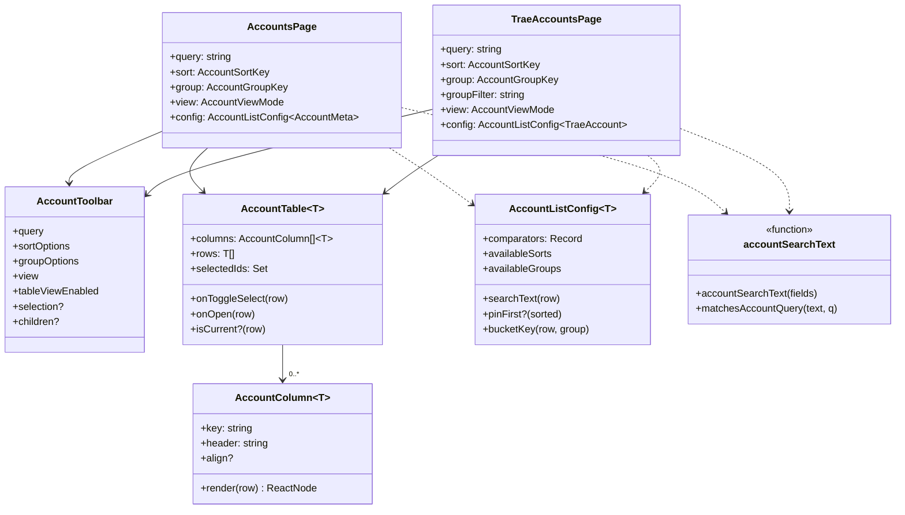
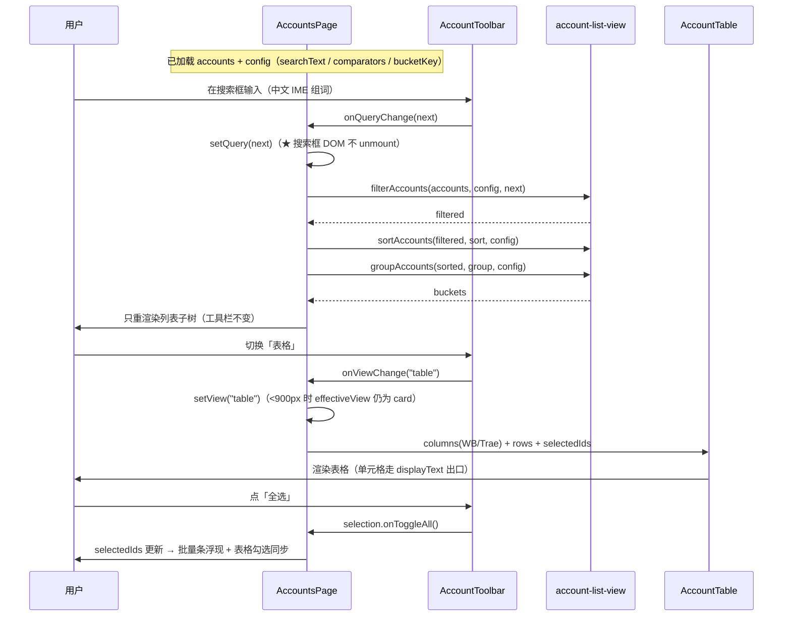
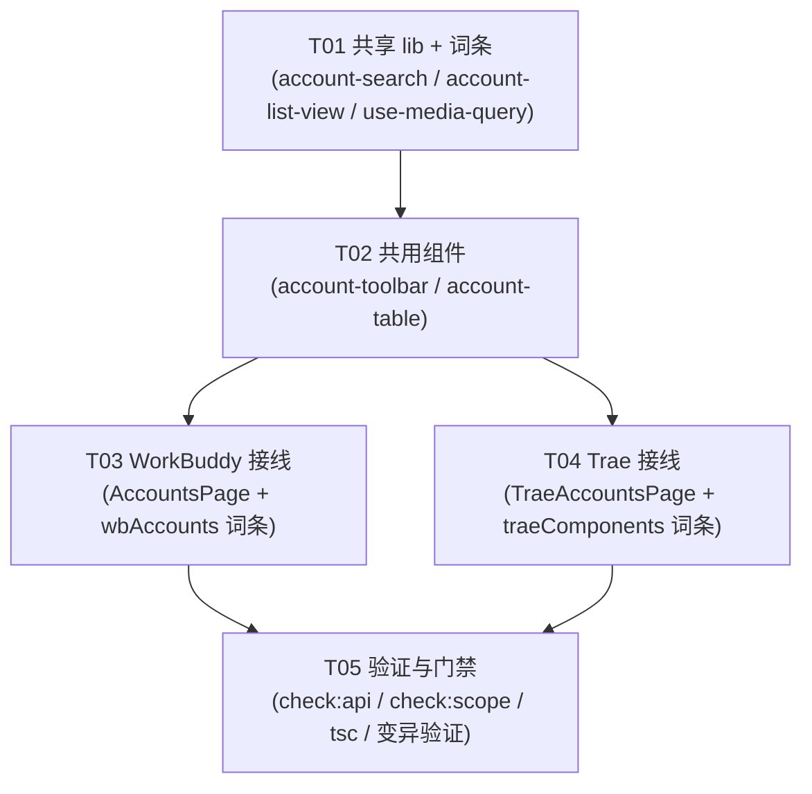

# P4 工具栏架构分解：搜索 / 排序 / 分组 / 卡片·表格视图

> **状态**：设计（2026-10-04）。**§6 的 8 条待明确事项已由 lead 全部拍板（2026-10-04），正文已同步。**
> **上游**：`PLAN.md` §3.4（账号列表工具栏 + 四条列表通用规则）、§3.12（响应式窄窗降级）、§3.13（两个搜索入口的分工）、§2.1（L3 视图参数归属）、§3.3（卡片可点区 ≤4）、§3.6（统一状态语言）、§5 的 P4 行；`DECISIONS.md` D1（数据域与视图分开）、D7（原型仅作交互参考、以 shadcn 为准）、D9（虚拟滚动不进）；`VOCABULARY.md`（视图参数 / 程序位 / 区域）。
> **前置已完成**：`P4-ARCH.md`（详情抽屉 + 卡片瘦身 + 程序位常显 + 最小批量条）。本文件是它 §「明确排除」段的续作。
> **下游**：本文件 §4 的任务列表直接交给工程师。
> **范围**：**仅** 搜索 / 排序 / 分组 / 卡片·表格视图切换。
> **明确排除**：虚拟滚动（D9）、命令面板 ⌘K（P6）、分页（**✅ 已决策 #7：本轮不做**，见 §6 #7）、账号卡片本身的改造（已由 `P4-ARCH.md` 完成）。

---

## 1. 实现方案

### 1.1 核心难点

| 难点 | 现状 | 处理 |
|:---|:---|:---|
| **★ 状态放哪** | 视图参数散落（`compact` 用 localStorage、`groupFilter` 用页内 state、`orderedAccounts` 写死排序） | **视图参数一律留在页内**（§2.1 L3）—— 见 §1.2。**不进 URL、不进全局 store、不碰作用域** |
| **★ IME 约束** | 原型靠「只重绘列表区、工具栏不重绘」保住中文输入法；React 里靠**不 unmount 输入框** | 搜索框必须**常驻挂载**（不随结果为空而消失）；工具栏与列表是**两个子树**——见 §1.4 |
| **两平台共用还是分家** | 账号卡已分家（`AccountCard` / `TraeAccountCard`）；工具栏**尚不存在** | **共用壳 + 平台注入 options/slots**（差异是**数据**不是**行为**）——见 §1.3 |
| **`compact` 与 `view` 是两个布局开关** | 现状已有 `compact`（紧凑/宽松）图标开关；本设计新增 `view`（卡片/表格） | 二者是**不同维度**；`compact` 仅在卡片视图下渲染，避免「两个看起来能切的控件」——见 §1.7 |
| **Trae 已有 `groupFilter`，本设计新增 `group`（分组）** | 现有 `groupFilter` = 筛选到某个自定义组；新增 `group` = 按什么分桶 | **两者语义不同**，明确分离并命名——见 §1.6 |
| **表格列渲染可能喂对象 ⇒ 白屏** | 对象当 React 子节点 ⇒ 卸载整棵树（issue #2） | 表格单元格复用**同一套** `displayText` 出口与既有格式化函数——见 §5 |
| **卡片可点区 ≤4 不能被破坏** | 刚达成的验收项（门禁有断言） | 工具栏在**卡片之外**，不新增卡内可点区；表格视图里程序位是**只读徽标**——见 §1.10 |

### 1.2 ★ 状态归属（最关键的一条）

**结论：搜索 / 排序 / 分组 / 视图 = 页面私有 `useState`。不进 URL，不进 store，不碰作用域。**

依据（三条纪律叠加）：

1. **§2.1 L3**：视图参数（时间范围 / 数据来源 / 合并开关 / 程序位…）的载体是「页面内参数条」，**是否全局 = 否，页面私有**。搜索 / 排序 / 分组 / 视图正是视图参数。
2. **D1**：「**作用域决定数据从哪来，开关决定怎么看**」。这四项只决定「怎么看」，**绝不进 `useScope`**（`use-scope.ts:33-36` 已就此立过规矩：`all`（合并态）不是作用域，不进 hook）。
3. **「不许出现第二个看起来能切的控件」**：作用域已由侧栏 `ScopeSwitch` 承担（`App.tsx:302-329`）。若把这四项塞进 URL 的 `?scope=`/`?region=` 附近，会与作用域控件产生视觉与语义纠缠。

**与原型的分歧（必须说明）**：原型把 `view` / `group` / `q` 放进了 URL（`demo-app.js:2641-2644`，`?view=table&q=code`）。**本设计不照搬** —— 那是原型「URL 是唯一真值」演示的一部分，而**真实应用里 URL 的唯一真值是「作用域 + 目的地」**（§3.8 `/s/{scope}/{dest}`），视图参数留在页内（§2.1 L3）。

**唯一例外（✅ 已决策 #1：本轮不接线，等 P6）**：§3.13 要求命令面板（P6）搜到别的作用域的账号时「跳到该作用域的账号页**并带上 `q`**」。这需要一个**一次性 URL 种子**（`?q=`），读一次后由页内 state 接管。本设计**为它预留接口**（`initialQuery` 参数），但**本轮不接线** —— P6 未实现，现在接线是**为不存在的调用方写代码（死代码）**。P6 落地时再接。

**持久化（✅ 已决策 #2：不持久化）**：`sort` / `group` / `view` **纯页内 `useState`，不持久化**（跨会话不记住）。理由：视图参数是临时的；持久化会让「为什么我的排序怪怪的」变成谜题。⚠️ `compact`（`use-compact-mode.ts`，localStorage）的持久化是**历史遗留，不要扩散**到本设计。§3.4 预留的可选 hook **不实现**。

### 1.3 组件分层：共用壳 + 平台注入（这不是「强行合并」）

**判断依据（P3 分层结论）**：*能合并的合并；不能合并的抽共享片段；差异 ≥3 处就别硬合。*

**逐项核对 WB 与 Trae 的工具栏差异**：

| 维度 | WorkBuddy | Trae | 差异性质 |
|:---|:---|:---|:---|
| 搜索字段 | `nickname` / `email` / `remark` | `name` / `uid` / `remark` | **数据**（字段集） |
| 排序选项 | priority / name / expiry（**无 recent**，✅ #3） | priority / name / expiry（**同样无 recent** —— 见 §1.5 的更正） | **数据**（两个平台的账号记录**都没有**「最近使用」字段） |
| 分组选项 | none / program / status | none / program / status / **group** | **数据**（WB 无 `group` 字段，见 `types.ts:12-32`） |
| 视图 | 卡片 / 表格 | 卡片 / 表格 | 相同 |
| 表格列 | 账号/状态/积分/今日Token/到期/程序位 | 账号/状态/积分/到期/程序位（无今日Token） | **数据**（列定义） |
| 平台专属控件 | 自动签到 + 自动旅行（开关） | 自动签到 + 跳过已签（开关）+ 分组筛选 | **数据/插槽** |
| 程序位 | 3（WorkBuddy/IDE/CLI） | ≤4（2 区域 × 2 程序位） | **数据** |

**结论**：四个核心控件（搜索框 / 排序下拉 / 分组下拉 / 视图切换）**结构完全相同**，差异**全部是「选项数据 + 专属插槽」**，**没有任何行为差异**。

⇒ **共用壳 + 平台注入 options/slots**：

- `AccountToolbar`（共用）：只渲染四个核心控件，选项列表由 props 传入；平台专属控件走 `children` 插槽。
- `AccountTable`（共用）：**列定义驱动**，`columns: AccountColumn<T>[]` 由各页传入；单元格渲染在列定义里（平台各自提供）。

**为什么这不是 P3 警告的「强行合并」**：P3 拒绝合并 `api-key-table` / `model-list` / `request-log`，是因为它们差异在**行为**（数据源 / 确认流程 / 加载态 / 脱敏 / 功能复杂度）——合并会把 `if (isTrae)` 塞进组件、丢掉语义。本设计的差异**只是列与选项的数据**，与 `account-pool-card`（差异只有 tiles 数量与 autoOptions，已共用）、`integration-guide`（差异只有数据来源，已合并）**同类**。

> ⚠️ **反向约束**：若 `AccountTable` 的列定义开始出现「平台行为分支」（例如 `if (platform === 'trae')`），即说明合并过度，应退回「两份表格 + 抽共享片段」。设计上**禁止**在共享组件内写平台判断。

### 1.4 搜索（含 IME 约束 + §3.13 共享索引）

**交互**：
- 输入框常驻（**永远渲染**，即使结果为空 —— 否则 IME/光标会丢）。
- `/` 键聚焦（§3.4「自动聚焦，`/` 唤起」）。
- 就地过滤当前列表，**不跳页**（§3.13）。

**★ IME 约束（可证伪的验收项，来自 `verify-demo.cjs:138-141`）**：
原型靠「工具栏不重绘、只重绘 `#acct-list`」保住中文输入法。React 里对应做法：

- 搜索框是**受控** `<Input>`，其 DOM 节点在 `query` 变化时**不被 unmount**（React 按位置/类型复用节点）。
- **禁止**：把搜索框放进 `key={query}` 的子树、或放进「结果为空就换掉整块」的条件分支。
- **禁止**：让搜索框的祖先因 `query` 变化而改变元素类型/层级（会触发 remount）。
- 工具栏（含输入框）与列表区是**两个独立子树**：`query` 只驱动列表子树重渲染，工具栏子树结构不变。

**★ 共享搜索索引（§3.13）**：列表搜索（本设计）与命令面板（P6）**必须共用同一个匹配规则**，否则「同一关键词两处结果不一致」是新的静默错误。

⇒ 抽 `src/lib/account-search.ts`：

```ts
/** 把账号的可搜索字段拼成一个**归一化**字符串（小写、去空白）。 */
export function accountSearchText(fields: {
  name?: string | null;
  email?: string | null;
  uid?: string | null;
  remark?: string | null;
  group?: string | null;
}): string;

/** 归一化查询串并判断是否命中。空查询恒为 true。 */
export function matchesAccountQuery(searchText: string, query: string): boolean;
```

页面为每个账号预先算一次 `accountSearchText(...)`（避免每次按键重算），P6 复用同一函数。

### 1.5 排序

**选项**（§3.4）：`priority`（积分优先级，**默认**）/ `name`（名称）/ `expiry`（到期时间）/ `recent`（最近使用）。

> **✅ 已决策 #3：两个平台都**不提供 `recent`。** `AccountMeta`（`types.ts:12-32`）**无 `lastUsed` 字段**（只有 `refreshedAt` / `createdAt`）。用 `refreshedAt` 近似是**假选项** —— 用户会以为那是「最近使用」，实际是「最近刷新」，两者语义不同。按 §3.4 规则 1「无数据不渲染」，**WB 的排序选项 = `priority` / `name` / `expiry`（3 项）**。
>
> ⚠️ **本文件的一处更正（2026-10-04，实施期发现）**：本节初稿曾写「**Trae 的排序选项 = 4 项**（Trae 有 `lastUsedAt`，见 `trae-types.ts:796`）」—— **这个引用是错的**。`trae-types.ts:796` 附近是 `TraeApiKeyRecord.lastUsedAt`，那是 **API Key 记录**的字段，**不是 `TraeAccount`**。核实 `TraeAccount` 的全部字段（`trae-types.ts:321-350`）：只有 `addedAt` / `updatedAt`，**没有「最近使用」口径**。
> ⇒ 按 #3 **自己的规则**（无数据不渲染），**Trae 的排序选项同样是 3 项**。这是实施者核对字段时发现的，已回写本文件各处（差异表 / 本节 / T04 / 决策记录）。
> **教训**：设计文档引用**具体字段**时，要核实该字段**属于哪个类型** —— 同名的 `lastUsedAt` 在两个接口里含义不同，只按名字搜索就会张冠李戴。

**★ 保留现状语义**：现有 `orderedAccounts`（`AccountsPage.tsx:908-933`）写死的「积分优先级」**成为 `priority` 选项**（而非唯一选项），并**保留 `pin_current_account` 的置顶覆盖**（`:929-932`）—— 该覆盖是「显式置顶，不插进比较函数」的既有正确做法，不得改动其语义。

**实现**：把排序抽成**纯函数**，比较器与置顶由平台经 `AccountListConfig` 注入（WB 用积分优先级，Trae 用自身积分字段）：

```ts
export type AccountComparator<T> = (a: T, b: T) => number;

/** 稳定排序：键相等时保持原序（同现状 `left.index - right.index`），并应用 `config.pinFirst`。 */
export function sortAccounts<T>(
  rows: T[],
  key: AccountSortKey,
  config: AccountListConfig<T>,
): T[];
```

**选项按需出现（§3.4 规则 1）**：某排序键若在当前平台无数据支撑则**不渲染该选项** —— **✅ 已决策 #3：两个平台都不渲染 `recent`**（`availableSorts` 由页面填，见 §3.1；Trae 侧的更正见 §1.5）。

### 1.6 分组

**★ 先澄清两个「组」**（这是最容易被误读的一处）：

| 名称 | 含义 | 现状 | 载体 |
|:---|:---|:---|:---|
| **`group`（分组，本设计新增）** | **按什么把列表分桶**（none / program / status / group） | 不存在 | 工具栏「分组」下拉 |
| **`groupFilter`（分组筛选，Trae 已有）** | **只显示某一个自定义组** | `TraeAccountsPage.tsx:1221-1234` | 标题侧的 Select |

两者**语义不同**（一个是「怎么分」，一个是「只看哪个」），**都必须保留**，且**命名与位置要区分**（`group` 靠排序、`groupFilter` 靠搜索）。

> **✅ 已决策 #4：都保留，文案区分。** `group`（分桶）与 `groupFilter`（筛选）合并会**丢掉「只看某组」的能力**，因此两者共存；文案须明确区分 —— `group` = 「分组方式」，`groupFilter` = 「只看某组」。位置分开（`group` 在排序旁，`groupFilter` 在搜索旁）。

**分桶规则**（`groupAccounts`）：

| `group` 值 | 桶键 | 可用平台 |
|:---|:---|:---|
| `none` | 单桶（不渲染分组标题） | 两平台 |
| `program` | 绑定的程序位标签（多个用 ` + ` 连接；未绑定 → 「未绑定程序位」） | 两平台 |
| `status` | 状态派生：正常 / 今日未签到 / 凭据已过期 / 需重新登录（Trae 状态集不同） | 两平台 |
| `group` | 自定义组名（`group`/`groupId`；无 → 默认组） | **仅 Trae**（WB `AccountMeta` 无 group 字段） |

**选项按需出现（§3.4 规则 1）**：`group` 选项仅当平台**有**分组概念时渲染（WB 不渲染「按自定义组」）；`program` 选项仅当存在程序位时渲染。

> **✅ 已决策 #8：状态集各平台一份。** 「按状态」分桶的**状态集由各平台自备**（`bucketKey` 由平台提供，见 §3.1），**不统一**。理由：Trae 有 `cooling` / `jwt` 等独有状态（`trae-types.ts:15`、`TraeAccountsPage.tsx:1180-1195`），统一为一套会**丢掉 Trae 的语义**。

**渲染**：每个桶渲染一行分组标题（组名 + 数量徽标，`accountListHtml` 原型 `demo-app.js:635`），后跟该桶的卡片/表格。`none` 时不渲染标题。

### 1.7 视图切换（含 `compact` 冲突与响应式）

**选项**：`card`（卡片，默认）/ `table`（表格）。

**★ 与既有 `compact` 的关系**：
- `compact`（`use-compact-mode.ts`）= **卡片密度**（紧凑 / 宽松）。
- `view`（本设计）= **卡片 / 表格**。
- 二者是**不同维度**，但都是「布局图标开关」——并排会构成「两个看起来能切的控件」。

**处理（✅ 已决策 #5：保留两个，`compact` 仅卡片视图下渲染）**：`compact` 开关**仅在 `view === "card"` 时渲染**（表格视图下密度无意义）。这样任一时刻只出现**一个**布局开关，且 `compact` 明确读作「卡片视图的密度选项」。

> **✅ 已决策 #5（lead 拍板 · 2026-10-04）：采纳候选 (A)。** 保留 `compact` 与 `view` 两个控件，但 `compact` **仅在卡片视图下渲染**。理由：候选 (B)「合并为单一三态 `卡片 / 紧凑 / 表格`」会**改变既有 `compact` 键语义与用户习惯**（`use-compact-mode.ts` 的 localStorage 已存在），且把「密度」与「形态」两个**正交维度**压进一个控件，语义更含糊。候选 (A) 改动最小，且任一时刻页面上只有一个「布局图标开关」，满足「不许出现第二个看起来能切的控件」。

**★ 响应式（§3.12）**：
- **< 900px**：**强制卡片视图**（表格在此宽度不可读），`view` 切换的表格按钮**禁用**并给 tooltip 原因（不是隐藏 —— 隐藏会让用户以为没有表格功能）。
- 断点判断用一个媒体查询 hook（`useMediaQuery`-style），**不写死常量散落各处**。

### 1.8 表格视图（`AccountTable`）

**列定义驱动**，两平台各自提供 `columns`：

```ts
export interface AccountColumn<T> {
  key: string;
  header: string;                 // 已 i18n
  align?: "left" | "right";
  /** 列宽（CSS 值，可选）。 */
  width?: string;
  /** ★ 必须返回**已归一**的节点（字符串 / 元素）；**禁止返回对象**（白屏防线，见 §5）。 */
  render: (row: T) => ReactNode;
}
```

**WB 列**：账号（头像+名+脱敏邮箱+当前/使用中徽标）/ 状态 / 积分 / 今日 Token / 到期 / 程序位（只读徽标）。
**Trae 列**：账号 / 状态 / 积分 / 到期 / 程序位（只读徽标）。**无「今日 Token」**（Trae 无该口径 —— 与 `traeStats` 的既有说明一致）。

**行交互（≤4 可点区）**：勾选框（1）+ 行本身（点行打开详情，1）= **2 个**；程序位是**只读徽标**（不可点）。满足 §3.3。

**表头全选**：表头第一列渲染一个「全选」勾选框（`aria-checked` 支持 `mixed` 半选语义，§3.11）。

> **✅ 已决策 #6（lead 拍板 · 2026-10-04）：采纳候选 (A)——本轮一并做「工具栏全选 + 表头全选」。** 理由：`GAP-ANALYSIS.md` 已把「全选按钮缺失」列为 P4 缺口，且**工具栏与表头是两个入口、同一个选中态**——只做其一会让「卡片视图下没有全选、表格视图下才有」成为新的不一致。两处共用同一份 `selectedIds`（键控），`AccountToolbarProps.selection`（§3.3）与 `AccountTableProps.onToggleAll`（§3.4）**读写同一个 state**，不会出现两套选中语义。**注意**：`selection` 仍是**可选** prop——当页面不需要勾选（未来若某列表无批量操作）时不传即不渲染全选，保持壳的通用性。

### 1.9 空态（§3.4 规则 3：两种文案，绝不混用）

| 场景 | 文案 | 出口 |
|:---|:---|:---|
| **真没有账号**（`accounts.length === 0`） | 「还没有账号」 | 「添加账号」按钮 |
| **有账号但被筛没**（过滤后为空） | 「没有符合条件的账号」 | 「清除筛选」按钮（清 `query` + 复位筛选） |

两者**必须用不同文案**——混用会让用户以为**数据丢了**（§3.6 静默错误）。

**状态语言（§3.6）**：列表区**首次加载** → `<Skeleton>`（形状接近卡片/行，§3.4 规则 4）；**按钮操作中** → `<Loader2>`（**不是加载态**，不许换成骨架屏）；空态 → `<EmptyState>`（四要素：icon + title + description + **出口**）。

**★ 分页（✅ 已决策 #7：本轮不做）**：列表**全量渲染**，工具栏与表格**都不做分页控件**。理由：①§3.4 规则 2 的「少于阈值不分页」是**通用规则**，账号列表原型即全量渲染，且本设计未引入任何分页缺口；②虚拟滚动已定不进（D9），此时分页会与「要不要虚拟滚动」的决策纠缠；③分页是**独立专题**（涉及「筛选后如何分页」「选中态跨页保持」），不应塞进工具栏范围。⇒ 无分页 state、无页码 UI，`filterAccounts` / `sortAccounts` / `groupAccounts` 的输出**直接全量渲染**。

### 1.10 与「卡片可点区 ≤4」的关系

- 工具栏在**列表之外**（列表标题行），**不新增任何卡内可点区**。`AccountCard` / `TraeAccountCard` 的 props **不变**。
- 表格视图的程序位列是**只读徽标**（复用 `account-detail-drawer.tsx` 的 `DetailProgramBadge` 呈现口径），**不是切换控件** —— 与抽屉同纪律。
- **禁止**在工具栏里为每张卡加「快速操作」按钮。

---

## 2. 文件列表

### 新建

| 相对路径 | 作用 |
|:---|:---|
| `src/lib/account-search.ts` | 共享搜索索引：`accountSearchText` / `matchesAccountQuery`（§3.13，P6 复用） |
| `src/lib/account-list-view.ts` | 视图参数**类型与纯函数**：`AccountSortKey` / `AccountGroupKey` / `AccountViewMode` / `AccountBucket` / `filterAccounts` / `sortAccounts` / `groupAccounts` |
| `src/components/account-toolbar.tsx` | **共用**工具栏壳（搜索 / 排序 / 分组 / 视图 + 全选 + `children` 插槽） |
| `src/components/account-table.tsx` | **共用**表格壳（列定义驱动 + 表头全选 + 行选中/打开） |
| `src/lib/use-media-query.ts` | 断点 hook（<900px 强制卡片，§3.12）；若仓内已有等价实现则复用，不新建 |

### 修改

| 相对路径 | 改动 |
|:---|:---|
| `src/pages/AccountsPage.tsx` | 接线工具栏 + 表格；把写死的 `orderedAccounts` 排序改为 `sortAccounts(priority)`；新增 `query`/`sort`/`group`/`view` 页内 state；构建 `AccountListConfig`；两种空态 |
| `src/pages/TraeAccountsPage.tsx` | 同上；`group` 选项含「按自定义组」；保留并**区分**既有 `groupFilter`；表格列去掉「今日 Token」 |
| `src/locales/domains/shared.zh.ts` / `.en.ts` | 工具栏/表格**共用键**（搜索占位、排序/分组标签、视图切换、空态、全选） |
| `src/locales/domains/wbAccounts.zh.ts` / `.en.ts` | WB 专属：排序选项标签、分组选项标签、表格列头 |
| `src/locales/domains/traeComponents.zh.ts` / `.en.ts` | Trae 专属：同上 + 「按自定义组」 |

> **不修改**：`account-card.tsx` / `trae-account-card.tsx`（卡片已在 P4-ARCH 定型，本设计不动其 props）；`use-scope.ts`（作用域不受影响）；`App.tsx`（路由不变）。
> **不新建** `src/lib/use-account-view-prefs.ts`（✅ 已决策 #2：视图参数**不持久化**，纯页内 state）。

---

## 3. 数据结构与接口

### 3.1 视图参数与纯函数（`src/lib/account-list-view.ts`）

```ts
import type { ReactNode } from "react";

/** 排序键。默认 `priority`（= 现状写死的「自动积分优先级」）。 */
export type AccountSortKey = "priority" | "name" | "expiry" | "recent";

/**
 * 分组键。
 * ⚠️ `group`（按自定义组）**仅对有分组概念的平台可用**（Trae；WB 的 AccountMeta 无 group 字段）。
 */
export type AccountGroupKey = "none" | "program" | "status" | "group";

/** 视图形态。 */
export type AccountViewMode = "card" | "table";

/** 一个分组桶。`key === null` 表示不分组（单桶）。 */
export interface AccountBucket<T> {
  key: string | null;
  items: T[];
}

export type AccountComparator<T> = (a: T, b: T) => number;

/** 平台侧提供的视图配置 —— 差异**全部在这里以数据表达**，共享组件不写平台判断。 */
export interface AccountListConfig<T> {
  /** 每个账号的可搜索文本（§3.13 共享索引）。 */
  searchText: (row: T) => string;
  /** 排序比较器（键集必须覆盖 `availableSorts`）。 */
  comparators: Record<AccountSortKey, AccountComparator<T>>;
  /** 排序后置顶（如 WB「当前账号置顶」）；缺省不动。 */
  pinFirst?: (sorted: T[]) => T[];
  /** 分组取桶键；返回 null ⇒ 不分组。 */
  bucketKey: (row: T, group: AccountGroupKey) => string | null;
  /** 可用的排序 / 分组选项（**按需出现**，§3.4 规则 1）。 */
  availableSorts: AccountSortKey[];
  availableGroups: AccountGroupKey[];
}

/** 过滤（就地，不改后端）。空查询恒返回原数组。 */
export function filterAccounts<T>(rows: T[], config: AccountListConfig<T>, query: string): T[];

/** 稳定排序 + 可选置顶。 */
export function sortAccounts<T>(
  rows: T[],
  key: AccountSortKey,
  config: AccountListConfig<T>,
): T[];

/** 分桶。`none` 返回单桶（key=null）。 */
export function groupAccounts<T>(
  rows: T[],
  group: AccountGroupKey,
  config: AccountListConfig<T>,
): AccountBucket<T>[];

/** 是否有任何筛选生效（用于「真没有数据」vs「被筛没了」的判据）。 */
export function hasActiveFilter(state: { query: string; group: AccountGroupKey }): boolean;
```

### 3.2 搜索索引（`src/lib/account-search.ts`）

```ts
/** 归一化：小写、去首尾空白。 */
function normalize(value: string): string;

/** 把可搜索字段拼成一个归一化字符串（字段缺失按空串）。 */
export function accountSearchText(fields: {
  name?: string | null;
  email?: string | null;
  uid?: string | null;
  remark?: string | null;
  group?: string | null;
}): string;

/** 命中判断。空查询恒 true（列表不过滤）。 */
export function matchesAccountQuery(searchText: string, query: string): boolean;
```

### 3.3 工具栏组件（`src/components/account-toolbar.tsx`）

```ts
import type { ReactNode, Ref } from "react";
import type { AccountViewMode } from "@/lib/account-list-view";

export interface ToolbarOption<V extends string = string> {
  value: V;
  /** 已 i18n。 */
  label: string;
}

export interface AccountToolbarProps {
  /** 搜索（受控）。 */
  query: string;
  onQueryChange: (next: string) => void;
  /** 搜索框 ref（`/` 快捷键聚焦）。 */
  searchInputRef?: Ref<HTMLInputElement>;

  /** 排序（受控；值集由 `sortOptions` 定义）。 */
  sort: string;
  sortOptions: ToolbarOption[];
  onSortChange: (next: string) => void;

  /** 分组（受控；**分桶**，与「分组筛选」不同）。 */
  group: string;
  groupOptions: ToolbarOption[];
  onGroupChange: (next: string) => void;

  /** 视图（受控）。 */
  view: AccountViewMode;
  onViewChange: (next: AccountViewMode) => void;
  /** 表格视图是否可用（<900px 强制卡片 ⇒ false ⇒ 禁用表格按钮并给原因）。 */
  tableViewEnabled?: boolean;

  /** 全选控制（列表支持勾选时传入）。 */
  selection?: {
    allSelected: boolean;
    someSelected: boolean;
    onToggleAll: () => void;
    /** 已 i18n：「全选」/「取消全选」。 */
    label: string;
  };

  /** 平台专属控件插槽（WB：自动签到/旅行开关；Trae：跳过已签 + 分组筛选）。 */
  children?: ReactNode;
}
```

**约束**：组件内**禁止**出现 `platform === ...` 判断；只按 props 渲染。

### 3.4 表格组件（`src/components/account-table.tsx`）

```ts
import type { ReactNode } from "react";

export interface AccountColumn<T> {
  key: string;
  header: string;                 // 已 i18n
  align?: "left" | "right";
  width?: string;
  /** ★ 必须返回**已归一**节点；禁止返回对象（白屏防线）。 */
  render: (row: T) => ReactNode;
}

export interface AccountTableProps<T> {
  columns: AccountColumn<T>[];
  rows: T[];
  rowKey: (row: T) => string;
  /** 勾选态（键控，与批量条共用）。 */
  selectedIds: ReadonlySet<string>;
  onToggleSelect: (row: T) => void;
  /** 表头全选。 */
  onToggleAll: (checked: boolean) => void;
  allSelected: boolean;
  someSelected: boolean;
  /** 点行打开详情。 */
  onOpen: (row: T) => void;
  /** 行是否「当前登录」（高亮）。 */
  isCurrent?: (row: T) => boolean;
  /** 无障碍标签（全选 / 选择某行 / 打开某行详情）。 */
  selectAllLabel: string;
  selectRowLabel: (row: T) => string;
  openRowLabel: (row: T) => string;
}
```

### 3.5 页面持有状态（两页同形）

```ts
// AccountsPage / TraeAccountsPage 内
const [query, setQuery] = useState("");                     // 搜索（页内，不持久化）
const [sort, setSort] = useState<AccountSortKey>("priority"); // 默认 = 现状写死的积分优先级
const [group, setGroup] = useState<AccountGroupKey>("none");
const [view, setView] = useState<AccountViewMode>("card");
const tableEnabled = useMediaQuery("(min-width: 900px)");   // <900px 强制卡片（§3.12）
const effectiveView: AccountViewMode = tableEnabled ? view : "card";
```

> **§3.13 预留**：命令面板（P6）跳转时经 `?q=` 种子 → `useState(() => initialQuery ?? "")`。本轮**不接线**（见 §6 #1）。

### 3.6 类图



### 3.7 调用流程（搜索 + 切换视图）



---

## 4. 任务列表（有序 · 含依赖 · 按实现顺序）

> **硬性顺序**：T01 → T02 →（T03 ∥ T04）→ T05。
> **P0 = 必须；P1 = 重要；P2 = 可裁剪。**

### T01 · 共享 lib（搜索索引 + 视图参数纯函数）与词条 ｜ P0
- **源文件**
  - 新建 `src/lib/account-search.ts`（`accountSearchText` / `matchesAccountQuery`）
  - 新建 `src/lib/account-list-view.ts`（类型 + `filterAccounts` / `sortAccounts` / `groupAccounts` / `hasActiveFilter` / `AccountListConfig`）
  - 新建 `src/lib/use-media-query.ts`（若无等价实现）
  - 修改 `src/locales/domains/shared.zh.ts` / `.en.ts`（工具栏/表格共用键，zh 与 en 同步）
- **依赖**：无
- **要点**：纯函数**不 import 任何页面/组件**（可单测）；`sortAccounts` **稳定**（键相等保持原序）；`availableSorts` / `availableGroups` 是**数据**，由页面填；词条**只加会被引用的键**。

### T02 · 共用组件（工具栏壳 + 表格壳）｜ P0
- **源文件**
  - 新建 `src/components/account-toolbar.tsx`
  - 新建 `src/components/account-table.tsx`
  - 修改 `src/locales/domains/shared.zh.ts` / `.en.ts`（若 T01 未覆盖的组件内文案）
- **依赖**：T01
- **要点**：
  - 工具栏：四控件 + 全选 + `children` 插槽；**禁止**平台判断；搜索框**常驻**（IME 约束，§1.4）。
  - 表格：列定义驱动；表头全选支持 `aria-checked="mixed"`；行内 ≤2 可点区（勾选 + 行）；程序位列是**只读**。
  - 状态语言：列表加载 `Skeleton`、按钮态 `Loader2`、空态 `EmptyState`（四要素含出口）。

### T03 · WorkBuddy 页面接线 ｜ P0
- **源文件**
  - 修改 `src/pages/AccountsPage.tsx`
  - 修改 `src/locales/domains/wbAccounts.zh.ts` / `.en.ts`（WB 排序/分组选项标签、表格列头）
- **依赖**：T02
- **要点**：
  - 用 `AccountToolbar` 替换现工具栏的布局（**保留**自动签到/旅行开关 → 走 `children` 插槽；**保留** `compact` 开关，**仅卡片视图下渲染**，见 §1.7 / ✅ #5）。
  - **`availableSorts = ["priority","name","expiry"]`（3 项，✅ #3：WB 无 `lastUsed` 字段 ⇒ 不渲染 `recent`）**；`availableGroups = ["none","program","status"]`。
  - 把写死的 `orderedAccounts`（`:908-933`）改为 `sortAccounts(priority, config)`，**保留 `pin_current_account` 置顶**。
  - 新增 `query`/`sort`/`group`/`view` 页内 state（✅ #2：不持久化）；`group` 选项**不含**「按自定义组」（WB 无 group 字段）。
  - 两种空态（真没有 / 被筛没）；表格列含「今日 Token」。
  - 工具栏全选 + 表头全选（✅ #6），共用 `selectedIds`。

### T04 · Trae 页面接线 ｜ P0
- **源文件**
  - 修改 `src/pages/TraeAccountsPage.tsx`
  - 修改 `src/locales/domains/traeComponents.zh.ts` / `.en.ts`（Trae 排序/分组选项标签、表格列头、分组相关）
- **依赖**：T02
- **要点**：
  - 同 T03；**`availableSorts = ["priority","name","expiry"]`（3 项 —— ⚠️ 初稿写的 4 项是错的，`TraeAccount` 无「最近使用」字段，更正见 §1.5）**；`availableGroups = ["none","program","status","group"]`。
  - **`group` 选项含「按自定义组」**（Trae 有 `groupId`）。
  - **保留并区分**既有 `groupFilter`（筛选到某组）与新增 `group`（分桶），命名/位置分开（§1.6 / ✅ #4）。
  - 表格列**无「今日 Token」**；程序位列复用 `programsFor`（跨区域，含区域消歧）。
  - 保留自动签到 / 跳过已签开关（走 `children`）；工具栏全选 + 表头全选（✅ #6）。

### T05 · 验证与门禁 ｜ P0
- **源文件**：无源码改动（跑门禁 + 手工回归 + 变异验证）
- **依赖**：T03、T04
- **要点**：
  - `npm run check:api` / `check:store-selectors` / `check:scope` / `tsc` 全绿。
  - **变异验证（可证伪）**：
    1. **IME 约束**：把搜索框改成「结果为空即替换整块」⇒ 期望输入框 DOM 被 unmount（断言变红）。
    2. **筛选 vs 空态**：删掉「清除筛选」出口 ⇒ 期望空态断言变红。
    3. **卡片可点区 ≤4**：给表格程序位列加 `onClick` ⇒ 期望「≤4」静态计数断言变红。
    4. **对象白屏**：给某表格单元格喂对象 ⇒ 期望**不白屏**（走 `displayText` 出口）。
    5. **分组**：切「按状态」⇒ 期望出现分组标题；切「无」⇒ 标题消失。
  - 手工回归：`/` 聚焦、中文输入法连续组词不丢字、<900px 强制卡片、`groupFilter` 与 `group` 互不干扰。

---

## 5. 共享知识（跨文件约定）

- **视图参数留在页内**（§2.1 L3 / D1）：搜索 / 排序 / 分组 / 视图 = 页内 `useState`，**不进 URL、不进 store、不碰作用域**，且**不持久化**（✅ #2：跨会话不记住，`compact` 的 localStorage 是历史遗留、不扩散）。唯一预留例外是 §3.13 的 `?q=` 种子（P6，✅ #1：本轮不接线）。
- **列表全量渲染、不做分页**（✅ #7）：工具栏与表格均无分页控件；`filterAccounts` / `sortAccounts` / `groupAccounts` 的输出**直接全量渲染**。
- **作用域归侧栏**：任何控件都**不得**读写 `useScope` / `?region=` / `?scope=`；作用域唯一入口是侧栏 `ScopeSwitch`。
- **不许出现第二个「看起来能切」的控件**：`compact` 仅卡片视图下渲染（§1.7）；`group`（分桶）与 `groupFilter`（筛选）命名与位置必须分开（§1.6）。
- **搜索框常驻挂载**（IME 约束）：受控 `<Input>` 不得因 `query` / 结果为空而 unmount；工具栏与列表是两个独立子树。
- **搜索索引唯一**（§3.13）：列表搜索与命令面板（P6）共用 `account-search.ts`，**禁止**两套匹配规则。
- **展示字段出口归一为「字符串或 null」**：表格单元格与所有新增渲染面一律过 `displayText`（`@/lib/display-text`）——**对象会卸载整棵树 ⇒ 白屏**（issue #2）。
- **状态语言（§3.6）**：区块**首次加载** → `<Skeleton>`（形状接近真实内容）；**按钮操作中** → `<Loader2>`（**不是加载态，不许换成骨架屏**）；空态 → `<EmptyState>`（四要素：icon + title + description + **出口**）。
- **两种空态不许混用**（§3.4 规则 3）：真没有数据 → 「还没有 X」+ 添加出口；被筛没 → 「没有符合条件的 X」+ 清除筛选出口。
- **筛选选项按需出现**（§3.4 规则 1）：某排序/分组值在当前平台无数据支撑时**不渲染该选项**（不摆假选项）。
- **卡片可点区 ≤4**：工具栏在卡外，不新增卡内可点区；表格行 ≤2 可点区；程序位列**只读**。
- **共享组件内禁止平台判断**：差异一律走 `AccountListConfig`（数据）/ `columns`（数据）/ `children`（插槽）；出现 `platform === ...` 即说明合并过度，应退回「两份 + 抽片段」。
- **i18n**：zh + en **同时**加（`src/locales/domains/`），扁平点分命名，**只保留真正被引用的键**；共享键放 `shared.*`，平台键放各平台 domain。
- **组件文件头注释说明「为什么这么设计」**（本仓惯例），不复述代码。
- **不保留死代码**；**最小可提交单元要查跨文件依赖**（A 用 B 的新符号 ⇒ 同批提交）。
- **UI 原语**：优先复用 / 新增 shadcn 组件于 `src/components/ui/`（D7）；自定义组件需在文件头记录理由（`AGENTS.md`）。

---

## 6. 决策记录（原待明确事项 · 已由 lead 拍板）

> **说明**：以下 8 条原为「待明确事项」，均已于 **2026-10-04 由 lead 全部拍板**，采纳默认建议。逐条列出**决策 + 理由**，并标明该决策是否**改变了下文/正文设计**（改变者已同步改对应章节）。

### ✅ #1 · 命令面板（P6）的 `?q=` 种子本轮是否接线？—— **不接线（候选 B）** ✅ 已决策（lead 拍板 · 2026-10-04）
- **决策**：本设计**为它预留** `initialQuery` 接口（§3.5），但**本轮不接线**。
- **理由**：§3.13 的命令面板跳转属 **P6**，尚未实现；现在接线等于**为一个不存在的调用方写代码（死代码）**，且会提前把 `?q=` 语义引入 URL（与「视图参数留在页内」冲突）。等 P6 落地时再接，届时语义清晰。
- **对正文的影响**：无（正文 §1.2「唯一例外」、§3.5「§3.13 预留」已按此表述，本就未接线）。

### ✅ #2 · `sort` / `group` / `view` 是否持久化？—— **不持久化（候选 A）** ✅ 已决策（lead 拍板 · 2026-10-04）
- **决策**：三者**纯页内 `useState`，不持久化**；`use-account-view-prefs.ts` **不新建**。
- **理由**：视图参数是**临时**的；持久化会让「为什么我的排序怪怪的」变成谜题。`compact`（`use-compact-mode.ts`）的 localStorage 是**历史遗留**，不应扩散到本设计（§3.4 预留的可选 hook 不实现）。
- **对正文的影响**：**已同步**——§1.2「持久化」段、§2「可选新建」注记均按此表述；`use-account-view-prefs.ts` 从「可选新建」明确为**不新建**。

### ✅ #3 · 「最近使用」（recent）排序是否有数据支撑？—— **两个平台都不提供** ✅ 已决策（lead 拍板 · 2026-10-04；2026-10-04 实施期更正）
- **决策**：**WB 与 Trae 都不提供 `recent` 排序项**（两个平台的排序 = `priority` / `name` / `expiry` 共 **3 项**）。
- **⚠️ 实施期更正**：初稿写「Trae 仍为 4 项（有 `lastUsedAt`，`trae-types.ts:796`）」—— 该行是 **`TraeApiKeyRecord`** 的字段，不是 `TraeAccount`。核实 `TraeAccount`（`trae-types.ts:321-350`）**无「最近使用」口径** ⇒ 按本决策自己的规则（无数据不渲染），Trae 同样只有 3 项。详见 §1.5。
- **理由**：`AccountMeta`（`types.ts:12-32`）**无 `lastUsed` 字段**；用 `refreshedAt` 近似是**假选项**（用户以为是「最近使用」，实为「最近刷新」，语义不同）。按 §3.4 规则 1「无数据不渲染」。
- **对正文的影响（★ 改变了设计）**：**已同步**——§1.3 差异表 WB 排序行、§1.5 决策块与末句、§3.1 `availableSorts` 说明、**§4 T03 要点**均改为 WB 3 项。

### ✅ #4 · Trae 的 `group`（分桶）与既有 `groupFilter`（筛选）如何共存？—— **都保留，文案区分（候选 A）** ✅ 已决策（lead 拍板 · 2026-10-04）
- **决策**：两者**共存**；`group` = 「分组方式」（靠排序）、`groupFilter` = 「只看某组」（靠搜索），**命名与位置分开**。
- **理由**：候选 (B) 合并会**丢掉「只看某组」的能力**（分桶无法表达「筛到某一组」）；两者语义正交，合并是功能损失。
- **对正文的影响**：无（正文 §1.6 澄清表与决策块、§3.3 `group` 注释本就按此表述）。**§4 T04 要点**保留「既有 `groupFilter` 与新增 `group` 命名/位置分开」。

### ✅ #5 · `compact` 开关与 `view` 切换是否合并？—— **保留两个，`compact` 仅卡片视图下渲染（候选 A）** ✅ 已决策（lead 拍板 · 2026-10-04）
- **决策**：**保留** `compact` 与 `view`；`compact` **仅在 `view === "card"` 时渲染**。
- **理由**：候选 (B)「三态合并」会改变既有 `compact` 键语义与用户习惯，且把「密度」与「形态」两个正交维度压进一个控件；(A) 改动最小，任一时刻只有一个布局开关。
- **对正文的影响**：无（正文 §1.7 与决策块、§5「不许出现第二个能切控件」本就按此表述）。**§4 T03 要点**保留「`compact` 仅卡片视图下渲染」。

### ✅ #6 · 「全选」是否在本轮范围内？—— **本轮一并做（候选 A）** ✅ 已决策（lead 拍板 · 2026-10-04）
- **决策**：**工具栏全选 + 表头全选**都做，共用同一份 `selectedIds`（键控）。
- **理由**：`GAP-ANALYSIS.md` 已把「全选按钮缺失」列为 P4 缺口；只做表头会让「卡片视图无全选、表格视图才有」成为新的不一致。两入口共享一个 state，不会出现两套选中语义。
- **对正文的影响**：无（正文 §1.8 表头全选 + 决策块、§3.3 `selection`（可选 prop）、§3.4 `onToggleAll` 本就按此表述）。**§4 T02 要点**保留「全选」；`selection` 保持可选以维持壳的通用性。

### ✅ #7 · 列表分页是否在本轮？—— **不做（候选 A）** ✅ 已决策（lead 拍板 · 2026-10-04）
- **决策**：**本轮不做分页**，列表**全量渲染**；工具栏与表格均无分页控件。
- **理由**：§3.4 规则 2 的阈值分页是通用规则，账号列表原型即全量渲染；虚拟滚动已定不进（D9），分页会与其决策纠缠；分页是**独立专题**（筛选后如何分页、选中态跨页保持），不属工具栏范围。
- **对正文的影响（★ 改变了设计）**：**已同步**——文件头「明确排除」、§1.9 新增「★ 分页（✅ 已决策 #7）」段。

### ✅ #8 · 「按状态」分组的状态集是否两平台各一份？—— **各平台一份（本设计默认）** ✅ 已决策（lead 拍板 · 2026-10-04）
- **决策**：**各平台自备状态集**（`bucketKey` 由平台提供），**不统一**。
- **理由**：Trae 有 `cooling` / `jwt` 等独有状态（`trae-types.ts:15`、`TraeAccountsPage.tsx:1180-1195`）；统一为一套会**丢掉 Trae 的语义**。
- **对正文的影响**：无（正文 §1.6 决策块、§3.1 `bucketKey` 签名本就按此表述）。

> **全部 8 条均已拍板，无遗留待明确事项。** 若实现中出现**新的**歧义，按本仓惯例**先问再定**，不自行拍板。

---

## 7. 任务依赖图


