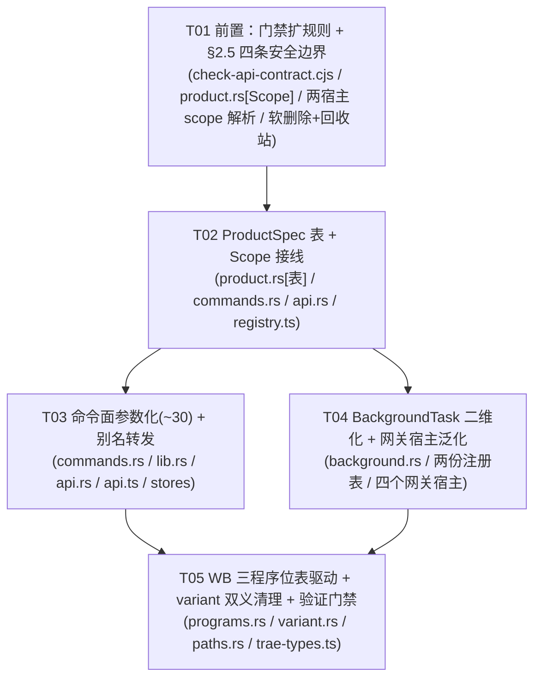

# P5 架构分解：后端收敛（`ProductSpec` + 命令面参数化 + `BackgroundTask` 二维化 + 网关宿主泛化）

> **状态**：设计（2026-10-04）。
> **上游**：`docs/redesign/PLAN.md`（v2.7）§2.4 / §2.4.1 / §2.5 / §2.6 / §2.7 / §3.3 / §4.1 / §5 的 P5 行；`docs/redesign/P5-P12-TASKS.md` §P5 与附 B；`docs/redesign/VOCABULARY.md`；`DECISIONS.md`。
> **格式参考**：`docs/redesign/P4-ARCH.md`。
> **下游**：本文件的「任务列表」直接交给工程师执行。
> **范围边界**：只做 P5 列出的六件事 —— `ProductSpec` 表 / 命令面参数化 / `BackgroundTask` 二维化 / 网关宿主泛化 / WB 三程序位表驱动 / `variant` 双义清理。
> **明确排除**：P6–P12 的一切（命令面板、备份恢复、会话工作台、悬浮窗、模型识别、请求代理）。**P5 原则上不做 UI 新功能**，只做「加数据、不改逻辑」的后端收敛；**唯一例外**：回收站的**最小恢复入口**（软删除的必需配套 —— 否则产生「有数据、没入口」中间态，见 **§2.7.1**）。
> **口径校正（重要 · 2026-10-05 工程师逐条实测）**：命令面参数化的真实收益**远小于「约三分之一」** —— **可安全参数化的只有 10/48**（旧写「约 30」**已证伪**：那 30 行里有 **20 行实际不可参数化**）；见 §2.3。

---

## 一、P5 的前置（**动 P5 之前必须先完成**）

> 这四条是**硬前置**，不是可选优化。顺序：先改门禁 → 再落地安全边界 → 才允许改命令面。理由（PLAN §5「为什么 P5 必须先改门禁再动命令面」）：保留旧命令名作别名 ⇒ 旧 ROUTES 条目立刻变成**死路由**，撞上 `check-api-contract.cjs` 第 3 条；若不先调整门禁规则，改造**第一步就红**，且红的原因与真实缺陷无关（**假失败**）。

### 前置 1 · `scripts/check-api-contract.cjs` 扩两条规则 + 处理第 3 条冲突

现状：脚本有 7 条校验（`extractRoutes` / `extractCallCommands` / `extractServerRoutes` / `extractInvokeCommands` / 单 Value 形状）。本次**新增第 8、9 条**，并**修改第 3 条**。

**要扩的两条规则（具体）：**

| 规则 | 名称 | 机检方式 | 为什么需要 |
|:---|:---|:---|:---|
| **第 8 条** | **「参数化命令必须带 `scope`」** | 脚本内维护一份 `SCOPE_PARAMETERIZED` 集合（参数化命令名清单，与 §2.3 的表同源）。对集合内每个命令断言：① `commands.rs` 该 fn 签名含名为 `scope` 的参数；② `api.ts` 对应 `call("<cmd>", {…})` 的**顶层键含 `scope`**；③ `api.rs` 对应 handler 从 query/body 读到 `scope`。任一缺失 ⇒ 报错 | 防止「参数化只做了一半」：命令签名带了 scope，但前端没传 / 服务端没读 ⇒ 桌面端与 webui 行为分叉，且**构建全绿** |
| **第 9 条** | **「scope 解析必须 fail-closed」** | 反例扫描：在 scope 解析点（`resolve_scope` / `Scope::parse` 等）**禁止**出现 `unwrap_or(Region::Cn)` / `unwrap_or_default()` / `?? DEFAULT_SCOPE` 式回落；断言解析函数返回 `Result` 且错误分支可达（用一个「未知 scope」输入跑单测，期望 `Err`） | 现状三处解析**全 fail-open**（见前置 2 第 (1) 条）。静默回落会把数据写进**错误的库**，且错误是无声的 —— 必须有机检兜住 |

**第 3 条冲突与处理（关键）：**

- **冲突成因**：第 3 条是「`ROUTES` 不得有死路由（没有任何 `call("<cmd>")` 使用它）」。参数化后前端改调新名（如 `accounts_list`），旧 `ROUTES["get_accounts"]` 就**没有任何 `call()` 引用** ⇒ 被判死路由 ⇒ 红。但旧命令**必须保留**（别名转发 + 可回滚，§2.4）。
- **处理方式（二选一，本设计**推荐 A**）**：
  - **A（推荐）：引入机器可读的 `ALIASES` 表**。在 `api.ts` 增加一张显式表 `const ALIASES: Record<string, string> = { get_accounts: "accounts_list", … }`（旧名 → 新名）。第 3 条改为：**一个 ROUTES 条目「活」当且仅当它有 `call()` 引用，或它是 `ALIASES` 的键**。再加一条正向约束：`ALIASES` 的**值**必须自身是活命令（防止别名指向死命令）。
    - 好处：死路由不是被「豁免」而是被「声明」—— 别名必须显式登记，不能悄悄腐烂。
  - **B（次选）：`ROUTE_EXEMPT_COMMANDS` 式豁免集**。把旧命令名加进一个 `ALIAS_ROUTE_COMMANDS` 集合豁免第 3 条。缺点：是**无条件的静默豁免**，别名链断了也不报。
- **另需一条硬约束**（PLAN §2.4）：**别名必须硬编码自己的 scope** —— 旧 `checkin(id)` 恒为 WB 当前 region，旧 `trae_checkin(...)` 恒为 Trae 当前 region；**不接受**「由调用方决定」或「按本机活跃客户端推断」。并且**禁止 `platform::detected_variant()` / `detect_data_dir()` 出现在任何写路径**（它们是全局探测，只适合环境自检与展示）。

**为什么这两条不能省**：门禁是唯一横跨「TS ↔ Rust ↔ 跨 crate」四处的编译期外护栏。P5 触碰 117 命令 + 99 路由，任何一处漂移的症状都是「构建全绿但某端静默失效」（桌面端 command not found / webui 抛「暂不支持」）。

### 前置 2 · §2.5 四条安全边界（**分别在哪个文件、以什么形式**）

| # | 边界 | 涉及文件（实测行号） | 落地形式 |
|:--|:---|:---|:---|
| **(1)** | **scope 解析 fail-closed** | ① `src-tauri/src/commands.rs:22-40`（`parse_region` / `parse_trae_variant`）；② `crates/buddy-switch-core/src/modules/region.rs:129-131`（`parse_region_filter`）；③ `crates/buddy-switch-server/src/api.rs:265-286`（`parse_region` / `parse_trae_variant`） | 新增 `Scope::parse(&str) -> Result<Scope, ScopeError>`（core）；把三处 `parse_*` 改为 `resolve_scope(...) -> Result<...>`，**未知 / 空 / 缺一律 `Err`**，**绝不 default**。`Region::parse` 的 `Option` 语义保留给「旧状态兼容」（`scopeFromLegacy` 式），但**参数化命令路径**一律走 `Result` |
| **(2)** | **capability 在命令分发层校验（默认拒绝）** | `src-tauri/src/commands.rs`（每个受影响命令入口）、`crates/buddy-switch-server/src/api.rs`（每个 handler 或统一中间件）、`crates/buddy-switch-core/src/modules/product.rs`（`ProductSpec.capabilities`）、`capability.rs` | 每个涉及能力的命令入口第一行 `require_capability(product, Capability::X)?`；缺能力 ⇒ `Err`（**默认拒绝**）。理由：后端现有 `trae/platform.rs` 的 `capabilities()` 只是**诊断用的 unsupported 列表**，不是执行门控；Tauri 自定义命令对 webview **全可达** ⇒ 漏配时 UI 不显示按钮但命令**仍可被调用** |
| **(3)** | **破坏性操作要有后端支撑** | `crates/buddy-switch-core/src/modules/account.rs:40-48`（`delete_account_from_path`，硬 `retain` + 原子覆写）、`crates/buddy-switch-core/src/modules/trae/account.rs`、两侧 delete 命令 | ✅ **已决策（2026-10-04）：软删除 + 回收站** —— 删除移入 `accounts.trash.<region>.json`（UI 可恢复），**永久删除 = 唯一不可逆步 ⇒ 二次确认**；批量删除 > N 条二次确认；每次破坏性操作记 **`scope + 数量 + 操作类型` 审计日志**。⚠️ 现状删除只匹配 `id`，而查找 / 备注匹配 `id` **或** `uid` ⇒ 按 `uid` 选批删会**静默空转** ⇒ 软删除 / 恢复 / 永久删除**必须统一用 `id|uid` 谓词**（与 P7 同源）。**详见 §2.7** |
| **(4)** | **跨作用域选择集按 `(scope, id)` 键控** | 前端选择态（`src/pages/AccountsPage.tsx` / `TraeAccountsPage.tsx` / 批量条）、`src/stores/*`；后端批量命令须接受 `scope` | 选中集合键 = `(scope, id)`；**切换 scope 即失效清空**。否则选中态只存 `id` 时，切到另一作用域点「批量删除」会用 A 的 id 打 B 的库（或静默空转） |

> ⚠️ **capability 接入范围（口径补记 · 2026-10-04）**：T02 的 capability 命令层校验是 **「代表性接入」而非「全量接入」** —— 只接入了**代表性命令（每侧约 10 个）**，**不是全部 117 条**。原因是硬的：
> 1. `require_capability` 需要**可失败的返回类型（`Result`）**，而**大量命令返回裸 `Value`（不可失败）**；
> 2. 强行把这些命令的签名改成 `Result` 会**变更前端契约** —— `scripts/check-api-contract.cjs` 校验 `api.ts` / `commands.rs` / `api.rs` / `generate_handler!` **四方一致**，而**契约本身就是门禁对象**，改签名即触发门禁重写，代价与收益不成比例；
> 3. **`autoRotate` 侧没有 `Result` 返回的命令** ⇒ 该侧**未接入**。
>
> ⇒ **门控覆盖了每类能力的代表命令，但不是每条命令都过门。** 这是**有意的最小接入**，不是漏做 —— 后续若要「全量接入」，须**先独立解决「裸 `Value` 命令如何表达失败」**（属独立改造，不在 P5 范围）。任何把 P5 的 capability 描述成「全命令强制」的表述都是**不准确**的。

> ✅ **已做对、P5 必须守住的隔离根基**：所有路径都由**类型化枚举**派生，raw scope 字符串**从不进路径**（`core/modules/region.rs:242`、`core/modules/trae/paths.rs:71-113`）；账号 / 凭据 / 快照 / 缓存均按 region 分家；server 仅绑 `127.0.0.1`；`safe_slot_name` 拦路径穿越。

### 前置 3 · scope 非法拒绝（与 `BUDDY_SWITCH_HOME` 先例一致）

**先例**：`crates/buddy-switch-server/src/main.rs:255-280` 的 `refuse_when_home_override_is_invalid` —— `BUDDY_SWITCH_HOME` **被设置但不合法**时**拒绝启动**（`exit(2)`），而**不是**「警告后回落真实 home」。原因（2026-09-30 真实事故）：回落会让调用方以为在隔离环境里跑，实际把账号 / 网关 Key / 签到与积分记录写到**真实数据**上，唯一的提示是一行可能被 `| head` 吞掉的 stderr 警告。

**P5 必须对齐同一先例**：scope 非法值 ⇒ **fail-closed**：

- **命令通道**：返回 `Err`（结构化错误，前端渲染空态 / 拒绝操作）；
- **HTTP 通道**：返回 4xx（不是「尽力解析」）；
- **绝不** `?? DEFAULT_SCOPE` / `unwrap_or(Region::Cn)` —— 那等于把 fail-closed 又变回 fail-open，而**静默回落会把数据写进错误的库**（`accounts_list("trae-glboal")` 静默读写 `trae-cn` 的库 ⇒ 用户看到「账号凭空消失」）。

### 前置 4 · 路径派生唯一规则不破

**唯一规则**：**「字符串 → 解析成枚举 → 查表派生路径」，中间任何一步都不许用原始字符串**（`core/modules/region.rs:242`、`core/modules/trae/paths.rs:71-113`）。

P5 引入 `Scope` / `ProductSpec` 时**必须**遵守：`resolve_scope(raw) -> Scope`（枚举）→ `product_spec(scope.product())`（查表）→ 由 `ProductSpec.dir_name` + `RegionSpec.accounts_filename`（或 `trae::paths` 的 `*_for_region`）派生路径。**禁止**把 `scope` 原始字符串拼进任何 `PathBuf`。这条是 §2.5 唯一「不能破」的规则，破它等于把 P0–P4 的隔离根基拆掉。

---

## 二、P5 主体（逐项给出文件与改动点）

### 2.1 `ProductSpec` 表（数据结构 + 放哪个 crate + 如何被两侧共用）

**放哪个 crate**：`crates/buddy-switch-core/src/modules/product.rs`（**新建**）。放 core 的理由：两个宿主（`src-tauri` 与 `buddy-switch-server`）都依赖 core；网关 crate 也已依赖 core。core 是唯一能同时被**两宿主 + 网关**引用的位置。

**数据结构（设计，非实现）：**

```rust
// crates/buddy-switch-core/src/modules/product.rs（新增）
use crate::modules::capability::Capability;
use crate::modules::region::Region;      // WB 区域
use crate::modules::trae::region::TraeRegion; // Trae 区域

/// 一条产品线（L1）。
#[derive(Debug, Clone, Copy, PartialEq, Eq, Hash, serde::Serialize, serde::Deserialize)]
#[serde(rename_all = "lowercase")]
pub enum Product { Workbuddy, Trae }

impl Product {
    /// scope 短标识（与前端 `PLATFORM_SLUG` 对齐："wb" / "trae"）。
    pub fn slug(self) -> &'static str;
    pub fn as_str(self) -> &'static str;  // "workbuddy" / "trae"
    pub fn parse(s: &str) -> Option<Product>;
    pub fn all() -> [Product; 2];
}

/// 作用域 = 平台 × 区域（L3）。**fail-closed** 的解析载体。
#[derive(Debug, Clone, Copy, PartialEq, Eq, Hash)]
pub enum Scope { WbCn, WbGlobal, TraeCn, TraeGlobal }

impl Scope {
    /// ★ fail-closed：未知 / 空 / 缺一律 `Err`，**绝不 default**（§2.5 第 (1) 条）。
    pub fn parse(s: &str) -> Result<Scope, ScopeError>;
    pub fn as_str(self) -> &'static str;   // "wb-cn" / "wb-global" / "trae-cn" / "trae-global"
    pub fn product(self) -> Product;
    /// WB 侧区域（Trae scope 调用它返回 `None`）。
    pub fn wb_region(self) -> Option<Region>;
    /// Trae 侧区域（WB scope 调用它返回 `None`）。
    pub fn trae_region(self) -> Option<TraeRegion>;
}

/// 一个产品线的全部差异（对照 `RegionSpec` 的表驱动风格）。
pub struct ProductSpec {
    pub id: Product,
    /// scope 短标识："wb" | "trae"（与前端 `PLATFORM_SLUG` **逐字对齐**）。
    pub slug: &'static str,
    /// 数据目录名：WB 用根（"."），Trae 用 "trae"（对应 `~/.buddy-switch/<dir_name>/`）。
    pub dir_name: &'static str,
    /// 该平台的区域（复用现有 `Region` / `TraeRegion` 表）。
    pub regions: &'static [Scope],
    /// 该平台的程序位（WB 见 §2.5；Trae 复用 `trae::region::ProgramSpec`）。
    pub programs: &'static [ProgramSpec],
    /// 平台能力（与前端 `registry.ts` 的 `Capability` **逐字对齐**）。
    pub capabilities: &'static [Capability],
}

pub fn product_spec(p: Product) -> &'static ProductSpec;
pub fn product_spec_for_scope(scope: Scope) -> &'static ProductSpec;
```

**如何被两侧共用**：`mod.rs` 加 `pub mod product;`。`src-tauri/src/commands.rs` 与 `crates/buddy-switch-server/src/api.rs` 各自 `use buddy_switch_core::modules::product::{Scope, Product, product_spec};`。**两份 `ProductSpec` 数据只写一次**（core），两侧只调用 `product_spec(...)`，不各写一份 —— 这正是「新增平台的**新增命令**注册点收敛到 2 处」的落点。

> ⚠️ **诚实口径（PLAN §2.4.1）**：`ProductSpec` 只收敛「**新增命令**的注册点」。**存量**注册点一个都减不掉（别名转发 ⇒ 旧 `generate_handler!` / 旧 `.route` / 旧 ROUTES 条目全保留）。且前端另有 **≥5 处**、后端另有 **≥10 处** 必须改（§4.1）。

### 2.2 `BackgroundTask` 二维化

**现状**：**两份注册表**（`src-tauri/src/lib.rs:39-82` 与 `crates/buddy-switch-server/src/main.rs:41-93`），各自一个扁平 `enum BackgroundTask` + `background_tasks()` + `spawn_background_task()`。产品名进枚举名（`TraeCreditsRefresh`），任务种类与产品混在一起。

**目标**：`(Product, TaskKind)` 二维，**表本体移进 core**：

```rust
// crates/buddy-switch-core/src/modules/background.rs（新增）
pub enum TaskKind { StartupMaintenance, AutoRotate, CreditsRefresh, PoolPersist, TraeCreditsRefresh, Scheduled(schedule::ScheduleTask) }
pub struct TaskSpec { pub product: Product, pub kind: TaskKind, pub interval: Duration }
/// 单一事实来源，两个宿主共用。
pub const TASKS: &[TaskSpec] = &[ /* … */ ];
```

**落地边界**：**表本体**（「有哪些任务」）移进 core；**两个宿主各自保留 `spawn` 分支**（「怎么启动」）—— 因为启动方式与宿主运行时绑定（Tauri 用 `tauri::async_runtime::spawn`，server 用 `tokio::spawn`）。这**不破坏**「两个宿主各一份、是唯一事实来源」的既有约定，只是把「有哪些」与「怎么启动」分开。

> ⚠️ **登记即执行（硬约束）**：新增「**写状态 / 周期性**」出口**先 grep 两侧注册表**（`src-tauri/src/lib.rs` 与 `crates/buddy-switch-server/src/main.rs`）确认是否需登记。既有护栏测试（`background_tasks_cover_all_scheduled_tasks` / `background_task_registry_includes_*`）在两侧都有，改动后**两侧都要补测试**。

### 2.3 命令面参数化（**列出具体哪些能参数化、哪些必须保留命名空间**）

**只有「两平台概念同构」的命令可参数化**（PLAN §2.4）。命名目标：`*_for(scope, …)` 风格，如 `accounts_list(scope)` / `account_delete(scope, …)` / `credits(scope)`。

> ⚠️ **口径校正（重要 · 2026-10-05 工程师逐条实测）**：本节原写「可参数化约 **30/48**，收益约三分之一」——**已证伪**。**逐条核对 48 条 Trae 命令后，可安全参数化的只有 10 条**；旧表那 ~30 行里，**有 20 行是「看着能参数化、实际不能」**（网关家族是死参数、若干命令非同构、`token_stats` 语义打架…）。**⇒ 别照旧表去试**，理由见下方两张表。

**可参数化（★ 实测 10/48）** —— Trae 命令 → WB 同构命令 → 参数化后名：

| Trae 命令 | WB 同构命令 | 参数化后 | 类别 |
|:---|:---|:---|:---|
| `get_trae_accounts` | `get_accounts` | `accounts_list(scope)` | 账号 |
| `trae_delete_account` | `delete_account` | `account_delete(scope, …)` | 账号 |
| `trae_set_account_remark` | `set_account_remark` | `account_remark(scope, …)` | 账号 |
| `get_trae_checkin_status` | `get_checkin_status` | `checkin_status(scope)` | 签到 |
| `get_trae_credits` | `get_credit_expiry` | `credits(scope)` | 积分 |
| `trae_import_local_account` | `import_local` | `import_local(scope)` | 导入导出 |
| `trae_export_accounts` | `export_accounts` | `export_accounts(scope)` | 导入导出 |
| `trae_export_accounts_to_path` | `export_accounts_to_path` | `export_accounts_to_path(scope)` | 导入导出 |
| `trae_import_accounts` | `import_accounts` | `import_accounts(scope)` | 导入导出 |
| `open_trae_data_dir` | `open_workbuddy_data_dir` | `open_data_dir(scope)` | 目录 |

> `open_data_dir` / `import_local` 由工程师**新做**（`open_data_dir` = 打开数据目录、跨平台同构；`import_local` = 本地导入、跨平台同构）。

**★ 不可参数化（38/48）—— 分两类，逐条给理由**：

**第一类 · 概念独有（约 18 条，无 `scope` 化语义）**：

`get_trae_env` · `get_trae_variants` · `get_trae_capabilities` · `get_trae_profiles` · `get_trae_settings` · `save_trae_settings` · `trae_oauth_cancel` · `trae_group_op` · `trae_refresh_jwt` · `trae_clear_cooldown` · `trae_merge_legacy_regions` · `trae_save_login` · `trae_backup_profile` · `trae_restore_profile` · `trae_delete_profile` · `trae_reset_device` · `get_trae_client_models` · `trae_launch_client`

> ⚠️ **诚实边界（PLAN §2.4，必须写进验收）**：这 ~18 条**概念 Trae 独有**（profiles / device / jwt / cooldown / group / legacy-merge / variants / capabilities / env / client-models / save-login / oauth-cancel…），**没有 `scope` 化语义** —— 硬套 `trae_xxx(scope)` 只会把平台名藏进参数，是**假收敛**。**保留 `trae_*` 前缀**就是它们的正确形态。

**第二类 · 看着能参数化、实际不能（约 20 条 · ★ 工程师逐条实测证伪 —— 别照旧表试）**：

| 命令 / 家族 | 为什么**不能**参数化（证据） |
|:---|:---|
| **网关家族**：`get_trae_gateway_config` · `save_trae_gateway_config` · `trae_gateway_status` · `get_trae_gateway_models` · `get_trae_gateway_logs` · `clear_trae_gateway_logs` · `list_trae_api_keys` · `create_trae_api_key` · `revoke_trae_api_key` · `delete_trae_api_key` | **WB 网关是单实例全局（不带 region）** ⇒ `scope` 是**死参数**（传了也不改变行为）⇒ **假收敛** |
| `get_trae_token_statistics`（`token_stats`） | Trae 的 `scope` **已经是 `TraeTokenScope`**（work / cn / unlabeled / all）⇒ 再折叠「平台-区域」轴会**语义打架**（两个 `scope` 同名不同义） |
| `trae_preview_import_accounts`（`import_preview`） | **纯函数、显式忽略 region** ⇒ `scope` 是**死参数** |
| `trae_checkin`（`account_checkin`） | WB 是**单账号**签到 vs Trae 是**批量**（且带进度事件）⇒ **非同构**（参数集与返回形状都不同） |
| `trae_switch_account`（`account_switch`） | 参数集**完全不同**，且**会关 / 重启客户端进程** ⇒ 与 WB 的「切换」非同构 |
| `trae_oauth_start` · `trae_oauth_status` | **配对非同构**：WB 需要 region、Trae 不需要 ⇒ 参数面不一致 |
| `get_trae_credits`(刷新)（`credits_refresh`）· `get_trae_logs`（`logs`）· `trae_add_account` · `trae_update_account` | **形状非同构 / WB 无同构命令**（WB 日志是 `get_checkin_logs` 专用查询；WB 无严格同构的「新增 / 更新账号」命令）⇒ 硬折叠会把差异藏进参数 |

> ⇒ **48 条 = 可参数化 10 + 不可参数化 38**（其中 **18 条概念独有** + **20 条看着能参数化、实际不能**）。**收益 ≈ 10/48 ≈ 五分之一** —— **不是「约三分之一」，更不是「减半」**。旧口径「约 30」**已证伪**：任何沿用「约 30 / 约三分之一 / 减半」的表述都**与实测不符**。

**四处同步（改命令后必做，硬约束）**：新增 / 参数化命令必须**同步四处**：`api.ts` ROUTES + `call()` / `generate_handler!` / server `.route` / 命令本体。缺一处 ⇒ `check:api` 红。

> ⚠️ **Tauri 按参数名取值** ⇒ **单 `Value` 参数命令必须传 `{ <参数名>: {…} }`**（否则浏览器好、桌面端报 `missing required key`）。参数化命令若实现为单 `Value`（如 `accounts_list(options: Value)`），前端必须 `call("accounts_list", { options: { scope } })`；脚本第 7 条会硬校验。

### 2.4 网关宿主泛化（⚠️ axum 同路径 merge 会 panic）

**现状**：**两对**平行网关宿主 ——
- server 侧：`crates/buddy-switch-server/src/gateway_host.rs`（WB）+ `trae_gateway_host.rs`（Trae）；
- tauri 侧：`src-tauri/src/gateway.rs`（WB）+ `trae_gateway.rs`（Trae）；
- 网关本体：`crates/buddy-switch-gateway/src/lib.rs`（WB router）+ `trae/mod.rs`（Trae router）。

**硬约束（`trae_gateway_host.rs:3` 注释，PLAN §4.1）**：两者**平行且有意不复用**，因为 **axum 对同一路径 `merge` 两个 router 会 panic**。`buddy_switch_gateway::trae::router()` 也挂 `/v1/models` 与 `/v1/chat/completions`，与 WB 网关路径**逐字相同**。⇒ **不能简单合并成一个结构体**，否则运行期直接崩。

**规避方式（必须写清，二选一或并用）**：

1. **按平台各持一个 router，在「不同挂载前缀」下 merge / nest**：WB 网关与 Trae 网关**各自独立端口**（现状：WB 57891 / Trae 7864）—— 泛化**不改变端口分离**，只去重那约 40 行生命周期代码；
2. **显式声明路径所有权**：泛型 `GatewayHost<P: GatewayProduct>`，`GatewayProduct` trait 提供 `type State`、`fn router(state) -> Router`、`fn spawn_listener(state) -> …`、`fn config() -> …`。**路径所有权由各 impl 声明**（WB impl 声明 `/v1/*` 归它，Trae impl 同理），泛型层**绝不把两个 router merge 到同一个 `Router`**。

**明确不做**：不把两个网关塞进**同一个监听端口**靠前缀区分（会让客户端配置难以理解，且撞 axum 同路径 panic）。

### 2.5 WB 三程序位表驱动

**现状**：三个程序位各自独立模块 + 独立命令，硬编码调用：
- `crates/buddy-switch-core/src/modules/codebuddy_cli.rs`（1263 行）→ `get_codebuddy_cli_status` / `install_codebuddy_cli_helper` / `switch_codebuddy_cli_account`；
- `codebuddy_cn_ide.rs`（1303 行）→ `get_codebuddy_cn_ide_status` / `switch_codebuddy_cn_ide_account` / `detect_codebuddy_cn_ide_account`；
- `vscode_cn_inject.rs`（673 行）→ 第三个程序位（VS Code CodeBuddy 插件同源加密模型）。

**目标**：WB 程序位提升为**表**（`ProgramSpec` + `ProgramAdapter` trait），加第 3 个程序位**无需改代码**：

```rust
// crates/buddy-switch-core/src/modules/programs.rs（新增）
pub struct ProgramSpec {
    pub id: &'static str,          // "codebuddy_cli" | "codebuddy_cn_ide" | "vscode_cn_inject"
    pub label_key: &'static str,   // i18n 键（不存成品文案）
    pub adapter: &'static dyn ProgramAdapter,
}
/// 统一操作面。做不到的操作返回结构化 `Unsupported`（`capability.rs`），**绝不 panic**。
pub trait ProgramAdapter {
    fn status(&self) -> Result<Value, String>;
    fn switch(&self, account_id: &str, restart: Option<bool>) -> Result<Value, String>;
    fn detect(&self) -> Result<Value, String> { Ok(Unsupported::new(...).to_json()) }
}
```

> ⚠️ **真实难点**：三个模块的 API **不一致**（`status` / `install_helper` / `set_active_account` vs `status` / `switch_account` / `detect_current_account`）⇒ 需要 **per-module adapter impl** 把差异收敛到 trait 面；做不到的操作（如 `install_helper`）走结构化 `Unsupported`，**不假装成功**。
> ⚠️ **验收项**：**加第 3 个 WB 程序位无需改代码**（只加一行表项 + 一个 adapter impl）。这条**必须可证伪**（见 §8）。

### 2.6 `variant` 双义清理

**问题**：`variant` 一个词被用来表达**两个概念** —— 既指「国内版 / 国际版」（**区域**），又指「TraeWork / TraeCode」（**程序位**）。这是最要命的混淆（VOCABULARY §4）。

**拆分规则**（VOCABULARY §4）：
- 指「国内版 / 国际版」⇒ 用 **`region`**（`TraeRegion`）；
- 指「TraeWork / TraeCode」⇒ 用 **`program`**（`TraeProgram`）。

**删除时点**：**P0 冻结 → P5 清退**。⚠️ **漏改会静默**（前端读到 `undefined`）。

**涉及文件与改动点**：
- `crates/buddy-switch-core/src/modules/trae/variant.rs`（1061 行，`TraeVariant` 单轴）：标记 `#[deprecated]`，调用点逐段迁到 `region.rs` 的 `TraeRegion` / `TraeProgram` 双轴；全部迁完后删除。
- `crates/buddy-switch-core/src/modules/trae/paths.rs`（1123 行）：**两代并存是过渡态** —— 旧 `*_for(variant)` 家族（`scoped_file` / `scoped_file_for_region` 上方的产品线命名）与新 `*_for_region` 家族并存。迁完后**删除旧家族**。
- `crates/buddy-switch-core/src/modules/trae/region.rs`（`TraeRegion` / `TraeProgram` / `ProgramSpec` 已是目标形态）。
- 前端 `src/lib/trae-types.ts`：`TraeVariantId` 拆为 `TraeRegionId` + `TraeProgramId`；`src/pages/TraeAccountsPage.tsx`（P4 已开始加 `region`）。
- ⚠️ **删除前必须确认**：前端 `TraeProgramId` / `TraeRegionId` **已完全替代**旧字段后再删（否则静默读到 `undefined`）。这是 §9 待确认项。

### 2.7 破坏性操作：软删除 + 回收站（★ 决策已定 · 2026-10-04）

> **上游决策**：§3.5 待明确 #2 已拍板为 **「软删除 + 回收站」**（不再「软删除 或 快照」二选一）。
> **同源依据**：`DECISIONS.md` D18（可撤销要有后端支撑）、PLAN §3.5（「**UI 不许承诺后端做不到的撤销**」）、PLAN §2.5 第 (3) 条。
> **直接动因**：§前置 2 第 (3) 条已确认的两个**真实缺陷** —— ① 三处 scope 解析 **fail-open**；② 删除按 `id` 匹配、而查找 / 备注按 `id|uid` ⇒ **按 uid 批删静默空转**。本设计**必须**与这两点对齐（见下「硬约束」）。

**决策内容**

| 操作 | 语义 | 可逆性 |
|:---|:---|:---|
| **删除** | 账号记录从 `accounts.<region>.json` **移入** `accounts.trash.<region>.json`（附 `deleted_at` / `expires_at`） | ✅ 可恢复 |
| **恢复** | 从 trash 移回 live | — |
| **永久删除（purge）** | 从 trash **真删** + 删除关联凭据 / 快照 | ❌ **不可逆**（唯一不可逆步） |

**为什么软删除（而非「删除前快照」）**：不可逆数据操作**优先保可恢复性**。快照方案的恢复粒度是**整库回滚**（会连「删除之后的新增」一起回退），而软删除的恢复粒度是**单条**，且天然提供 UI 入口。软删除的代价是**多一个文件 + 留存策略**，可接受。

**与两个已确认缺陷对齐（★ 硬约束）**

1. **scope fail-open ⇒ trash 路径与命令同样 fail-closed**：`accounts.trash.<region>.json` 必须由 **`resolve_scope(raw) -> Scope` → 查表派生**（新增 `accounts_trash_file_for(region)`），**禁止**把原始 scope 字符串拼进 `PathBuf`（§前置 4）。四条 trash 命令**全部带 `scope`** 且走 `Result`：`account_trash_list("trae-glboal")` 必须 `Err`，**绝不**静默读 `trae-cn` 的 trash（否则用户「删了 A 库的账号，却在 B 库的回收站里找不到 / 或看到 B 库的账号」）。
2. **`id` vs `uid` 匹配不一致 ⇒ 必须统一谓词**：软删除 / 恢复 / 永久删除**三者共用同一谓词**（`id` **或** `uid`，即 `find_account_in` 的谓词）。若沿用现状 `delete_account_from_path` 的「仅 `id`」谓词，则**按 `uid` 批删会「移了 0 条却报成功」**，软删除会把这个静默缺陷**原样带进回收站**（更隐蔽）。落地：抽 `resolve_account_key(region, key) -> Result<…>` 作**唯一匹配出口**。

**数据结构（设计，非实现）**

```rust
// crates/buddy-switch-core/src/modules/account.rs（+ trae/account.rs 同构）
// 文件：accounts.trash.<region>.json（路径经 enum→table 派生，非字符串拼接）
#[derive(serde::Serialize, serde::Deserialize)]
pub struct TrashEntry {
    pub account: Value,       // 原账号记录（原样保留 ⇒ 恢复无损）
    pub deleted_at: i64,      // ms
    pub expires_at: i64,      // ms（= deleted_at + 留存窗口）
    pub origin_scope: Scope,  // 冗余存 scope，便于跨 scope 审计
}
// 谓词唯一出口（id 或 uid）
pub fn resolve_account_key(region: Region, key: &str) -> Result<AccountRef, String>;
// 软删除 / 恢复 / 永久删除 / 读取 / 留存清理
pub fn trash_account_for(region: Region, key: &str) -> Result<(), String>;
pub fn restore_account_for(region: Region, key: &str) -> Result<(), String>;
pub fn purge_account_for(region: Region, key: &str) -> Result<(), String>;
pub fn load_trash_for(region: Region) -> Vec<TrashEntry>;
pub fn sweep_trash_for(region: Region, now: i64) -> usize; // 留存策略
```

**凭据 / 快照怎么处理**：软删除**只搬移账号记录**；关联凭据 / 快照文件**保持原位不动**（⇒ 恢复无损）。**只有 `purge` 才删除凭据**（否则「删了账号，token 还在」）。⚠️ 待工程确认：凭据是**按账号分文件**还是**内嵌在记录里** —— 若内嵌，则随记录一起搬移，无需额外处理。

**命令面（新增 4 条；非参数化、无别名 ⇒ 不受 §2.3 参数化影响）**

- `account_trash_list(scope)` · `account_restore(scope, key)` · `account_purge(scope, key)` · `account_trash_clear(scope)`
- 四处同步照旧：`api.ts` ROUTES + `call()` / `generate_handler!` / server `.route` / 命令本体（§2.3）。
- 单 `Value` 参数命令前端传 `{ <参数名>: {…} }`（§2.3 第 7 条）。

**审计日志**：每次破坏性操作记 `scope + 数量 + 操作类型（soft_delete / restore / purge / sweep）+ 账号标识`。

#### 2.7.1 恢复入口（UI）与承载期次 ★

**落点**

- **组件**：新建 `src/components/recycle-bin-sheet.tsx`（复用 `ui/sheet.tsx` / `ui/empty-state.tsx` / `ui/dialog.tsx`）。
- **入口**：账号页工具栏「回收站」按钮 —— `src/pages/AccountsPage.tsx` / `src/pages/TraeAccountsPage.tsx`，按**当前 scope** 过滤。
- **不放设置页**：避免与 P7「备份与恢复」（§3.14，**整库级 / 跨 scope**）语义混淆 —— 回收站是**账号级 / 单 scope**。
- **内容**：账号名 · 删除时间 · **到期时间** · 来源 scope · 「恢复」·「永久删除」·「清空回收站」。

**承载期次：✅ 已确认（lead 拍板 · 2026-10-04）—— 回收站 UI 与后端同批交付，放入 T01**

- P5 原边界写的是「**不做任何 UI 新功能**」。**我建议对这条边界做一次定向扩张**：把回收站的**最小恢复入口**放进 P5。
- 理由：
  1. 软删除的**成本在 P5 已付出**（新文件、留存、迁移、审计），**收益（用户可恢复）必须同批交付**，否则是半成品。
  2. 若 UI 后补（P6）⇒ P5→P6 窗口是「**有数据、没入口**」的中间态：数据已进 trash，但用户**没有任何恢复路径**，软删除对用户**零收益**（只有能手改 JSON 的极客能受益）。
  3. 更危险的是**文案 / 事实反转**：P5 后若 UI 已改文案为「可在回收站恢复」而入口未做 ⇒ **假承诺**（PLAN §3.5 红线）；若 UI 仍写「不可撤销」而后端已可恢复 ⇒ 误导。
  4. **不违反 P5「排最后」的理由**：P5 排最后的原因是「命令面**参数化**会让 UI 迭代要同步两套命令面」；回收站用的是**全新命令**（非参数化、无别名），**不产生**该同步问题 ⇒ 一个自包含 UI 组件是安全的。
  5. **规模可控**：1 组件 + 4 命令，**不触碰** P5 的 117 命令主体。
- **结论（已确认）**：✅ **回收站最小入口进 P5（T01），UI 与后端同批交付**。lead 已拍板采纳（2026-10-04）；对 P5「不做 UI」边界的**定向扩张**已获确认。决策理由（三条，尤其后两条）：
  1. 只做后端 ⇒ P5→P6 窗口内数据已进 trash 但**用户没有任何恢复路径** ⇒ 软删除对普通用户**零收益**（只有能手改 JSON 的人受益）；
  2. **假承诺是红线**（PLAN §3.5）—— 文案写「可恢复」而入口没做，比不写更糟；反之写「不可撤销」而后端已可恢复，同样误导。两个方向都错；
  3. **P5「排最后」的理由不适用于这个 UI** —— 那条理由是「命令面**参数化**会让 UI 迭代要同步两套命令面」，而回收站用**全新命令**（非参数化、无别名）⇒ 不产生该同步问题；规模可控（1 组件 + 4 命令），不碰 117 命令主体。
- **若不进 P5 的兜底（硬约束）—— ⚠️ 当前不适用**：P5 期间删除相关文案**一律不得出现「可恢复 / 回收站 / 撤销」承诺**，直到承载期次落地 —— 否则就是「UI 承诺后端做不到的撤销」的**镜像版**（后端做到了、UI 没入口，却已承诺可恢复），同样违反 PLAN §3.5。
  - **为何当前不适用**：lead 已拍板 **UI 与后端同批交付** ⇒ 不存在「后端已可恢复、UI 没入口」的中间态，本条无需生效。
  - **重新生效条件（保留作预案，勿删）**：若将来改为**分批交付**（后端先、UI 后），本条**立即重新生效**。

**永久删除（purge）是否保留：保留**

- 理由：无 purge ⇒ ① 回收站**无限增长**；② 已删账号的**凭据永不销毁**（安全：token 不应无限期留存）。
- purge 是**唯一真正不可逆**的一步 ⇒ **必须二次确认**（danger Dialog，明示「永久删除，不可恢复」）。
- **批量 purge / 清空回收站** ⇒ 更强确认（明示将删除的**条数**）。
- purge 必须**同时删除关联凭据 / 快照**。

**留存策略（建议）**

- **默认：N 天自动清理（30 天）+ 上限条数（200 条，先到先出）**。
- 理由：
  - 回收站**含凭据** ⇒ **不能永久保留**（安全：已删账号 token 不应无限期留存）。
  - **30 天**是 OS 级回收站的通用预期，用户有合理恢复窗口。
  - **上限 200 条**防「批量导入 → 批量删除」把文件撑爆。
  - UI **明示每条到期时间**，避免「以为还在」的假期待。
- **执行**：复用 P5 的 `BackgroundTask::StartupMaintenance`（启动维护）跑 `sweep_trash_for`，**不新增调度器**（§2.2）。
- **不提供用户可配置项**（避免 scope creep）；如确需，后续期再加。

---

## 三、其余

### 3.1 文件列表

**新建**

| 相对路径 | 作用 |
|:---|:---|
| `crates/buddy-switch-core/src/modules/product.rs` | `Product` + `Scope`（fail-closed 解析）+ `ProductSpec` 表 + `product_spec()` |
| `crates/buddy-switch-core/src/modules/programs.rs` | WB 程序位表 + `ProgramAdapter` trait（§2.5） |
| `crates/buddy-switch-core/src/modules/background.rs` | `TaskKind` + `TaskSpec` + `TASKS` 单一事实来源（§2.2） |
| `src/components/recycle-bin-sheet.tsx` | 回收站入口：列 / 恢复 / 永久删除 / 清空（按 scope 过滤）（§2.7） |
| `docs/redesign/P5-ARCH.md` | 本文档 |

**修改**

| 相对路径 | 改动 |
|:---|:---|
| `crates/buddy-switch-core/src/modules/mod.rs` | `pub mod product; pub mod programs; pub mod background;` |
| `crates/buddy-switch-core/src/modules/region.rs` | `parse_region_filter` 保持（统计用途）；补 `Region` 与 `Scope` 的对齐测试；**不破** `accounts_file_for` 的枚举派生 |
| `crates/buddy-switch-core/src/modules/account.rs` | 破坏性删除：**软删除 + 回收站**（`accounts.trash.<region>.json`）+ 恢复 / 永久删除 + 留存 sweep + 审计日志 + `id`/`uid` 匹配统一（§2.7） |
| `crates/buddy-switch-core/src/modules/trae/account.rs` | 同上（Trae 侧：软删除 + 回收站 + 恢复 / 永久删除，§2.7） |
| `crates/buddy-switch-core/src/modules/trae/paths.rs` | 迁完旧 `*_for(variant)` 家族后删除；**不破**区域派生 |
| `crates/buddy-switch-core/src/modules/trae/variant.rs` | `#[deprecated]` + 调用点迁移；清退时删除 |
| `src-tauri/src/commands.rs` | `parse_region` → `resolve_scope`（fail-closed）；capability 命令层校验；参数化命令 + 别名转发；新程序位命令 |
| `src-tauri/src/lib.rs` | `generate_handler!` 同步；`BackgroundTask` 表本体移 core（保留 spawn 分支） |
| `src-tauri/src/gateway.rs` / `trae_gateway.rs` | 网关宿主泛化（§2.4，**不合并 router**） |
| `crates/buddy-switch-server/src/api.rs` | `parse_region` → `resolve_scope`（fail-closed）；capability 校验；参数化 `.route` + 别名 `.route` |
| `crates/buddy-switch-server/src/main.rs` | `BackgroundTask` 表本体移 core（保留 spawn 分支） |
| `crates/buddy-switch-server/src/gateway_host.rs` / `trae_gateway_host.rs` | 网关宿主泛化（§2.4） |
| `crates/buddy-switch-gateway/src/lib.rs` / `trae/mod.rs` | `GatewayProduct` trait / 路径所有权声明（§2.4） |
| `scripts/check-api-contract.cjs` | 新增第 8、9 条 + 修改第 3 条（`ALIASES` 表）（§前置 1） |
| `src/lib/api.ts` | `ROUTES` + `call()` + `ALIASES` 表 + `DEMO_READ_COMMANDS`（参数化只读命令同步）；新增回收站 4 命令（§2.7） |
| `src/lib/screenshot-demo.ts` | 新增只读命令的 case 分支（脚本第 6 条强制） |
| `src/pages/AccountsPage.tsx` / `src/pages/TraeAccountsPage.tsx` | 工具栏「回收站」入口（按当前 scope，§2.7.1） |
| `src/lib/trae-types.ts` | `TraeVariantId` → `TraeRegionId` + `TraeProgramId`（§2.6） |
| `src/stores/*` | 缓存键编码**全部影响结果的入参（含 `scope`）**（§4.1 第 7 项） |
| `src/lib/platforms/registry.ts` | `Capability` 与后端 `ProductSpec.capabilities` **逐字对齐**（护栏） |
| `src/locales/domains/*`（zh + en 同步） | 新平台名 / 区域名 / 程序位名（`TranslationKey` 是编译期类型，缺则 `tsc` 红） |

> ⚠️ **最小可提交单元要查跨文件依赖**：`ALIASES` 表（`api.ts`）与门禁第 3 条（`check-api-contract.cjs`）**必须同批**（A 用 B 的新符号）；`ProductSpec`（core）与两宿主接线**必须同批**（否则编译不过）。**不保留死代码**。

### 3.2 任务列表（有序 · 含依赖 · 按实现顺序）

> **硬性顺序**：T01 → T02 → T03 → T05；T02 → T04 → T05。
> **原子提交**：T01 的「门禁扩规则 + `ALIASES` 表」同一提交（否则改造第一步即红）；T02 的「core `ProductSpec` + 两宿主接线」同一提交（否则编译不过）。
> **P0 = 必须；P1 = 重要；P2 = 可裁剪。** 本期全部 P0。

#### T01 · 前置：门禁扩规则 + §2.5 四条安全边界 + 软删除 / 回收站（含最小 UI 入口） ｜ P0
- **源文件**
  - 修改 `scripts/check-api-contract.cjs`（新增第 8 条「参数化命令带 scope」、第 9 条「scope 解析 fail-closed」；修改第 3 条以 `ALIASES` 表为准）
  - 新建 `crates/buddy-switch-core/src/modules/product.rs`（**先只落 `Scope` + `Product` + fail-closed `Scope::parse`**，`ProductSpec` 表在 T02 补全）
  - 修改 `crates/buddy-switch-core/src/modules/mod.rs`（`pub mod product;`）
  - 修改 `src-tauri/src/commands.rs`（`parse_region` → `resolve_scope`，fail-closed）
  - 修改 `crates/buddy-switch-server/src/api.rs`（`parse_region` → `resolve_scope`，fail-closed）
  - 修改 `crates/buddy-switch-core/src/modules/account.rs` + `trae/account.rs`（**软删除 + 回收站**：trash 文件 / 恢复 / 永久删除 / 留存 sweep + 审计日志；`id`/`uid` 统一谓词）
  - 修改 `src/lib/api.ts`（新增 `ALIASES` 表骨架 + 回收站 4 命令 `account_trash_list` / `account_restore` / `account_purge` / `account_trash_clear`）
  - 新建 `src/components/recycle-bin-sheet.tsx`（回收站入口：列 / 恢复 / 永久删除 / 清空，§2.7.1）
  - 修改 `src/pages/AccountsPage.tsx` / `src/pages/TraeAccountsPage.tsx`（工具栏「回收站」入口，按当前 scope）
  - 修改 `src/locales/domains/*`（回收站词条，zh + en 同步）
- **依赖**：无
- **要点**：四条安全边界**全部落地**（§前置 2）；scope 非法 ⇒ `Err` / 4xx，**不落盘**；与 `BUDDY_SWITCH_HOME` 先例一致（fail-closed，不回落）；**路径派生唯一规则不破**（§前置 4）；第 3 条改造**必须先于**任何命令面改动。**破坏性操作 = 软删除 + 回收站**（§2.7）：trash 路径经 enum→table 派生、四条 trash 命令**带 scope 且 fail-closed**、软删除 / 恢复 / 永久删除**共用 `id|uid` 谓词**（否则按 uid 批删静默空转）、**永久删除二次确认**；**回收站最小 UI 入口与后端同批交付**（否则产生「有数据、没入口」中间态，§2.7.1）。

#### T02 · `ProductSpec` 表 + `Scope` 接线（两宿主）｜ P0
- **源文件**
  - 修改 `crates/buddy-switch-core/src/modules/product.rs`（补全 `ProductSpec` 表 + `product_spec()` + `capabilities`）
  - 修改 `src-tauri/src/commands.rs`（`use product::{Scope, product_spec}`；capability 命令层校验接入点）
  - 修改 `crates/buddy-switch-server/src/api.rs`（同上）
  - 修改 `src/lib/platforms/registry.ts`（`Capability` 与后端逐字对齐；护栏）
- **依赖**：T01
- **要点**：`ProductSpec` 数据**只写一次**（core），两宿主只 `product_spec(...)`；capability **默认拒绝**（缺能力 ⇒ `Err`）；`slug` 与前端 `PLATFORM_SLUG` 逐字对齐（加护栏断言）；**存量注册点不动**（别名保留）。

#### T03 · 命令面参数化（★ 实测 10 条）+ 别名转发 ｜ P0
- **源文件**
  - 修改 `src-tauri/src/commands.rs`（新增参数化命令本体 + 旧命令别名转发，**别名硬编码自己的 scope**）
  - 修改 `src-tauri/src/lib.rs`（`generate_handler!` 同步）
  - 修改 `crates/buddy-switch-server/src/api.rs`（参数化 `.route` + 别名 `.route`）
  - 修改 `src/lib/api.ts`（`ROUTES` + `call()` + `ALIASES` 补全 + `DEMO_READ_COMMANDS`）
  - 修改 `src/lib/screenshot-demo.ts`（参数化只读命令的 case）
  - 修改 `src/stores/*`（缓存键编码含 `scope`）
- **依赖**：T02
- **要点**：**四处同步**（ROUTES+call / generate_handler / server route / 命令本体）；**★ 实测 10/48，收益 ≈ 五分之一**（旧口径「约 30 / 约三分之一」**已证伪**，不得再写）；**不可参数化的 38 条**（18 条概念独有 + 20 条看着能参数化实际不能，§2.3）**保留命名空间 / 不参数化**；别名**硬编码自己的 scope**，**禁止** `detected_variant()` / `detect_data_dir()` 进写路径；单 `Value` 参数命令前端传 `{ <参数名>: {…} }`。

#### T04 · `BackgroundTask` 二维化 + 网关宿主泛化 ｜ P0
- **源文件**
  - 新建 `crates/buddy-switch-core/src/modules/background.rs`（`TaskKind` + `TaskSpec` + `TASKS`）
  - 修改 `crates/buddy-switch-core/src/modules/mod.rs`（`pub mod background;`）
  - 修改 `src-tauri/src/lib.rs`（表本体移 core，保留 spawn 分支 + 补测试）
  - 修改 `crates/buddy-switch-server/src/main.rs`（同上）
  - 修改 `src-tauri/src/gateway.rs` / `trae_gateway.rs`（泛化，**不合并 router**）
  - 修改 `crates/buddy-switch-server/src/gateway_host.rs` / `trae_gateway_host.rs`（同上）
  - 修改 `crates/buddy-switch-gateway/src/lib.rs` / `trae/mod.rs`（`GatewayProduct` trait / 路径所有权）
- **依赖**：T02
- **要点**：⚠️ **登记即执行** —— 新增「写状态 / 周期性」出口**先 grep 两侧注册表**；表本体进 core、两宿主保留 spawn（**不破**「两侧都登记」约定）；⚠️ **axum 同路径 merge 会 panic** ⇒ 泛化**必须**按平台各持 router + 不同挂载前缀 / 显式路径所有权，**绝不**合成一个结构体；泛化**不改变**端口分离（WB 57891 / Trae 7864）。

#### T05 · WB 三程序位表驱动 + `variant` 双义清理 + 验证与门禁 ｜ P0
- **源文件**
  - 新建 `crates/buddy-switch-core/src/modules/programs.rs`（`ProgramSpec` + `ProgramAdapter` trait）
  - 修改 `crates/buddy-switch-core/src/modules/mod.rs`（`pub mod programs;`）
  - 修改 `src-tauri/src/commands.rs` / `lib.rs`、`crates/buddy-switch-server/src/api.rs`（程序位命令走表）
  - 修改 `crates/buddy-switch-core/src/modules/trae/variant.rs`（`#[deprecated]` + 调用点迁移 / 清退）
  - 修改 `crates/buddy-switch-core/src/modules/trae/paths.rs`（删除旧 `*_for(variant)` 家族）
  - 修改 `src/lib/trae-types.ts`（`TraeRegionId` + `TraeProgramId`）
  - 修改 `src/locales/domains/*`（新程序位 / 区域词条，zh + en）
- **依赖**：T03、T04
- **要点**：WB 程序位表驱动，**加第 3 个程序位无需改代码**（可证伪）；`variant` 双义清退**必须在**前端 `TraeProgramId` / `TraeRegionId` **完全替代**旧字段之后（否则静默 `undefined`）；收尾跑**门禁四条 + `check:store-selectors` + cargo 全量**（见 §8）。

**任务依赖图**



### 3.3 风险点（P5 是「最危险期次」，风险要写透）

| # | 风险 | 影响 | 缓解 |
|:--|:---|:---|:---|
| R1 | **触碰 117 命令 + 99 路由 + 门禁 + 全部既有测试** | 任何一处漂移都是「构建全绿但某端静默失效」 | 门禁四条每任务后全绿；参数化**先门禁后命令面**；小步提交 |
| R2 | **`variant` 双义清理漏改** | 静默读到 `undefined`（前端不报错） | 删除时点严格（前端新字段完全替代后才删）；加护栏测试 |
| R3 | **网关宿主泛化撞 axum 同路径 merge panic** | 运行期直接崩 | 各平台各持 router + 不同挂载前缀 / 显式路径所有权；**不合并结构体** |
| R4 | **`PickPolicy` 默认值被改** | **静默改 WorkBuddy 选号**（`expiry_urgency_weight=0` / `deterministic=false` 是 WB 基线） | 只允许显式覆写（`trae_pick_policy()` 式）；加护栏断言默认值不变 |
| R5 | **假收敛**：把概念独有 / 死参数命令硬套 scope | 把平台名藏进参数、或传了 scope 不改变行为，语义错 | 保留 `trae_*` 命名空间；**收益口径 = 实测 10/48**（不得再写「约 30 / 约三分之一 / 减半」） |
| R6 | **别名转发破坏安全边界** | 旧命令「按本机活跃客户端推断」scope ⇒ 写错库 | 别名**硬编码自己的 scope**；**禁止** `detected_variant()` / `detect_data_dir()` 进写路径 |
| R7 | **单 `Value` 参数命令形状错** | 桌面端报 `missing required key`（webui 正常） | 脚本第 7 条硬校验；前端 `{ <参数名>: {…} }` |
| R8 | **两份同款实现（`commands.rs` / `api.rs`）漂移** | 两通道行为分叉 | 注释互指 + **两边都补测试**（刻意不去重） |
| R9 | **`BackgroundTask` 新增出口未登记** | 任务在生产上永不执行（「调用点静默消失」类事故） | **登记即执行**：先 grep 两侧注册表；两侧补护栏测试 |
| R10 | **scope 解析 fail-open 残留** | 静默写错库（用户「账号凭空消失」） | 门禁第 9 条反例扫描；单测「未知 scope ⇒ `Err` 且不落盘」 |
| R11 | **★ 沙箱内 `cargo test --workspace` 必失败** | 误判为项目缺陷 | build script 探测被挡，**非项目缺陷**；全量测试用 `-p` **排除 `src-tauri`** |
| R12 | **构建/测试并发不稳定** | cargo 抢锁 / 增量污染 | `cargo` 串行 `-j 1` + `CARGO_INCREMENTAL=0`；**构建/测试一律用 Bash** |
| R13 | **选择集未按 `(scope, id)` 键控** | 切 scope 后用 A 的 id 打 B 的库 | 键 = `(scope, id)`，切 scope 即清空 |
| R14 | **死代码残留** | 旧字段 / 旧函数删不干净，静默腐坏 | **不保留死代码**；**最小可提交单元查跨文件依赖** |
| R15 | **软删除后无恢复入口（「有数据、没入口」中间态）** | 数据已进 trash 但用户**无法恢复** ⇒ 软删除对用户**零收益**；若文案已承诺「可恢复」即为**假承诺** | 回收站最小 UI **随 P5 交付**（§2.7.1）；若后补 ⇒ P5 期间删除文案**不得**出现「可恢复 / 回收站 / 撤销」 |
| R16 | **回收站无限增长 + 凭据残留 / 永久删除误触** | 含凭据的文件永久留存（安全）；purge 误触 = 真丢数据 | 留存策略（30 天 + 上限 200，启动维护 `sweep_trash_for`）；purge **二次确认** + 批量明示条数；仅 purge 删凭据（§2.7） |

### 3.4 验收项（可验证判据）

1. **新增平台的新增命令注册点 = 2**（1 张 `ProductSpec` + 1 个模块目录）。
2. **加第 3 个 WB 程序位无需改代码**（只加一行表项 + 一个 adapter impl）。
3. **门禁四条全绿**：`tsc` · `check-scope-registry.cjs` · `check:api`（`check-api-contract.cjs`）· `build:fast`；并按 PLAN §6 补跑 `check:store-selectors` + **cargo 全量（`-p` 排除 `src-tauri`）**。
4. **scope fail-closed 断言**：非法 scope 返回 `Err`（命令）/ 4xx（HTTP），且**不落盘**（构造 `trae-glboal` ⇒ 不读写 `trae-cn` 的库）。
5. **capability 默认拒绝**：给某平台去掉一个 capability ⇒ 对应命令返回 `Err`（**不是**「UI 隐藏但命令仍可调」）。
6. **别名转发可用且安全**：旧命令名仍可调用；别名**硬编码自己的 scope**；写路径**无** `detected_variant()` / `detect_data_dir()`（可 grep 断言）。
7. **参数化规模**：★ 实测 **10/48**（旧写「约 30」**已证伪**）；**不可参数化的 38 条**（18 条概念独有 + 20 条死参数 / 非同构，§2.3）**保留命名空间 / 不参数化**；旧命令保留别名 ⇒ 命令面可回退。**不得**出现「约 30 / 约三分之一 / 减半」表述。
8. **`variant` 双义清理**：新代码**无**旧 `variant` 双义字段（`TraeVariantId` 已拆为 `TraeRegionId` + `TraeProgramId`）。
9. **网关泛化后**：WB 网关（57891）与 Trae 网关（7864）**仍各自端口**；启动**不 panic**；两网关管理面各自独立。
10. **`PickPolicy` 默认值不变**（`expiry_urgency_weight=0` / `deterministic=false`），Trae 仍走 `trae_pick_policy()` 覆写。
11. **删除后账号出现在回收站且可恢复**：删除 N 条 ⇒ `account_trash_list(scope)` 返回 N 条；`account_restore` 后回到 live 且**凭据无损**；删除前后「live 数量 + trash 数量」**守恒**（不丢、不重）。
12. **按 uid 批删不再静默空转**：用 `uid` 选批删 ⇒ 实际移入 trash 的条数 **== 选中条数**（**≠ 0**）；软删除 / 恢复 / 永久删除**共用同一 `id|uid` 谓词**（可 grep 断言 `delete_account_from_path` 已改用 `resolve_account_key`）。
13. **永久删除需二次确认**：`account_purge` / `account_trash_clear` 走 danger 二次确认 Dialog；未确认**不执行**；purge 后**关联凭据 / 快照一并删除**（trash 记录与凭据文件都不在）。
14. **回收站留存策略生效**：超过 N 天（默认 30）的条目在启动维护时被 `sweep_trash_for` 清理；超过上限（默认 200 条）时最旧条目被清理；UI **显示每条到期时间**。
15. **回收站按 scope 隔离且 fail-closed**：`account_trash_list("wb-cn")` 与 `account_trash_list("trae-global")` **互不可见**；非法 scope（如 `trae-glboal`）⇒ `Err` 且**不落盘**（与验收 4 同源）。
16. **文案与事实一致（假承诺红线）**：✅ **P5 已交付**回收站入口 ⇒ 删除文案**应写**「可在回收站恢复」，**不得**再出现「此操作不可撤销」（与事实不符）。〔反例保护〕若将来改为分批交付且未交付入口 ⇒ 文案**不得**出现「可恢复 / 回收站 / 撤销」（PLAN §3.5）。

> **变异验证（必须做，否则断言在空转）**：① 把某参数化命令的 `scope` 参数删掉 ⇒ 期望门禁第 8 条变红；② 把某处 `resolve_scope` 改回 `unwrap_or(Region::Cn)` ⇒ 期望门禁第 9 条变红；③ 把某旧命令的 `ALIASES` 条目删掉、ROUTES 条目保留 ⇒ 期望门禁第 3 条变红；④ 从 WB 程序位表移除一项 ⇒ 期望「第 3 个程序位」用例变红；⑤ 把软删除改回硬删除（`retain` + **不写 trash**）⇒ 期望验收 11 变红；⑥ 把 `restore` / `purge` 的谓词从 `id|uid` 改回**仅 `id`** ⇒ 期望验收 12 变红（按 uid 恢复 / 删除空转）。

> **归属（T01 自洽性）**：验收 **11–16** 与变异验证 **⑤⑥** 全部归属 **T01**（软删除 + 回收站后端 + 最小 UI **同批交付**）—— 11/12/13/15 证后端、16 证「文案与事实一致」、14 证留存 sweep。T01 源文件已含 UI 那一半（`recycle-bin-sheet.tsx` + `AccountsPage.tsx`/`TraeAccountsPage.tsx` 接线 + 回收站 locales zh+en），UI 只调用 T01 内新增命令、不依赖 T02–T04 ⇒ **T01 依赖仍为「无」**。⚠️ **跨任务注意**：验收 14 的清理函数 `sweep_trash_for` 归 T01，但其**调度触发点**挂在既有的 `StartupMaintenance` 任务上 —— **T04** 把 `BackgroundTask` 表本体迁 core 时**必须保留**该调用（「登记即执行」，§2.2 / R9），否则回收站永不自动清理（**静默失效**）。

### 3.5 待明确事项（有歧义列出来，**不自行拍板**）

1. ~~**★ 命令面参数化的精确切分（最关键）**~~ —— ✅ **已解决（2026-10-05 · 工程师逐条实测）**：§2.3 的切分**已从「约 30 可参数化」修正为「实测 10 可参数化 / 38 不可参数化」**。**原列的「边界命令」全部落入不可参数化**：`trae_add_account` / `trae_update_account`（WB 无严格同构的「新增 / 更新账号」命令）、`get_trae_logs`（WB 是 `get_checkin_logs` 专用查询，非同构）、`get_trae_credits`(刷新)（非同构）**均不参数化** —— 理由见 **§2.3 第二类**。
2. ~~**★ 破坏性操作（§2.5 第 (3) 条）：软删除 还是 删除前快照？**~~ —— ✅ **已决策（2026-10-04）：软删除 + 回收站**。理由：**不可逆数据操作优先保可恢复性**（快照恢复粒度是整库回滚，软删除是单条）；与 `DECISIONS.md` D18（可撤销要有后端支撑）/ PLAN §3.5（「UI 不许承诺后端做不到的撤销」）同源。设计见 **§2.7**；恢复入口与承载期次见 **§2.7.1**（建议随 P5 交付，需确认）。
3. **别名转发的 ROUTES 处理方式**：本设计**推荐 A（`ALIASES` 表）**，但需确认是否接受「新增一张表」的复杂度（vs B 的无条件豁免集）。
4. **WB 三程序位表驱动的 `ProgramAdapter` 接口面**：三个模块 API 不一致（`install_helper` / `set_active_account` / `detect_current_account`），统一 trait 的**最小公共面**需确认；做不到的操作走 `Unsupported` 是否可接受。
5. **`BackgroundTask` 二维化的落地边界**：表本体移 core、两宿主保留 `spawn` 分支 —— 需确认**「两侧宿主都要登记」的既有约定不被破坏**（项目硬约束）。
6. **`variant` 双义清理的删除时点**：需确认前端 `TraeProgramId` / `TraeRegionId` **已完全替代**旧字段后再删（否则静默 `undefined`）。
7. **capability 命令层校验的粒度**：哪些命令挂哪个 `Capability`（例如 `gateway` 能力是否覆盖全部 `gateway_*` 命令），需与前端 `registry.ts` 的 `Capability` 定义对齐后确认。

---

## 四、共享知识（跨文件约定）

- **门禁四条**（每期必须全绿）：`tsc` · `check-scope-registry.cjs` · `check:api` · `build:fast`；另按 PLAN §6 补 `check:store-selectors` + cargo 全量（`-p` 排除 `src-tauri`）。
- **改命令后必跑 `check:api`**；**新增命令同步四处**：`api.ts` ROUTES + `call()` / `generate_handler!` / server `.route` / 命令本体。
- **Tauri 按参数名取值** ⇒ 单 `Value` 参数命令必须传 `{ <参数名>: {…} }`。
- **同款实现散落两 crate 是刻意不去重**（`commands.rs` / `api.rs`）：注释互指 + **两边都补测试**。
- **不保留死代码**；**最小可提交单元要查跨文件依赖**。
- **★ 沙箱内 `cargo test --workspace` 必失败**（build script 探测被挡，**非项目缺陷**）⇒ 全量测试用 `-p` **排除 `src-tauri`**。
- **构建/测试一律用 Bash**；`cargo` 串行 `-j 1` + `CARGO_INCREMENTAL=0`。
- **选号内核两线共用**（`pool/entry_like.rs::PoolEntryLike`）：`PickPolicy.expiry_urgency_weight`（默认 `0`）/ `deterministic`（默认 `false`）是 **WorkBuddy 行为基线**，改默认值会**静默**改它的选号；Trae 靠 `trae_pick_policy()` 覆写。
- **路径派生唯一规则**：字符串 → 枚举 → 查表，中间**不用原始字符串**。
- **破坏性操作 = 软删除 + 回收站**：删除移入 `accounts.trash.<region>.json`（可恢复）；**永久删除（purge）是唯一不可逆步 ⇒ 二次确认**；软删除 / 恢复 / 永久删除**共用 `id|uid` 谓词**（否则按 uid 批删静默空转）；trash 路径经 enum→table 派生；留存 = 30 天 + 上限 200 条（启动维护 `sweep_trash_for`）；**软删除只搬账号记录、仅 purge 删凭据**（§2.7）。
- **词汇**：`variant` 双义拆成 `region` / `program`；表里没有的词，代码里不许出现（VOCABULARY §7）。
- **诚实边界**：参数化收益 = **实测 10/48（≈ 五分之一）** —— 旧口径「约 30 / 约三分之一 / 减半」**已证伪**；**不可参数化的 38 条**（18 概念独有 + 20 死参数 / 非同构，§2.3）保留命名空间；存量注册点一个都减不掉。

---

## 五、与 P4 的关系

- **P4 已完成**：账号工作台（详情抽屉 + 卡片瘦身 + 程序位常显），见 `P4-ARCH.md`。P4 已在 `TraeProgram` 上新增 `region` 字段（`P4-ARCH.md` §1.4）——**这正是 P5 §2.6 `variant` 双义清理的前置**：P5 在此之上把旧 `variant` 双义字段彻底清退。
- **P4 → P5 的接口**：P4 的 `region`（来源区域）+ `variant`（切换目标）双字段形态，P5 将其统一到 `TraeRegion` / `TraeProgram` 双轴，并删除旧 `TraeVariant`。
- **P5 是 P6–P12 的硬前置**（PLAN §5 串行骨架）：凡涉及命令面者都在 P5 之后。
