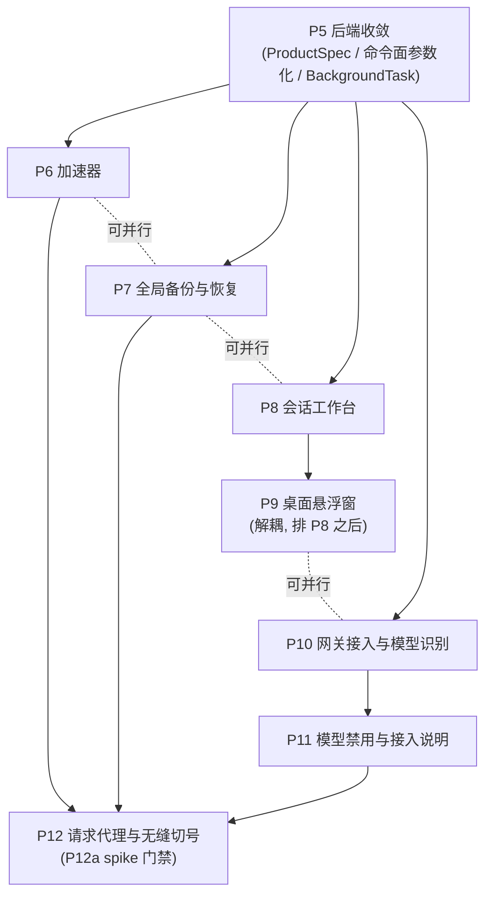

# P5–P12 任务分解（把 PLAN §5 转成可执行列表）

> **状态**：设计（2026-10-03）。
> **上游**：`docs/redesign/PLAN.md`（v2.7）§5 分期表 + §2.4/§2.4.1/§2.5/§2.6/§2.7 + §3.8–§3.19 + §4 Playbook；`DECISIONS.md`（34 条已确认）；`VOCABULARY.md`。
> **当前进度**：P0–P3 已完成；**P4 进行中**（账号工作台抽屉 + 卡片瘦身 + 程序位常显，见 `P4-ARCH.md`）。
> **口径校正（重要）**：本文件一律采用 **PLAN §5 的期次编号** —— **P9 = 桌面悬浮窗**（D21 进本期），**P12 = 请求代理与无缝切号**。任务描述里「P9 请求代理」是笔误，按 PLAN 为准。
> **后续期次**：P13–P16 见 **`P13-REFERENCE-PARITY.md`**（对照外部兄弟实现 `changexbc/workbuddy-switch` 得出的可纳入功能方案；决策 D35–D42 待拍板）。
> ⚠️ **本文件的进度行已过时**：P4–P12 **均已落地**（含 P7 备份 / P8 会话工作台 / P9 悬浮窗 / P11 模型禁用 / P12 本地路由），以 `COVERAGE-REPORT.md` 第六轮 + `P13-REFERENCE-PARITY.md` §1.3 为准。

### 已完成基线（P0–P3，可直接依赖，不必重调研）

| 产出 | 位置 |
|:---|:---|
| 作用域解析（fail-closed 目标） | `src/lib/scope.ts` |
| 平台注册表（`PlatformDescriptor` / `Capability`） | `src/lib/platforms/registry.ts` |
| 注册表门禁 | `scripts/check-scope-registry.cjs`（**当前 28 条断言**） |
| 作用域状态钩子 | `useScope`（URL 为唯一真值 + localStorage 记忆） |
| 路由 | `/s/{scope}/{dest}`（**旧 10 条路由保留**，重定向） |
| 工作台 | `OverviewPage`、`UsagePage`（Token + 积分 子 Tab，两平台共用） |
| 状态语言 | `src/components/ui/empty-state.tsx`（`EmptyState` 四要素） |

> ⚠️ **P5 会改造 `scope.ts` 的解析为 `Result`（fail-closed）** —— 这是 P5 第一条前置，见附 B。

### 构建与门禁（当前口径）

| 用途 | 命令 |
|:---|:---|
| 快速构建（开发验证） | `build-quick.cmd`（`-Fast`）/ 等价 `npm run build:fast` |
| 发布构建 | `build-exe.cmd` |
| **门禁四条** | `tsc` · `check-scope-registry.cjs` · `check:api`（`check-api-contract.cjs`） · `build:fast` |

> PLAN §6 另列 `check:store-selectors` / cargo 全量；本文件统一按上表四条门禁作为「每期必须全绿」的最小集，其余按 PLAN §6 补跑。

---

## 0. 总览（一眼看全）

| 期 | 目标一句话 | 前置阻塞 | 可否并行 | 结论 |
|:---|:---|:---|:---|:---|
| **P5** | 后端收敛：`ProductSpec` 表 + 命令面参数化（★ 实测仅 10/48）+ `BackgroundTask` 二维化 + 网关宿主泛化 + WB 三程序位表驱动 + `variant` 双义清理 | ⚠️ **必须先改门禁与 §2.5 四条安全边界** | 主线**串行前置**，P6–P12 凡涉及命令面者都在其后 | **必做**，但成本最高、必须最后做 UI 之外的收敛 |
| **P6** | 加速器：⌘K 命令面板 / 动态作用域快捷键 / 撤销 toast / 首次引导 | 「撤销 toast」依赖 P5 第 3 条（软删除 / 快照） | 面板 / 快捷键 / 引导**可与 P7/P8 并行** | 可做（撤销项受 P5 约束） |
| **P7** | 全局备份与恢复（envelope 契约 + 设置页第 9 项 + 导出勾选 + 导入预览） | 依赖 P5（scope fail-closed、uid 合并语义统一） | 可与 P6/P8 并行 | 可做 |
| **P8** | 会话工作台（第 6 目的地）：副本关联 / 安全同步 / 分歧处理 / 统一重启确认 | ⚠️ **依赖 WB 数据三件套**；「关联」是**新增能力**；只有 WB 桌面具备 ⇒ Tab 退化不渲染 | 可与 P6/P7 并行 | 可做（范围受 D20 收窄） |
| **P9** | 桌面悬浮窗（独立浮层 + 托盘 + 只读订阅） | 独立窗口**键盘可达性需单独验证路径**；宿主侧入口需登记 | **与 P0–P8 解耦**，排 P8 之后，可与 P10/P11 并行 | 可做（靠解耦 + 顺序化解复杂度） |
| **P10** | 网关接入与模型自动识别（接入即识别 + 三级来源 + 四个触发时机） | 依赖 P5（scope 化）；探测凭据必须按 scope | 可与 P6/P7/P8 并行 | 可做 |
| **P11** | 模型禁用与接入说明（协议 Tab × 工具 Tab） | 依赖 P10（模型清单同源） | **必须 P10 之后**（串行） | 可做 |
| **P12** | 请求代理与无缝切号（P12a spike → P12b C 路 → P12c A 路） | ⚠️ **P12a 是硬门槛：证书固定 / 无可行拦截路 ⇒ 整个 P12 作废（无兜底）** | 最后做，独立 | **条件性可做**（spike 决定生死） |

### 串行 / 并行关系

> **串行骨架**：`P5 → {P6, P7, P8, P10} → {P9（在 P8 后）, P11（在 P10 后）} → P12`。
> **P9 与 P10/P11 可并行**（D21：P9 与主线解耦，只共享注册表）。
> **P12 放最后**：它是权限最大的功能，且被 spike 门禁卡住；先做它会拖累主线。

---

## P5 · 后端收敛（`ProductSpec` + 命令面参数化 + `BackgroundTask` 二维化 + 网关宿主泛化）

> **PLAN 章节**：§2.4（产品维度提升为表）/ §2.4.1（注册点真实口径）/ §2.5（安全边界）/ §2.7（能力 vs 偏好）/ §4.1（新增平台实测清单）。

**目标**：把「产品维度」从散落硬编码提升为**表**；命令面按 `scope` 参数化（**仅可参数化子集**）；`BackgroundTask` 二维化；网关宿主泛化；WB 三程序位表驱动；清理 `variant` 双义。

**★ 前置阻塞（硬）**：
1. **先改门禁** `scripts/check-api-contract.cjs`：加「新命令必须带 scope 参数」「scope 解析 fail-closed」，并处理既有第 3 条「ROUTES 不得有死路由」与**别名转发**的冲突（否则改造第一步就红，且红的原因与真实缺陷无关 = 假失败）。
2. **先落地 §2.5 四条安全边界**：
   - scope 解析 **fail-closed**（三处现状全 fail-open：`src-tauri/src/commands.rs:22-40`、`core/modules/region.rs:129-131`、`server/src/api.rs:265-286`）；
   - capability 在**命令分发层**校验（缺能力 ⇒ `Err`，默认拒绝）；
   - 破坏性操作后端支撑（软删除 `accounts.trash.<region>.json` 或删除前快照）；
   - 跨作用域选择集按 `(scope, id)` 键控，切 scope 即失效。

**涉及文件（前端 + 后端，逐文件实测口径见 §4.1）**：
- 后端新增：`crates/buddy-switch-core/src/modules/product.rs`（`ProductSpec` 表）
- 后端修改：`modules/mod.rs`（`pub mod foo;`）、`src-tauri/src/commands.rs` + `generate_handler!`、`crates/buddy-switch-server/src/api.rs`（`.route`）、两份 `BackgroundTask` 注册表（`src-tauri/lib.rs` + `server/main.rs`）、`src-tauri/src/gateway.rs` + `trae_gateway.rs`、`crates/buddy-switch-gateway/src/lib.rs` + `trae/mod.rs`、`modules/trae/paths.rs` 式路径派生
- 门禁：`scripts/check-api-contract.cjs`
- 前端：`src/lib/api.ts`（**111 ROUTES + 123 导出函数 + `DEMO_READ_COMMANDS`**）、`src/lib/screenshot-demo.ts`（44 case）、`src/stores/*` 缓存键（须编码全部入参含 scope）
- 词条：`src/locales/domains/*`（新平台名 / 区域名 / 程序位名）

**依赖**：P0–P4（UI 稳定后做，否则每次 UI 迭代要在两套命令面同步）。

**验收项**：
- 新增平台的**新增命令**注册点 = **2**（1 张 `ProductSpec` + 1 个模块目录）；
- 加第 3 个 WB 程序位**无需改代码**；
- **门禁四条**（`tsc` · `check-scope-registry.cjs` · `check:api` · `build:fast`）全绿；并按 PLAN §6 补跑 `check:store-selectors` + cargo 全量；
- scope fail-closed 断言：非法 scope 返回 `Err` 且**不落盘**。

**风险点**：
- 触碰 **117 条命令 + 99 条路由 + 门禁 + 全部既有测试**（最高风险期次）；
- ⚠️ **`variant` 双义清理**：删旧字段有明确时点（P0 冻结 → P5 清退），漏改会静默；
- ⚠️ 网关宿主泛化：`trae_gateway_host.rs:3` 注释指出两者**有意不复用** —— axum 对同一路径 `merge` 两个 router 会 **panic** ⇒ 泛化必须处理路径所有权，**不能简单合成一个结构体**；
- ⚠️ `PickPolicy` 默认值（`expiry_urgency_weight=0` / `deterministic=false`）是 **WorkBuddy 选号基线**，改默认值会**静默改 WB 选号** ⇒ 只允许显式覆写（`trae_pick_policy()` 式）。
- **诚实边界**：48 条 Trae 命令**实测只有 10 条可安全参数化**（旧写「约 30」**已证伪**）—— 其余 **38 条不可参数化**：其中约 **18 条概念独有**（profiles / device / jwt / cooldown / group / legacy-merge / variants / capabilities / env / client-models / save-login / oauth-cancel…）**无可 scope 化语义**，另 **20 条「看着能参数化、实际不能」**（网关家族是死参数 / `token_stats` 语义打架 / 若干命令非同构 ⇒ 硬折叠会把平台名藏进参数）⇒ 保留平台命名空间；收益 ≈ **10/48（五分之一）**。**逐条理由见 `P5-ARCH.md` §2.3。**

**回滚**：旧命令名保留为别名转发 ⇒ 命令面可回退；表驱动改动可回退到硬编码。

---

## P6 · 加速器（命令面板 / 快捷键 / 撤销 toast / 首次引导）

> **PLAN 章节**：§3.7（命令面板 ⌘K）/ §3.1（作用域快捷键，含 macOS 红绿灯避让与可扩展性）。

**目标**：⌘K 命令面板（跨作用域搜账号、跳目的地、执行动作）；作用域快捷键**动态生成**（§3.1）；撤销 toast；首次引导。

**涉及文件**：命令面板组件（新）、快捷键注册（按作用域注册表序号动态生成 `Ctrl/Cmd+1..N`，>5 个降级为不绑定）、`toast`（sonner）、首次引导组件、词条 ×2。

**依赖**：P5（撤销 toast 需要后端软删除 / 快照支撑 —— §2.5 第 3 条：**UI 不许承诺后端做不到的撤销**）。

**验收项**：高频任务 3 步内完成；作用域 > 5 时快捷键降级为不绑定（仅菜单显示序号）。

**风险点**：
- ⚠️ **撤销 toast 的边界**：删除账号当前是**硬删除**，**没有撤销能力** ⇒ 未实现软删除前，UI 上**不许出现「已删除·撤销」**（否则是假承诺）；
- 快捷键与浏览器 / 系统快捷键冲突面（Tauri webview 内需实测，尤其 Windows `Ctrl+1..9`、macOS `Cmd+数字`）。

**回滚**：纯新增，可关闭。

---

## P7 · 全局备份与恢复

> **PLAN 章节**：§2.6（备份数据契约）/ §3.14（备份与恢复 UI）/ §3.9（设置 9 项子导航）/ §4.2（新增可备份内容类型）。

**目标**：备份 envelope 契约（§2.6）+ 设置页「备份与恢复」（第 9 项子导航，§3.14）+ 导出分区勾选（三态）+ 凭据开关 + 导入预览与冲突策略 + 导入前自动快照。

**涉及文件**：备份模块（新，`BackupSection` 表驱动）、`core/modules/config.rs:280`（`backup_dir()` 已有）、导出 / 导入对话框、设置页子导航（9 项，§3.9）、命令面板两动作（「导出全部备份」/「从备份导入」）、词条 ×2。

**依赖**：P5（scope fail-closed、`merge_import_record` 语义统一到 **uid**、D12 平台专属子项）；D14–D18 已确认（默认全选作用域 / 凭据默认关 / 冲突默认保留本地 / 定时备份每日保留 7 份 / 导入前快照强制）。

**验收项**（§6，全部可证伪）：
- 4 作用域一次导出 / 导入；遍历 `SCOPES` 注册表覆盖 **4/4**（加平台后自动 5/5）；
- **不含凭据时文件文本里搜 `accessToken` / `refreshToken` / 信封标记 ⇒ 0 次命中**；
- **导入幂等**：同一文件连续导入两次，第二次全部「跳过」；
- **未知 scope 拒绝**：构造含 `foo-cn` 的文件 ⇒ 该分区**整体拒绝并报错**（不静默跳过）；
- **往返一致**：导出 → 导入 → 再导出，语义一致（忽略时间戳）。

**风险点**：
- ⚠️ 现状**不一致**：删除只匹配 `id`，查找 / 备注匹配 `id` **或** `uid` ⇒ 全局导入必须统一到 `uid`，否则「导入进来了但删不掉」；
- ⚠️ `formatVersion` 是**唯一兼容依据**（fail-closed）：`> 上限` 拒绝并提示升级；缺 `kind` 或不匹配 ⇒ 拒绝（防误导入任意 JSON）；
- 凭据是「可选字段」不是「可选结构」：不含凭据时**完全不出现** token 键（不是写成 `null`）。

**回滚**：账号级导入导出**并存不替换**；导入前自动快照 ⇒ 可恢复。

---

## P8 · 会话工作台

> **PLAN 章节**：§3.15（会话工作台，含 3.15.1 IA / 3.15.2 关联图 / 3.15.3 统一重启确认 / 3.15.4 批量同步）/ §3.2（可配置目的地）/ §3.9（侧栏第 6 项）。

**目标**：侧栏第 6 目的地；客户端大卡片 Tab + 会话组列表 + 状态筛选 + 会话关联图 + 分歧处理 + 批量安全同步 + 统一重启确认流程（§3.15）。

**★ 前置阻塞（硬）**：
- 依赖 **WorkBuddy 数据三件套**：① 正文 `~/.workbuddy/projects/{workspace}/{cid}.jsonl`；② 索引 `~/.workbuddy/workbuddy.db` 的 sessions 表；③ 云端归属映射 `~/.workbuddy/edge-sync-mapping-v{N}.db`（复制后靠 `register_edge_sync_mapping_for` 把新会话归属到目标账号）。
- **「关联」是新增能力**：现状只有 `list_sessions` / `copy_sessions`（切换时按需复制），**没有** session group / 增量同步 / 分歧处理管理面。
- **精确到客户端**：会话复制调用点在 **`switch.rs:93`**（**WorkBuddy 账号切换路径**）⇒ **CodeBuddy IDE / CLI 也没有** ⇒ 客户端 Tab 当前只剩「WorkBuddy 桌面」**1 项** ⇒ 按规则**退化为静态标题，不渲染 Tab**。
- ⚠️ **Trae 作用域不渲染「会话」入口**（无等价三件套，见下）。

**涉及文件**：会话工作台页面（新）、会话关联图组件（新）、统一重启确认流程组件（跨程序位复用）、后端会话管理命令（新增：关联 / 增量同步 / 分歧处理）、词条 ×2。

**依赖**：P5；D19（侧栏 6 项）、D20（先「查看 + 安全同步」）。

**验收项**：一眼看出「哪些副本落后 / 分叉」；**同步是加法且可见**；分叉时**必须显式选择保留哪一份**；三个程序位（CodeBuddy IDE / TraeWork / TraeCode）**共用同一条重启确认流程**。

**风险点**：
- ⚠️ **分歧处理最复杂**（要逐条 diff、选保留哪一份，需后端内容级比较）⇒ D20 已收窄为「先查看 + 安全同步」，分歧组**只展示不提供统一入口**；
- ⚠️ **Trae 下不应渲染入口**：Trae 无等价三件套 ⇒ 走 §3.2 可配置目的地；URL 直达时给**结构化空态**说明「该平台暂不支持会话管理」，**绝不列 WorkBuddy 的会话**；
- ⚠️ **CLI 例外**：CodeBuddy CLI 切换**不重开**且会中断当前会话，文案**不得**沿用「自动重开」；
- 客户端 Tab 的**两个过滤条件**都要满足才渲染：`capabilities.sessionCopy`（平台固有）**且**用户启用（偏好）—— 两者全被过滤时，两种原因给**不同出口**。

**回滚**：会话入口可被用户关闭（§3.2）⇒ 关掉即回退；同步为加法 ⇒ 不破坏已有内容。

---

## P9 · 桌面悬浮窗（独立浮层）

> **PLAN 章节**：§3.16（桌面悬浮窗）/ §2.7（入口走**用户偏好**，非 `capabilities`）/ D21（进本期）。

**目标**：可拖动桌面浮层，列出各来源会话状态（运行中 / 待确认 / 已完成 / 失败）；悬停出卡；点击回原会话；托盘可临时隐藏（§3.16）。

**涉及文件**：独立窗口（Tauri `WebviewWindow`，新）、浮层 UI（新）、托盘开关、只读状态订阅、宿主侧入口（侧栏左下角图标 + 设置页开关）、词条 ×2。

**依赖**：**与 P0–P8 解耦**（除注册表外不共享代码），**排在 P8 之后启动**（D21 拍板进本期，用「解耦 + 顺序」化解复杂度，而非推迟）。

**验收项**：**只读、无写操作**；**独立窗口的键盘可达性单独验证**（不能复用主窗口验证）；默认**不显示完整会话标题**（悬停才展开）。

**风险点**：
- ⚠️ 并进本期会把「独立窗口的复杂度」混进重构 ⇒ 出问题时**难以归因** ⇒ 靠解耦 + 顺序化解；
- ⚠️ 按项目硬约束：新增「写状态 / 周期性」出口要 **grep 两侧 `BackgroundTask` 注册表**确认是否需登记状态轮询；
- **明确不做**：不在浮层里做账号切换、批量操作、自定义布局编辑器（浮层价值是「一眼看清 + 一键回去」）。

**回滚**：独立窗口 ⇒ 关掉即回退；与主窗口无耦合。

---

## P10 · 网关接入与模型自动识别

> **PLAN 章节**：§3.17（网关接入与模型自动识别，含 3.17.1 三级来源 / 3.17.2 触发时机 / 3.17.3 三陷阱 / 3.17.4 UI / 3.17.5 安全边界）/ D23 / D24。

**目标**：绑定凭据后**自动探测**模型清单 + 四个触发时机 + 三级来源标注 + 接入向导「识别」阶段 + 接入指引补「自动发现」（§3.17）。

**涉及文件**：探测服务（后端，新 / 扩展现有模型读取）、接入向导（扩展现有「快速接入」）、模型清单页（来源徽标 + 上次识别时间 + 按 scope 分组 Tab）、`/v1/models` 出口、词条 ×2。

**依赖**：P5（scope 化）；D23（触发范围）、D24（不做识别后校验）。

**验收项**（§6）：
- 接入后**未经手动刷新**即出现清单；
- **三级来源显式标注**（实时 / 已保存 / 内置）+ 时间 + 失败原因，非「实时」时**给出原因**；
- 识别失败**不阻断接入**（接入仍标成功，清单回落「内置」并有重试出口）；
- 对外 `/v1/models` 与识别清单**同源**（id 集合完全一致）；
- **跨 scope 探测被拒**（不写缓存）。

**风险点**（§3.17.3 三个陷阱，不处理「识别」会骗人）：
- **识别到的 ≠ 能用的** ⇒ UI 只展示过滤后（`servable_entries`）清单；
- **名称必须按区域规范化**（国际版裸名 / 国内版带 `CN` 后缀）⇒ 识别**按 scope 分家**，否则用户复制名字去调用会失败；
- **HTTP 200 ≠ 模型可用** ⇒ 不做校验时文案只能说「已识别 N 个」，**不能说「N 个可用」**；
- 探测请求**必须用该 scope 自己的凭据**，失败**不许静默回落另一个 scope 的缓存**。

**回滚**：探测失败回落「内置」且**明确标注**；手动刷新保留。

---

## P11 · 模型禁用与接入说明

> **PLAN 章节**：§3.18（3.18.1 模型禁用 / 3.18.2 `/v1/messages` 已支持 / 3.18.3 接入说明）/ D25–D28。

**目标**：按 scope 禁用 / 启用模型 + `/v1/models` 过滤 + 调用被禁模型走**既有拒绝路径** + 接入说明升级为「协议 Tab × 工具 Tab」（§3.18）。

**涉及文件**：模型禁用 UI（模型页）、`/v1/models` 过滤逻辑、网关拒绝路径（复用）、接入说明组件（协议 Tab × 工具 Tab）、`ACCESS_TOOLS` 常量 + 词条 ×2。

**依赖**：**P10（模型清单同源）**；D25（可加不可删）、D26（可见但标灰）、D27（默认全开）、D28（工具清单硬编码）。

**验收项**（§6，两条出口同时生效，**只过一条即视为假开关**）：
- ① 被禁模型**不在** `/v1/models` 输出里；② 直接调用返回**明确说明「已禁用」**的错误（不是笼统 4xx）；
- **四种 `available × disabled` 组合**在 UI 上可区分（4/4）；
- 接入说明按协议给对认证头：Anthropic 页 `x-api-key`、OpenAI 页 `Authorization: Bearer`（2/2）；
- 接入说明**不编造**：未确认客户端只出现「通用参数 + 以其官方文档为准」，**不出现具体配置片段**。

**风险点**：
- ⚠️ **两个出口必须同时改**：只改清单 = 假开关（隐藏了但调得通）；只改调用 = 用户困惑（清单里有、调了报错）；
- ⚠️ 复用**既有拒绝路径**，**不新造错误格式**（否则客户端要处理两套）；
- `available`（上游事实）与 `disabled`（用户偏好，§2.7 存本地不进 `capabilities`）是**两个正交维度**，别混。

**回滚**：禁用是本地偏好 ⇒ 清掉即恢复；接入说明为纯展示。

---

## P12 · 请求代理与无缝切号（P12a spike → P12b C 路 → P12c A 路）

> **PLAN 章节**：§3.19（3.19.1–3.19.11，含 spike 步骤）/ D29（默认关 + 不劫持）/ D30–D34。

**目标**：网关代理客户端**业务请求** + 按请求选号 + 401 换号重试（§3.19）。

**★ 硬门槛（P12a spike，先做再写代码）**：

| # | 做什么 | 通过判据 | 失败含义 |
|:--|:---|:---|:---|
| **0** | 先查 **C**（最便宜）：业务域能否配自定义地址 | 业务域可配 | 不可配 ⇒ **C 出局**（大概率如此） |
| **1** | 只配代理、不装 CA（仅记录 CONNECT） | 看到目标域 CONNECT | 客户端不认代理 ⇒ **A 出局** |
| **2** | 装 CA + 中间人 | 客户端**不报证书错误**、业务正常 | **证书固定** ⇒ **A 出局** |
| **3** | A 路确认 | 业务请求正常且流量确实过网关 | ✅ 用 A |

> ⚠️ **A / C 都出局 ⇒ 整个 P12 作废，没有兜底**（B = hosts 劫持已被 D29 排除）。
> ⚠️ **顺序不能反**：步骤 0 排最前（直接判死 C）；步骤 1 先于步骤 2（先确认客户端认代理，否则 CA 白装还得清理）。
> ⚠️ **spike 阶段就要做出「还原」**（代理改回、CA 移除），否则试错会把机器搞脏。
> ⚠️ **结论必须写回 §3.19**（无论通过与否 —— 失败的 spike 也是产出）。

**涉及文件**：代理转发层（后端，新）、`StickyTable`（复用）、`PickPolicy`（复用，**不改默认值**）、`credits.rs` 冷却机制（复用）、网关请求日志（扩展「代理」来源标记）、一键还原入口、词条 ×2。

**依赖**：P5（scope / 命令面）；D29（默认关 + 不劫持）、D33（宽口径，A 可用）、D34（C 先行）；P12b 完成后重新评估 A 是否值得（D34）。

**验收项**（§6，全部可证伪）：
- **P12a 证书固定门槛**：装 CA 后客户端**不报错** ⇒ 继续；报错 ⇒ 停（整个 P12 作废）；
- **代理只碰白名单域**：白名单外请求断言**未经过网关**（不解析、不记录）；
- **不落盘正文**：磁盘无请求 / 响应体，日志只有元数据；
- **写操作不自动换号重试**（写路径 401 不换号；读路径换号重试一次）；
- **换号重试上限 = 1**；
- **一键还原无残留**（代理已撤、CA 已提示移除）；
- **绝不劫持**：实现中**不存在** hosts / DNS / 透明代理的写入路径。

**风险点**：
- ⚠️ **证书固定**（硬阻塞，非工作量问题）；
- ⚠️ **header casing**：转发层若用现成框架须**先验证大小写不被改写**（`anthropic-version` → `Anthropic-Version` 会 401，别人踩过）；
- ⚠️ **改 `PickPolicy` 默认值会静默改 WorkBuddy 选号** ⇒ 只允许显式覆写；
- ⚠️ **排除已用完 / 已过期**的包（issue #7：空包会把紧迫度顶满）；
- ⚠️ 会话复制（§3.15）与 P12 **无关**（文件层 vs 网络层）—— **两件事都要做，不能互相替代**。

**回滚**：**默认关**；一键还原 ⇒ 随时回到原状；**P12a 失败即停**；**绝不劫持**。

---

## 附 A · 明确「不适合做 / 需用户先决策」的部分

> 原则：**不假装都能做**。以下要么是硬阻塞，要么是需产品先拍板的口径。

| # | 事项 | 性质 | 处理 |
|:--|:---|:---|:---|
| A1 | **P12 若 P12a spike 失败** | 硬阻塞（证书固定 / 无可行拦截路） | **整个 P12 作废**，不做；结论写回 §3.19（失败的 spike 也是产出） |
| A2 | **P8「关联会话」** | 新增能力（现状只有复制，无管理面） | D20 收窄为「查看 + 安全同步」，分歧处理后置 |
| A3 | **P8 在 Trae 作用域** | 无等价数据三件套 | **不渲染入口**；URL 直达给结构化空态，不列 WB 会话 |
| A4 | **P8 客户端 Tab** | 当前只剩 1 项 ⇒ 假控件 | **不渲染 Tab**（保留结构供将来第二个客户端零改动出现） |
| A5 | **P6 撤销 toast** | 后端无软删除支撑 | 实现软删除 / 快照**之前**，UI 不许出现「已删除·撤销」 |
| A6 | **新增客户端（VS Code CodeBuddy 插件 / JetBrains 插件）** | **未排入 P0–P12** | 需**单独立项**（见 §A.1 的「待新增」分列）：VS Code 优先（可复用 `vscode_cn_inject.rs` 同源加密模型），JetBrains 待调研；走 §4.1 注册表扩展路径（前端 ≥5 处 / 后端 ≥10 处） |
| A7 | **P5 参数化范围** | 48 条 Trae 命令**实测仅 10 条可参数化**（旧写「约 30」已证伪）；另 38 条不可参数化（18 条概念独有 + 20 条死参数 / 非同构，见 `P5-ARCH.md` §2.3） | **不做**假收敛，保留平台命名空间；可参数化 **10/48** |
| A8 | **P9 悬浮窗键盘可达性** | 独立窗口，不能复用主窗口验证 | 需**单独验证路径**，否则「通过」是空转 |

### A.1 客户端清单：**「现状」与「待新增」必须分列**（PLAN §3.3 A / B 表）

> ⚠️ 这是本仓反复踩坑的地方（把「目标」写成现状、或把「目标」当错误删掉）⇒ **必须显式区分**。

**现状（本仓已有，逐文件核实）**：

| 客户端 | 平台 | 切换 | 会话复制 | 切换时需关闭并重开 |
|:---|:---|:---|:---|:---|
| WorkBuddy 桌面 | WB | ✅ | ✅（**唯一**有会话复制的客户端，`switch.rs:93`） | 是 |
| CodeBuddy IDE（CN） | WB | ✅ | — | 是 |
| CodeBuddy CLI | WB | ✅ | — | **否**（会中断当前 CLI 会话，且不自动重开） |
| TraeWork | Trae | ✅ | — | 见 `trae-module` |
| TraeCode | Trae | ✅ | — | 见 `trae-module` |

**待新增（本仓尚未支持，**不是**现状）**：

| 客户端 | 归属 | 技术前提 | 优先级 | 排期 |
|:---|:---|:---|:---|:---|
| **VS Code CodeBuddy 插件** | WB | 凭据 = VS Code **SecretStorage**（`state.vscdb` 的 ItemTable）；**本仓已有可复用实现** `vscode_cn_inject.rs`（同源 Chromium/Electron 加密模型） | **高** | **未排期**，建议单独立项（注册表加一行 + 一个凭据读写模块 ⇒ 页面组件零改动） |
| **JetBrains IDE 插件**（IDEA / PyCharm） | WB | **待调研**：自有 Credential Store，与本仓 Chromium 系加密模型**不同源** | 低 | **未排期** |

> ⚠️ 新增客户端走 §2.3 / §4.1 注册表扩展路径（**前端 ≥5 处 / 后端 ≥10 处**，不是「加一行」）；
> VS Code 插件会是注册表机制的**第一个真实检验**。新增客户端**不自动获得会话复制能力**（需等价数据三件套，§3.15 能力边界）。

### 需用户先决策 / 拍板的口径（34 条已确认之外的遗留）

1. **§3.1 快捷键降级阈值**：作用域 > 5 个时「降级为不绑定」—— 阈值 5 是否合适？（D5 已定「按 scope 记住上次选择」，但快捷键降级阈值未见明确决策）
2. **A 路「中间人解密」**：D33 已确认**宽口径可接受**（附三条硬边界）⇒ A 可用；若日后口径收窄为「不接受解密」，则**只剩 C ⇒ 大概率 P12 作废**。此项已确认，**记录以备口径变化**。
3. **`BackgroundTask` 二维化的落地边界**：表本体移进 `core`、两宿主保留 `spawn` 分支 —— 需确认**两侧宿主都要登记**的既有约定不被破坏（项目硬约束）。
4. **P5 的 `variant` 双义清理删除时点**：P0 冻结了删除计划，P5 执行 —— 需确认前端 `TraeProgramId` / `TraeRegionId` 已完全替代旧字段后再删（否则静默读到 `undefined`）。

---

## 附 B · 关键前置清单（动 P5 之前必须先完成）

1. `scripts/check-api-contract.cjs` 扩两条规则（新命令带 scope / scope fail-closed）+ 处理第 3 条与别名转发的冲突；
2. §2.5 四条安全边界落地（scope fail-closed、capability 命令层校验、软删除 / 快照、`(scope, id)` 选择集）；
3. `BUDDY_SWITCH_HOME` 非法拒绝启动的既有先例保持一致（scope 非法也拒绝，不回落）；
4. 路径派生唯一规则**不许破**：**「字符串 → 解析成枚举 → 查表派生路径」**，中间任何一步都不许用原始字符串（`core/modules/region.rs:242`、`core/modules/trae/paths.rs:71-113`）。

---

## 附 C · 与其他文档的关系

- **P4**（进行中）见 `docs/redesign/P4-ARCH.md`；
- 本文件是 PLAN §5 的**执行视图**，不替代 PLAN 正文（设计与理由以 PLAN 为准）；
- 期次编号以 PLAN §5 为唯一权威（本文件已校正「P9 请求代理」笔误）。
