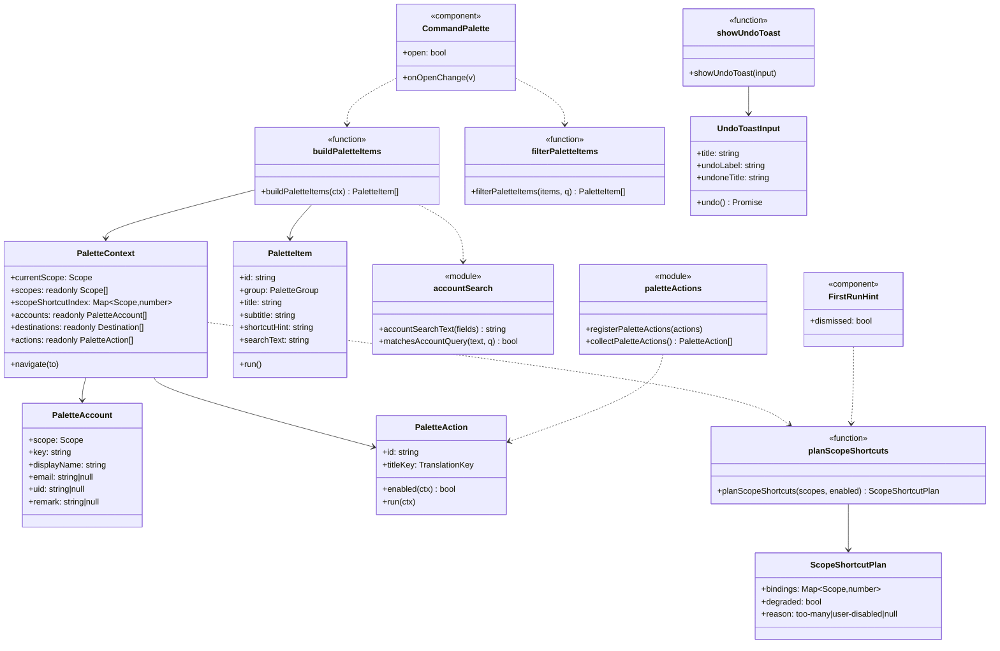
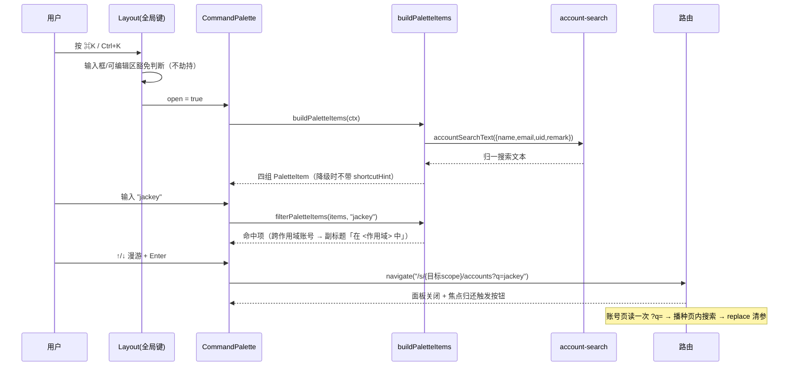
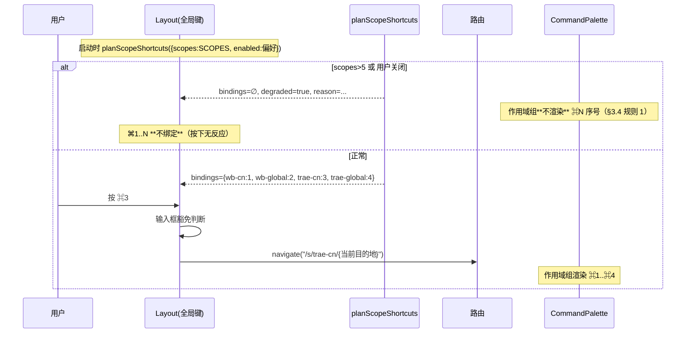
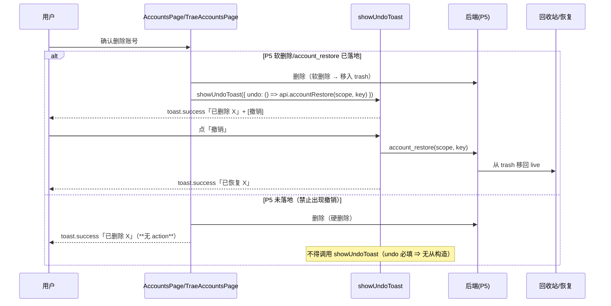
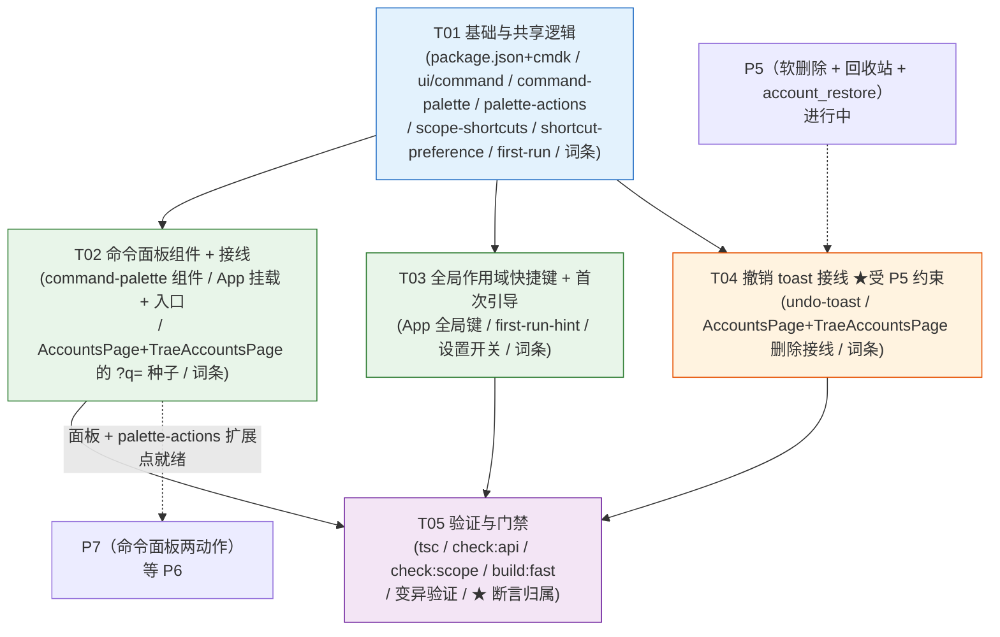

# P6 架构分解：加速器（⌘K 命令面板 / 动态作用域快捷键 / 撤销 toast / 首次引导）

> **状态**：设计（2026-10-04）· **§8 八条待明确已决策（lead 拍板 · 2026-10-05）**，正文已同步（改动点见 §8 末「同步清单」）。本文是 `P5-P12-TASKS.md` P6 段的**落地设计**，可直接交给工程师。
> **上游**：`PLAN.md` §3.7（命令面板 ⌘K）/ §3.1（作用域快捷键：动态生成 / >5 降级 / 可关闭 / 冲突实测）/ §3.5（撤销 toast 边界 + **假承诺红线**）/ §3.6（统一状态语言）/ §3.4（规则 1 无数据不渲染）/ §3.13（两个搜索入口的分工：列表搜索 `/` vs 命令面板 ⌘K，**共用同一搜索索引**）/ §2.5（安全边界）/ §2.7（能力 ≠ 偏好）；`P5-P12-TASKS.md` P6 段 + 附 A5 + 附「需用户先决策」#1；`DECISIONS.md`（D5 按 scope 记住上次选择）；`VOCABULARY.md`。
> **格式参考**：`P11-ARCH.md` / `P10-ARCH.md`（同构：实现方案 / 文件列表 / 数据结构 / 有序任务 / 共享知识 / 风险 / 待明确 / 依赖图）。
> **下游**：§4 任务列表直接交给工程师。
> **范围**：**仅** P6 —— ① ⌘K 命令面板；② 动态作用域快捷键；③ 撤销 toast；④ 首次引导。
> **明确排除**：命令面板里的**备份两动作**（「导出全部备份」/「从备份导入」）属 **P7**（`P7-ARCH.md` §7 #6 已推到 P6 **之后**）；回收站 UI 属 **P5**（`P5-ARCH.md` §2.7.1）；会话/悬浮窗/网关/请求代理属 P8–P12。本文**不碰**。
> **依赖**：**P5**（撤销 toast 需要 §2.5 第 3 条的**软删除 / 快照**后端支撑）。**面板 / 快捷键 / 引导**不受此约束，可与 P7/P8 并行。
> **⚠️ 依赖方向（重要，勿反）**：**P7 等 P6，不是 P6 等 P7** —— P7 决策 #6 已把「命令面板两动作」推到 P6 之后（P6 未落 ⇒ 登记动作**无法接线 ⇒ 死代码**）。因此 **P6 必须先落「命令面板本体 + 动作扩展点」**，P7 才能把它的两个动作挂上来（见 §1.11）。

---

## 1. 实现方案

### 1.1 核心难点

| 难点 | 现状（证据） | 处理 |
|:---|:---|:---|
| **★ 撤销 toast 是「假承诺」高危区** | 删除账号现状是**硬删除**（`P5-ARCH.md` §2.7）；PLAN §3.5 红线：**后端无支撑前 UI 不许出现「已删除·撤销」** | 撤销 toast **必须以后端 `account_restore` 存在为前提**；helper 把 `undo` 设为**必填**（缺它编译不过）⇒ 从类型上杜绝「无支撑的撤销」——见 §1.4 |
| **★ 「快捷键列表不能有绑了但没作用的项」** | §3.4 规则 1；作用域 >5 时快捷键**降级为不绑定**（PLAN §3.1） | 绑定与「序号提示」**同源派生**：降级 ⇒ 提示**一并不渲染**（不是「显示了序号却按了没反应」）——见 §1.3 / §1.5 |
| **★ 不许出现第二个「看起来能切」的控件** | 作用域已由侧栏 `ProductSwitch`（2 Tab）+ `ScopeSwitch`（2 区域 Tab）承担（`App.tsx:302-329`） | 快捷键是**纯键盘加速器**：只导航到 `/s/{scope}/{dest}`，**不新增任何 scope 控件**；⌘K 入口是「搜索/跳转」，不是切换器——见 §1.5 / §1.6 |
| **两个搜索入口必须共用同一索引** | 列表搜索 `/` 已存在于 `AccountsPage`/`TraeAccountsPage`（`AccountsPage.tsx:328-339`）；索引已抽出（`src/lib/account-search.ts`） | 命令面板**复用** `accountSearchText` / `matchesAccountQuery`，**不另写一套匹配**（§3.13，否则同一关键词两处结果不一致 = 静默错误）——见 §1.2 |
| **★ 字段张冠李戴（本仓出过两次事故）** | `lastUsedAt` 属 `ApiKeyRecord`（`types.ts:685`）/ `TraeApiKeyRecord`（`trae-types.ts:837`），**不属任何账号类型**；WB 账号名是 **`nickname`**（`types.ts:16`）不是 `name`；Trae 账号键是 **`userId`**（`trae-types.ts:321`）不是 `id`/`uid` | 面板账号键 / 搜索字段**逐字段核实归属**并写进契约断言——见 §1.2 / §3.3 / §5 |
| **cmdk 未安装** | `node_modules/cmdk` 不存在；`package.json` 只有 `sonner`（`^2.0.8`）+ Radix 家族 | 新增依赖 `cmdk`（PLAN §3.11 指定「用 `cmdk`，不要手写列表」）；**不手写 combobox 语义**——见 §1.6 |
| **首次引导会泄露「不存在的快捷键」** | 原型引导条写死 `⌘K` / `/`（`index.html:128-132`） | 引导内容**由真实绑定派生**：降级的快捷键**不出现在引导里**（§3.4 规则 1 的延伸）——见 §1.7 |

### 1.2 命令面板：条目集与「唯一搜索索引」

命令面板 = **跨作用域**搜账号 + 跳目的地 + 执行动作（PLAN §3.7），**不替代侧栏**。条目分四组（原型 `demo-app.js:1994-2016`，语义沿用）：

| 组 | 内容 | 执行 |
|:---|:---|:---|
| **页面** | 当前作用域的 5 个目的地 | 跳 `/s/{currentScope}/{dest}` |
| **作用域** | 全部作用域（含各自登录态摘要） | 切到该作用域（**并显示 `⌘N` 序号**，仅绑定时） |
| **账号** | **跨作用域**全部账号 | 结果显示「在 `<作用域>` 中」；回车 = 跳该作用域账号页并带 `?q=<名>`（§3.13） |
| **动作** | 刷新当前作用域 / 新增账号 / 打开数据目录（**P7 的两动作后续追加**） | 就地执行 |

**★ 唯一搜索索引（§3.13 硬要求）**：面板的账号匹配**必须**走既有 `src/lib/account-search.ts`：

```ts
// 列表搜索与命令面板共用的同一份实现（已存在，P4 落地）
accountSearchText({ name, email, uid, remark, group })
matchesAccountQuery(searchText, query)
```

**★ 字段归属（逐字段核实，防张冠李戴）** —— 面板把两个平台的账号**归一**成 `PaletteAccount`，归一表**必须**按真实类型写：

| 归一字段 | WorkBuddy（`AccountMeta`，`types.ts:12-32`） | Trae（`TraeAccount`，`trae-types.ts:320-351`） |
|:---|:---|:---|
| **稳定键 `key`** | `id` | **`userId`**（Trae 账号**没有** `id` / `uid`） |
| **展示名 `displayName`** | **`nickname`**（**没有** `name` 字段） | `name` |
| `email` | `email` | —（Trae 账号视图无 email） |
| `uid` | `uid` | 用 `userId` 充当（`accountSearchText` 的 `uid` 槽） |
| `remark` | `remark` | `remark` |
| **禁止引用** | ~~`lastUsedAt`~~（属 `ApiKeyRecord`） | ~~`lastUsedAt`~~（属 `TraeApiKeyRecord`） |

> ⚠️ **本项目已两次因字段张冠李戴翻车**：① `lastUsedAt` 被误当账号字段（真属 `ApiKeyRecord` / `TraeApiKeyRecord`）；② P7 的 **camelCase vs snake_case 假断言**（搜 `accessToken` 而真实字段是 `access_token`，见 `AccountRecord` `types.ts:82`）。本设计**任何引用账号字段处**都按上表核过归属，并落成断言（§5）。

### 1.3 动态作用域快捷键：绑定与「序号提示」同源

PLAN §3.1 规则：按**作用域在注册表中的序号**动态生成 `Ctrl/Cmd + 1..N`（N = 作用域总数，`SCOPES`，`scope.ts:50`）；**>5 个降级为不绑定**；**提供设置项可关闭**。

**纯函数（可测、可门禁）**：

```ts
planScopeShortcuts({ scopes, enabled })
// → { bindings: Map<Scope, number>, degraded, reason: "too-many" | "user-disabled" | null }
```

- `scopes.length > SCOPE_SHORTCUT_LIMIT(=5)` ⇒ `bindings = ∅`、`degraded = true`、`reason = "too-many"`；
- `enabled === false` ⇒ `bindings = ∅`、`degraded = true`、`reason = "user-disabled"`；
- 否则 `SCOPES[i] → i+1`。

**★ 「绑定」与「序号提示」同源（§3.4 规则 1）**：`⌘N` 提示（出现在面板「作用域」组 / 首次引导 / 设置项说明）**只能**在 `bindings` 非空时渲染。降级时：

- 快捷键**不绑定**（按下无反应）；
- **序号提示一并不渲染** —— 绝不出现「显示了 ⌘3、按了却没反应」的**假控件**。

**快捷键行为**：`Ctrl/Cmd + 1..N` ⇒ 导航到 `/s/{SCOPES[n-1]}/{当前目的地}`（当前目的地在旧路由下缺失则回落 `accounts`）。它是**纯键盘加速器**，**不新增任何 UI 控件**（满足「不许第二个看起来能切的控件」）。

> ⚠️ **★ 降级分支是「未验证代码」—— 必须被断言覆盖（lead 拍板 #2 · 2026-10-05）**：
> 真实应用的 `SCOPES` 只有 **4 个**（`wb-cn` / `wb-global` / `trae-cn` / `trae-global`，`scope.ts:50`）⇒ **4 < 5 ⇒ `reason="too-many"` 分支永不触发**。
> **「永不执行」和「正确」在测试里长得一样** —— 只靠手工回归**永远验不到**它。⇒ **必须**在 `check-scope-registry.cjs` 里用**模拟 ≥6 个 scope** 的输入直接单测 `planScopeShortcuts`（见 §7 A1），验证「**不绑定 + 不提示**」；否则该分支就是**死代码**。
> （保留降级逻辑本身是对的 —— 防御性，将来 scope 增加时自动生效；但**保留 ≠ 已测**。）

> ⚠️ **切 scope 必须清空选择集**：`/s/wb-cn/accounts → /s/wb-global/accounts` 是**同一路由、不同参数**，React 不会重挂载页面 ⇒ 页内 `selected` 会残留。这属 **P5 §2.5 第 (4) 条**（选择集按 `(scope, id)` 键控、切 scope 即失效）—— P6 **依赖 P5 已落地**该纪律；P6 的导航路径**不额外补偿**（避免两处各写一份「清空」逻辑）。见 §6 R7。

### 1.4 撤销 toast：★ 假承诺红线（本期最硬的一条）

**边界（PLAN §3.5 + `P5-P12-TASKS.md` 附 A5）**：`toast` 撤销**只适用于后端真的可逆**的操作；删除账号在 P5 落地软删除 / 回收站**之前是硬删除 ⇒ UI 上不许出现「已删除·撤销」**。

**做法：把「无支撑的撤销」变成编译不过** —— helper 的 `undo` 是**必填**：

```ts
// src/lib/undo-toast.ts
export interface UndoToastInput {
  title: string;
  description?: string;
  undoLabel: string;                 // 已 i18n
  undoneTitle: string;               // 已 i18n
  /** ★ 后端恢复调用。**必填** —— 没有它就不该有「撤销」。 */
  undo: () => Promise<void>;
}
export function showUndoToast(input: UndoToastInput): void; // 内部走 sonner toast.success(..., { action })
```

- **能调用的唯一前提** = 后端有恢复命令（P5 §2.7 的 `account_restore(scope, key)`）。
- **接线点**：账号删除（WB + Trae）成功后调 `showUndoToast({ …, undo: () => api.accountRestore(scope, key) })`。
- **P5 未落地时的行为（硬约束）**：删除成功后**仍是普通 `toast.success`（无 action）**，且删除相关文案**不得**出现「可恢复 / 回收站 / 撤销」（与 `P5-ARCH.md` §2.7.1 的「后补兜底」同源）。⇒ **本任务的产出与否，由「`account_restore` 是否已存在」决定**（§4 T04 明确依赖 P5）。

> ✅ **不构成假承诺**：P5 已把删除**对话框**文案改为「可在回收站恢复」，且交付了回收站入口 ⇒ 后端确实可恢复 ⇒ P6 的撤销 toast 是**第二条加速路径**（`toast` 一键恢复），与回收站**同源同后端**，**不是新承诺**。
> ⚠️ **两个恢复入口要一致**：撤销 toast 与回收站都调 `account_restore`，**同一命令**，不各写一份恢复逻辑（否则漂移）。

### 1.5 首次引导：内容由「真实绑定」派生

原型引导条（`index.html:128-132`）写死几条提示。真实应用里**必须**避免「引导里列了、实际按了没反应」：

- 引导条内容**由运行时绑定派生**：`⌘K` 始终可用；`⌘1..N` **仅在 `bindings` 非空时**出现；`/`（列表搜索）已存在（`AccountsPage.tsx:328`）⇒ 可列。
- 形态：**可关闭的顶部提示条**（非模态、不挡操作），**关闭后持久化**（localStorage），下次冷启动不再出现（原型是「15 秒自动退场 + 会话级」，见 §8 #4）。

### 1.6 命令面板组件：cmdk + Radix Dialog（不手写 combobox）

PLAN §3.11 要求：命令面板 = combobox 语义 + `aria-activedescendant` + 上下键漫游 + `aria-live` 播报结果数，**用 `cmdk`，不要手写列表**。

- 新增依赖 `cmdk`；新增 shadcn 风格薄封装 `src/components/ui/command.tsx`（`Command` / `Command.Input` / `Command.List` / `Command.Group` / `Command.Item`）；
- 外层用既有 `@radix-ui/react-dialog`（已装）承载浮层 ⇒ **焦点陷阱 + `Esc` 关闭 + 关闭后焦点归还触发按钮**由 Radix 默认能力提供（§3.11），**不手写**；
- **`aria-live` 播报结果数**（`「N 个结果」`）；
- 触发：`⌘K` / `Ctrl+K` 全局键 + 侧栏「搜索或跳转」入口按钮（**搜索入口 ≠ 作用域切换器**，不违反「第二个看起来能切的控件」）。

### 1.7 「无数据不渲染」在本期的三处落点（§3.4 规则 1）

| 位置 | 规则 |
|:---|:---|
| 面板「作用域」组 | 降级时**不渲染 `⌘N` 序号提示**（只留作用域名） |
| 面板「账号」组 | 某作用域**无账号** ⇒ 不产该作用域的账号条目（不留空组） |
| 首次引导 | 降级的快捷键**不写进引导** |
| 设置项「键盘快捷键」 | 降级（`reason="too-many"`）时**不显示「可开启」开关**，改为一句说明（无可开启之物） |

### 1.8 与 P4 的接口：`?q=` 一次性种子（P4 已预留，P6 接线）

P4-ARCH §1.2 明确：命令面板搜到**别的作用域**的账号时，回车要「跳到该作用域的账号页**并带上 `q`**」。这需要一个**一次性 URL 种子**（`?q=`），读一次后由页内 state 接管；P4 **为它预留了 `initialQuery` 接口但未接线**（「P6 未实现时接线 = 死代码」）。

⇒ **P6 负责接线**：`AccountsPage` / `TraeAccountsPage` 挂载时读一次 `?q=` 播种页内搜索 state，随后清掉该参数（`replace`），此后 URL 不再承载 `q`（视图参数留在页内，§2.1 L3）。

### 1.9 状态语言 / 白屏防线 / i18n（§3.6 / issue #2）

- **状态语言**：面板首次打开若需异步取账号 ⇒ `<Skeleton>`；无结果 ⇒ 面板内**结构化空态**（图标 + 「没有匹配项」+ 换词提示，**不是**一行虚线框）；动作执行中 ⇒ 触发动作的按钮内 `<Loader2>`（**不是**区块加载态）。
- **`displayText` 白屏防线**：面板里所有展示字段（账号名 / 邮箱 / 作用域名 / 副标题）**一律过 `displayText`**（`@/lib/display-text`）—— 对象当 React 子节点会**卸载整棵树 ⇒ 白屏**（issue #2）。`account-search.ts` 的契约也要求「先过 `displayText` 再传字符串」。
- **i18n**：zh + en **同步**加（`src/locales/domains/shell.{zh,en}.ts` 为主），扁平点分命名，**只保留真正被引用的键**。

### 1.10 无障碍与快捷键冲突（§3.11 / PLAN §3.1）

- 面板：Radix Dialog 的焦点陷阱 + `Esc` + 焦点归还；cmdk 的 combobox 语义；`aria-live` 结果数。
- **冲突实测**：`Ctrl/Cmd + 1..N` 在 Tauri webview 内需实测（Windows `Ctrl+1..9` / macOS `Cmd+数字`）；与浏览器标签页切换习惯冲突 ⇒ **设置项可关闭**（§3.1）。关闭后 `bindings=∅`，序号提示同步消失。
- **不劫持输入**：`⌘K` / `⌘1..N` 在输入框 / 文本域 / 可编辑区聚焦时**不触发**（沿用 `AccountsPage.tsx:330-334` 的判据）。

### 1.11 与 P7 的接口：动作扩展点（★ P7 等 P6）

P7 的两个动作（「导出全部备份」/「从备份导入」）需要在**命令面板**里出现，但 P7 **不能**依赖一个不存在的面板。

⇒ **P6 交付「动作扩展点」**，把动作清单从面板组件里**解耦**：

```ts
// src/lib/palette-actions.ts
export interface PaletteAction {
  id: string;                 // 稳定 key（断言用）
  titleKey: TranslationKey;   // 已 i18n
  subtitleKey?: TranslationKey;
  /** 运行条件：返回 false 时该动作**不渲染**（§3.4 规则 1）。 */
  enabled?: (ctx: PaletteContext) => boolean;
  run: (ctx: PaletteContext) => void | Promise<void>;
}
/** 面板渲染时合并基础动作 + 注册动作。P7 往这里注册它的两个动作。 */
export function registerPaletteActions(actions: readonly PaletteAction[]): void;
export function collectPaletteActions(): readonly PaletteAction[];
```

- P6 先注册**基础动作**（刷新当前作用域 / 新增账号 / 打开数据目录）。
- **P7 落地时**只需 `registerPaletteActions([...])`（或直接往 `palette-actions.ts` 的默认清单追加），**不改面板组件**。
- ⇒ **依赖方向坐实**：**P7 等 P6**（P6 先落面板 + 扩展点，P7 再挂动作），**不是 P6 等 P7**。

---

## 2. 文件列表

### 新建

| 相对路径 | 作用 |
|:---|:---|
| `src/lib/command-palette.ts` | 面板**纯逻辑**：`PaletteItem` / `PaletteAccount` / `buildPaletteItems(ctx)` / `filterPaletteItems(items, q)`（复用 `account-search.ts`） |
| `src/lib/palette-actions.ts` | 动作**扩展点**：`PaletteAction` / `registerPaletteActions` / `collectPaletteActions`（基础动作在此注册；**P7 扩展点**） |
| `src/lib/scope-shortcuts.ts` | `planScopeShortcuts({scopes, enabled})`（`SCOPE_SHORTCUT_LIMIT=5`；绑定与降级**同源**） |
| `src/lib/shortcut-preference.ts` | 「快捷键可关闭」偏好：`readShortcutsEnabled` / `writeShortcutsEnabled` / `useShortcutsEnabled()`（localStorage，默认开） |
| `src/lib/undo-toast.ts` | `showUndoToast(input)` —— `undo` **必填**（假承诺的类型级护栏），内部走 sonner `toast.success(..., { action })` |
| `src/lib/first-run.ts` | 首次引导持久化：`shouldShowFirstRunHint(storage)` / `dismissFirstRunHint(storage)` |
| `src/components/ui/command.tsx` | cmdk 薄封装（shadcn 风格：`Command` / `Input` / `List` / `Group` / `Item`） |
| `src/components/command-palette/command-palette.tsx` | 面板组件（Radix Dialog + cmdk；四组条目；`aria-live` 结果数；`Esc`/焦点归还） |
| `src/components/first-run-hint.tsx` | 首次引导条（**内容由真实绑定派生**；可关闭 + 持久化） |

### 修改

| 相对路径 | 改动 |
|:---|:---|
| `package.json` | 新增依赖 **`cmdk`**（PLAN §3.11 指定） |
| `src/App.tsx` | 挂载 `<CommandPalette />` + `<FirstRunHint />`；`Layout` 内注册**全局键**（`⌘K` + `⌘1..N`，含输入框豁免）；侧栏「搜索或跳转」入口按钮 |
| `src/pages/AccountsPage.tsx` | ① 接线 `?q=` 一次性种子（§1.8）；② 删除成功后调 `showUndoToast({ undo: () => api.accountRestore(...) })`（**受 P5 约束**，§1.4） |
| `src/pages/TraeAccountsPage.tsx` | 同上（Trae 侧；键 = `userId`） |
| `src/pages/SettingsPage.tsx`（或 `src/components/app-settings.tsx`） | 「键盘快捷键」开关（关闭 ⇒ `bindings=∅`）；降级时**不显示开关**（§1.7） |
| `src/locales/domains/shell.zh.ts` / `shell.en.ts` | 面板 / 快捷键 / 引导 / 撤销 toast 词条（zh + en 同步，**只加被引用的键**） |
| `src/lib/api.ts` | 仅**引用** P5 已登记的 `account_restore`（若 P5 用别名/命名不同，按 `api.ts` 实际导出接线）；**不新增**后端命令 |
| `scripts/check-scope-registry.cjs` | 追加 P6 的**真实应用**断言（§5） |

> **不新建** 独立的 `sequence-diagram.mermaid` / `class-diagram.mermaid` —— 本文**内嵌**（与 `P11-ARCH.md` 同惯例）。
> **不修改**：`src/lib/account-search.ts`（已就绪，直接复用）；`docs/redesign/verify-demo.cjs`（验**原型**，**不动**）；`docs/redesign/verify-behaviors.cjs`（**无** P6 断言，见 §5）。
> **不新增后端命令**：撤销 toast 复用 P5 的 `account_restore`；面板的动作都是既有命令的前端编排。

---

## 3. 数据结构与接口

### 3.1 面板纯逻辑（`src/lib/command-palette.ts`）

```ts
import type { Scope } from "@/lib/scope";
import type { Destination } from "@/lib/platforms/registry";
import type { Translate } from "@/lib/i18n";

export type PaletteGroup = "page" | "scope" | "account" | "action";

export interface PaletteItem {
  /** 稳定 key（React key + 断言用）。 */
  id: string;
  group: PaletteGroup;
  /** 已 i18n 的标题（**展示字段一律字符串**，过 displayText 后才组装）。 */
  title: string;
  /** 已 i18n 的副标题（可空）。 */
  subtitle?: string;
  /** 快捷键提示（如 "⌘3"）；**未绑定 / 降级时为 undefined**（§3.4 规则 1）。 */
  shortcutHint?: string;
  /** 已归一的搜索文本（复用 accountSearchText 的归一规则）。 */
  searchText: string;
  run: () => void;
}

/** 跨作用域账号的**归一视图**（字段归属见 §1.2 表）。 */
export interface PaletteAccount {
  scope: Scope;
  /** 稳定键：WB = AccountMeta.id；Trae = TraeAccount.userId。 */
  key: string;
  /** 展示名：WB = nickname；Trae = name。 */
  displayName: string;
  email?: string | null;
  uid?: string | null;
  remark?: string | null;
}

export interface PaletteContext {
  t: Translate;
  currentScope: Scope;
  scopes: readonly Scope[];
  /** 作用域 → 快捷键序号；降级时为空 Map（序号提示据此渲染）。 */
  scopeShortcutIndex: ReadonlyMap<Scope, number>;
  accounts: readonly PaletteAccount[];
  destinations: readonly Destination[];
  navigate: (to: string) => void;
  actions: readonly PaletteAction[];
}

export function buildPaletteItems(ctx: PaletteContext): PaletteItem[];
/** 空查询返回全部（与列表搜索一致）；命中判定复用 matchesAccountQuery 的归一规则。 */
export function filterPaletteItems(items: readonly PaletteItem[], query: string): PaletteItem[];
```

### 3.2 动作扩展点（`src/lib/palette-actions.ts`）★ P7 接口

```ts
import type { TranslationKey } from "@/locales/zh";
import type { PaletteContext } from "@/lib/command-palette";

export interface PaletteAction {
  id: string;
  titleKey: TranslationKey;
  subtitleKey?: TranslationKey;
  /** 返回 false ⇒ 该动作**不渲染**（§3.4 规则 1）。 */
  enabled?: (ctx: PaletteContext) => boolean;
  run: (ctx: PaletteContext) => void | Promise<void>;
}

/** 合并式注册（P6 注册基础动作；**P7 注册它的两个动作**）。 */
export function registerPaletteActions(actions: readonly PaletteAction[]): void;
export function collectPaletteActions(): readonly PaletteAction[];
```

### 3.3 作用域快捷键（`src/lib/scope-shortcuts.ts`）

```ts
import type { Scope } from "@/lib/scope";

/** 超过此数量即降级为不绑定（PLAN §3.1）。 */
export const SCOPE_SHORTCUT_LIMIT = 5;

export interface ScopeShortcutPlan {
  /** 绑定：scope → 序号（1..N）。降级时为空 Map。 */
  bindings: ReadonlyMap<Scope, number>;
  degraded: boolean;
  /** 降级原因（供 UI 解释；未降级为 null）。 */
  reason: "too-many" | "user-disabled" | null;
}

export function planScopeShortcuts(input: {
  scopes: readonly Scope[];
  /** 用户偏好（§3.1「可关闭」）。 */
  enabled: boolean;
}): ScopeShortcutPlan;

/** 快捷键目标 URL：`/s/{scope}/{dest}`；当前目的地缺失（旧路由）回落 accounts。 */
export function scopeShortcutTarget(scope: Scope, currentDest: string | null | undefined): string;
```

### 3.4 撤销 toast（`src/lib/undo-toast.ts`）★ 假承诺护栏

```ts
export interface UndoToastInput {
  title: string;
  description?: string;
  undoLabel: string;      // 已 i18n
  undoneTitle: string;    // 已 i18n
  /** ★ 后端恢复调用（**必填**）。没有它就不该有「撤销」。 */
  undo: () => Promise<void>;
}

/** 成功 toast + 「撤销」action。撤销失败走 toast.error（不静默）。 */
export function showUndoToast(input: UndoToastInput): void;
```

### 3.5 偏好 / 引导持久化（`shortcut-preference.ts` / `first-run.ts`）

```ts
// shortcut-preference.ts
export const SHORTCUTS_ENABLED_KEY = "buddy-switch:v1:shortcuts-enabled";
export function readShortcutsEnabled(storage: Pick<Storage, "getItem"> | undefined): boolean; // 缺失 ⇒ true
export function writeShortcutsEnabled(storage: Pick<Storage, "setItem"> | undefined, enabled: boolean): void;
export function useShortcutsEnabled(): [boolean, (v: boolean) => void];

// first-run.ts
export const FIRST_RUN_HINT_KEY = "buddy-switch:v1:first-run-hint-dismissed";
export function shouldShowFirstRunHint(storage: Pick<Storage, "getItem"> | undefined): boolean;
export function dismissFirstRunHint(storage: Pick<Storage, "setItem"> | undefined): void;
```

### 3.6 类图



### 3.7 调用流程（打开面板 → 跨作用域跳账号）



### 3.8 调用流程（作用域快捷键 + 降级）



### 3.9 调用流程（撤销 toast · 受 P5 约束）



---

## 4. 任务列表（有序 · 含依赖 · 按实现顺序）

> **硬性顺序**：T01 先；T02 / T03 可并行（都依赖 T01，文件不重叠）；**T04 受 P5 约束**（P5 未落则跳过撤销接线，仅保留普通 toast）；T05 收尾。
> **P0 = 必须；P1 = 重要；P2 = 可裁剪。**

### T01 · 基础与共享逻辑（依赖声明 + 纯函数 + 词条骨架） ｜ P0
- **源文件**
  - 修改 `package.json`（新增 `cmdk`）
  - 新建 `src/components/ui/command.tsx`（cmdk 薄封装）
  - 新建 `src/lib/command-palette.ts`（`buildPaletteItems` / `filterPaletteItems`，复用 `account-search.ts`）
  - 新建 `src/lib/palette-actions.ts`（动作扩展点；**P7 接口**）
  - 新建 `src/lib/scope-shortcuts.ts`（`planScopeShortcuts` / `SCOPE_SHORTCUT_LIMIT` / `scopeShortcutTarget`）
  - 新建 `src/lib/shortcut-preference.ts`
  - 新建 `src/lib/first-run.ts`
  - 修改 `src/locales/domains/shell.zh.ts` / `shell.en.ts`（词条骨架，zh + en 同步）
- **依赖**：无（可立即开工）
- **要点**
  - `buildPaletteItems` **纯函数**：不碰 DOM / 不读全局，入参全在 `PaletteContext`（**可测、可门禁**）。
  - **字段归属按 §1.2 表**：WB 键 = `id` / 名 = `nickname`；Trae 键 = `userId` / 名 = `name`；**禁止**引用 `lastUsedAt`。
  - `scopeShortcutIndex` **由 `planScopeShortcuts` 派生** ⇒ 降级时 `⌘N` 提示**自动消失**（§3.4 规则 1，绑定与提示同源）。
  - 复用 `account-search.ts`，**不另写匹配**（§3.13）。
  - 词条**只加会被引用的键**；`displayText` 出口在组装 `title`/`subtitle` 前完成。

### T02 · 命令面板组件 + 接线（含 `?q=` 种子） ｜ P0
- **源文件**
  - 新建 `src/components/command-palette/command-palette.tsx`
  - 修改 `src/App.tsx`（挂载 `<CommandPalette />` + 侧栏「搜索或跳转」入口 + `⌘K` 全局键）
  - 修改 `src/pages/AccountsPage.tsx`（读一次 `?q=` → 播种页内搜索 → `replace` 清参）
  - 修改 `src/pages/TraeAccountsPage.tsx`（同上）
  - 修改 `src/locales/domains/shell.{zh,en}.ts`（面板词条）
- **依赖**：T01
- **要点**
  - **Radix Dialog + cmdk**：焦点陷阱 / `Esc` / 焦点归还 / combobox 语义 / `aria-live` 结果数 —— **不手写**（§1.6）。
  - **四组条目**：页面 / 作用域 / 账号 / 动作；**空组不渲染**（§1.7）；作用域组**仅在绑定时**显示 `⌘N`。
  - **跨作用域账号** → 副标题「在 `<作用域>` 中」；回车 → `/s/{scope}/accounts?q=<名>`（§1.8）。
  - **`?q=` 一次性**：读一次即由页内 state 接管，随后 `replace` 去掉参数（视图参数留页内，§2.1 L3）。
  - **动作走扩展点**（`palette-actions.ts`）：P6 注册基础动作；**P7 后续追加**（§1.11）。
  - 展示字段**一律过 `displayText`**（白屏防线）；无结果 → **结构化空态**（非虚线框）。
  - **不新增 scope 切换控件**（快捷键是导航，不是控件）。

### T03 · 全局作用域快捷键 + 首次引导 ｜ P0
- **源文件**
  - 修改 `src/App.tsx`（`Layout` 内注册 `⌘1..N` 全局键 + 挂载 `<FirstRunHint />`）
  - 新建 `src/components/first-run-hint.tsx`（内容由真实绑定派生；可关闭 + 持久化）
  - 修改 `src/pages/SettingsPage.tsx`（或 `src/components/app-settings.tsx`）——「键盘快捷键」开关
  - 修改 `src/locales/domains/shell.{zh,en}.ts`
- **依赖**：T01
- **要点**
  - 快捷键：`Ctrl/Cmd + 1..N` → `scopeShortcutTarget(scope, 当前目的地)`；**输入框 / 可编辑区豁免**（沿用既有判据）。
  - **降级**：`>5` 或用户关闭 ⇒ **不绑定 + 不显示序号**；设置页在 `reason="too-many"` 时**不显示开关**（§1.7）。
  - **首次引导**：`⌘K` 恒列；`⌘1..N` **仅绑定时**列；`/`（已存在）可列；关闭即持久化。
  - **切 scope 清空选择**由 P5 §2.5(4) 承担，P6 不重复补偿（§1.3）。
  - 词条 zh + en 同步，只加被引用键。

### T04 · 撤销 toast 接线（★ 受 P5 约束） ｜ P0（**P5 未落则降级为 P1**）
- **源文件**
  - 新建 `src/lib/undo-toast.ts`（`undo` **必填**）
  - 修改 `src/pages/AccountsPage.tsx`（删除成功后 `showUndoToast`）
  - 修改 `src/pages/TraeAccountsPage.tsx`（同上）
  - 修改 `src/locales/domains/shell.{zh,en}.ts`（撤销 toast 词条）
- **依赖**：**P5**（`account_restore` 必须已存在，§2.5 第 3 条 / `P5-ARCH.md` §2.7）+ T01
- **要点**
  - **★ 假承诺红线**：**仅当** `account_restore` 存在才接线；否则**跳过本任务**，删除成功后为**普通 toast（无 action）**，文案**不得**含「可恢复 / 回收站 / 撤销」。
  - `showUndoToast` 的 `undo` **必填**（编译期护栏）；`undo` 调 `api.accountRestore(scope, key)` —— 与**回收站同一命令**，不另写恢复逻辑。
  - 撤销失败 → `toast.error`（不静默）；撤销成功 → `toast.success(undoneTitle)`。
  - 词条 zh + en 同步。

### T05 · 验证与门禁 ｜ P0
- **源文件**：无源码改动（跑门禁 + 变异验证 + 断言归属）
- **依赖**：T02、T03、T04
- **要点**
  - `tsc` · `check-scope-registry.cjs` · `check:api` · `build:fast` 全绿；按 PLAN §6 补 `check:store-selectors`。
  - **★ 验收归属（同 `P11-ARCH.md` §1.10.1 纪律）**：P6 的**真实应用**断言加进 **`scripts/check-scope-registry.cjs`**；**不动** `verify-demo.cjs`（它验**原型**，含原型级面板断言 `:319-346`）。
  - **★ 降级分支必须有断言（lead 拍板 #2）**：生产仅 **4 个 scope** ⇒ `reason="too-many"` 分支**永不触发**；**必须**在 `check-scope-registry.cjs` 用**模拟 ≥6 个 scope** 单测 `planScopeShortcuts`（§7 A1）—— 否则它是**死代码**，而**手工回归永远验不到**。
  - **变异验证（可证伪，逐条见 §6）**：假撤销 / 降级仍显示序号 / 面板另写匹配 / 字段张冠李戴 / 白屏。
  - 手工回归：`⌘K` 开关、跨作用域跳账号带 `?q=`、`⌘1..N` 切换（真实 4 scope）、删除→撤销、首次引导只在首启出现。（⚠️ **`>5` 降级不可手工触发** —— 只能靠 §7 A1 的**模拟断言**覆盖。）

---

## 5. 共享知识（跨文件约定）

- **★ 不许做假承诺（§3.5 红线）**：**后端无软删除支撑前，UI 不许出现「已删除·撤销」**。实现护栏 = `showUndoToast.undo` **必填**；接线前提 = P5 的 `account_restore` 存在。P5 未落 ⇒ 删除为普通 toast（无 action），文案不得含「可恢复 / 回收站 / 撤销」。
- **★ 绑定与序号提示同源（§3.4 规则 1）**：`⌘N` 提示只在 `planScopeShortcuts` 的 `bindings` 非空时渲染；降级（`>5` 或用户关闭）⇒ **不绑定 + 不提示**，杜绝「绑了但没作用」。
- **★ 不许第二个「看起来能切」的控件**：快捷键是**纯键盘加速器**（导航 `/s/{scope}/{dest}`），**不新增 scope 控件**；⌘K 入口是「搜索/跳转」，非切换器。
- **★ 字段归属逐字段核实（本仓两次事故）**：`lastUsedAt` 属 `ApiKeyRecord`（`types.ts:685`）/ `TraeApiKeyRecord`（`trae-types.ts:837`），**不属账号**；WB 账号名 = **`nickname`**（`types.ts:16`）；Trae 账号键 = **`userId`**（`trae-types.ts:321`）；导出记录是 **snake_case**（`access_token`，`types.ts:82`），Trae 视图是 camelCase（`jwt`）。**引用任何字段前先确认它属于哪个类型**。
- **两个搜索入口共用索引（§3.13）**：面板账号匹配**复用** `src/lib/account-search.ts`（`accountSearchText` / `matchesAccountQuery`），**不另写一套**。
- **视图参数留页内（§2.1 L3）**：面板跳账号用 `?q=` **一次性种子**，读一次后由页内 state 接管（P4 §1.2 预留，P6 接线）。
- **依赖方向**：**P7 等 P6**（P6 先落面板 + `palette-actions.ts` 扩展点，P7 再挂两动作）。
- **`displayText` 白屏防线**：面板 / 引导所有展示字段过 `@/lib/display-text`（对象当子节点 ⇒ 卸载整棵树 ⇒ 白屏，issue #2）。
- **状态语言（§3.6）**：面板首次打开 → `<Skeleton>`；无结果 → **结构化空态**（图标 + 说明，非虚线框）；动作执行中 → 按钮内 `<Loader2>`（**不是**区块加载态）。
- **i18n**：zh + en **同时**加（`src/locales/domains/shell.*`），扁平点分命名，**只保留被引用的键**。
- **无障碍（§3.11）**：面板用 Radix Dialog（焦点陷阱 / `Esc` / 焦点归还）+ cmdk（combobox / `aria-activedescendant` / `aria-live`）；**不手写**。
- **组件文件头注释说明「为什么这么设计」**（本仓惯例）；**不保留死代码**；**最小可提交单元查跨文件依赖**（A 用 B 的新符号 ⇒ 同批提交）。
- **两套验收各验各的对象**：`verify-demo.cjs` 验**原型**（**不动**）；P6 **真实应用**断言加进 `scripts/check-scope-registry.cjs`。

---

## 6. 风险点

| # | 风险 | 后果 | 对策 |
|:--|:---|:---|:---|
| **R1** | **假撤销**：后端无软删除却出现「已删除·撤销」 | **假承诺**（§3.5 红线），用户以为可恢复、实际已丢 | `showUndoToast.undo` **必填**；接线前提 = P5 `account_restore` 存在；T04 明确依赖 P5；变异验证 ① 兜住 |
| **R2** | **降级仍显示序号**（`>5` 或用户关闭时）；**且降级分支在 4-scope 生产环境永不触发 ⇒ 未被验证** | ① 「绑了但没作用」的**假控件**（§3.4 规则 1）；② 降级逻辑沦为**死代码**（「永不执行」与「正确」在测试里长得一样） | 绑定与提示**同源**（`planScopeShortcuts`）；**必须**用**模拟 ≥6 个 scope** 的断言覆盖降级分支（§7 A1，lead 拍板 #2）；变异验证 ② 兜住 |
| **R3** | **面板另写一套账号匹配** | 同一关键词两处结果不一致 = **静默错误**（§3.13） | **复用** `account-search.ts`；变异验证 ③ 兜住（改面板匹配 ⇒ 与列表搜索不一致断言变红） |
| **R4** | **字段张冠李戴** | 面板读到 `undefined`（如把 WB 名当 `name`、Trae 键当 `id`）⇒ 搜不到 / 键错 | §1.2 归一表 + 契约断言（WB `id`/`nickname`、Trae `userId`/`name`；**禁 `lastUsedAt`**）；变异验证 ④ 兜住 |
| **R5** | **展示字段是脏对象** | 当 React 子节点 ⇒ **白屏**（issue #2） | 过 `displayText`；变异验证 ⑤ 兜住 |
| **R6** | **切 scope 残留选择集** | 用 A 的 id 打 B 的库（§2.5 第 4 条） | 依赖 P5 的 `(scope, id)` 键控；P6 导航不额外补偿（避免两份「清空」） |
| **R7** | **快捷键与系统/浏览器冲突** | 按 `Ctrl+1..9` 误切标签页 | 设置项**可关闭**（§3.1）；Tauri webview **实测**（Windows/macOS）；关闭后提示同步消失 |
| **R8** | **首次引导列了不存在的快捷键** | 「引导里有、按了没反应」的假承诺 | 引导内容**由真实绑定派生**（降级项不列） |
| **R9** | **cmdk 手写替代** | combobox 语义 / `aria-activedescendant` / 焦点管理缺失（§3.11） | 用 `cmdk` + Radix Dialog，**不手写列表** |
| **R10** | **P7 反向依赖 P6 落空** | P7 登记动作时面板不存在 ⇒ **死代码**（`P7-ARCH.md` §7 #6） | P6 **先落**面板 + `palette-actions.ts` 扩展点；依赖方向 **P7 等 P6** |
| **R11** | **两套验收错配** | 拿 `verify-demo.cjs`（验**原型**）卡真实应用，或反之 | `verify-demo.cjs` **不动**；P6 真实应用断言加进 `scripts/check-scope-registry.cjs`（**✅ #1**） |

---

## 7. 验收断言（拟加进 `scripts/check-scope-registry.cjs`）

> ⚠️ **口径校正（重要 · ✅ 已决策 #1）**：`docs/redesign/verify-behaviors.cjs` 经 grep 核实**不含 P6 断言**（仅第 2 行注释提到「命令面板」）；**命令面板的原型断言在 `docs/redesign/verify-demo.cjs:319-346`**（验**原型**，**不动**）。故 P6 的**真实应用**断言落到 `scripts/check-scope-registry.cjs`（同 `P11-ARCH.md` §1.10.1 的「两套验收，各验各的对象」）。
> ⚠️ **降级分支必须被单测覆盖（✅ 已决策 #2）**：生产只有 4 个 scope ⇒ `reason="too-many"` 分支**永不触发**。A1 **必须**用**模拟 ≥6 个 scope** 的输入**直接单测 `planScopeShortcuts`**（不依赖真实 `SCOPES`），否则该分支是死代码（见 §1.3 / §6 R2）。

| # | 断言 | 变异（期望变红） |
|:--|:---|:---|
| A1 | **★ 降级分支（模拟 ≥6 个 scope）**：`planScopeShortcuts({ scopes: 6 个**模拟** scope, enabled: true })` ⇒ `bindings` 为空、`degraded=true`、`reason="too-many"`（**不依赖真实的 4-scope `SCOPES`**，否则分支永不触发 ⇒ 空转） | 让 `>5` 仍返回绑定 |
| A2 | **用户关闭即降级**：`enabled:false` ⇒ 空绑定、`reason="user-disabled"` | 忽略 `enabled` |
| A3 | **提示与绑定同源**：面板「作用域」组的 `shortcutHint` 仅当 `bindings` 非空时存在 | 硬编码 `⌘1..4` 提示 |
| A4 | **共用索引**：面板账号过滤与列表搜索对同一 `(accounts, q)` 结果一致 | 面板另写 `includes` |
| A5 | **字段归属**：面板 WB 账号键取 `id`、名取 `nickname`；Trae 键取 `userId`、名取 `name`；**源码不出现 `lastUsedAt` 用于账号** | 把 WB 名改读 `name` / Trae 键改读 `id` |
| A6 | **撤销护栏**：`undo-toast.ts` 的 `undo` 为必填（删掉后 `tsc` 变红）；删除路径仅在 P5 `account_restore` 存在时调用 `showUndoToast` | 给删除加无 `undo` 的「撤销」 |
| A7 | **白屏防线**：给账号名喂对象 ⇒ **不白屏**（走 `displayText`） | 去掉 `displayText` |
| A8 | **无第二个 scope 控件**：面板 / 快捷键**不渲染** scope 切换控件（只导航） | 在面板里加 scope 切换按钮 |

---

## 8. 决策记录（**8 条待明确已决策 · lead 拍板 2026-10-05**）

> 每条给出「原问题 → ✅ 决策 → 理由」。**正文已同步**（同步清单见本节末）。

1. **★ 断言文件口径** → ✅ **按本文处理**：**原型断言不动**（`verify-demo.cjs:319-346`），P6 的**真实应用**断言加进 `scripts/check-scope-registry.cjs`。
   理由：`verify-behaviors.cjs` 经**逐字 grep 核实无 P6 断言**（仅第 2 行注释）—— team-lead 的原始信息是**二手推断**，原文才是准的；两套验收**各验各的对象**（同 `P11-ARCH.md` §1.10.1）。

2. **★ 快捷键降级阈值 = 5** → ✅ **采纳 5**，但 **⚠️ 降级分支必须有断言覆盖**。
   理由：真实应用只有 **4 个 scope ⇒ 4 < 5 ⇒ `reason="too-many"` 分支永不触发**；**「永不执行」与「正确」在测试里长得一样** ⇒ 该分支是**未验证的死代码**。⇒ **保留降级逻辑**（防御性，将来 scope 增加自动生效）**且**在 `check-scope-registry.cjs` 里用**模拟 ≥6 个 scope** 直接单测 `planScopeShortcuts`，验「不绑定 + 不提示」（§1.3 / §7 A1 / §6 R2）。

3. **★ `⌘N` 序号提示的承载位置** → ✅ **放命令面板「作用域」组**（不在侧栏）。
   理由：真实应用当前是 `ProductSwitch`(2 Tab) + `ScopeSwitch`(2 区域 Tab)，**不是** PLAN §3.1 的单一作用域下拉菜单；要在侧栏显示序号需先有「单一作用域列表控件」⇒ 那是 **§3.1 骨架改造，不在 P6 范围**（**避免范围膨胀**）。命令面板里与快捷键**同源**（都读 `bindings`）、**可发现**。

4. **首次引导的退场方式** → ✅ **可关闭 + 持久化（首启一次）**。
   理由：优于原型的「15 秒自动退场」（自动退场会让人**来不及看**；且会话级退场 ⇒ **每次冷启动重现**）。

5. **命令面板入口位置** → ✅ **侧栏按钮**（`ProductSwitch` 之下、`nav` 之上，文案「搜索或跳转 ⌘K」）。
   理由：它是**搜索/跳转入口**，**不是作用域切换器** ⇒ 不违反「不许第二个看起来能切的控件」。

6. **P7 动作扩展方式** → ✅ **两者都留口子**（`registerPaletteActions` 注册函数 + `palette-actions.ts` 默认清单）。
   理由：注册函数**解耦更彻底**（P7 不改面板组件），默认清单作为轻量兜底；P6 先落，P7 落地时二选一。

7. **撤销 toast 与回收站的关系** → ✅ **并存**（撤销 toast 是第二条加速路径，与回收站**同后端** `account_restore`）。
   理由：两条路径调**同一命令**，不各写一份恢复逻辑（否则漂移）；两者都**不构成假承诺**（后端确实可恢复）。

8. **`⌘K` 与浏览器/系统冲突实测** → ✅ **归 T05 手工回归项**。
   理由：Tauri 无地址栏，`⌘K` 被占用风险低，但仍需在 webview 内**实测**（Windows `Ctrl+K` / macOS `Cmd+K`）。

### 8.1 同步清单（正文改在哪）

| 决策 | 正文改动点 |
|:--|:---|
| **#1** | 头部「状态」、§7 口径校正、§6 R11 |
| **#2** | §1.3（新增降级分支「未验证代码」警示块）、§6 R2、**§7 A1（改为「模拟 ≥6 scope」）**、§7 口径校正第 2 条 |
| **#3** | §1.3（提示承载 = 命令面板）、§1.5、§7 A3 |
| **#4** | §1.5 |
| **#5** | §1.6 |
| **#6** | §1.11、§2（`palette-actions.ts`） |
| **#7** | §1.4、§6 R1 |
| **#8** | §4 T05 |

---

## 9. 任务依赖图



> **可立即开工**：**T01**（纯逻辑 + 依赖声明，无外部依赖）。
> **核心路径**：T01 → T02（面板本体，**P7 依赖它**）。
> **受 P5 约束**：**T04**（P5 的 `account_restore` 未落 ⇒ 跳过撤销接线，删除为普通 toast）。
> **依赖方向（勿反）**：**P7 等 P6** —— P6 先落面板 + `palette-actions.ts` 扩展点，P7 再挂两动作（`P7-ARCH.md` §7 #6）。
