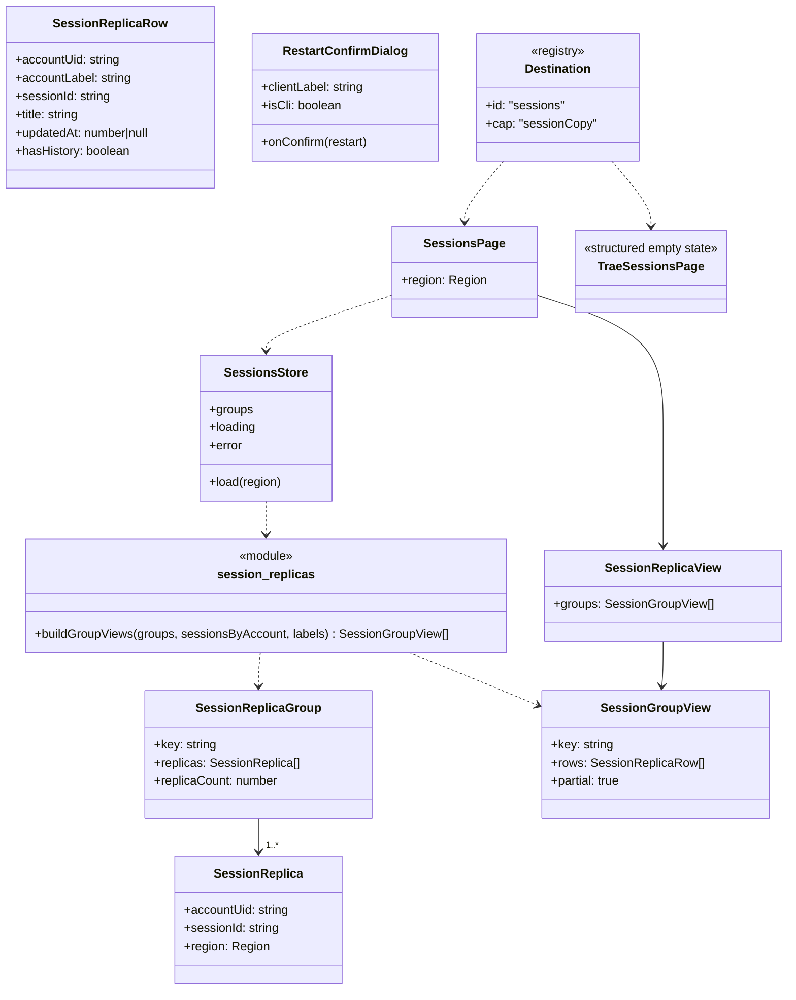
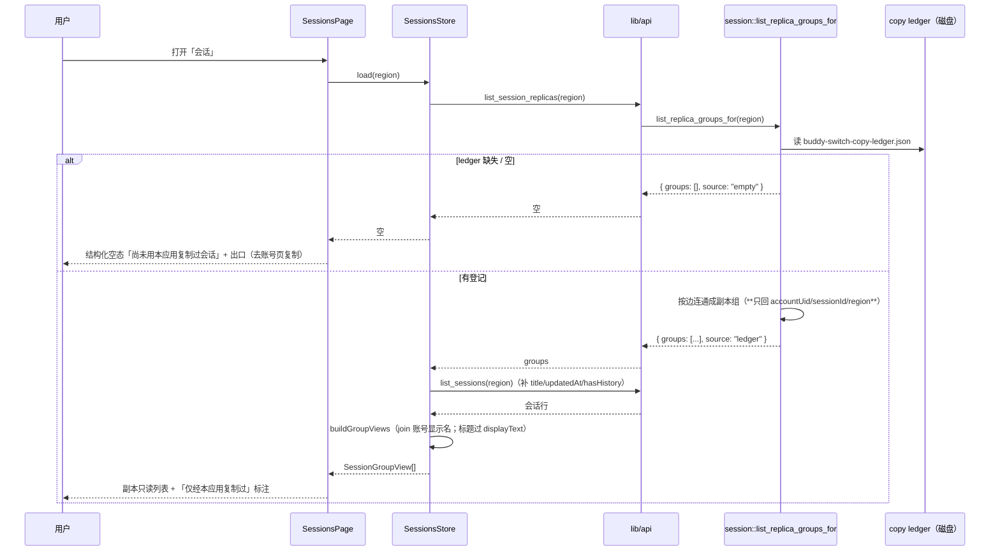
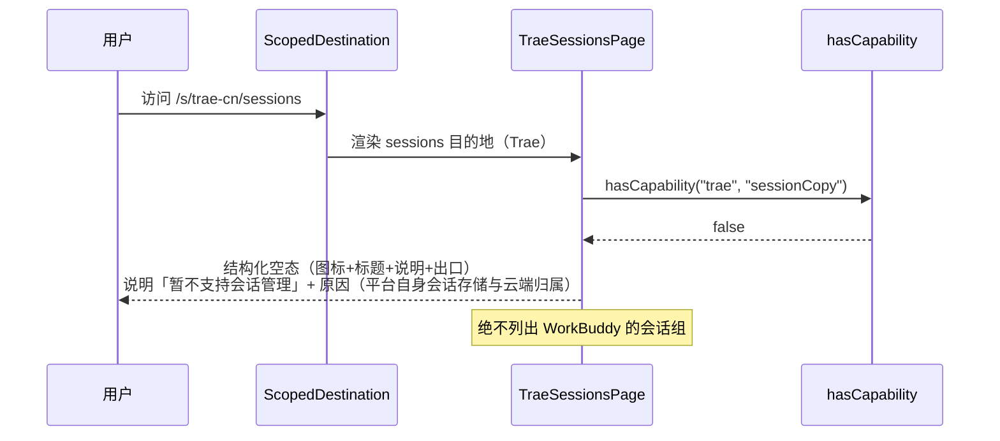
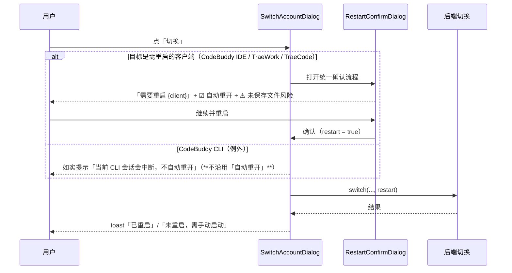
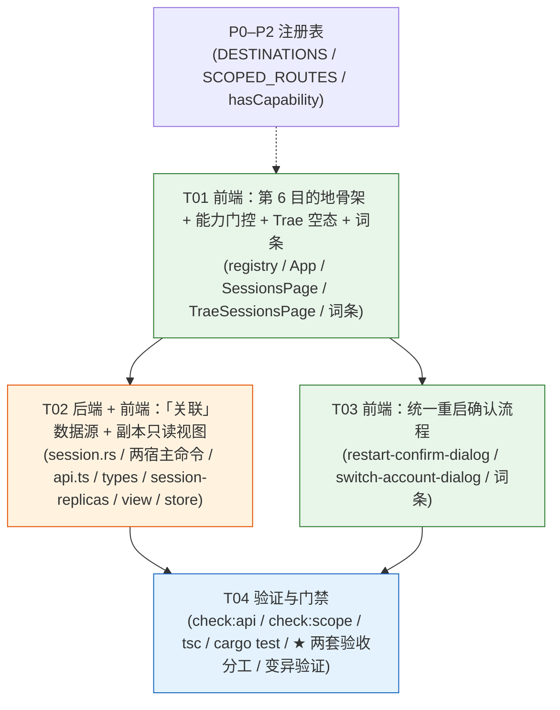

# P8 架构分解：会话工作台

> **★ 实现状态（2026-10-07 回写 —— 以代码 + 门禁为准）**：**T01/T02/T03 已落**，
> 且**原「被后端阻塞」的 3 项已解禁并落地**（组状态四态 / 关联图 / 状态筛选）。
> **原「仍未做的 2 项」现已全部落地**：**安全同步（增量追加）** 与 **分歧处理**（覆盖式统一，
> 先选保留哪一份 + 覆盖前自动备份）。
> 门禁相关断言：`check-scope-registry.cjs` 第 165–181、220–221 条，及 P8 分歧处理新增条。
>
> **状态**：设计（2026-10-04）。**§7 的 8 条待明确事项已由 lead 全部拍板（2026-10-04），正文已同步。** 本文是 `P5-P12-TASKS.md` P8 段的**落地设计**，可直接交给工程师。
> **上游**：`PLAN.md` §3.15（会话工作台：3.15.1 IA / 3.15.2 关联图 / 3.15.3 统一重启确认 / 3.15.4 批量同步）/ §3.2（可配置目的地）/ §3.9（侧栏第 6 项）/ §2.7（能力 ≠ 偏好）/ §3.4 规则 1（无数据不渲染）/ §3.5（文案不许假承诺）/ §3.6（状态语言：部分失败态）；`DECISIONS.md` **D19**（侧栏 6 项）/ **D20**（先「查看 + 安全同步」，分歧后置）/ **D12**（允许平台专属子项）；`GAP-ANALYSIS.md` §2.5（P8 十二条：**0 ✅ / 2 ⚠️ / 10 ❌**）。
> **格式参考**：`P7-ARCH.md` / `P10-ARCH.md` / `P11-ARCH.md`（同构：实现方案 / 文件列表 / 数据结构 / 有序任务 / 共享知识 / 风险 / 待明确 / 依赖图）。
> **下游**：§4 任务列表直接交给工程师。
> **范围**：**仅** P8 —— ① 侧栏第 6 目的地「会话」（**能力门控**）；② 会话**副本只读视图**（数据源 = 既有 **copy ledger**，**只读当前 region**）；③ Trae 作用域**不渲染入口** / URL 直达**结构化空态**；④ **统一重启确认流程**（§3.15.3，**✅ #6：随 P8 一起做**）。
> **★ 数据就绪声明（本文最重要的一节，见 §1.2）**：后端**只有** `list_sessions` / `copy_sessions`（`session.rs:175` / `:1106`）+ 一份**内部** copy ledger（`session.rs:928`），**没有**跨账号会话组 / 分歧 / 内容级比较模型 ⇒ **P8 的「组状态派生 / 关联图 base+delta / 分歧处理 / 安全同步」全部被后端阻塞**，本期**只做能落地的子集**。
> **明确排除**：桌面悬浮窗属 **P9**（§3.16）；请求代理属 **P12**（§3.19）。本文**不碰**。
> **依赖**：**P0–P2**（`DESTINATIONS` / `SCOPED_ROUTES` / `capabilities` 注册表）；**P5**（`Scope` / 注册表收敛）。

---

## 1. 实现方案

### 1.1 核心难点

| 难点 | 现状（证据） | 处理 |
|:---|:---|:---|
| **★ 数据就绪：只有「复制」没有「关联」** | 命令面仅 `list_sessions`（`session.rs:175`）/ `copy_sessions`（`session.rs:1106`）；**无** session group 模型 | **分层**：能先做的（副本只读视图，数据源 = copy ledger）vs 待后端补数据的（组状态 / 关联图 / 分歧 / 同步）—— §1.2。**2026-10-07：组状态 / 关联图 / 分歧 / 增量同步均已落地** |
| **★「关联」的数据从哪来** | 本仓**无** group 模型；但有一份 **copy ledger**（`buddy-switch-copy-ledger.json`，`session.rs:928`）：`{source_uid␟target_uid␟source_cid: new_cid}`（跨 region 键加源 region 前缀，`session.rs:958-971`） | **以 ledger 为关联源**（**只读**，不改其结构）；但它**只覆盖「经本应用复制过」的会话** ⇒ 文案**必须诚实标注**（§1.4 / §1.5） |
| **★「分歧 / 落后」原本不可推导** | ledger 的值是 `new_cid`（**字符串，无消息计数**，`session.rs:1062-1065`）；`list_sessions` 行只有 `{id,title,cwd,updatedAt,hasHistory,isPlayground}`（`session.rs:275-282`）**无消息数** | **★ 已不成立**：2026-10-07 新增 `session_fingerprint_for`（读 jsonl 取 `line_count` + 逐行 `prefix_hashes`）⇒ 状态可派生、已落地（§1.2 / §1.6）。**分歧处理**与**增量同步**亦已于 2026-10-07 落地；**禁止**用 `updatedAt` 当「落后」的代理（§3.15.2「时间新 ≠ 内容新」）——**这条禁令不因指纹落地而放宽** |
| **★ Trae 无会话能力** | `registry.ts:84` Trae `capabilities` **无** `sessionCopy`；复制调用点在 **WB 路径**（`switch.rs:93`） | 侧栏**不渲染**入口；URL 直达 ⇒ **结构化空态 + 说明原因**（§1.3） |
| **★ 客户端 Tab 只剩 1 项** | 会话复制只有 **WorkBuddy 桌面**（`switch.rs:93`）⇒ 1 项 | 按退化规则**不渲染 Tab**，**也不保留结构**（为 1 项写映射表 = 死代码，✅ #7）（§1.9） |
| **★ 侧栏徽章原本没有机制** | `App.tsx:610-615` 侧栏仅 `NavLink`（**无徽章**）；`DEST_META`（`App.tsx:197-208`）无徽章位 | **★ 已补并落地**：组状态有了之后徽章才有意义 ⇒ 现已渲染「待同步组数」（门禁第 181 条：只读已加载 store + 仅会话 + `>0` 才渲染） |
| **★ 统一重启确认不存在** | 切换走 `restart` 参数（`api.ts` 的 `switchCodebuddyCnIdeAccount`），**无前端确认弹窗**（§3.15.3 要「未保存文件」提示 + CLI 例外） | 抽**一条**确认流程，跨程序位复用（§1.7） |
| **★ 目的地是「平台无关」5 项** | `registry.ts:102-111` `DESTINATIONS` 固定 5 项；`App.tsx:168` `SCOPED_ROUTES` **无 sessions** | 加 `sessions` 目的地 + **能力门控**（**不是**平台分支，§1.3） |

### 1.2 ★ 数据就绪分层（本文的枢纽：能先做 vs 被后端阻塞）

**P8 的十二条验收，绝大部分依赖一个本仓不存在的模型**。先把「需要什么数据」摊开，再决定本期边界：

| 能力（原型 / §3.15） | 需要的数据 | 现状 | 本期 |
|:---|:---|:--:|:--:|
| 目的地 + 能力门控 + Trae 空态 | `capabilities.sessionCopy` | ✅ 已有（`registry.ts`） | ✅ **T01 已落** |
| **副本只读视图**（这份会话在哪些账号有副本） | copy ledger 的边（`source→target`） | ✅ 已有（**内部**，`session.rs:928`） | ✅ **T02 已落** |
| 统一重启确认（§3.15.3） | 客户端运行态（**与会话数据无关**） | ✅ 已有 | ✅ **T03 已落** |
| 组状态派生（`latest`/`behind`/`diverge`） | 每副本**相对共同旧版**的消息增量 | ✅ **已有**（2026-10-07 新增：`session_fingerprint_for` 从 jsonl 取 `line_count` + 逐行 `prefix_hashes`） | ✅ **已落**（`session-replicas.ts::deriveGroupStatus`，门禁第 220 条）· ⚠️ **指纹必须先归一化自己的 `sessionId`**，见下方注 |
| 关联图（共同旧版 + delta） | base 快照 + 每副本消息计数 | ✅ **已有**（同上，公共前缀 = 最长公共前缀） | ✅ **已落**（`commonPrefix` / `deltas` / `latestLineCount`，`session-replica-view.tsx` 渲染「共同旧版」行） |
| 分歧处理（先选保留哪一份） | **内容级** diff + 逐条选择 UI | ✅ **已有**（2026-10-07：`buildUnifyItems` + `lostLinesFor` + `UnifyReplicasDialog`） | ✅ **已落**（只在 `diverge` 给出口；覆盖前**自动备份**、备份失败即 fail-closed） |
| 安全同步（§3.15.4「增量追加」） | **内容级** append | ✅ **已有**（2026-10-07：`sync_session_replicas_for` + `append_delta_between_files`） | ✅ **已落**（只 append、绝不截断；分歧 fail-closed 不落字节） |
| 状态筛选（落后 / 分叉 / 已一致） | 组状态 | ✅ **已有**（组状态落地后解禁） | ✅ **已落**（按需出现 + 失效回落，门禁第 221 条） |

> **★ 结论（2026-10-06 写下的原判断）**：**「查看」的一半**（副本归属）**能做**——数据源就是既有的 copy ledger；**「查看」的另一半 + 全部「同步」**（状态 / 关联图 / 分歧 / 增量同步）**被后端阻塞**，本期**不做**。
> **⇒ 本期 P8 = 壳（目的地 + 门控 + 空态）+ 副本只读视图 + 统一重启确认。** 其余登记为**后续期次**（见 §1.6）。
>
> **★★ 2026-10-07 回写（前提变了，结论就该变）**：上面那句「被后端阻塞」**只对了一半**。
> 后端后来补上了**内容指纹**（`session_fingerprint_for` ⇒ `line_count` + 逐行 `prefix_hashes`）
> ⇒ **组状态派生 / 关联图（共同旧版 + delta）/ 状态筛选三项解禁并已落地**。
> ⇒ **原「仍未做的两项」（分歧处理 / 安全同步）亦已于 2026-10-07 落地** —— P8 设计范围内**已全部实现**。
> ⇒ 原文「ledger 值是字符串、无消息计数」这个**论据已失效**，不要再引用它来论证「状态做不了」。
>
> ⚠️ **不许用「时间」冒充「内容」**：`updatedAt` 只能表达「谁最近被改过」，**不能**表达「谁落后 N 条」（§3.15.2 明确「时间新不等于内容新」）。**任何**用 `updatedAt` 排序去渲染「落后 / 最新」的做法，都是 §3.10 第 1 条「图不能撒谎」的违反。

> ★★ **2026-10-07 实测踩到的坑：指纹必须先把「本会话自己的 id」归一化。**
> WorkBuddy 的会话 jsonl **几乎每一行都嵌着 `"sessionId":"<cid>"`** —— 实测一份 15 行的真实会话里
> **14 行**含该 cid（唯一不含的是 `file-history-snapshot`）。而副本是**另一个 cid**
> （复制时整份 `text.replace(cid, new_cid)`）。
> ⇒ 若直接对**原始行**做 hash，两个**内容完全一致**的副本公共前缀恒为 0
> ⇒ `deriveGroupStatus` 会把**每一个组都判成 `diverge`**（**假分歧**：明明一致却报「有分歧」，
> 比不显示更坏）。
> ⇒ 已在 `session_fingerprint_for` / `fingerprint_of_file` 里把 cid 换成
> `SESSION_ID_PLACEHOLDER` 再 hash；护栏见 `fingerprint_ignores_the_replicas_own_session_id`。
> **同一个坑对「增量同步」的行比较同样成立** —— 见 `append_delta_between_files`。

### 1.3 目的地 + 能力门控 + Trae 空态（对应 GAP §2.5 的 4 条边界断言）

**加第 6 个目的地**（`sessions`），但**用能力门控而不是平台分支**：

- `registry.ts`：`Destination` 联合类型加 `"sessions"`；`DESTINATIONS` 加 `"sessions"`（**顺序即侧栏顺序**）。
- `App.tsx`：`DEST_META` 加 `sessions`（`labelKey` + 图标）；`SCOPED_ROUTES` **两平台都加** `sessions`（WB ⇒ `SessionsPage`；Trae ⇒ `TraeSessionsPage`）。
- **门控**：侧栏 `scopedNav` 按 **`hasCapability(product, meta.cap)`** 过滤 —— `sessions` 的 `cap = "sessionCopy"`。**Trae 无该能力 ⇒ 入口不渲染**（`registry.ts:169` 的 `hasCapability`，**不是** `product === "trae"`）。

> ⚠️ **为什么用 `cap` 而不是平台判断**：`DESTINATIONS` 是**平台无关**的（`registry.ts:94-111`）。加平台分支会破坏这条纪律，且新增平台时会漏改。**能力门控是数据驱动的**（同 §1.2 的 P4/P10 口径）。
>
> **✅ #5 已决策（lead 拍板 · 2026-10-04）：本期只做「能力门控」，「用户偏好门控」留后续。** 理由：**能力门控是正确性问题**（Trae 没有这个能力）；**偏好门控是体验问题**（用户可关入口）—— 后者留后续，**避免范围膨胀**。

**Trae 经 URL 直达**（`/s/trae-cn/sessions`）：渲染**结构化空态**（四要素：图标 + 标题 + 说明 + **出口**），说明「**该平台暂不支持会话管理**」，并给出**原因**（依赖平台自身的会话存储与云端归属）。**绝不**列出 WorkBuddy 的会话组（否则用户以为「复制过来了」，§3.15 能力边界）。

### 1.4 ★「关联」的数据来源：copy ledger（只读 · 有限 · 必须诚实标注）

**本仓没有 session group 模型**。唯一与「关联」沾边的是 **copy ledger**：

```
buddy-switch-copy-ledger.json      // 位于「目标 region」的会话数据目录（session.rs:928-935）
{ "source_uid␟target_uid␟source_cid": "new_cid", ... }        // 同 region
{ "source_region␟source_uid␟target_uid␟source_cid": "new_cid" } // 跨 region（前缀，session.rs:958-971）
```

- 它在**每次成功复制**时写入（`record_copy_ledger`，`session.rs:1069`）；命中且副本存活时跳过重复复制（`ledger_hit_for`，`session.rs:1025`）。
- **它就是「副本边」的原始数据**：`source_cid`（在 `source_uid` 账号里）→ `new_cid`（在 `target_uid` 账号里）。

**★ 三条必须承认的局限（写进文案 / 类型）**：

1. **只覆盖「经本应用复制过」的会话** —— 用户在 WorkBuddy 里手动复制、或别处复制的，**不在账本里**。
2. **无内容信息** —— 值是 `new_cid`，**没有**消息计数 / base / 时间 ⇒ **推不出「落后 / 分叉」**。
3. **按 region 分文件** —— 一份 region 的账本只含「目标在该 region」的边；跨 region 边带源 region 前缀。**✅ #2 已决策（lead 拍板）：本期只读当前 region**（与 P10/P11 同口径）；**跨 region 的边本期不引入**（语义不清）。

⇒ **设计决策（✅ #1 已决策 · lead 拍板 2026-10-04：接受 ledger 为正式关联源）**：把 ledger **作为只读关联源暴露**，并附**五条防耦合硬约束**：

1. **只读** —— 绝不写回；
2. **类型锁死** —— `partial: true`（字面量）锁死诚实性（§3.5 不假承诺）；
3. **文案固定** —— 「**仅显示经本应用复制过的会话**」，**shipped 文案零出现**「全部副本」（**注释 / 门禁负断言 / 设计文档 / 原型不算** —— 注释里「禁止用它」本身就含该词，字面「全仓零出现」不可能成立）；
4. **不依赖内部细节** —— 只依赖「边」语义（`source_cid → new_cid`），不依赖键的拼接格式（R10）；
5. **⚠️ 函数头注释** —— 在 `list_replica_groups_for` 的函数头**写明**：「**这是一个内部去重账本被提升为产品语义；改动去重逻辑前先看这里**」。理由：否则将来有人**优化去重**，会**静默改变 P8 的行为**（那是最难查的一类缺陷）。

### 1.5 副本只读视图（本期「查看」的落点）

**「组」= ledger 边的连通分量**：把 `(source_uid, source_cid)` 与 `(target_uid, new_cid)` 当作图的顶点、账本条当作边，连通即一组。

- **每行显示**：副本所属**账号**（`accountUid` join 账号库显示名）+ 会话**标题**（过 `displayText`）+ `updatedAt` + `hasHistory`。
- **★ 账号显示名（✅ #3 已决策 · lead 拍板）**：uid 在账号库 ⇒ 用显示名；**uid 不在账号库**（已删除 / 从未保存）⇒ 显示 **uid 前缀 + 「未知账号」标注**。**不许「不显示」** —— 缺一行会让用户以为「这条副本**没有来源**」，而实际是「来源账号**已删**」—— **两者含义完全不同**。
- **标题过 `displayText`**（`@/lib/display-text`）：会话标题可能是**脏对象** ⇒ 当 React 子节点会**卸载整棵树 ⇒ 白屏**（issue #2，同 §5 白屏防线）。
- **★ 标题不脱敏（✅ #4 已决策 · lead 拍板）**：会话页是**用户主动打开**的（威胁模型 ≠ 悬浮窗的「常驻屏幕、防截图泄露」）⇒ 脱敏反而妨碍使用。**两者的威胁模型不同，不统一。**
- **账号名从账号 store join**，**不重造第二份账号清单**（禁止与账号页各写一份）。
- **不做状态 / 分歧 / 同步按钮**（无数据，§1.6）；**不渲染**状态筛选（§1.9）。
- **空态**：ledger 无登记 ⇒ 结构化空态（「**尚未用本应用复制过会话**」+ 出口去账号页复制），**不是**「加载中」也不是「暂无数据」的含混措辞。

### 1.6 被后端阻塞的部分（**2026-10-07 复核后的真实剩余**）

> ★ **本节已被回写**。原表把 5 项都记为「阻塞」，其中 **3 项后来解禁并已落地**
> （后端补了内容指纹）—— 保留在此是为了让「哪些曾经阻塞、为什么解禁」有据可查。

| 阻塞项 | 原阻塞理由（缺什么） | 2026-10-07 实际状态 |
|:---|:---|:---|
| 组状态派生（`latest`/`behind`/`diverge`） | 缺「每副本相对 base 的消息增量」 | ✅ **已解禁并落地** —— `session_fingerprint_for` 提供 `line_count` + `prefix_hashes`；`deriveGroupStatus` 派生四态 |
| 关联图（共同旧版 + delta） | 缺 base + 每副本计数 | ✅ **已解禁并落地** —— `commonPrefix`（两两最长公共前缀的最小值）+ `deltas` + `latestLineCount` |
| 状态筛选（落后/分叉/已一致） | 依赖组状态 | ✅ **已解禁并落地** —— 按需出现 + 失效回落（门禁第 221 条） |
| 分歧处理（先选保留哪一份） | 缺内容级 diff | ✅ **已解禁并落地** —— `buildUnifyItems`（只在 `diverge` 出项）+ `lostLinesFor`（未知即 null）+ `UnifyReplicasDialog`（先选保留哪一份）；后端 `unify_replica_between_files` **覆盖前先备份**、备份失败即 fail-closed |
| 安全同步（增量追加） | 现 `copy_sessions` 是**整会话新 id 复制**，**不是**追加（`session.rs:647`） | ✅ **已解禁并落地** —— `sync_session_replicas_for` + `append_delta_between_files`（只 append、绝不截断） |

> **本节的意义**：把「不做」写成**有理由的阻塞**，而不是「忘了做」。**后续期次**（暂定 P8.1）在做后端内容级模型后，可**零改动**接入本期的壳（`SessionsPage` / `DESTINATIONS` / 门控都不变）。

### 1.7 统一重启确认流程（§3.15.3，**独立于会话数据**）

切换 CodeBuddy IDE / TraeWork / TraeCode 时客户端需**先关再开** ⇒ 抽**一条**确认流程（跨程序位复用），**不要各写一套**（必然漂移）：

- **默认勾选「自动重开」**（符合预期），**必须显式提示**「⚠️ 未保存的文件可能丢失，请先保存」。
- **CLI 是例外**：切换 CodeBuddy CLI **不重开**且**会中断当前 CLI 会话** ⇒ 文案**不得**沿用「自动重开」，如实写「**当前 CLI 会话会中断**」（§3.3 规则 2 的「错误预防」）。
- 切换完成后 toast 给**明确结果**：「已重启」/「未重启，需手动启动」。
- 后端 `restart` 参数**已存在**（`api.ts` 的 `switchCodebuddyCnIdeAccount(accountId, restart)` / `api.rs:702`）⇒ **不改后端**，只补前端确认环节。

> **与 P8 主体的关系（✅ #6 已决策 · lead 拍板 2026-10-04：随 P8 一起做）**：它**与会话数据无关**（不需要 ledger / group）⇒ **没有阻塞理由**。**能交付的就交付**，不要为了「整期一起」而拖着 ⇒ **本期做**（任务 T03）。

### 1.8 侧栏徽章（待同步组数）+ 无数据不渲染

原型：侧栏「会话」项带**徽章 = 待同步组数**（落后 + 分叉）。**本期没有「待同步」概念**（无组状态）⇒：

- **★ 本期不加徽章机制**（✅ #7 优先，理由见下方张力说明）：无组状态 ⇒ 徽章数据源恒空 ⇒ 按 **§3.4 规则 1「无数据不渲染」**，**徽章不渲染**（原型断言 `sessions: sessionPendingCount() ? {n, warn:true} : null` 也是「0 则不渲染」）。
- **为什么不加机制**：为「将来的多项」预先写一份映射 / 渲染结构 = **死代码**（✅ #7：「为 1 项写映射表 = 死代码，将来真有多项时再建，那时才知道真实形状」）⇒ **有组状态时再加**，那时才知道真实形状。
- **门禁守**：`★ P8 侧栏徽章恒不渲染` 断言 `scopedNav` 无 `badge` 字段、`NavLink` 无 `<Badge>`（防被误加「恒 0 假徽章」）。

> ⚠️ **不许**现在渲染一个恒 `0` 或恒空白的徽章 —— 那是「点了永远是空」的同源缺陷（§3.15.1 规则 2）。
>
> **★ §1.8 与 ✅ #7 的张力（lead 裁决 2026-10-06）**：本节原写「**加**可选 badge 机制（为后续零改动点亮）」，而 ✅ #7 立「**为 1 项写映射表 = 死代码，不加**」。两条冲突时**以 ✅ #7 为准** —— 理由：✅ #7 更晚、更具体，且「为将来预留的结构」正是本仓反复踩过的「死代码 / 假控件」来源。⇒ **本期不加机制**；有组状态（后续期次）时再加。

### 1.9 客户端 Tab 退化 + 状态筛选不渲染（对应两条 IA 规则）

- **客户端 Tab（✅ #7 已决策 · lead 拍板 2026-10-04）**：会话复制**只有 WorkBuddy 桌面**（`switch.rs:93`）⇒ **1 项** ⇒ 按 §3.15.1「单选项的切换器是假控件」**不渲染 Tab**。**⚠️ 也不保留结构** —— 为 1 项写一份映射表 = **死代码**；将来真有多项时再建，那时才知道真实形状。
- **状态筛选**：选项为「全部 / 落后 / 分叉 / 已一致」，但**本期无组状态** ⇒ **一个选项都算不出** ⇒ **整条筛选不渲染**（不是「渲染了但永远空」）。这与 §3.15.1 规则 2「没有该状态的组不渲染该选项」**同源**：**数据里一个状态都没有 ⇒ 一个选项都不渲染**。

> ⚠️ **不许出现第二个「看起来能切」的控件**：不加载 scope 切换器、不加载客户端切换器（1 项时）。筛选器即使将来出现，也是**筛选**语义，与「切换当前作用域」无关。

### 1.10 与 P0–P2 / P5 的关系

- **依赖 P0–P2 的注册表**：`Destination` / `DESTINATIONS` / `SCOPED_ROUTES` / `hasCapability` —— **本设计只加一项 + 加门控**，不重写注册表。
- **依赖 P5**：会话按 region 隔离（`session.rs` 已 `*_for(region)` 参数化）⇒ **不阻塞于 P5 的 `Scope` 化**（region 参数化功能等价）。
- **不改后端复制逻辑**：`copy_sessions` / ledger 结构**保留**；本期只**新增一个只读命令**读 ledger。
- **★ 为 P9 预留接口（✅ #8 已决策 · lead 拍板 2026-10-04）**：P9 悬浮窗**预留**与 P8 同源的「会话状态 provider」接口（`P9-ARCH.md` ✅ #2：**预留但不依赖**）⇒ 本设计**预留**该 provider 的接口形状（**本期不填数据**，P9 先接现有事件），使 P9 就绪时可**直接替换**、无需改 P8。

---

## 2. 文件列表

### 新建

| 相对路径 | 作用 |
|:---|:---|
| `src/pages/SessionsPage.tsx` | WorkBuddy 会话工作台页（副本只读视图 + 空态；**无**状态筛选 / Tab / 同步按钮） |
| `src/pages/TraeSessionsPage.tsx` | Trae 侧目的地组件（**结构化空态**，说明「暂不支持会话管理」+ 原因） |
| `src/components/sessions/session-replica-view.tsx` | 副本只读视图（账号 + 标题 + `updatedAt` + `hasHistory`；`partial` 诚实标注） |
| `src/components/sessions/restart-confirm-dialog.tsx` | **统一重启确认流程**（§3.15.3，跨程序位复用） |
| `src/lib/session-replicas.ts` | 前端归一：ledger 边 → 副本组；uid → 账号显示名 join；标题过 `displayText` |
| `src/stores/sessions.ts` | 会话工作台状态（replicaGroups / loading / error） |
| `src/locales/domains/sessions.zh.ts` / `sessions.en.ts` | 会话工作台 + 重启确认**功能**词条（zh + en 同步） |

### 修改

| 相对路径 | 改动 |
|:---|:---|
| `src/lib/platforms/registry.ts` | `Destination` 加 `"sessions"`；`DESTINATIONS` 加一项；目的地**能力门控**字段（`cap`） |
| `src/App.tsx` | `SCOPED_ROUTES`（两平台）加 `sessions`；`DEST_META` 加 `sessions`；`scopedNav` 按 `hasCapability` 过滤（**侧栏无 badge** —— 本期不加机制，§1.8） |
| `crates/buddy-switch-core/src/modules/session.rs` | **新增** `list_replica_groups_for(region)`（读 ledger → 连通成组；**只读，不改 ledger 结构**） |
| `src-tauri/src/commands.rs` + `crates/buddy-switch-server/src/api.rs` | **新命令** `list_session_replicas`（**两宿主同步**） |
| `src/lib/api.ts` | 新命令接线（`call` + ROUTES/ALIASES + `DEMO_READ_COMMANDS`） |
| `src/lib/types.ts` | 追加 `SessionReplica` / `SessionReplicaGroup` |
| `src/components/switch-account-dialog.tsx` | 切换前走 `RestartConfirmDialog`（§3.15.3） |
| `src/lib/screenshot-demo.ts` | 新 case（会话页演示态） |

> **不修改**：`copy_sessions` / `copy_session_to_user_cross`（复制逻辑**保留**）；`buddy-switch-copy-ledger.json` 的**结构**（只读）；`registry.ts` 的 `DESTINATIONS` **既有 5 项**（只加不删）。
> **不新建** 独立 `sequence-diagram.mermaid` / `class-diagram.mermaid` —— 本文内嵌。

---

## 3. 数据结构与接口

### 3.1 后端：只读关联源（`session.rs`）

```rust
/// ★ 只读：把 copy ledger 的边连通成「会话副本组」。
///
/// ⚠️ **这是一个内部去重账本被提升为产品语义；改动去重逻辑前先看这里。**
///    （ledger 本是「同一源会话 → 同一目标只复制一次」的去重机制（`ledger_hit_for`），
///     P8 把它当作「副本边」的数据源。**优化 / 重构去重会静默改变 P8 的行为** —— 改前先读本注释。）
///
/// 数据源 = `buddy-switch-copy-ledger.json`（`session.rs:928`），**只读当前 region**（✅ #2）。
/// ⚠️ **不新增模型、不改 ledger 结构** —— 只是把既有边**读出来连通**。
/// ⚠️ 返回值**无内容信息**（无消息计数 / base）⇒ 前端**推不出**「落后 / 分叉」。
pub fn list_replica_groups_for(region: Region) -> Value;
// 返回：
// {
//   "groups": [
//     { "key": "…", "replicas": [
//         { "accountUid": "…", "sessionId": "…", "region": "cn" }, …
//     ] }
//   ],
//   "source": "ledger" | "empty",   // empty = 无登记（文件缺失 / 空）
// }
```

> ⚠️ **本命令只回 ledger 里有的字段**（`accountUid` / `sessionId` / `region`）。`title` / `updatedAt` / `hasHistory` **不在 ledger 里** ⇒ 由**前端**用 `list_sessions` / 账号 store join 补齐（§3.2）。**后端不臆造**这些字段。

### 3.2 前端：视图类型（`src/lib/types.ts` 追加）

```ts
import type { Region } from "@/lib/scope";

/** 一份会话在某个账号里的副本（= ledger 的一条边的一端）。 */
export interface SessionReplica {
  /** 副本所属账号 uid（ledger 的 source_uid / target_uid）。 */
  accountUid: string;
  /** 该账号里的会话 id（复制生成的新 id）。 */
  sessionId: string;
  /** 副本所在 region。 */
  region: Region;
}

/** 一份会话的跨账号副本组（由 ledger 边连通而成）。 */
export interface SessionReplicaGroup {
  /** 稳定组键（用于 React key 与抽屉定位）。 */
  key: string;
  replicas: SessionReplica[];
  replicaCount: number;
}
```

> ⚠️ **字段归属（本项目已两次踩坑，务必核对）**：`updatedAt` / `hasHistory` / `title` 属于 **`list_sessions` 的会话行**（`session.rs:275-282`），**不属于** ledger 边；`newId` / `deduplicated` / `ledgerWritten` 属于 **`CopyResult`**；`sourceUid` / `targetUid` / `copied` / `skipped` 属于**复制报告**（**不是** `CopyResult`）。**别混。**

### 3.3 前端：归一（`src/lib/session-replicas.ts`）

```ts
/** ledger 组 + 账号显示名 + 会话行 → 可渲染的视图（标题过 `displayText`）。 */
export interface SessionReplicaRow {
  accountUid: string;
  accountLabel: string;      // 账号 store 显示名；**uid 不在账号库 ⇒ `uid 前缀 + 「未知账号」`**（✅ #3，不许留空）
  sessionId: string;
  title: string;             // ★ 已过 `displayText`（白屏防线，issue #2）
  updatedAt: number | null;  // 来自 `list_sessions` 会话行；取不到为 null
  hasHistory: boolean;       // 来自 `list_sessions` 会话行
}

export interface SessionGroupView {
  key: string;
  rows: SessionReplicaRow[];
  /** ★ 恒 true：仅覆盖「经本应用复制过」的会话（诚实标注，§3.5）。 */
  partial: true;
}

export function buildGroupViews(
  groups: SessionReplicaGroup[],
  sessionsByAccount: Map<string, SessionRow[]>,
  accountLabels: Map<string, string>,
): SessionGroupView[];
```

### 3.4 后端命令（两宿主同步）

```rust
#[tauri::command] pub async fn list_session_replicas(region: Option<String>) -> Result<Value, String>;
```

### 3.5 类图



### 3.6 调用流程（打开会话页 · 副本只读）



### 3.7 调用流程（Trae URL 直达 · 结构化空态）



### 3.8 调用流程（统一重启确认 · §3.15.3）



---

## 4. 任务列表（有序 · 含依赖 · 按实现顺序）

> **硬性顺序**：T01 → T02；**T03 独立**（重启确认与会话数据无关，但**共用 `sessions` 词条文件 ⇒ 与 T01 串行**）；T04 收尾。
> **P0 = 必须；P1 = 重要；P2 = 可裁剪。**

### T01 · 前端：第 6 目的地骨架 + 能力门控 + Trae 结构化空态 + 词条 ｜ P0
- **源文件**
  - 修改 `src/lib/platforms/registry.ts`（`Destination` 加 `"sessions"`；`DESTINATIONS` 加一项；目的地 `cap` 门控字段）
  - 修改 `src/App.tsx`（`SCOPED_ROUTES` 两平台加 `sessions`；`DEST_META` 加 `sessions`；`scopedNav` 按 `hasCapability` 过滤）
  - 新建 `src/pages/SessionsPage.tsx`、`src/pages/TraeSessionsPage.tsx`
  - 新建 `src/locales/domains/sessions.zh.ts` / `sessions.en.ts`
  - 修改 `src/lib/screenshot-demo.ts`（会话页演示态）
- **依赖**：**P0–P2**（注册表）；无强依赖
- **要点**
  - **能力门控**（`hasCapability(product, "sessionCopy")`），**禁止** `product === "trae"` 分支。
  - **客户端 Tab（✅ #7）**：只有 1 项 ⇒ **不渲染 Tab，也不保留结构**（为 1 项写映射表 = 死代码）。
  - **Trae URL 直达 ⇒ 结构化空态**（图标 + 标题 + 说明 + 出口）+ **说明原因**（平台自身会话存储与云端归属）。
  - **不许出现第二个「看起来能切」的控件**（不加 scope / 客户端切换器）。
  - **状态语言**（§3.6）：区块首次加载 → `<Skeleton>`；空态 → `<EmptyState>`（四要素含出口）；**无数据不渲染**（§3.4 规则 1）。
  - 词条 **zh + en 同步**，**只留被引用的键**。

### T02 · 后端 + 前端：「关联」数据源（copy ledger → 副本组）+ 副本只读视图 ｜ P0
- **源文件**
  - 修改 `crates/buddy-switch-core/src/modules/session.rs`（`list_replica_groups_for(region)`；**只读** ledger）
  - 修改 `src-tauri/src/commands.rs` + `crates/buddy-switch-server/src/api.rs`（`list_session_replicas`，两宿主）
  - 修改 `src/lib/api.ts`（接线 + ROUTES/ALIASES + `DEMO_READ_COMMANDS`）
  - 修改 `src/lib/types.ts`（`SessionReplica` / `SessionReplicaGroup`）
  - 新建 `src/lib/session-replicas.ts`、`src/components/sessions/session-replica-view.tsx`、`src/stores/sessions.ts`
- **依赖**：T01
- **要点**
  - **数据源 = copy ledger**（`session.rs:928`）；**只读**，**不改 ledger 结构**、**不新增 group 模型**。
  - **✅ #1**：`list_replica_groups_for` **函数头注释**必须写明「**内部去重账本被提升为产品语义；改动去重逻辑前先看这里**」。
  - **✅ #2**：**只读当前 region** 的账本（跨 region 边本期不引入）。
  - **✅ #3**：账号 uid 不在账号库 ⇒ 显示 **uid 前缀 + 「未知账号」**（**不许不显示**）。
  - **诚实标注**：`partial: true` ⇒ 文案固定「**仅显示经本应用复制过的会话**」；**禁止**「全部副本」。
  - **不做状态 / 分歧 / 同步**（无数据，§1.6）；**不渲染**状态筛选。
  - **标题过 `displayText`**（脏对象 ⇒ 白屏，issue #2）；**标题不脱敏**（✅ #4）；**账号名从账号 store join**（不重造清单）。
  - **ledger 空 ⇒ 结构化空态**（「尚未用本应用复制过会话」+ 出口）。
  - **字段归属核对**：`updatedAt`/`hasHistory`/`title` 来自 `list_sessions` 行，**非** ledger 边（§3.2 注）。

### T03 · 前端：统一重启确认流程（§3.15.3 · ✅ #6 随 P8 一起做） ｜ P1
- **源文件**
  - 新建 `src/components/sessions/restart-confirm-dialog.tsx`
  - 修改 `src/components/switch-account-dialog.tsx`（切换前走确认流程）
  - 修改 `src/locales/domains/sessions.zh.ts` / `.en.ts`（重启确认词条）
- **依赖**：T01（**词条文件串行**）；**与会话数据无关**
- **要点**
  - **一条流程跨程序位复用**（CodeBuddy IDE / TraeWork / TraeCode），**禁止**各写一套。
  - **默认勾选「自动重开」** + **必须显式提示**「未保存文件可能丢失」。
  - **CLI 例外**：切换 CodeBuddy CLI **不重开且中断当前会话** ⇒ 文案**不得**沿用「自动重开」，如实写「当前 CLI 会话会中断」。
  - 完成后 toast 明确结果：「已重启」/「未重启，需手动启动」。
  - **后端不改**（`restart` 参数已存在：`api.ts` 的 `switchCodebuddyCnIdeAccount`）。

### T04 · 验证与门禁 ｜ P0
- **源文件**：无源码改动（跑门禁 + 手工回归 + 变异验证）
- **依赖**：T01、T02、T03
- **要点**
  - `npm run check:api` / `check:scope` / `check:api-contract` / `tsc` 全绿；`cargo test`（core）。
  - **★ 两套验收各验各的对象**（P11 口径）：
    - `verify-behaviors.cjs`（验**原型**，`dest=sessions`，`:929-1014` / `:1237-1272`）**不动** —— 它是原型的规格。
    - **真实应用**的断言加进 `scripts/check-scope-registry.cjs`（`loadTs` 转译 `src/` 后跑真代码）：如既有「Trae 无 `sessionCopy`」（`:209-215`）；**补**「`DESTINATIONS` 含 `sessions` 且受能力门控」。
  - **变异验证（可证伪）**：
    1. **门控失效**：把侧栏过滤改成「总是渲染」⇒ 期望「Trae 不渲染会话入口」断言变红。
    2. **假承诺**：把副本视图文案改成「全部副本」（去掉 `partial`）⇒ 期望「诚实标注」断言变红。
    3. **时间冒充内容**：用 `updatedAt` 排序渲染「落后 / 最新」⇒ 期望「**不出现**落后/分叉状态」断言变红。
    4. **假控件**：客户端 1 项时渲染 Tab ⇒ 期望「不渲染 Tab」断言变红。
    5. **白屏防线**：给会话标题喂一个对象 ⇒ 期望**不白屏**（走 `displayText`）。
    6. **未知账号被吞掉（✅ #3）**：uid 不在账号库时**不显示该副本** ⇒ 期望「未知账号仍列出（uid 前缀 + 标注）」断言变红。
    7. **脱敏越界（✅ #4）**：把会话标题按悬浮窗规则脱敏 ⇒ 期望「会话页标题**不脱敏**」断言变红。
  - **注释文本回归护栏（非行为）**：`list_replica_groups_for` 的**函数头注释**存在（✅ #1）—— 门禁有一条**文本**断言防它被误删（`★ P8 T02 函数头注释存在`），但**注释不是行为**，**真正的保证在代码评审**。
  - 手工回归：WB 侧栏有「会话」/ Trae 侧栏无；Trae URL 直达空态；ledger 空时结构化空态；切换 IDE 时出重启确认、切 CLI 时如实提示中断。

---

## 5. 共享知识（跨文件约定）

- **★ 数据就绪分层**（§1.2）：**能先做** = 壳 + 副本只读视图 + 重启确认；**被阻塞** = 组状态 / 关联图 / 分歧 / 增量同步。**不许**把阻塞项做成「看起来有」的假 UI。
- **★ 关联源 = copy ledger，只读、有限**（§1.4）：**只覆盖「经本应用复制过」的会话** ⇒ 文案固定「仅显示经本应用复制过的会话」，**禁止**「全部副本」（§3.5 不假承诺）。**✅ #1**：五条防耦合硬约束（只读 / `partial` 锁死 / 文案固定 / 不依赖内部细节 / **函数头注释**「内部去重账本被提升为产品语义」）；**✅ #2**：只读**当前 region**。
- **★ 不许用时间冒充内容**：`updatedAt` **不能**当「落后」的代理（§3.15.2「时间新 ≠ 内容新」）；无消息计数 ⇒ **不渲染**落后 / 分叉。
- **★ 能力门控不是平台分支**：侧栏按 `hasCapability(product, "sessionCopy")` 过滤（`registry.ts:169`），**禁止** `product === "trae"`。**✅ #5**：本期只做**能力**门控；**偏好**门控（用户可关入口）留后续。
- **Trae 无会话能力**：侧栏**不渲染**入口；URL 直达 ⇒ **结构化空态**（图标+标题+说明+出口）+ 原因；**绝不**列 WB 会话（§3.15 能力边界）。
- **客户端 1 项 ⇒ 不渲染 Tab，也不保留结构**（✅ #7）：单选项的切换器是假控件（§3.15.1）；为 1 项写映射表 = 死代码，将来真有多项时再建。
- **会话标题不脱敏（✅ #4）**：会话页是**用户主动打开**的（威胁模型 ≠ 悬浮窗的「常驻屏幕防截图」）⇒ **不脱敏**；悬浮窗的脱敏规则**不搬到**会话页。
- **无数据不渲染**（§3.4 规则 1）：徽章无待同步数 ⇒ 不渲染；状态筛选无状态 ⇒ **整条不渲染**。
- **不许出现第二个「看起来能切」的控件**（§3.15.1 / P2 纪律）：不加 scope / 客户端切换器。
- **统一重启确认只有一条**（§3.15.3）：跨程序位复用；**CLI 例外**文案**不得**写「自动重开」。
- **展示字段出口归一为「字符串或 null」**：会话标题 / 账号显示名一律过 `displayText`（对象当 React 子节点 ⇒ 白屏，issue #2）。
- **字段归属别混**（本项目已两次踩坑）：`updatedAt`/`hasHistory`/`title` 属 `list_sessions` 行；`newId`/`deduplicated`/`ledgerWritten` 属 `CopyResult`；`sourceUid`/`targetUid`/`copied`/`skipped` 属复制报告。
- **状态语言（§3.6）**：区块首次加载 → `<Skeleton>`；空态 → `<EmptyState>`（四要素含出口）；批量操作 → 部分失败态（本期无批量同步，故暂不适用）。
- **i18n**：zh + en **同时**加（`src/locales/domains/sessions.*`），扁平点分，**只保留被引用的键**。
- **命令面两宿主同步**：新命令在 `commands.rs`（Tauri）与 `api.rs`（server）**各注册一次**，并接 `api.ts` ROUTES/ALIASES（P5 纪律）。

---

## 6. 风险点

| # | 风险 | 后果 | 对策 |
|:--|:---|:---|:---|
| **R1** | **把被阻塞项做成假 UI**（渲染落后/分叉但数据恒空） | 「点了永远是空」；用户以为功能坏了 | §1.2 分层：阻塞项**本期不做**；状态筛选**整条不渲染**；变异验证 ③ 兜住 |
| **R2** | **用 `updatedAt` 冒充「落后」** | 图撒谎（时间新 ≠ 内容新，§3.15.2 / §3.10 第 1 条） | 禁：只显示 `updatedAt` 事实，**不**派生成「落后/最新」；变异验证 ③ 兜住 |
| **R3** | **关联被当成「全部副本」** | 假承诺：用户以为看到了所有副本，实际只有本应用复制过的 | `partial: true` 锁死 + 文案固定「仅经本应用复制过」；变异验证 ② 兜住 |
| **R4** | **Trae 渲染了会话入口** | Trae 无三件套 ⇒ 列出 WB 会话会让用户以为「复制过来了」 | 能力门控（`hasCapability`）；变异验证 ① 兜住 |
| **R5** | **会话标题是脏对象** | 当 React 子节点 ⇒ **白屏**（issue #2） | 过 `displayText`；变异验证 ⑤ 兜住 |
| **R6** | **客户端 1 项却渲染 Tab** | 单选项的假控件（§3.15.1） | 退化：1 项不渲染；变异验证 ④ 兜住 |
| **R7** | **重启确认写死「自动重开」** | CodeBuddy CLI 不重开且中断会话 ⇒ 文案撒谎（§3.3 规则 2） | CLI 例外分支；文案如实写「当前 CLI 会话会中断」 |
| **R8** | **字段张冠李戴** | 设计/实现引用错类型的字段（本项目已两次：`lastUsedAt`、camelCase 假断言） | §3.2 字段归属注 + §5 共享知识；评审守 |
| **R9** | **重造第二份账号清单** | 账号名与账号页漂移 | 账号名从账号 store join，**不重造** |
| **R10** | **ledger 被当成稳定模型** | 它只是**去重账本**（内部机制），结构可能随去重需求演进 | 只读、**不依赖其内部细节**（只依赖「边」语义）；读写路径仍归 `session.rs` |

---

## 7. 决策记录（**8 条待明确已决策 · lead 拍板 2026-10-04**）

> 每条给出「原问题 → ✅ 决策 → 理由」。**正文已同步**（同步清单见 §7.1）。

1. **是否接受 copy ledger 作为「关联」的正式数据源？** → ✅ **接受，但加一条硬约束**。
   理由：它是本仓**唯一**的副本边数据，**不用它就没得做**。**防耦合硬约束**（全部落到正文 §1.4）：① **只读**（绝不写回）；② **`partial: true` 类型锁死**；③ **文案固定**「仅显示经本应用复制过的会话」；④ **不依赖内部细节**；⑤ **⚠️ 在 `list_replica_groups_for` 的函数头注释里写明**「**这是一个内部去重账本被提升为产品语义；改动去重逻辑前先看这里**」—— 否则将来有人**优化去重**，会**静默改变 P8 的行为**（那是最难查的一类）。

2. **「关联」是否只覆盖当前 region？** → ✅ **只读当前 region**。
   理由：与 P10 / P11 同一口径（**按当前 region**）。跨 region 的边语义不清（源 region 前缀）⇒ **本期不引入**。

3. **副本账号显示名：uid 不在账号库时显示什么？** → ✅ **uid 前缀 + 标注「未知账号」**。
   理由：**不要不显示** —— 缺一行会让用户以为「这条副本**没有来源**」，而实际是「来源账号**已删 / 未保存**」。**两者含义完全不同。**

4. **会话标题是否脱敏？** → ✅ **不脱敏**。
   理由：悬浮窗脱敏是**防截图泄露**（它常驻屏幕、可能被别人看到）；**会话页是用户主动打开的** ⇒ 脱敏反而妨碍使用。**两者的威胁模型不同，不要统一。**

5. **侧栏入口是否也受用户偏好门控？** → ✅ **本期只做能力门控**，偏好门控留后续。
   理由：避免范围膨胀。能力门控是**正确性**问题（Trae 没有这个能力），偏好门控是**体验**问题。

6. **统一重启确认是否随 P8 一起做？** → ✅ **随 P8 一起做**（本期 T03）。
   理由：它**与会话数据无关** ⇒ **没有阻塞理由**。**能交付的就交付**，不要为了「整期一起」而拖着。

7. **客户端 Tab 结构本期是否落地？** → ✅ **不保留结构**。
   理由：只有 1 项就**直接不渲染 Tab**。**为 1 项写一份映射表 = 死代码**（将来真有多项时再建，那时才知道真实形状）。

8. **是否为 P9 预留接口？** → ✅ **预留**（P9 已声明「预留但不依赖」，`P9-ARCH.md` ✅ #2）。

### 7.1 同步清单（正文改在哪）

| 决策 | 正文改动点 |
|:--|:---|
| **#1** | §1.4（五条硬约束 + 函数头注释要求）、§3.1（函数头注释）、§4 T02 要点、§5 |
| **#2** | §1.4（局限 3 → 只读当前 region）、§3.1、§4 T02 要点、§5 |
| **#3** | §1.5（账号显示名）、§3.3（`accountLabel`）、§4 T02 要点 |
| **#4** | §1.5（不脱敏）、§5 |
| **#5** | §1.3（只做能力门控）、§5 |
| **#6** | 头部「范围」、§1.7、§4 T03 |
| **#7** | §1.1（Tab 行）、§1.9（不保留结构）、§4 T01 要点、§5 |
| **#8** | §1.10（预留 P9 provider 接口） |

---

## 8. 任务依赖图



> **可先做（不阻塞于后端模型）**：**T01**（壳 + 门控 + 空态）与 **T03**（重启确认）—— 两者都**不需要**被阻塞的会话组 / 分歧模型。
> **核心路径**：T01 → T02（副本只读视图 = 本期「查看」的落点）。
> **★ 本期边界**：**组状态 / 关联图 / 分歧 / 增量同步**被后端阻塞，**登记为后续期次**（§1.6）；本期**不做**、**也不做假 UI**。
