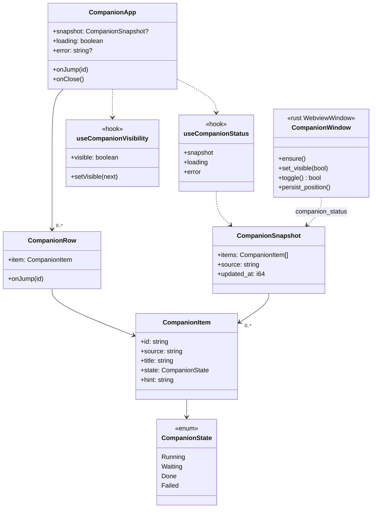
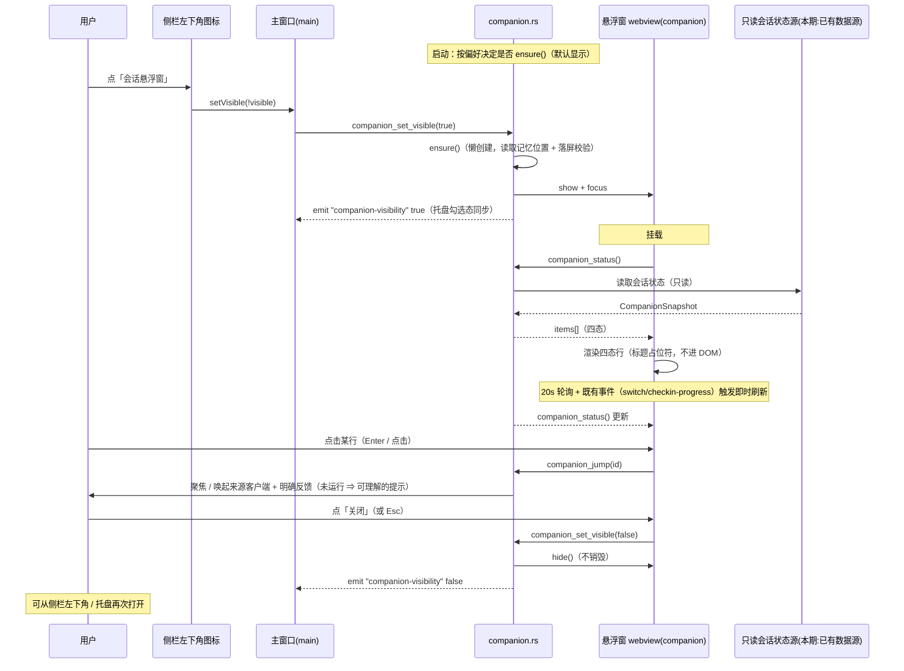
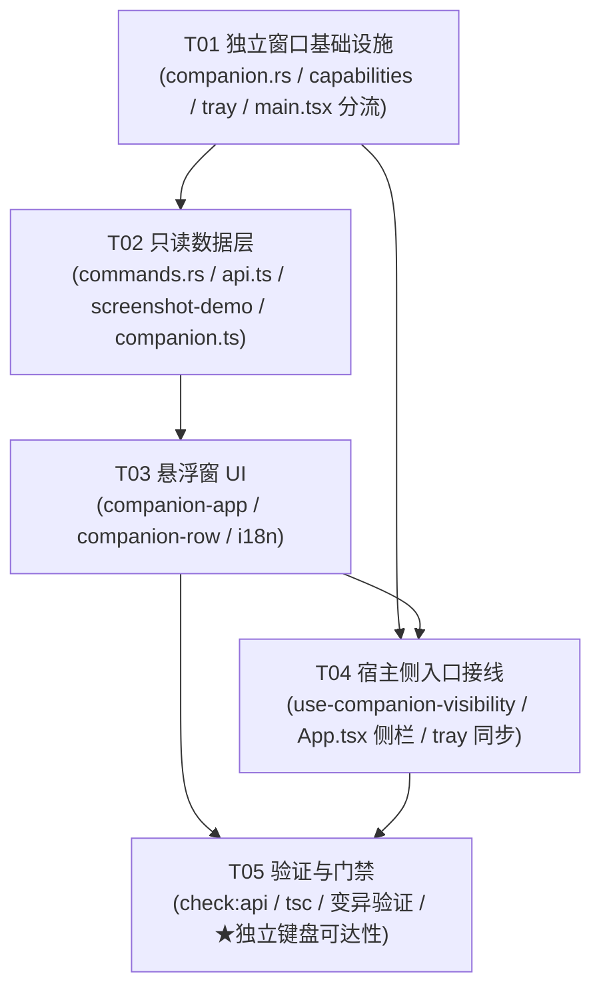

# P9 架构分解：桌面悬浮窗（独立窗口 + 托盘 + 只读订阅）

> **状态**：设计（2026-10-04）。**§7 的 6 条待明确已由 lead 全部拍板（2026-10-04），正文已同步。**
> **上游**：`PLAN.md` §3.16（桌面悬浮窗）、§2.7（入口走**用户偏好**，非 `capabilities`）、§2.1 L0（可见性 = localStorage，非全局）、§3.3（邮箱脱敏同原则）、§3.6（状态语言）、§5 的 P9 行；`DECISIONS.md` D21（进本期）；`P5-P12-TASKS.md` §P9 与附 B **A8**；`GAP-ANALYSIS.md` §2.6（P9 = 7 条：1 ✅ / 5 ❌ / 1 ⬜）与 §4.1（**必须换实现**）。
> **格式参考**：`P4-ARCH.md` / `P5-ARCH.md`。
> **下游**：本文件 §5 的任务列表直接交给工程师执行。
> **范围**：桌面悬浮窗（**独立窗口**）+ 其宿主侧入口（**侧栏左下角 + 托盘**）+ **只读**状态订阅。
> **明确排除**：会话工作台本身（P8）、请求代理（P12）、浮层里的**任何写操作**（§3.16 明确「不做的」：账号切换 / 批量操作 / 自定义布局编辑器）、自定义布局编辑器。
> **不在本期**：**邮箱脱敏（D22）已实现**（`account-card.tsx:93-105`），属既有能力 —— 本文件不复做。

---

## 1. 实现方案

### 1.1 核心难点

| 难点 | 现状 | 处理 |
|:---|:---|:---|
| **★ 原型是「页面内 DOM 浮层」，真实是「独立窗口」** | 原型 `renderCompanion()` 把 `.companion` 塞进 `#companion-slot`（`demo-app.js:183-207`），是主页面里的一个 `position:fixed` 层 | **Tauri 独立 `WebviewWindow`**（label=`companion`）—— 见 §1.2。**不能照搬 DOM 浮层** |
| **★ 只读：不含任何写操作** | 无 | 命令面**只有读 + 显隐 + 聚焦**；**门禁断言**禁写操作（`verify-behaviors.cjs:1185-1192` 的 `forbidden` 列表）—— 见 §2 / §6 |
| **★ 独立窗口的键盘可达性要单独验证** | 无（这是 P5-P12-TASKS 附 B **A8** 明确标注的坑） | 独立 webview ⇒ **不能复用主窗口的键盘验证**；`decorations(false)` ⇒ **必须自管焦点** —— 见 §1.7 |
| **标题默认不进 DOM（防截图泄露）** | 原型靠 `demo.css` 的 `.cp-title { filter: blur }`（**只防截图**，明文仍在 DOM） | **未悬停 / 未聚焦渲染占位符**（完整标题不进 DOM）+ 悬停 / 聚焦才展开（✅ #3）—— 见 §1.6 |
| **入口不是一次性的** | 原型 `cp-close` 关闭 + `cp-toggle` 侧栏重开（`index.html:67`） | **双入口**：侧栏左下角图标 + 托盘菜单项，读写**同一份可见性偏好** —— 见 §1.5 |
| **数据从哪来（会话状态）** | 原型是 `COMPANION_SOURCES` **演示数据**（`demo-data.js:610-615`，固定 4 行） | **只读订阅**一个后端快照命令；**本期只接「已有数据源」的来源**（✅ #2：跨来源 Codex / CodeBuddy 等**不在本期**，按 §3.4 规则 1「无数据不渲染」）—— 见 §1.3。**不造假数据**（无源 ⇒ 结构化空态） |
| **新窗口的权限（Tauri v2 capability）** | `capabilities/default.json` 的 `"windows": ["main"]` **只授权主窗口** | 新增 `capabilities/companion.json`（**最小权限**，`windows:["companion"]`）—— 见 §1.2 / §6 R2 |

### 1.2 独立窗口的生命周期

**为什么用 `WebviewWindow` 而不是「主窗口里的浮层」**：§3.16 明写「**这是本应用里唯一一个「常驻桌面、脱离主窗口」的 UI**」「层级：**不属于 L0–L3**，它是**独立浮层**，有自己的窗口」。主窗口关闭后它是否存活由设置决定。**DOM 浮层做不到「脱离主窗口」**。

**创建方式：Rust 懒创建**（新建 `src-tauri/src/companion.rs`）—— 复用 `tray.rs` 已有的 `WebviewWindowBuilder` 模式（`tray.rs:301` 的 `from_config` + `build`）：

```rust
// 设计（非实现）
WebviewWindowBuilder::new(app, "companion", WebviewUrl::App("index.html?window=companion".into()))
    .title("会话状态")
    .inner_size(292.0, 240.0)      // 宽与原型一致（demo.css:851 width:292px）
    .decorations(false)            // 无系统标题栏 ⇒ 自管焦点（§1.7）
    .transparent(true)             // 圆角卡片外观（demo.css:851-854）
    .always_on_top(true)           // 「常驻桌面」
    .skip_taskbar(true)            // 不占任务栏
    .resizable(false)
    .shadow(false)                 // 与 transparent 配合，避免方角阴影
    .visible(false)                // 首次由可见性偏好决定是否 show
    .build()?;
```

| 项 | 规则 |
|:---|:---|
| **创建时机** | **懒创建**：首次需要显示时 `ensure()`；或启动时按偏好创建（隐藏）。**不写进 `tauri.conf.json` 的 `windows[]`** —— 那会在启动时无条件创建，与「默认显示由偏好决定」冲突，且透明 / 置顶等属性在主窗口配置里不适用 |
| **默认位置** | 主显示器**右下角**，距边 18px（与原型 `right:18px; bottom:18px` 对齐） |
| **位置记忆** | 用户拖动后记忆：Rust 监听 `WindowEvent::Moved` → 持久化到应用配置（**Rust 侧**，见 §4.2）—— **不在前端**（前端 `decorations(false)` 下拖拽由 `data-tauri-drag-region` 触发原生移动，Rust 是唯一知道最终坐标的一侧） |
| **关闭语义** | `CloseRequested` → `api.prevent_close()` + `window.hide()`（**隐藏而非销毁**）+ `emit("companion-visibility", false)`。与主窗口 `tray.rs:74-84` 同一套「关闭 = 隐藏」纪律 |
| **显示 / 隐藏** | 一个 `companion_set_visible(bool)` 命令（显隐 + 持久化偏好 + emit `companion-visibility`）；`companion_toggle()` 为便捷封装 |
| **与「轻量模式」的关系** | 轻量模式销毁的是 **`main`** 窗口（`tray.rs:272-283`）；companion 是**独立窗口**，**不受影响**（但应用退出时随之销毁） |
| **多显示器** | 位置记忆需**校验目标显示器仍在**（拔掉外接屏后坐标可能落在屏幕外）⇒ 落屏校验，越界则回落默认右下角（见 §6 R4） |

> ⚠️ **不在 `tauri.conf.json` 里声明 companion 窗口**（懒创建），但**必须**在 `capabilities/companion.json` 里登记 label，否则新窗口**没有 core 权限**（拖拽 / 事件监听会静默失败）。

### 1.3 只读数据订阅（命令 + 事件，**不用 accounts store**）

**为什么不用 `useAccountsStore`**：账号 store 是**按 region 分家**的账号 / 积分数据（`stores/accounts.ts`），而悬浮窗展示的是**跨来源的「会话 / 任务状态」**（运行中 / 待确认 / 已完成 / 失败），**不是账号列表**，也**不属于任何单一 scope**（§3.16：层级不属于 L0–L3）。两者数据域不同，硬塞进 accounts store 会把「会话状态」伪装成「账号数据」。

⇒ **一个专用只读命令** `companion_status() -> CompanionSnapshot`：

- **只读**：无参数（app 级聚合，✅ #4）、无副作用、不改任何状态。
- **★ 本期数据源范围（✅ #2：只做「已有数据源」的来源）**：本期**只接已有数据源的来源** —— 即由**现有事件**（`switch-progress` / `checkin-progress` / `trae-checkin-progress`）能推导出的会话 / 任务状态。**跨来源客户端（Codex / CodeBuddy 等）不在本期**：按 §3.4 规则 1「**无数据不渲染**」，**没有数据源的来源不该出现在悬浮窗里**（否则就是造一个永远空着的分组）。
- **★ 与 P8 的关系（✅ #2：预留接口但不依赖）**：provider **预留**与 P8 会话工作台同源的接口（将来 P8 就绪可直接替换 provider），但**本期不依赖它**。若 P8 只做 WB 桌面，则**本期悬浮窗就只有 WB 来源 —— 如实呈现即可**，不为「看起来丰富」塞假数据（§6 R7）。
- **降级（fail-closed，不造假）**：provider 未就绪 / 命令报错 / **某来源无数据源** ⇒ 返回**结构化空态**（`items: []` + `source: "unavailable"`），前端渲染 `<EmptyState>`（四要素含出口）。**绝不**用演示数据填充。

**刷新策略（★ 不新增 Rust 后台循环）**：

| 触发 | 机制 |
|:---|:---|
| 首次挂载 | `companion_status()` 拉一次 |
| 低频轮询 | 前端 `setInterval`（默认 **20s**）在 companion webview 内拉取 |
| 既有事件驱动 | `listen` 既有事件 `switch-progress` / `checkin-progress` / `trae-checkin-progress`（`commands.rs:465/1575`）→ **立即**再拉一次 |
| 窗口重新可见 | `listen("companion-visibility")` true → 立即拉一次 |

> ⚠️ **为什么不用后台任务**：项目硬约束「**登记即执行** —— 新增『写状态 / 周期性』出口先 grep 两侧 `BackgroundTask` 注册表」（`lib.rs:32-82` / server 侧同款）。P9 的刷新**全部在前端 webview 内**（轮询 + 事件），**不新增任何 Rust 周期循环** ⇒ **不触碰 BackgroundTask 注册表**，把 R9（「任务未登记 ⇒ 永不执行」）的风险**归零**。

### 1.4 四态怎么驱动

**四个状态**（§3.6 状态语言对齐）：`running`（运行中）/ `waiting`（待确认）/ `done`（已完成）/ `failed`（失败）。

| state | 状态点 class | 颜色语义 | 头部徽标 |
|:---|:---|:---|:---|
| `running` | `run` | primary + **脉冲动画**（`cppulse`） | — |
| `waiting` | `wait` | warning | **`N 待确认`**（`waiting` 计数） |
| `done` | `done` | success | — |
| `failed` | `fail` | destructive | — |

**驱动方式（★ 前端不做业务判断）**：状态**完全由快照的 `item.state` 字段决定** —— 前端只按字段渲染对应 class / 文案 / 徽标，**不自己推断**「什么算运行中」。计数徽标 = `items.filter(i => i.state === "waiting").length`。

> ⚠️ **「四态齐备」的正确含义（不能照搬原型）**：原型断言 `rows.length === 4` 且四态各一（`verify-behaviors.cjs:1173-1183`）——那是**演示数据恰好 4 行**。真实实现里**行数与状态分布由数据决定**，不能人为凑 4 行。⇒ 本期保留的是「**四种状态都有渲染分支、可被数据驱动**」，**不保留**「恰好 4 行」（见 §2 第 1 条与 §6 R6）。

### 1.5 宿主侧入口（侧栏左下角 + 托盘，**双入口同一偏好**）

**入口 1 · 侧栏左下角图标**（`App.tsx` 的侧栏底部 `<section>`，与 `AppFooter` / `DonateButton` 同区，`App.tsx:625-631`）：一个 `size-5` 的 mini 图标按钮（与原型 `index.html:67` 的 `.mini-btn` 同位），`onClick` → `setCompanionVisible(!visible)`。**不占侧栏 5 项**（§3.16：不占侧栏项，入口在侧栏左下角）。

**入口 2 · 托盘菜单项**（`tray.rs:422-459` 的 `build_tray_menu`）：新增一项「会话悬浮窗」（`CheckMenuItem`，勾选态 = 当前可见），与既有 `lightweight-mode` 同款；`on_menu_event` 加 `"toggle-companion"` 分支。

**可见性偏好（§2.7：用户偏好，非 `capabilities`；§2.1 L0）**：

- **默认 = 显示**（§3.16「默认显示」）。
- 载体：**L0 localStorage**（§2.1 表：「桌面悬浮窗可见性 → localStorage」）。键名与 scope 无关（**全局一个**）。
- **单一真值**：两入口 + 窗口内的关闭按钮都通过 `companion_set_visible(bool)` 命令改同一份状态；主窗口 `useCompanionVisibility()` 与托盘勾选态都 **`listen("companion-visibility")`** 同步（沿用 `main-window-visible` 的既有事件模式，`tray.rs:114-116`）。

> ⚠️ **不许出现第二个「看起来能切」的控件**（沿用 P4 纪律）：可见性**只有**「侧栏左下角 + 托盘 + 窗口内关闭按钮」三处，它们**不是三个独立开关**而是**同一状态的三面**，全部经 `companion_set_visible` 收敛。**不做**「设置页再来一个开关」除非确认冗余（见 §7 #5）。

### 1.6 隐私：标题默认**不进 DOM**（防截图泄露）—— ✅ 已决策 #3

与 §3.3 邮箱脱敏**同一原则**（`PLAN.md:1056`），但**比原型更进一步**（✅ #3：采纳「数据防线」）。

**★ 决策（✅ #3，lead 拍板 · 2026-10-04）：未悬停 / 未聚焦时渲染占位符，完整标题根本不进 DOM。** 理由：原型的 `blur` 只是**视觉**防线 —— 完整标题**仍在 DOM 里**，DevTools / 无障碍树 / 任何读 DOM 的途径都能拿到，等于**只防住了截图这一个出口**。这条行为的**目的是防截图泄露**，让完整标题**根本不进 DOM** 才真正达到目的。

| 状态 | 渲染 | DOM 内容 |
|:---|:---|:---|
| **默认（未悬停 / 未聚焦）** | 占位符（如 `••••••••` 或固定骨架条） | **不含**完整标题（只有占位符文本） |
| **悬停 / `:focus-visible`** | 展开为完整标题 | 悬停 / 聚焦时才把完整标题写入 DOM |

- 悬停出**信息卡**（§3.16「悬停出信息卡」）：完整标题 + 来源 + 时间 —— 用 Radix `Tooltip`（`ui/tooltip.tsx` 已有）；**标题只在悬停 / 聚焦那一刻进入 DOM**（`Tooltip` 内容按需挂载）。
- ⚠️ **无障碍代价与处理（✅ #3 附带约束）**：占位符下读屏拿不到标题 ⇒ **用 `aria-label` 给一个脱敏后的描述**（例如「1 条待确认」），**绝不因为无障碍就把明文塞回去** —— 那会重新打开被堵住的出口。
- `:focus-visible` 也要展开（键盘用户不悬停，见 §1.7）。
- **不做**「只 `blur` 但 DOM 仍含明文」的旧方案（那是被否掉的候选 A）。

### 1.7 ★ 键盘可达性（独立窗口，单独验证路径）

**为什么必须单独验证**（A8 / `DECISIONS.md:254`）：`decorations(false)` 的独立窗口**没有系统标题栏**，主窗口的焦点管理（`App.tsx` 的 `pt-20` 红绿灯避让、`Suspense` 路由层等）**一条都不适用**。

**规则**：

| 项 | 要求 |
|:---|:---|
| 焦点入口 | 窗口打开后焦点落在**第一个可聚焦行**；`decorations(false)` ⇒ 不能依赖 OS 默认聚焦 |
| 行可聚焦 | 每行是 `<button>`（原生可 Tab / Enter）；`:focus-visible` 展开标题（§1.6） |
| 拖动不抢焦点 | 拖拽手柄用 `data-tauri-drag-region`（原生拖动，不产生可聚焦元素） |
| Esc | 隐藏窗口（回到「可从侧栏 / 托盘重开」） |
| 关闭按钮 | 是 `<button aria-label="隐藏悬浮窗">`（原型 `demo-app.js:202`）—— 可聚焦、可 Enter |
| **验证路径** | **独立于主窗口**：companion 是**另一个 webview**，`verify-behaviors.cjs`（JSDOM 驱动原型 HTML）**覆盖不到**它 ⇒ 需要**针对 companion webview 的 E2E**（或一份**独立手测清单**，见 §5 T05）。**复用主窗口的键盘测试 = 空转**（A8 的原话：「否则『通过』是空转」） |

### 1.8 与原型的分歧（★ 不能照搬）

| 原型行为 | 为什么不能照搬 | 真实实现 |
|:---|:---|:---|
| `.companion` **页面内 DOM 浮层**（`demo-app.js:197`） | §3.16 要求**脱离主窗口**的独立浮层 | **独立 `WebviewWindow`**（§1.2） |
| `#companion-slot` 注入（`index.html`） | 没有「主页面里的槽位」这回事 | 独立 HTML 入口 **`index.html?window=companion`**（`main.tsx` 分流，§4.1） |
| `COMPANION_SOURCES` **演示数据**（`demo-data.js:610-615`，固定 4 行 / 4 源） | 断言的是原型演示数据；真实数据来自后端 | 只读快照命令（§1.3）；**恰好 4 行不照搬**，保留「四态都支持」（§1.4） |
| `cp-jump` 的 toast「已回到…」（`demo-app.js:2269`） | 原型只弹 toast，**没有真的回去** | 真实实现 = **聚焦 / 唤起来源客户端**（OS 级 bring-to-front，**不切账号、不导航主窗口**，✅ #1）+ 明确反馈；**来源未运行 ⇒ 可理解的反馈**，不静默失败 —— 见 §4.2 / §5 T02 |
| 标题模糊用 `demo.css` 的 `filter: blur`（`demo.css:887-892`） | 原型的 `blur` **只防截图**：完整标题仍在 DOM，DevTools / 无障碍树可读 | **未悬停 / 未聚焦时渲染占位符**（完整标题不进 DOM）+ 悬停 / 聚焦才展开 + `aria-label` 脱敏描述（✅ #3，§1.6） |
| `data-act` 命名 | 原型专属 DOM 契约 | shadcn/Radix + React 事件 |

---

## 2. 必须保留的原型行为（**读 `verify-behaviors.cjs:1173-1219` 确认原文**）

> 下表每条都对齐 `verify-behaviors.cjs` 的**断言体**（非名字）。P9 的 7 条差距见 `GAP-ANALYSIS.md` §2.6。

| # | 原型断言（`verify-behaviors.cjs`） | 行号 | 真实实现要求 | 能否照搬 |
|:--|:---|:--|:---|:--|
| B1 | **默认显示，四态齐备**（运行中/待确认/已完成/失败） | `:1173-1183` | 默认可见（偏好默认 true）；**四态各有渲染分支、可被数据驱动** | ⚠️ **部分**：「默认显示」照搬；「恰好 4 行」**不照搬**（数据决定行数） |
| B2 | **只读：不含任何写操作**（§3.16「不做的」） | `:1185-1192` | 命令面**只有读 / 显隐 / 聚焦**；`forbidden = [switch, delete, batch-delete, batch-checkin, model-disable, bk-export, acct-prog, pin]` **一条都不许出现在 companion** | ✅ **照搬**（这是红线，见 §6 R1） |
| B3 | **标题默认模糊，悬停才展开** | `:1194-1202` | **未悬停 / 未聚焦渲染占位符**（完整标题不进 DOM）；`:hover` **与 `:focus-visible`** 才展开（✅ #3，§1.6） | ⚠️ **加强**：原型只 `blur`（DOM 仍含明文）；本期改为**数据防线**（占位符），不照搬 `blur` |
| B4 | **可关闭 + 侧栏左下角重开（入口不是一次性的）** | `:1204-1212` | 关闭 = 隐藏；侧栏左下角图标 + 托盘重开 | ✅ 照搬（**并补托盘入口**） |
| B5 | **点击条目回到原会话（有明确反馈）** | `:1214-1219` | 点击 → **聚焦 / 唤起来源客户端**（✅ #1，不切账号 / 不导航主窗口）+ 明确反馈；**来源未运行 ⇒ 可理解的反馈** | ✅ 照搬（反馈照搬；(A) 满足「有明确反馈」） |
| — | 邮箱默认脱敏（账号页不出现完整邮箱） | `:1221-1226` | **已实现**（`account-card.tsx:93-105`） | ✅ 既有能力，**不在本期** |
| — | 搜索仍按完整邮箱匹配 | `:1228-1235` | 脱敏只作用于展示（P4 工具栏搜索已规划） | ⬜ 原型特有场景（WB 账号页原无搜索，P4 已补） |

---

## 3. 文件列表

### 新建

| 相对路径 | 作用 |
|:---|:---|
| `src-tauri/src/companion.rs` | 独立窗口：`ensure` / `set_visible` / `toggle` / 位置记忆 / `on_window_event`（Moved / CloseRequested） |
| `src-tauri/capabilities/companion.json` | companion 窗口的**最小权限**（`windows:["companion"]`：`core:default` + `core:window:allow-start-dragging` + 事件监听） |
| `src/components/companion/companion-app.tsx` | 悬浮窗根组件（头部 + 行列表 + 空态 + 状态语言；**只读**） |
| `src/components/companion/companion-row.tsx` | 单行（状态点 + 来源 + **占位符标题**（完整标题不进 DOM，✅ #3）+ 悬停信息卡；点击**聚焦来源**，✅ #1） |
| `src/lib/companion.ts` | 类型 `CompanionSnapshot` / `CompanionItem` / `CompanionState` + `useCompanionStatus()`（拉取 + 轮询 + 事件订阅） |
| `src/lib/use-companion-visibility.ts` | 可见性偏好 hook（L0 localStorage）+ `listen("companion-visibility")` 同步 |
| `docs/redesign/P9-ARCH.md` | 本文档 |

### 修改

| 相对路径 | 改动 |
|:---|:---|
| `src/main.tsx` | 入口分流：`?window=companion` ⇒ 渲染 `<CompanionApp/>`（**不经 Router / 侧栏 / 错误边界之外的任何主窗口结构**） |
| `src-tauri/src/lib.rs` | `mod companion;`；注册 `companion_*` 命令到 `generate_handler!`；`on_window_event` 转发 companion 事件 |
| `src-tauri/src/tray.rs` | 托盘菜单加「会话悬浮窗」项 + `on_menu_event` 分支 + 勾选态刷新 |
| `src-tauri/src/commands.rs` | 新增 `companion_status` / `companion_set_visible` / `companion_toggle` / `companion_jump`（**只读 + 显隐 + 聚焦，无写操作**） |
| `src/lib/api.ts` | `ROUTES` + `call()` + `DEMO_READ_COMMANDS`（`companion_status` 是只读命令，需登记否则 `build:demo` 报错） |
| `src/lib/screenshot-demo.ts` | `companion_status` 的 case 分支（脚本第 6 条强制） |
| `src/App.tsx` | 侧栏左下角图标入口 + `useCompanionVisibility()`（**不改** 5 项导航与路由） |
| `src/locales/domains/shared.zh.ts` / `.en.ts` | 悬浮窗通用键（标题 / 四态文案 / 只读脚注 / 空态 / 无障碍标签） |

> **不修改**：`stores/accounts.ts`（数据域不同，见 §1.3）、`tauri.conf.json`（companion 懒创建，不进 `windows[]`）。
> **最小可提交单元**：T01 的「窗口 + capability + `main.tsx` 分流 + 托盘入口」**必须同批**（缺 capability 则新窗口无权限、缺分流则白屏）；T02 的「命令 + `api.ts` + `screenshot-demo.ts`」**必须同批**（`check:api` 四方一致）。

---

## 4. 数据结构与接口

### 4.1 入口分流（`src/main.tsx`）

```ts
// 设计（非实现）
const isCompanionWindow =
  typeof window !== "undefined" &&
  new URLSearchParams(window.location.search).get("window") === "companion";

ReactDOM.createRoot(document.getElementById("root")!).render(
  <React.StrictMode>
    <ErrorBoundary>
      {isCompanionWindow ? <CompanionApp /> : <App />}
    </ErrorBoundary>
  </React.StrictMode>,
);
```

> **为什么用 URL 查询而非 `getCurrentWindow().label`**：`main.tsx` 在 **webui 也会执行**（`api.isWebui()`），那里没有 Tauri 窗口 API ⇒ 用 `@tauri-apps/api` 会让 webui 崩。URL 查询**两端都安全**，且显式、可测。

### 4.2 后端契约（`src-tauri/src/companion.rs` + `commands.rs`）

```rust
// 设计（非实现）——只读快照
#[derive(serde::Serialize)]
pub struct CompanionItem {
    pub id: String,            // 稳定键（聚焦 / 去重用）
    pub source: String,        // 来源客户端名（本期：有数据源的来源）
    pub title: String,         // 会话标题（★ **默认不进 DOM**，悬停 / 聚焦才展开，见 §1.6 / ✅ #3）
    pub state: CompanionState, // 四态
    pub hint: String,          // 相对时间 / 提示（如「12 分钟前」「等待确认」）
}
#[derive(serde::Serialize)]
#[serde(rename_all = "lowercase")]
pub enum CompanionState { Running, Waiting, Done, Failed }

#[derive(serde::Serialize)]
pub struct CompanionSnapshot {
    pub items: Vec<CompanionItem>,
    /// 数据来源状态：provider 未就绪时为 "unavailable" ⇒ 前端渲染结构化空态（**不造假数据**）
    pub source: String,        // "live" | "cached" | "unavailable"
    pub updated_at: i64,       // ms
}

// 命令面（★ 全部只读 / 显隐 / 聚焦，**无写操作**）
#[tauri::command] pub async fn companion_status() -> Result<CompanionSnapshot, String>;
#[tauri::command] pub async fn companion_set_visible(app: AppHandle, visible: bool) -> Result<(), String>;
#[tauri::command] pub async fn companion_toggle(app: AppHandle) -> Result<bool, String>;
/// 点击行（✅ #1）：**聚焦 / 唤起来源客户端**（OS 级 bring-to-front）。
/// ★ **不切账号、不导航主窗口、不删改任何数据** —— 悬浮窗只「把你带到那儿」。
/// ⚠️ 来源客户端**未运行**时返回**可理解的错误**（前端渲染明确反馈），**不静默失败**。
#[tauri::command] pub async fn companion_jump(id: String) -> Result<(), String>;
```

**窗口位置记忆（Rust 侧）**：`WindowEvent::Moved` → 写应用配置（`modules::config` 同源）；启动 `ensure()` 时读取并**做落屏校验**（§6 R4）。

### 4.3 前端 hook（`src/lib/companion.ts` / `use-companion-visibility.ts`）

```ts
// 设计（非实现）
export function useCompanionStatus(): {
  snapshot: CompanionSnapshot | null;
  loading: boolean;      // 首次加载 → 骨架（§3.6）
  error: string | null;
} ; // 内部：挂载拉一次 + 20s 轮询 + listen(既有进度事件) 触发即时刷新

export function useCompanionVisibility(): [boolean, (next: boolean) => void];
// 载体：L0 localStorage（默认 true）；写时调 companion_set_visible；
// 并 listen("companion-visibility") 与托盘 / 窗口内关闭按钮同步。
```

### 4.4 类图



### 4.5 调用流程（打开 / 订阅 / 点击回到会话）



---

## 5. 任务列表（有序 · 含依赖 · 按实现顺序）

> **硬性顺序**：T01 → T02 → T03 → T04 → T05。
> **原子提交**：T01 的「窗口 + capability + `main.tsx` 分流 + 托盘入口」**同一提交**；T02 的「命令 + `api.ts` + `screenshot-demo.ts`」**同一提交**。
> **P0 = 必须；P1 = 重要；P2 = 可裁剪。**

### T01 · 独立窗口基础设施（Rust + capability + 入口分流）｜ P0
- **源文件**
  - 新建 `src-tauri/src/companion.rs`（`ensure` / `set_visible` / `toggle` / 位置记忆 / `on_window_event`）
  - 新建 `src-tauri/capabilities/companion.json`（`windows:["companion"]`，最小权限）
  - 修改 `src-tauri/src/lib.rs`（`mod companion;` + 注册命令 + 事件转发）
  - 修改 `src-tauri/src/tray.rs`（托盘「会话悬浮窗」项 + `on_menu_event` 分支 + 勾选态）
  - 修改 `src/main.tsx`（`?window=companion` 分流）
  - 新建 `src/components/companion/companion-app.tsx`（**骨架**：仅标题 + 空容器，供 T03 填充）
  - 修改 `src/locales/domains/shared.zh.ts` / `.en.ts`（悬浮窗基础键，zh + en 同步）
- **依赖**：无
- **要点**：窗口 `decorations(false)` / `transparent(true)` / `always_on_top(true)` / `skip_taskbar(true)`；关闭 = 隐藏（不销毁）；**不进 `tauri.conf.json` 的 `windows[]`**；**必须**登记 `capabilities/companion.json`（否则新窗口无权限）；位置记忆在 **Rust 侧**（`WindowEvent::Moved`）；`main.tsx` 用 **URL 查询**分流（webui 安全）。

### T02 · 只读数据层（命令 + api + hook）｜ P0
- **源文件**
  - 修改 `src-tauri/src/commands.rs`（`companion_status` / `companion_set_visible` / `companion_toggle` / `companion_jump`）
  - 修改 `src-tauri/src/lib.rs`（`generate_handler!` 同步）
  - 修改 `src/lib/api.ts`（`ROUTES` + `call()` + `DEMO_READ_COMMANDS`）
  - 修改 `src/lib/screenshot-demo.ts`（`companion_status` case）
  - 新建 `src/lib/companion.ts`（类型 + `useCompanionStatus`）
- **依赖**：T01
- **要点**：**四处同步**（`api.ts` ROUTES+call / `generate_handler!` / server `.route`（若 webui 也暴露）/ 命令本体）；`companion_status` 登记进 `DEMO_READ_COMMANDS`（否则 `build:demo` 报错）；**本期 provider 只接「已有数据源」的来源（✅ #2）**，预留与 P8 同源的接口但**不依赖**（P8 未就绪时**先接现有事件**）；未就绪 / 无源 ⇒ `source:"unavailable"` + `items:[]`（**不造假**）；刷新 = 前端轮询 + 既有事件，**不新增 Rust 后台循环**。**`companion_jump` = 聚焦 / 唤起来源客户端（✅ #1）**，**不切账号、不导航主窗口**；**来源未运行 ⇒ 返回可理解的错误**（前端给明确反馈，不静默失败）。

### T03 · 悬浮窗 UI（四态 + 隐私 + 只读）｜ P0
- **源文件**
  - 修改 `src/components/companion/companion-app.tsx`（头部 + 行列表 + 空态 + 状态语言）
  - 新建 `src/components/companion/companion-row.tsx`（状态点 + 来源 + **占位符标题**（完整标题不进 DOM，✅ #3）+ 悬停信息卡 + 点击聚焦来源）
  - 修改 `src/locales/domains/shared.zh.ts` / `.en.ts`（四态文案 / 脚注 / 空态 / 无障碍标签）
- **依赖**：T02
- **要点**：**四态各有渲染分支**（`run/wait/done/fail`）；`waiting` 计数 → 头部徽标；**标题默认渲染占位符（完整标题不进 DOM），`:hover` 与 `:focus-visible` 才展开，并给 `aria-label` 脱敏描述（✅ #3，§1.6）**；点击行 → `companion_jump`（聚焦来源，✅ #1）；脚注「只读 · 点击回到原会话 · 标题悬停显示」；空态 `<EmptyState>`（四要素含出口）、首次加载 `<Skeleton>`；**禁止任何写操作入口**（`forbidden` 列表一条都不出现）；展示字段过 `displayText` 出口（白屏防线）。

### T04 · 宿主侧入口接线（侧栏左下角 + 可见性同步）｜ P0
- **源文件**
  - 新建 `src/lib/use-companion-visibility.ts`（L0 localStorage + `listen("companion-visibility")`）
  - 修改 `src/App.tsx`（侧栏底部 `<section>` 加图标入口，与 `AppFooter` 同区）
  - 修改 `src-tauri/src/tray.rs`（勾选态随 `companion-visibility` 刷新，若 T01 未含）
  - 修改 `src/locales/domains/shared.zh.ts` / `.en.ts`（入口 tooltip / 无障碍标签）
- **依赖**：T01、T03
- **要点**：入口**不占侧栏 5 项**（放底部 `<section>`）；侧栏 / 托盘 / 窗口内关闭按钮**读写同一份偏好**（经 `companion_set_visible` 收敛，**不许出现第二个「看起来能切」的控件**）；默认可见；**不改**路由与导航。

### T05 · 验证与门禁（含**独立键盘可达性**）｜ P0
- **源文件**：无源码改动（跑门禁 + 手工回归 + 变异验证 + 独立键盘验证）
- **依赖**：T03、T04
- **要点**：
  - `npm run check:api` / `check:store-selectors` / `check:scope` / `tsc` / `build:fast` 全绿。
  - **★ 独立键盘可达性验证**（A8，**不能复用主窗口**）：针对 **companion webview** 单独验证 —— Tab 可遍历各行、`:focus-visible` 展开标题、Enter 触发 `companion_jump`、Esc 隐藏、拖动不抢焦点、关闭按钮可聚焦。**复用主窗口的键盘测试 = 空转**。
  - **变异验证（可证伪）**：
    1. **只读红线**：给悬浮窗加一个写操作入口（如「切换账号」）⇒ 期望「只读 / 无写操作」断言变红。
    2. **标题不进 DOM**：把占位符改回「未悬停时直接渲染完整标题」⇒ 期望「默认不进 DOM」断言变红。
    3. **入口非一次性**：删掉侧栏左下角图标 ⇒ 期望「可从入口重开」断言变红。
    4. **capability**：从 `capabilities/companion.json` 移除窗口 label ⇒ 期望拖拽 / 事件**静默失败**（暴露权限缺失）。
    5. **不造假数据**：provider 置为不可用 ⇒ 期望渲染**空态**（而非演示数据）。
  - 手工回归：默认显示、四态渲染、关闭后可重开（侧栏 + 托盘）、位置记忆、多显示器拔插、截图不外泄完整标题。

---

## 6. 风险点

| # | 风险 | 影响 | 缓解 |
|:--|:---|:---|:---|
| **R1** | **悬浮窗混进写操作**（破坏「只读」红线） | 违反 §3.16「不做的」；`forbidden` 列表是门禁断言 | 命令面只有读 / 显隐 / 聚焦；`companion_jump` **不切账号、不改数据**；变异验证①兜住 |
| **R2** | **新窗口无 capability ⇒ 权限静默失败** | 拖拽 / 事件监听不报错但**不生效**（最难查的一类） | 新增 `capabilities/companion.json`（`windows:["companion"]`）；T05 变异④显式暴露 |
| **R3** | **★ 独立窗口键盘可达性「假通过」** | 复用主窗口测试 ⇒ 空转（A8 明确） | **单独验证路径**（T05）：针对 companion webview 的 E2E 或独立手测清单 |
| **R4** | **位置记忆落在已断开的显示器上** | 窗口出现在屏幕外 ⇒ 用户「打不开」（实为看不见） | 启动 `ensure()` 时**落屏校验**（目标显示器不存在 / 坐标越界 ⇒ 回落默认右下角） |
| **R5** | **透明 + 置顶的平台差异** | Windows / macOS / Linux 表现不一致（阴影 / 圆角 / 焦点） | 三平台各测；`shadow(false)` 与 `transparent(true)` 配合；平台差异不硬抹平 |
| **R6** | **把「恰好 4 行」当验收** | 真实数据行数可变 ⇒ 断言永远红（假差距） | 验收口径 = 「**四态各有渲染分支、可被数据驱动**」，非「恰好 4 行」（§1.4 / §2 B1） |
| **R7** | **数据源（provider）未就绪 / 某来源无数据源** | 悬浮窗空白或造假数据 | **本期只接「已有数据源」的来源（✅ #2）**；provider **预留**与 P8 同源接口但**不依赖**（先接现有事件）；无源 / 未就绪 ⇒ 结构化空态（`source:"unavailable"`），**绝不造假**；某来源无数据源 ⇒ **不渲染该来源**（§3.4 规则 1） |
| **R8** | **可见性出现「第二个能切的控件」** | 与 P4 同款纪律冲突 | 三处入口经 `companion_set_visible` **收敛为同一状态**（§1.5） |
| **R9** | **误新增 Rust 后台循环** | 触发「登记即执行」硬约束（漏登记 ⇒ 任务永不执行） | 刷新**全在前端 webview**（轮询 + 既有事件）；**不碰 BackgroundTask 注册表**（§1.3） |
| **R10** | **`companion_jump` 越界成「写操作」** | 破坏只读红线 | ✅ #1 已拍板：`companion_jump` = **聚焦 / 唤起来源客户端**，**不切账号、不导航主窗口**；来源未运行 ⇒ 明确反馈 |

---

## 7. 决策记录（原待明确事项 · 已由 lead 拍板）

> **说明**：以下 6 条原为「待明确事项」，均已于 **2026-10-04 由 lead 全部拍板**。逐条列出**决策 + 理由**，并标明该决策是否**改变了设计**（改变者已同步改对应章节）。**无遗留待明确事项。**

### ✅ #1 · 「点击条目回到原会话」的真实语义 —— **采纳 (A)：聚焦 / 唤起来源客户端** ✅ 已决策（lead 拍板 · 2026-10-04）
- **决策**：`companion_jump` = **聚焦 / 唤起来源客户端**（OS 级 bring-to-front），**不切账号、不导航主窗口**。
- **理由**：
  1. **P9 是只读的**（§3.16 明确「不做的」）—— **导航到会话是主窗口的动作，不是悬浮窗的**；悬浮窗只该「把你带到那儿」，不该自己动主窗口状态。
  2. **(B) 需要 P8 深链，而 P8 未就绪** ⇒ 选 (B) 就是**给不存在的依赖写代码**。
  3. 原型验收「点击条目回到原会话（**有明确反馈**）」——(A) 能满足：聚焦来源客户端 + 明确反馈。
- ⚠️ **附带约束**：若来源客户端**未运行**，「聚焦」要给出**可理解的反馈**，**不要静默失败**。
- **对正文的影响（★ 改变了设计）**：**已同步** —— §1.8 表格、§2 B5、§4.2 命令注释、§4.5 时序、§5 T02/T03 要点、§6 R10。

### ✅ #2 · 数据源（provider）与 P8 的边界 —— **本期只做「已有数据源」的来源** ✅ 已决策（lead 拍板 · 2026-10-04）
- **决策**：**跨来源（Codex / CodeBuddy 等）不在本期**；provider **先接现有事件**（`switch` / `checkin-progress`），**预留**与 P8 同源的接口**但不依赖它**。
- **理由**：**§3.4 规则 1「无数据不渲染」** —— 没有数据源的来源**不该出现在悬浮窗里**，否则就是造一个永远空着的分组。P8 未就绪 ⇒ 不把 P8 作为硬依赖。
- ⚠️ **附带说明**：若 P8 只做 WB 桌面，则**本期悬浮窗就只有 WB 来源 —— 如实呈现即可**，不为「看起来丰富」塞假数据（§6 R7）。
- **对正文的影响（★ 改变了设计）**：**已同步** —— §1.1 表格、§1.3、§4.2、§4.5 时序、§5 T02 要点、§6 R7。

### ✅ #3 · 标题的「数据防线」是否要做 —— **采纳 (B)：未悬停渲染占位符** ✅ 已决策（lead 拍板 · 2026-10-04）
- **决策**：**未悬停 / 未聚焦时渲染占位符，完整标题根本不进 DOM**（不是只做视觉 `blur`）。
- **理由**：这条行为的**目的是防截图泄露**。(A) 仅视觉模糊的话，**完整标题仍在 DOM 里** —— DevTools、无障碍树、任何读 DOM 的途径都能拿到，等于**只防住了截图这一个出口**。(B) 让完整标题**根本不进 DOM**，才真正达到目的。
- ⚠️ **附带约束**：代价是无障碍读屏拿不到标题 ⇒ 用 `aria-label` 给一个**脱敏后的**描述（例如「1 条待确认」），**不要因为无障碍就把明文塞回去**。
- **对正文的影响（★ 改变了设计）**：**已同步** —— §1.6（整节重写为「数据防线」）、§1.8 表格、§2 B3、§3 文件列表、§4.2 字段注释、§5 T03 要点。

### ✅ #4 · scope 维度 —— **app 级聚合（无 scope 参数）** ✅ 已决策（lead 拍板 · 2026-10-04）
- **决策**：悬浮窗是 **app 级聚合**（不属于 L0–L3、跨 scope）；`companion_status` **无 scope 参数**。
- **理由**：§3.16 层级「**不属于 L0–L3**，是独立浮层」；给它加 scope 会把悬浮窗变成「**哪个 region 的悬浮窗**」这种**伪问题**（`stores/accounts.ts` 的 region 分家是账号数据域的属性，不适用于跨来源的会话状态）。
- **对正文的影响**：无（正文 §1.3 本就按 app 级聚合表述，已标 ✅ #4）。

### ✅ #5 · 设置页是否再加一个可见性开关 —— **只做侧栏 + 托盘** ✅ 已决策（lead 拍板 · 2026-10-04）
- **决策**：本期**只做侧栏左下角 + 托盘**两个入口；**设置页开关列为 P1 可选**，本期不做。
- **理由**：避免与「**不许出现第二个『看起来能切』的控件**」纪律冲突（§1.5）—— 三处入口已是同一状态的三面，设置页再加一个只是冗余。
- **对正文的影响**：无（正文 §1.5 本就按此表述）。

### ✅ #6 · 托盘项形态 —— **`CheckMenuItem`（勾选态 = 可见）** ✅ 已决策（lead 拍板 · 2026-10-04）
- **决策**：托盘项用 **`CheckMenuItem`**（勾选态 = 当前可见），与既有 `lightweight-mode` 同款。
- **理由**：状态**可见**（用户一眼知道悬浮窗是否开着），与既有托盘菜单风格一致（`tray.rs:440-447`）。
- **对正文的影响**：无（正文 §1.5 本就按此表述）。

> **全部 6 条均已拍板，无遗留待明确事项。** 若实现中出现**新的**歧义，按本仓惯例**先问再定**，不自行拍板。

---

## 8. 任务依赖图


